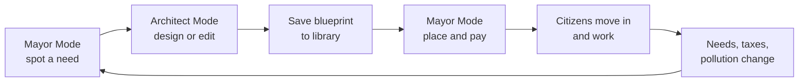

# 02 — Game Design

This is the design-level view of Townsmith. System-level details live in [[07 - Simulation and AI]]; voxel and performance details live in [[03 - Voxel and Scale]]; technical structure lives in [[12 - Technical Architecture]].

> [!info] Vocabulary
> **Mayor Mode (Mode A):** god's-eye city management. **Architect Mode (Mode B):** first-person voxel building. **Blueprint:** a saved voxel building plus metadata. **Prop:** a non-voxel functional object such as a bed or oven. **Lot:** a parcel where a building can stand. **Age:** a technology era. Full list: [[11 - Glossary]].

## 1. The two modes

### Mayor Mode (Mode A)

You are the mayor: a flying camera with authority. You see the city as a system. You place buildings, draw roads, manage utilities and budgets, and respond to the city's needs.

**Camera**
- Free-fly with WASD + mouse, orbit, zoom to cursor, smooth tilt.
- Click a building to inspect it; double-click to enter Architect Mode at its door.
- Optional tilt-shift and a "postcard" screenshot mode.
- Camera bookmarks for districts.

**Time**
- Pause, 1×, 2×, 4×. Day/night cycle. Months and years for the economy.
- **Single-player:** entering **Architect Mode** automatically pauses game time. Leaving Architect Mode restores the previous speed (or stays paused if it was paused before).
- **Multiplayer:** time is server-authoritative and never auto-pauses for one player's Mode B. An admin with `time.control`, or a vote of the online players, can pause, resume, or fast-forward. See [[05 - Multiplayer]] and D-021.
- **Pause is a design freeze, not a menu.** It stops simulation progress only: citizens, construction, production, needs, economy, and day/night freeze. Players can still fly, inspect, place/remove buildings, edit blueprints, and plan for as long as they want. Construction progress starts when time resumes.
- **No auto-resume timer.** In single-player, the pause lasts until you leave Architect Mode (or manually resume); in multiplayer, until an admin resumes or a resume vote passes.

**Tools**
- **Select / inspect:** buildings, citizens, vehicles, tiles.
- **Roads:** draw, upgrade, downgrade, intersections, sidewalks, bridges/tunnels later.
- **Zoning:** residential, commercial, industrial, office; density; paint and erase.
- **Place blueprint:** choose from the library, preview, rotate, snap, validate.
- **Bulldoze:** refund a fraction of materials; confirm for large demolitions.
- **Terraform:** raise/lower/flatten/smooth, with slope limits. Expensive; affects water.
- **Services:** place civic buildings and set their coverage/funding.
- **Policies:** taxes, subsidies, bans, service budgets, district rules.
- **Budget:** income/expenses, loans, tax rates, trade contracts.
- **Overlays:** power, water, sewage, garbage, noise, air pollution, happiness, land value, traffic, education, health, fire risk, commute time.

**Information**
- Hover tooltips explain *why*: "Happiness −8: noise from the steel mill; +4: park within 300 m."
- Notifications for problems, with a click-to-locate.
- An advisor panel with the top three issues and suggested fixes.
- City dashboard: population, employment, budget, happiness, pollution, traffic, housing.

**Placement philosophy**
- **Direct placement** for civic buildings, infrastructure, and any specific blueprint the mayor wants.
- **Zoned growth** for residential/commercial/industrial: the city grows buildings automatically from the enabled blueprint library, matching lot size, density, age, and class. This is the bridge that makes player-authored buildings the city's default stock.
- The player can lock a lot to a specific blueprint or exclude blueprints from growth.

### Architect Mode (Mode B)

You are the architect: a first-person builder in a creative-mode-like space. You build with 10 cm voxels, place functional props, and save the result as a blueprint.

**Camera and movement**
- First-person walk, jump, crouch; creative flight toggle.
- No survival constraints. No fall damage. No inventory limits while authoring.
- "Enter building" from Mayor Mode drops you at the building's door.
- The **Workshop/creative editor is the default authoring space** at launch. Placement is build-anywhere; permissioned live editing of placed buildings comes later (D-026).

**Building tools**
- **Place voxel** with the selected material; brush sizes 1×1×1, 2×2×2, 3×3×3, and a line/box/plane mode.
- **Remove voxel.**
- **Paint / replace** a material without changing geometry.
- **Pick material** from an existing voxel.
- **Select** a box, then copy, paste, move, mirror, rotate 90°.
- **Undo/redo** with a generous history.
- **Symmetry** across X/Z.
- **Grid snap** and a faint 1 m / 10 cm grid overlay.
- **Structural overlay:** show unsupported or over-limit voxels in red.
- **Room overlay:** show detected rooms and their types.
- **Prop placement:** beds, stoves, toilets, machines, counters, shelves, doors, stairs, windows.

**Validation panel**
- Material cost in liters, by material.
- Labor cost and build time.
- Room list: type, area, height, occupancy.
- Derived stats: resident capacity, job slots, class, utility demand, production, storage.
- Structural warnings: unsupported spans, height over material limit, missing stairs/doors.
- Accessibility warnings: no entrance, no path to a room, blocked stairs.
- Fire warnings: kitchen without ventilation, single exit (later).

**Saving**
- Select a bounding box (or the whole build), name it, tag it, choose a thumbnail.
- Save to the local library, the server library, or publish to the Workshop (later).
- A saved blueprint is versioned. Existing city instances stay pinned to their version unless the player explicitly upgrades them.

**Testing**
- Walk through the building; check sightlines and room flow.
- Optional "test family" later: spawn a household and watch them use the space.
- A statistics readout that predicts the building's city impact before placement.

## 2. The core loop



The loop has two nested rhythms:

- **Short loop (minutes):** place a building, fix a utility, respond to a complaint.
- **Long loop (hours):** unlock an age, redesign the city's building stock, watch the skyline change.

The blueprint library is the memory of the loop. It is also the multiplayer and modding surface: everything the city can contain is a blueprint or a piece of infrastructure.

## 3. City model

### World and terrain

The world is not a fixed city tile. It is an **effectively infinite**, procedurally generated world that the player can build anywhere in. This is the Minecraft fantasy applied to a city builder.

| Property | v1 target |
|---|---|
| World | Procedurally generated from a seed; chunked and streamed |
| Extent | **Effectively infinite**; no hard map edge; practical limits are streaming radius, save size, and server resources (Q-063 answered) |
| Terrain | Heightmap at **1 m** resolution; slopes, water, cliffs |
| Biomes | Forest, plains, hills, coast, river valley (3–4 at launch) |
| Resources | Forests, stone, coal, iron, farmland, wildlife |
| Build anywhere | Yes, with terrain/access validation; no hard city tile |
| Regions | 512 m × 512 m simulation units; active, aggregate, or dormant |
| Chunks | 256 m world chunks; 32³ voxel building chunks |
| Population | **1M+** late-game across settlements; cohort simulation |
| Target hardware | 8-core/16-thread CPU + RTX 3060-class GPU; 16–32 GB RAM; **~30 FPS at 1080p for 1M**; dedicated server recommended |
| Outside connections | Highway, rail, river port at settlement edges; imports/exports |
| Expansion | The world is the map; new settlements can be founded anywhere |

> [!decision] Terrain resolution
> The 1 m terrain grid is confirmed (Q-004). It keeps the world tractable while buildings use 10 cm detail. At 1M+ scale, 10 cm terrain is effectively impossible.

### Settlements, regions, and chunks

- **Regions** are 512 m × 512 m simulation units. A region near a player is **active** and ticks at full detail; a region outside the active set is **aggregate** (slower statistics) or **dormant** (no ticks, advanced when the player returns).
- **Settlements** are player-named clusters of buildings and roads. Boundaries are soft, derived from density and service coverage, not fixed walls. A player can found multiple settlements; at late game they can merge into one continuous metropolis. In multiplayer, each player may manage their own settlement(s), and one player may manage several.
- **Districts** are sub-areas within a settlement for statistics, policies, and overlays.
- **World chunks** (256 m) are the streaming unit for terrain, vegetation, and resources. **Building chunks** (32³ voxels) store 10 cm building data where the player has built.
- Only player edits and dynamic state are persisted: terrain deltas, roads, buildings, harvested resources, and wildlife changes. The procedural base is regenerated from the seed.

### Build anywhere

- The player can place roads and buildings anywhere the terrain allows: a forest clearing, a coastal inlet, a mountain shelf.
- Placement validation checks slope, water, foundation depth, road access, and utility connection. Steep or unstable terrain needs terraces, stilts, or retaining walls.
- Wilderness placement is **direct**: the player chooses the building and position. Inside settlements, **zoning** can grow buildings from the library.
- Off-grid buildings are possible but expensive: they need their own water, power, and waste solutions.
- Terrain is edited at 1 m resolution; building foundations are cut/filled to fit. 10 cm terrain sculpting is not in v1.
- The world is large enough that the player can start over somewhere else, but connected settlements are usually more efficient.

### Roads and lots

- Roads are drawn as segments with lanes, sidewalks, and intersections. A grid snap is available but not mandatory.
- In settlements, lots are generated along roads: frontage, depth, slope, and access determine buildable area.
- In the wilderness, there are no lots; buildings are placed directly and must satisfy access/slope rules.
- Lot size and shape constrain which blueprints fit. A 10 m × 12 m lot cannot hold a 30 m × 30 m tower.
- Corner lots, alley access, and shared walls are later refinements.
- Roads carry utilities (water, sewage, power) or require separate pipes/line placement. v1 proposal: roads carry water and sewage; power uses above-ground lines or buried cables.

### Zoning and growth

| Zone | Purpose | Growth source |
|---|---|---|
| Residential | Housing | Library blueprints matching density, age, class, lot |
| Commercial | Shops, services, offices | Library blueprints matching demand and lot |
| Industrial | Production, refining, warehousing | Library blueprints matching industry type and lot |
| Office | High-density service jobs | Library blueprints, later age |
| Civic | Schools, clinics, fire, police, parks | Direct placement only |
| Infrastructure | Power, water, sewage, transit, waste | Direct placement only |

- Zoning applies **inside settlements**. In the wilderness, the player places buildings directly.
- Zoned growth consumes demand: citizens need housing, shops need customers, factories need workers and freight.
- The player can steer growth with taxes, policies, district rules, and blueprint allowlists.
- If the library has no suitable blueprint, the city can fall back to a small set of **starter blueprints** shipped with the game. Modders and players can replace them.
- This makes the library a strategic asset: a city built from well-designed blueprints is more efficient and more beautiful.

### Buildings as instances

A placed building is an **instance** of a blueprint plus local state:

- Blueprint ID and version.
- Position, rotation, lot.
- Condition/quality (maintenance, damage).
- Residents, workers, visitors.
- Inventory (inputs, outputs, goods).
- Utility connections and service assignments.
- Upgrades and overrides.
- Ownership/rent.

Two instances of the same blueprint can diverge through upgrades, damage, and occupancy. The blueprint is the template; the instance is the living thing.

### Construction and demolition

- **No instant pop-in.** Placing a building creates a **construction site**, not a finished building. The site is built over game time by NPC crews, with materials, phases, and inspections.
- **Cost:** material liters + labor + permits. The cost is computed from the blueprint and scaled by age/quality. The project budget is committed at placement; materials and wages draw down as phases progress, and delays/contractor premiums can cause overruns.
- **Time:** based on volume, complexity, trade availability, materials, weather, and site access. A small house takes days; a factory takes months.
- **Phasing:** survey/site prep → foundation → structure → envelope → utility rough-in → interior finish → commissioning/inspection. Scaffolding, cranes, material piles, and partial buildings are visible; the building is not occupied until it passes inspection.
- **Jobs:** each phase creates temporary job slots for the relevant trades — laborers, carpenters, masons, steelworkers, roofers, glaziers, electricians, plumbers, HVAC technicians, painters, surveyors, and inspectors. The exact mix depends on the blueprint, materials, age, and installed systems.
- **Crews:** construction offices/public works provide crew capacity and vehicles. If no crew or trade is available, the site stalls with a visible reason; the player can build more capacity, train workers, or pay for expensive outside contractors.
- **Materials:** deliveries are progressive. A site has a stockpile; missing materials stall the phase. This connects construction to the forestry, mining, manufacturing, and freight chains.
- **Demolition:** refund a fraction (e.g., 50%) of materials; demolition also requires crews and time. Hazardous materials cost extra to remove (later).
- **Upgrades:** renovate a building to a new blueprint version, add a floor, replace a roof, install insulation. Temporary closure, crews, and cost. Editing a blueprint in the library is design work; applying it to a placed building is a renovation project, not an instant swap.
- **Pause:** construction progress freezes while paused, but players can still place/design. See [[05 - Multiplayer]] and D-021.

> [!note] Design goal
> Construction should make the city feel built by people, not spawned by the player. It also creates a visible demand for trades, training, and logistics — and a reason to care about the construction sector.

## 4. Blueprints

### What a blueprint contains

| Layer | Contents |
|---|---|
| Voxel data | Sparse 10 cm voxel volume: material index per solid voxel |
| Palette | Material IDs, colors/textures, physical properties |
| Props | Functional objects with footprints, tags, costs, utility demand |
| Rooms | Detected enclosed volumes: type, area, height, doors, windows |
| Structure | Support graph, load-bearing elements, material limits |
| Metadata | Name, author, description, tags, age tier, thumbnail, version |
| Dependencies | Required base game version, mod IDs, resource pack IDs |
| Economics | Material cost, labor cost, upkeep, expected stats |

### Cost model

- Count solid voxels by material: `cost = Σ (voxels_material × price_per_liter)`.
- Add props: `Σ prop_cost`.
- Add labor: a function of volume, complexity (rooms, stairs, machines), and age.
- Add permits and utility connections.
- Deconstruction returns a fraction.
- **Resource quantities are in liters** because one 10 cm cube is exactly 1 L. A 10 m × 10 m × 10 m solid block is 1,000,000 L (1,000 m³) — but buildings are mostly air, so the actual material count is much smaller.

> [!example] Why liters are nice
> A timber wall 10 m long × 3 m high × 0.2 m thick = 6 m³ = 6,000 voxels = 6,000 L of timber. A player can reason about that. A steel beam is priced per liter of steel, which is dense and expensive. The units stay consistent from the voxel editor to the city budget.

### Derived stats

| Stat | Derived from |
|---|---|
| Resident capacity | Beds; bedroom privacy; floor area per person |
| Building class | Area per resident, amenities, material quality, pollution, noise, services, views |
| Job slots | Workstations, machines, counters, offices |
| Production | Machines + recipes + staff + inputs + power |
| Storage | Shelves, tanks, silos, cold rooms |
| Utility demand | Occupants, appliances, machines; peak vs average |
| Upkeep | Condition, age, services, elevators, heating |
| Fire risk | Materials, kitchens, heating, exits, sprinklers |
| Structural validity | Support graph, cantilever, height, material strength |
| Accessibility | Doors, stairs, elevators, corridor width |

### Versioning

- Editing a blueprint creates a new version (`v2`, `v3`, …).
- Existing instances remain pinned to the version they were built from.
- The player can apply an upgrade to an instance: pay the difference, close temporarily, update stats.
- Mod updates can invalidate a blueprint if a required material or prop is removed. The game must show a clear error and offer a fallback, not crash.
- Blueprint files store their dependencies and a content hash for multiplayer.

### Library

- **Local library:** the player's own blueprints, available in every save.
- **Server library:** shared among players on a server; permissions control who can add or edit.
- **Workshop library:** subscribed content, later.
- Search and filter by: name, author, age, category, size, capacity, class, cost, tags, mod dependencies.
- Preview: 3D thumbnail, stats, room list, required materials.
- Favorites, collections, and "recently used."
- A blueprint can be marked **private**, **server-shared**, or **public**.

## 5. Simulation overview

The full system design is in [[07 - Simulation and AI]]. At the design level:

### Population scale: 1M+

- A **town** is a few hundred to a few thousand people. A **city** is 100k. A **metropolis** is 1M+.
- 1M+ is a **late-game target** on 8-core/16-thread + RTX 3060-class hardware, with an expected **~30 FPS at 1080p**; a dedicated server can run the simulation and free the client CPU. It is not the starting scale, and it is not a promise on minimum hardware.
- Every citizen has a record and a household, but the population is simulated in **cohorts** grouped by district, building type, and needs band. Individual agents are used near the camera and for selected citizens. The full model is in [[07 - Simulation and AI]] §3.
- The player manages **districts and systems**, not a million individual people: heatmaps, statistics, policies, service coverage, and sampled citizen stories.
- The city's UI scales from a village dashboard to a metropolitan region dashboard. The same panels work at every size; the aggregation changes.

### Citizens

- Citizens are NPCs. They are not player-controlled.
- They live in households, work jobs, need food/rest/hygiene/social/fun/safety, and form opinions about the city.
- Off-screen citizens are simulated statistically; visible citizens are simulated and rendered as agents.
- Citizens move between buildings via the road/sidewalk network and transit. They do not pathfind through building interiors in v1; a building's rooms are abstracted once they enter.

### Needs and happiness

- **Needs:** hunger, rest, hygiene, social, fun, safety, health.
- **Happiness** is a weighted aggregate plus modifiers (housing quality, noise, pollution, commute, services, taxes).
- Unmet needs cause complaints, health problems, and eventually move-out.
- Happiness is a feedback signal, not a win condition.

### Jobs and production

- Buildings provide job slots. Citizens have skills and commute to work.
- Workplaces consume inputs, labor, and power to produce outputs.
- Commercial buildings sell goods to citizens; industrial buildings produce goods and pollution; offices provide services and tax revenue.
- Production chains are data-driven: recipes, inputs, outputs, byproducts, time, workers, power.

### Primary industries and the living world

The first economy is built on the land around the settlement. These jobs are not abstract income sources; they have workplaces, tools, routes, and visible work loops.

| Job | Workplace | Work loop | Outputs | World interaction |
|---|---|---|---|---|
| **Lumberjack** | Lumber camp, sawmill | Find mature tree → chop → carry logs → replant sapling | Logs, timber, branches, saplings | Harvests and regrows forests; overlogging depletes the area |
| **Farmer** | Farmhouse, barn, silo | Plow → plant → water/tend → harvest → store; livestock later | Grain, vegetables, milk, eggs, meat, wool | Fields have soil, water, crop growth, pests, and seasons |
| **Hunter** | Hunting lodge | Patrol → track → hunt → carry meat/hide home | Meat, hides, fur, pest control | Wildlife populations; overhunting depletes; predators and pests affect farms |

- **Forestry:** trees are entities with species, growth stage, and wood volume. A lumberjack replants; a managed forest is sustainable; clear-cutting is fast but depletes the land.
- **Agriculture:** fields are plots with crop type, soil quality, water, growth stage, and pests. Farmers plant, tend, and harvest; livestock (cows, chickens, sheep) are a later sub-system. Seasons are at launch with a toggle and matter for growth.
- **Hunting:** wildlife lives in populations per region, with habitat, food, predators, and migration. A hunter can take a contract to thin rabbits or boars that damage crops, or to cull predators threatening livestock.
- **Early loop:** wood + food + hides → houses, a sawmill, a market, a well → a village that can survive winter.
- **Late loop:** primary industries move outward, become specialized, and feed a metropolis through freight and trade. The player can choose sustainable forestry, intensive agriculture, or import-dependent growth.

The living-world layer is intentionally **light**: regrowth, depletion, pests, and predators, not a full ecology simulation. The goal is meaningful decisions, not a biology paper.

### Utilities

| Utility | Model | Failure mode |
|---|---|---|
| Power | Generation + capacity + consumption + storage; grid connectivity | Brownouts; buildings lose function |
| Water | Pumps + pipes + towers + consumption | No water; hygiene and health collapse |
| Sewage | Pipes + treatment + discharge | Pollution; health penalties |
| Garbage | Generation + trucks + landfills/recycling | Overflow; pollution; happiness |
| Food | Farms, hunting, fishing, imports + grocery coverage | Hunger; unrest |
| Noise | Emitters + propagation + insulation | Sleep/health penalties |
| Air pollution | Emitters + diffusion + weather | Health penalties; land value drop |
| Transit | Bus/tram/metro lines + capacity | Commute time; traffic; happiness |

### Traffic

- The road network is a graph. Vehicles are visual agents; traffic flow is simulated per segment.
- Commute demand comes from households going to jobs and services.
- Congestion increases commute time, which reduces happiness and economic output.
- v1 uses a simplified lane/segment model with visual cars, not full per-vehicle physics.

### Economy

- **Treasury:** income (taxes, trade, fees) minus expenses (upkeep, loans, construction).
- **Taxes:** residential/commercial/industrial/office rates; happiness and growth effects.
- **Trade:** import/export at the map edge; prices fluctuate; contracts later.
- **Loans:** bonds with interest; bankruptcy triggers emergency measures, not a game-over screen.
- **Construction:** project budget committed at placement; materials/wages draw down as work progresses; financing later.
- **Balance goal:** the player should feel pressure but always have a lever to pull.

## 6. Progression and ages

Ages are the long-term arc. They change materials, structural limits, building types, jobs, and the visual language of the city.

### Draft age table

| Age | Unlock trigger | Materials | Typical max stories | Signature buildings | New systems |
|---|---|---|---|---|---|
| **Wood** | Start | Timber, thatch, stone, clay, lime | 3 | Tent, shed, hut, timber house, lumber camp, farm, hunting lodge, well, market stall | Forestry, agriculture, hunting, water, food, basic housing |
| **Masonry** | 250 population + research | Brick, stone, glass, mortar | 6 | Stone house, half-timber house, town hall, bakery, school, sawmill, aqueduct, chapel | Education, sanitation, fire risk, masonry construction |
| **Industrial** | 20,000 population + coal | Steel, concrete, coal, iron | 12 | Factory, refinery, rail depot, power plant, tenement | Power, rail, heavy pollution, mass housing |
| **Modern** | 150,000 population + electricity | Reinforced concrete, steel, glass, aluminum | 30 | Office tower, apartment block, hospital, subway | Density, transit, health, high-rise construction |
| **Information** | 750,000 population + research | Composites, electronics, solar | 80+ | Data center, solar farm, monorail, university, supertall | High-tech jobs, sustainability, 1M+ metropolis |

> [!warning] Draft numbers
> Population thresholds, story limits, and building names are placeholders. They exist to test the progression curve and the structural-rule system, not to lock the design. The 1M+ target means the late ages must support a very long campaign or a very large sandbox city.

### How ages work

- **Research** is generated by schools, universities, libraries, and specific buildings. It is a city-wide pool, not a per-building tech tree (v1).
- **Population milestones** gate the big transitions; research gates specific unlocks.
- **Materials** unlock with ages; a blueprint that uses steel cannot be placed in the Wood age.
- **Structural limits** are material-based, not purely age-based. Wood is limited to 2 stories; brick to 4; steel to 8; reinforced concrete to 20; composites to 40. A player can build a 4-story brick building in the Masonry age, but not a 4-story timber one.
- **Blueprints carry an age tier.** The library can show "unlocked in: Industrial." Placing an out-of-age blueprint is blocked or warned.
- **Visual progression:** roads, roofs, windows, streetlights, and vehicles change with age. The city should *look* like it has progressed.
- **Obsolescence:** older buildings remain usable but become less efficient, more polluting, or more expensive to maintain. The player can retrofit them.

### Technology tree

- Nodes: materials, building types, services, policies, infrastructure, efficiency.
- Example branches: construction, water/sanitation, power, transport, education, health, commerce, industry, environment.
- Dependencies are data-driven so mods can add nodes.
- The UI is a graph with clear prerequisites and a search box.

## 7. Building rules

### Rooms

- A room is an enclosed air volume inside a building, detected by flood fill from the exterior.
- Doors and windows are boundary elements. Doors connect rooms; windows provide light and ventilation.
- A room's type is inferred from its props: bed → bedroom; stove/oven → kitchen; toilet/shower → bathroom; sofa/table → living/dining; machine → workshop/factory; counter/shelf → shop/storage; desk/blackboard → office/classroom.
- Multi-function rooms are allowed. A studio apartment can be bedroom + kitchen + living in one volume.
- Room quality: area, height, light (windows), ventilation, finish materials, privacy, noise, pollution.

### Capacity

- Residential capacity = beds, modified by room sharing and floor area per person.
- A house with one bed cannot hold more than one resident (unless the design allows couples sharing a double bed).
- Overcrowding is possible but penalized: more residents than beds/area → happiness and health penalties.
- Commercial/industrial capacity = job slots from workstations and machines.

### Class

Building class is a score, not a single threshold:

```
class_score =
  area_per_resident
  + amenity_score (private bath, kitchen, living room, balcony, garden)
  + material_quality
  + service_access (schools, clinic, park, transit)
  - noise
  - pollution
  - overcrowding
  - commute_time
```

- **Lower class:** small, shared facilities, few amenities, poor services.
- **Middle class:** private kitchen/bath, adequate space, some amenities.
- **Upper class:** generous space, high-quality materials, views, private outdoor space, excellent services.
- Class affects rent, tax revenue, happiness, and demand.
- The player can intentionally build affordable housing; it should be viable, not a trap.

### Structure

- Every solid voxel must be connected to the ground through a support path, or be within a material's cantilever limit.
- Materials have strength, weight, maximum unsupported span, fire rating, and foundation/bracing requirements.
- **Height is set by the structural system**, not just the material:

| System | Initial max |
|---|---|
| Tent / lean-to | 1 temporary level |
| Timber shed | 1 story |
| Timber house | **2–3 stories + roof** |
| Load-bearing stone | 2–3 stories + roof |
| Half-timber with stone ground floor | **3–4 stories + roof** |
| Brick masonry | 4–6 stories |
| Reinforced concrete | **20–30 stories** |
| Steel frame | 40–80 stories |
| Composite steel/concrete | 80+ stories |
| Glass curtain wall | Non-structural; height set by the frame |

- **Composite construction is allowed**: stone ground floor + timber upper, concrete podium + steel tower, etc. The weakest support in the load path sets the limit.
- **Glass facades are cladding, not structure.** They can improve light, prestige, energy, and class, but do not add height.
- Tall buildings also need service gates: elevators, water pressure, fire suppression, wind bracing, structural engineering, and HVAC.
- Load-bearing walls and columns can be marked explicitly; the validator can also infer them.
- The validator highlights problems in Architect Mode and blocks placing a structurally invalid blueprint (with a sandbox override).
- Advanced structural simulation (stress, buckling, settlement) is out of scope for v1.
- **No material minimum height:** a one-story concrete or stone building is valid. Materials have maximums, not minimums; service gates are separate.
- **Basements:** cellars and utility basements are supported from the start; habitable basements and underground parking come later. Basements do not count toward above-ground stories but add load, depth, and excavation cost. See D-025.
- Full details: [[17 - Materials and Structure]].

### Interior access

- Buildings need at least one exterior door at ground level (or a valid entrance).
- Rooms need a path to the entrance through doors/stairs/elevators.
- In v1, NPCs do not pathfind through interiors; the building is abstracted once entered. The validator still checks that the layout is plausible for the player and for future citizen mode.
- Elevators are required above a certain height (e.g., 5 stories) or the building is unreachable for some citizens.
- Accessibility (wheelchairs, elderly) is a later refinement.

### Fire, damage, and decay

- **Fire risk** from materials, kitchens, heating, and exits. Fire spread and firefighting are later; v1 can use a risk stat and insurance cost.
- **Damage** from disasters is later. v1 has condition/maintenance, not destruction.
- **Decay:** buildings lose condition slowly; maintenance budget affects it. Neglect raises upkeep and lowers class.

## 8. Multiplayer roles

Full architecture: [[05 - Multiplayer]].

| Role | Can do |
|---|---|
| **Host / Admin** | Everything: time control, speed, permissions, mods, save management |
| **Mayor** | Budget, taxes, policies, place/demolish buildings, roads, zones, services |
| **Architect** | Architect Mode building, save blueprints, edit unlocked blueprints |
| **Builder (player role)** | Place/remove voxels in Architect Mode but cannot save to the shared library; not an NPC construction trade |
| **Viewer** | Fly/walk, inspect, chat; no edits |

- Permissions are configurable per player or per role.
- Shared treasury by default; separate treasuries are a server option (later).
- Blueprint editing uses a lock/claim to avoid simultaneous conflicting edits.
- **Time control:** an admin with `time.control` can pause, resume, or set speed directly. Other players can start a time vote; a simple majority of online players passes it. One vote at a time, with a cooldown.
- `time.control` is admin-only by default and can be granted to other roles.
- Text chat and ping system at launch; voice later.

## 9. Sandbox vs campaign

| Mode | Description |
|---|---|
| **Sandbox** | Infinite money optional, all ages unlockable, no fail state. The creative mode of the city builder. |
| **Standard** | Normal economy, progression, failure pressure. The default. |
| **Scenario / campaign** | Authored maps with goals and constraints. v1 ships one tutorial scenario; more later. |
| **Challenge** | Modifiers: limited water, harsh winter, no imports, etc. Later. |

## 10. UX principles

1. **Readable at a glance.** A player should identify a building's function from silhouette, materials, and signage.
2. **Few clicks to place.** Blueprint → preview → confirm. Stats before purchase.
3. **Undo everything.** Placement, demolition, painting, blueprint edits.
4. **Explain the why.** Tooltips show causes, not just numbers.
5. **Warn before failure.** Placement validation, budget warnings, utility shortages.
6. **No hidden math.** The player can inspect the formula behind a stat.
7. **Search and filter everywhere.** The library and build menus will be large.
8. **Colorblind-safe overlays.** Never rely on red/green alone.
9. **Tutorial by doing.** The first scenario teaches by placing a lumber camp, a farm, a well, and a house.
10. **Respect the player's time.** Fast-forward, blueprints, copy/paste, and templates.
11. **Localize from day one.** English + German at launch; all user-facing strings are keys; each player picks their own language, including in multiplayer. See [[16 - Localization]].

## 11. Open design questions

These are tracked formally in [[09 - Open Questions]]. The design-critical ones:

- **Q-002:** Target multiplayer scale: 8-player co-op, or public servers with more players?
- **Q-066:** Multiple settlements with per-player ownership; how are permissions and shared services handled?
- **Q-007:** Campaign, sandbox, or both at launch?
- **Q-009:** Furniture as props, voxels, or both? The current proposal is both: voxels for structure, props for function.
- **Q-011:** Global grid vs local grid with rotation? Sloped terrain?
- **Q-021:** Direct placement only, zoning only, or both? The current proposal is both, with zoning growing from the library.
- **Q-022:** Real-time with pause, or turn-based? The current assumption is real-time.
- **Q-023:** Day/night cycle? v1 has it; seasons are accepted with a toggle, weather is later.
- **Q-024:** Disasters? v1 has risk stats but not active disasters.
