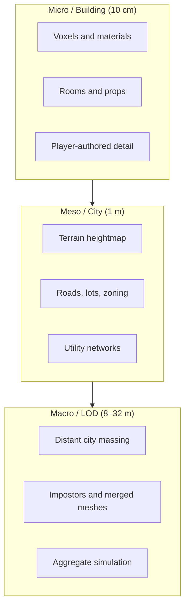

# 03 — Voxel and Scale

> [!decision] D-001 — 10 cm voxels
> One voxel is **10 cm × 10 cm × 10 cm = 1 liter**. There are **1,000 voxels per cubic meter**. This is accepted. The consequences are significant and are the subject of this document.

## 1. Why 10 cm?

- **Detail:** a 1 m wall is 10 voxels across. Windows, trim, stairs, furniture, and machinery can be modeled without mods or props.
- **Unit coherence:** 1 voxel = 1 L. Material quantities, construction costs, and storage capacities can all use the same SI-friendly unit.
- **First-person feel:** at 10 cm, a room feels constructed rather than blocky. It is the scale Teardown uses for its voxel world.
- **Minecraft look without Minecraft coarseness:** the palette, lighting, and 1 m terrain can carry the Minecraft identity while buildings have finer detail.

> [!warning] 10 cm is not free
> 10 cm voxels are **1,000× denser** than 1 m voxels. A city-scale world cannot store or render every voxel. The rest of this document is about making 10 cm tractable.

## 2. The scale problem

### The math

| Volume | Voxel count at 10 cm | Raw at 1 byte/voxel | Comment |
|---|---:|---:|---|
| 1 m³ | 1,000 | 1 KB | A single cube of space |
| 10 m × 10 m × 10 m | 1,000,000 | 1 MB | A small house's bounding box |
| 32 m × 32 m × 32 m | 32,768,000 | 32.8 MB | A large building's bounding box |
| 1 hectare × 1 m deep | 10,000,000 | 10 MB | 100 m × 100 m terrain slab |
| 1 km² × 1 m deep | 1,000,000,000 | 1 GB | Not feasible raw |
| 1 km² heightmap at 1 m | 1,000,000 cells | 1–4 MB | The meso-grid alternative |

A 1 km² city at 10 cm resolution is **one billion voxels per meter of depth**. Even a surface-only shell is hundreds of millions of voxels. This is why the whole world cannot be a dense 10 cm voxel grid.

### What is actually feasible

- **Buildings are sparse.** A house is mostly air. A 10 m cube's bounding box is 1,000,000 voxels, but the solid shell and interior might be 50,000–200,000 voxels (5–20%). At 1 byte each, that is 50–200 KB raw, and much less with run-length encoding and zstd.
- **Buildings repeat.** A city of 1,000 buildings may use only 50–200 unique blueprints. Store the voxel data once per blueprint; each placed instance stores a transform and local state, not a copy of the voxels.
- **Detail is local.** Only the building the player is editing, and the handful of buildings near the camera, need full 10 cm geometry. Distant buildings can be LOD meshes or impostors.
- **The city is simulated at a coarser level.** Roads, lots, utilities, and citizens do not need 10 cm resolution.

## 3. Proposed multi-scale world

> [!decision] D-002 — Multi-scale world (proposed)
> Use three cooperating scales. The player still experiences a 10 cm building grid; the city does not store one.



| Scale | Resolution | What lives here | Why |
|---|---|---|---|
| **Micro** | 10 cm (1 L) | Building voxels, interiors, props, furniture, machines | Player authorship, cost in liters, room semantics |
| **Meso** | 1 m | Terrain, roads, lots, zoning, pipes, sidewalks, trees | City-scale simulation and pathfinding without 1B voxels |
| **Macro** | 8–32 m | Distant LOD, impostors, merged district meshes, aggregate citizens | Rendering and simulation at city scale |

### What this means for the player

- Buildings are authored at 10 cm and look detailed up close.
- Terrain is authored at 1 m, which preserves a Minecraft-like blocky landscape and keeps the city tractable.
- From Mayor Mode's altitude, buildings fade into LOD meshes; the player sees the skyline, not individual bricks.
- The transition between scales must be invisible in normal play. That is a rendering and LOD problem, not a design compromise.

> [!question] Q-004 — Is 1 m terrain acceptable?
> If terrain must also be 10 cm, the world size, memory budget, and streaming architecture all change. This is the single most important technical question in the project.

### Alternative considered: 10 cm everywhere

- **Pros:** one grid, one editor, no scale mismatch; digging and terraforming at the same resolution as building.
- **Cons:** a 1 km² map is ~1B voxels per meter of depth; meshing, saving, streaming, and multiplayer sync become much harder; the visual benefit at mayor altitude is negligible.
- **Verdict:** rejected for v1, unless Q-004 says otherwise.

## 4. Open world, chunks, and build anywhere

The world is not a fixed city tile. It is a **large, procedurally generated region** that the player can build anywhere in. That changes the storage and streaming model.

### Chunk hierarchy

| Unit | Size | Purpose |
|---|---:|---|
| **Building chunk** | 32 × 32 × 32 voxels (3.2 m) | 10 cm building data, meshing, editing |
| **World chunk** | 256 m × 256 m | Terrain at 1 m (65,536 cells), vegetation, resources, streaming |
| **Simulation region** | 512 m × 512 m | Active/aggregate/dormant simulation LOD |
| **Settlement** | Soft, player-defined | Named cluster of buildings and roads |
| **World** | Target 16 km × 16 km (256 km²) | The playable region; soft edges |

- **Streaming:** world chunks load within a radius of each player/camera; building voxel data loads only for nearby or edited buildings.
- **Dormant regions:** outside the active set, no per-tick simulation runs. When the player returns, the region is advanced statistically.
- **Build anywhere:** terrain is 1 m; building detail is 10 cm. The player can place a building anywhere the terrain/access rules allow. There is no lot requirement in the wilderness.
- **Sparse edits:** the procedural base is deterministic from a seed. The save stores only player edits: terrain height deltas, roads, buildings, harvested resources, and wildlife changes.

### Deterministic generation

- **Seed:** one world seed drives terrain, biomes, rivers, resources, and wildlife spawns.
- **Noise layers:** continentalness, elevation, moisture, temperature, river carving, resource distribution.
- **Biomes:** forest, plains, hills, coast, river valley; moddable (Q-072).
- **Regeneration:** the same seed + edits produces the same world on every machine.
- **Worldgen version:** stored in the save; a generation change can invalidate old deltas, so migrations must preserve them or pin the generator version.

### 1M+ footprint

| Metric | Estimate at 1M population |
|---|---:|
| City area at 10k people/km² | 100 km² |
| City area at 20k people/km² | 50 km² |
| Residential/commercial/industrial buildings | 100k–250k |
| Households (3–4 people each) | 250k–333k |
| Jobs (0.4–0.6 per citizen) | 400k–600k |
| Road graph edges | 100k–200k |
| Terrain cells at 1 m over 100 km² | 100M |
| Terrain storage (1–4 bytes/cell, compressed) | 50–200 MB on disk |
| Citizen records (64 bytes each) | 64 MB |
| Building records (~128 bytes each) | 13–32 MB |
| Total simulation memory (with indexes/overhead) | ~0.5–2 GB |

- The world is **not** dense 10 cm voxels. Only player-built structures have 10 cm data; terrain, roads, and distant city massing are 1 m / LOD.
- A 100 km² terrain at 10 cm would be ~100 billion voxels per meter of depth. That is the hard reason for 1 m terrain.

### Build-anywhere implications

- The player can start a settlement in a forest, on a coast, or on a mountain shelf. The game does not require a pre-authored city tile.
- Placement validation checks slope, water, foundation depth, road access, and utility connection.
- Off-grid buildings are allowed but need self-contained utilities; connected settlements are more efficient.
- The world's soft edges allow future expansion; the v1 target is a finite 16 km × 16 km region.

## 5. Voxel data structures

### Chunks

- A chunk is a fixed **32 × 32 × 32** voxel block (3.2 m cube), the unit of storage and meshing.
- Chunks are sparse: empty chunks cost nothing.
- A building is a set of chunks in its local bounding box. A 32 m × 32 m × 32 m building has 10 × 10 × 10 = 1,000 chunk slots, but only surface/interior chunks are allocated.
- Chunk groups of 8 × 8 × 8 chunks can be used for coarse culling and LOD.

### Voxel representation

| Layer | Proposal |
|---|---|
| Material index | 8-bit palette index per voxel (0 = air) |
| Palette | Per-blueprint material table; IDs resolve to content registry entries |
| Compression | Run-length encoding along X, then zstd on the chunk |
| Empty chunks | Not allocated; sparse chunk map |
| Solid voxel count | Tracked per blueprint for cost and limits |
| Surface extraction | Greedy meshing per material, with face culling and ambient occlusion |

- 8-bit indices support 255 materials per blueprint. If a blueprint needs more, split into sub-palettes or use 16-bit indices (modded/large builds).
- A 32³ chunk at 1 byte/voxel is 32 KB raw; RLE and zstd typically reduce a sparse architectural chunk to a few KB.
- Do **not** store per-voxel normals, colors, or positions. Derive faces at mesh time.

### Material definitions

Materials are data, not code:

```json
{
  "id": "base:oak_plank",
  "display_name": "Oak Plank",
  "palette_color": "#b98a4e",
  "texture": "base:textures/oak_plank",
  "cost_per_liter": 0.4,
  "density_kg_per_liter": 0.65,
  "strength": 2,
  "max_cantilever_m": 1.2,
  "fire_risk": 0.7,
  "insulation": 0.3,
  "age": "wood",
  "tags": ["wood", "structural", "flammable"]
}
```

- `cost_per_liter` makes the 1 L voxel directly meaningful.
- `strength` and `max_cantilever_m` feed the structural validator.
- `fire_risk` and `insulation` feed simulation.
- Mods can add materials without touching the mesher.

### Blueprint limits (proposal)

| Limit | Value | Rationale |
|---|---:|---|
| Max solid voxels | 2,000,000 | Keeps editing, meshing, and saving responsive |
| Max footprint | 32 m × 32 m | Fits city lots; encourages compact design |
| Max height | 128 m | Supports modern towers without a separate format |
| Max props | 5,000 | Enough for detailed interiors |
| Max rooms | 500 | Enough for large buildings |

- These are soft limits with warnings and a hard cap. Modded/sandbox settings can raise them.
- A 2M-solid-voxel building is 2 MB raw at 1 byte/voxel; compressed, likely 0.2–1 MB. A library of 500 unique buildings is a few hundred MB, acceptable on disk and streamable.
- Skyscrapers taller than 128 m can be composed of stacked blueprints or a future "tower module" system.

## 6. Meshing and rendering

### Greedy meshing

- Merge adjacent coplanar faces of the same material into larger quads.
- A flat 10 m × 10 m wall at 10 cm is 100 × 100 = 10,000 voxel faces; greedy meshing reduces it to **one quad**.
- Detailed buildings still produce more triangles, but far fewer than naive per-voxel cubes.
- Compute ambient occlusion per vertex and bake it into vertex colors or a second UV channel.

### Render path

1. **Near buildings (full detail):** chunk meshes with greedy meshing, texture array, vertex AO.
2. **Mid distance:** merged building LODs (2×2×2 and 4×4×4 voxel downsamples), simplified materials.
3. **Far distance:** a low-poly massing mesh or impostor billboard per building, plus a district merge.
4. **Repeated blueprints:** instanced rendering (Godot `MultiMeshInstance3D`) per blueprint/LOD/material. One draw call can cover many copies.
5. **Unique/edited buildings:** per-building merged mesh, cached and invalidated on edit.

### Material rendering

- Use a **texture array** (`sampler2DArray`) indexed per vertex, not a single atlas, to avoid bleeding and support resource packs cleanly.
- Each material has a texture (or flat color) and a small set of properties (roughness, emissive, transparency).
- Avoid transparent voxels in v1 except windows; use a separate pass for glass.
- Resource packs replace the texture array entries by material ID, not by hard-coded path.

### Draw call and triangle budgets

| Budget | Target |
|---|---|
| Visible triangles | 5–10 million |
| Draw calls | < 2,000 |
| Voxel meshing | < 4 ms/frame across worker threads |
| Mesh upload | < 2 ms/frame on the render thread |
| Visible buildings at full detail | 10–30 |
| Distant buildings | Impostors/LOD, hundreds visible |
| Shadow casters | Near buildings only; distant LODs do not cast |

> [!warning] The draw-call trap
> One mesh per building is fine for 100 buildings, not 10,000. Repeated blueprints must be instanced, and distant buildings must be merged or impostored. This is a hard architectural requirement, not an optimization pass.

### Godot-specific notes

- Godot 4's `ArrayMesh` + `MultiMeshInstance3D` + `VisibilityRange` (LOD) + occlusion culling cover the v1 render path.
- Mesh generation on worker threads needs care: build vertex/index arrays off-thread, then create/upload the `ArrayMesh` on the main thread or via the rendering server. The engine spike must measure this.
- If `ArrayMesh` upload becomes the bottleneck, the escape hatch is a custom `RenderingDevice` voxel renderer (indirect draws, storage buffers, GPU meshing). That is a large step; do not start there.
- Godot's Forward+ renderer is the target; the Compatibility renderer is a fallback for low-end machines, not the design target.

## 7. Blueprint file format

A blueprint is a self-contained, versioned package.

```
my_house.tsbp (zip)
├── blueprint.json      # metadata, palette, rooms, props, stats, dependencies
├── voxels.bin          # chunked, RLE + zstd voxel data
├── thumbnail.png       # library preview
└── preview.glb         # optional low-poly preview
```

- **`blueprint.json`** is human-readable and schema-versioned. It contains everything except the raw voxel array.
- **`voxels.bin`** is a binary chunk stream: chunk coordinates, palette, RLE data, compressed with zstd.
- **Content hash:** BLAKE3 over the canonical package contents, used for dedupe, multiplayer validation, and library indexing.
- **Dependencies:** base game version, mod IDs + versions, resource pack IDs. Missing content must produce a readable error, not a crash.
- **Versioning:** `format_version` in JSON; migrations run on load.
- **Thumbnails:** rendered at save time from a fixed camera angle; stored as PNG.

Example metadata:

```json
{
  "format_version": 1,
  "id": "player:alice/cottage_01",
  "name": "River Cottage",
  "author": "Alice",
  "description": "Two-bedroom timber cottage with a north kitchen.",
  "tags": ["residential", "wood", "cottage"],
  "age": "wood",
  "bounds": { "x": 12.0, "y": 7.0, "z": 10.0 },
  "solid_voxels": 84210,
  "materials": {
    "base:oak_plank": 51200,
    "base:stone_brick": 21400,
    "base:glass": 1610
  },
  "rooms": [
    { "type": "bedroom", "area_m2": 12.4, "beds": 2 },
    { "type": "kitchen", "area_m2": 8.1 },
    { "type": "bathroom", "area_m2": 4.2 }
  ],
  "props": [
    { "id": "base:bed_single", "position": [2.1, 0.1, 3.4], "rotation": 90 },
    { "id": "base:stove", "position": [6.0, 0.1, 2.0], "rotation": 0 }
  ],
  "stats": {
    "resident_capacity": 3,
    "job_slots": 0,
    "class": "lower_middle",
    "water_l_per_day": 420,
    "power_kw_peak": 3.2
  },
  "dependencies": {
    "game": ">=0.1.0",
    "mods": [],
    "resource_packs": []
  }
}
```

## 8. Editing model

- **Brush sizes:** 1×1×1, 2×2×2, 3×3×3; line, box, and plane modes.
- **Tools:** place, remove, paint/replace, pick, select, copy, paste, move, rotate 90°, mirror, undo/redo.
- **Undo:** store voxel diffs `(chunk, index, old_material, new_material)`, not full snapshots. A generous history (e.g., 500 operations) fits in memory.
- **Dirty chunks:** edits mark chunks dirty; remesh asynchronously with a per-frame budget. Never remesh the entire building on every voxel click.
- **Structural overlay:** recompute the support graph on demand or incrementally; highlight unsupported voxels in red.
- **Room overlay:** recompute room detection on demand (after edits), not per frame.
- **Local grid:** the building is authored in its own local 10 cm grid, then rotated and placed on the city. See Q-011 for global-vs-local grid implications.
- **Terrain contact:** a building's foundation must sit on the terrain/lot. The editor shows the terrain cut and warns about floating or buried foundations.

## 9. Collision and physics

- **No per-voxel rigid-body physics in v1.** This is decision D-008 (proposed).
- Player collision in Architect Mode uses static trimesh colliders generated from the visual mesh (or simplified collision meshes per chunk).
- Voxel placement uses a DDA raycast against the voxel grid, not the physics engine.
- Terrain collision uses the heightmap.
- NPCs do not collide with building interiors; they are abstracted at the door.
- Structural failure is a **validation rule**, not a physics simulation. Unsupported voxels are rejected at save/placement time.
- Destruction, debris, and fire propagation are post-v1 features and would require a different voxel/physics architecture.

> [!question] Q-006 — Destruction?
> If destruction is a core fantasy, say so now. Retrofitting it into a static-mesh architecture is expensive. If it is a "nice to have," D-008 stands.

## 10. Streaming and saving

### What is saved

| Data | Format | Frequency |
|---|---|---|
| World seed + generator version | JSON | Once |
| Terrain heightmap deltas | Per-chunk binary + zstd | On edit |
| Roads/lots/zones | Structured binary or SQLite | On change |
| Building instances | SQLite rows: blueprint ID, transform, state | On change |
| Blueprint voxels | `.tsbp` files, content-addressed | On save |
| Citizens/households/cohorts | SQLite or binary snapshot | Autosave |
| Resource/wildlife deltas | Per-region binary | On change / autosave |
| Economy/time | SQLite | Autosave |
| Mod/content manifest | JSON | On save |

- **The world is seed + deltas.** The procedural base is regenerated; only player changes and dynamic state are stored.
- **Building instances never duplicate voxel data.** They reference a blueprint by content hash.
- **Edits in the live world** create a new blueprint version or a per-instance override; the save stores the override, not a full copy.
- **Streaming:** load world chunks within a radius of each player/camera; load building voxel data only for nearby or edited buildings; distant buildings use cached LOD meshes/impostors.
- **Dormant regions:** store a compact statistical snapshot; advance it on activation.
- **Autosave:** every N minutes, rotating backups, atomic writes (write temp, fsync, rename).
- **Crash recovery:** a journal or write-ahead log for world edits.
- **Save compatibility:** versioned schema and worldgen version; migrations; missing mod content becomes a placeholder with a clear warning.

### World size vs memory at 1M

| Data | Estimate |
|---|---:|
| Terrain, 100 km² at 1 m | 100M cells; 50–200 MB compressed on disk |
| Citizens (1M × 64 B) | 64 MB |
| Households (250k × 64 B) | 16 MB |
| Buildings (250k × 128 B) | 32 MB |
| Jobs (500k × 32 B) | 16 MB |
| Road graph (100k–200k edges) | 10–30 MB |
| Cohorts (10k × 256 B) | 2.5 MB |
| Blueprints (500 unique × 0.5 MB) | 250 MB on disk, loaded on demand |
| Save file, compressed | 100–300 MB |
| Simulation RAM incl. indexes | ~0.5–2 GB |

The architecture is feasible **because** the world is multi-scale, instanced, and cohort-simulated. It is not feasible as a dense 10 cm world or as 1M individually pathfound agents.

## 11. Performance targets

Two target tiers, because 1M+ is not a minimum-hardware promise:

| Metric | Minimum | Recommended (1M+ target) |
|---|---:|---:|
| CPU | 6-core mid-range | 8-core modern |
| RAM | 16 GB | 32 GB |
| GPU | 8 GB VRAM | 12+ GB VRAM |
| Frame rate | 60 FPS at 1080p (100k city) | 60 FPS at 1080p, 45+ at 1440p (1M city) |
| Visible triangles | 3–5M | 5–10M |
| Draw calls | < 1,500 | < 2,000 |
| Voxel meshing | < 4 ms/frame | < 4 ms/frame |
| Active agent tick (10 Hz) | < 6 ms | < 10 ms |
| Aggregate/cohort tick (1 Hz) | < 20 ms | < 50 ms |
| Economy tick (1 Hz) | < 5 ms | < 15 ms |
| Chunk streaming | < 8 ms/frame | < 8 ms/frame |
| Streaming hitch | < 16 ms | < 16 ms |
| 1M benchmark | n/a | 1M cohorts, 250k buildings, 2k active agents |
| Save/load | < 15 s (100k) | < 30 s (1M) |

These are **targets**, not measurements. The Phase 0 spike in [[08 - Roadmap]] must produce real numbers on the target machine before D-002, D-016, and D-017 are accepted.

## 12. Open questions

- **Q-004 / Q-071:** Must terrain also be 10 cm, or is 1 m acceptable?
- **Q-006:** Is destruction/physics required?
- **Q-010:** What are the final blueprint size limits?
- **Q-011:** Global grid or local grid with rotation? How are slopes handled?
- **Q-025:** How much visual fidelity is required at distance? Are impostors acceptable?
- **Q-026:** Texture resolution per voxel face: 16×16, 8×8, or flat colors? This affects the Minecraft look and resource pack authoring.
- **Q-027:** Do we need voxel lighting (torches, lamps) inside buildings, or is baked/emissive lighting enough?
- **Q-062:** What is the target hardware for the 1M benchmark?
- **Q-063:** Is the world a finite 16 km × 16 km region, or effectively infinite?
- **Q-064:** Is cohort simulation acceptable for the 1M population?
- **Q-072:** How moddable is worldgen (biomes, features, resources)?

See [[09 - Open Questions]] for the full list and assumptions.
