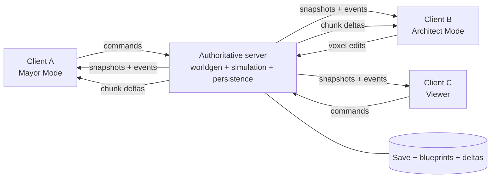

# 05 — Multiplayer

> [!decision] D-004 — Authoritative server, co-op first
> Townsmith uses an **authoritative server** architecture. Single-player runs the same server locally, in-process. Multiplayer is co-op at launch (2–8 players), with dedicated servers. MMO scale is out of scope.

## 1. Goals and non-goals

### Goals

- **Co-op city building:** a small group shares one world, one treasury (by default), and one blueprint library.
- **Build anywhere:** players can found settlements anywhere in the procedural world, not only inside a fixed city tile.
- **1M+ population servers:** the server runs the aggregate/cohort simulation for a metropolis; clients receive detailed data only near them.
- **Two modes at once:** one player can be in Mayor Mode placing buildings while another is in Architect Mode editing a blueprint.
- **Dedicated servers:** headless, Linux-first, runnable on a cheap VPS or a home machine.
- **Listen servers:** host from the game client for casual sessions.
- **Persistence and reconnect:** the world survives restarts; a dropped player can rejoin.
- **Mod-aware:** the server declares required content; clients verify it before joining.
- **Permission-aware:** not every player can bulldoze the capital.

### Non-goals (v1)

- Public servers with hundreds of players.
- Competitive/PvP city building.
- Cross-server persistent worlds.
- Real-time voice chat (text chat and pings at launch).
- Seamless host migration. If the host leaves a listen server, the session pauses or ends; dedicated servers are the durable option.
- Deterministic lockstep. We use server authority, not lockstep.

## 2. Topology



| Mode | Server location | Use case |
|---|---|---|
| **Single-player** | In-process, local | Solo play; same code path as multiplayer |
| **Listen server** | Host's client process | Friends playing together; host has authority |
| **Dedicated server** | Separate headless process | Persistent community server; no host advantage |
| **LAN** | Listen or dedicated | Local co-op |

The client never simulates the authoritative city. It predicts local movement and UI feedback, then reconciles with server snapshots.

## 3. Roles and permissions

| Role | Budget | Roads/zones | Place buildings | Bulldoze | Architect edit | Save blueprint | Time control | Mods/admin |
|---|---|---|---|---|---|---|---|---|
| **Admin** | ✅ | ✅ | ✅ | ✅ | ✅ | ✅ | ✅ | ✅ |
| **Mayor** | ✅ | ✅ | ✅ | ✅ | ✅ | ✅ | ⚙️ | ❌ |
| **Architect** | ❌ | ❌ | ❌ | ❌ | ✅ | ✅ | ❌ | ❌ |
| **Builder (role)** | ❌ | ❌ | ❌ | ❌ | ✅ | ❌ | ❌ | ❌ |
| **Viewer** | ❌ | ❌ | ❌ | ❌ | ❌ | ❌ | ❌ | ❌ |

⚙️ = configurable; admin-only by default. All players can start a time vote by default (`time.vote`). The **Builder** role is a player permission role, not the NPC construction trade; construction crews are simulation jobs.

- Permissions are configurable per player and per role.
- The server owner can disable roles entirely for a "everyone is mayor" casual server.
- **Blueprint locks:** only one player can edit a given blueprint at a time. Others can view it read-only. The lock is released on save, cancel, or timeout.
- **Authoring:** workshop/creative authoring is the launch default. Live in-world editing requires an explicit server edit lock and permission; it ships after the multiplayer foundation (D-026).
- **Lot claims:** a player can claim a lot for a planned building; others see the claim. Claims expire.
- **Shared treasury** by default. Separate personal budgets are a server option (later).

### Settlement ownership

- Every settlement has an **owner**: a player, a group, or the server (shared).
- The owner can set local policies, taxes, building permissions, and blueprint allowlists.
- A player may own **multiple settlements**; a settlement may have multiple managers with roles.
- Admins can override ownership, transfer it, or resolve disputes.
- Shared services (highways, regional rail, power) are managed at the world/server level; local services at the settlement level.

## 4. Time and ticks

| System | Rate | Notes |
|---|---:|---|
| Active simulation | 10 Hz | Nearby agents, movement, construction |
| Cohort/region aggregate | 1 Hz | Population cohorts, buildings, utilities |
| Economy tick | 1 Hz | Taxes, upkeep, production, trade |
| Snapshot send | 10–20 Hz | Per-client, interest-filtered, delta-compressed |
| Client render | 60+ FPS | Interpolates between snapshots |
| Autosave | 5–10 min | Atomic writes, rotating backups |

- Server time is authoritative. Clients display server time; day/night and seasons follow it.
- Time state is one of `paused`, `1×`, `2×`, or `4×`. Time scale affects simulation and economy ticks proportionally, not network rates.
- **Single-player:** entering Architect Mode pauses the local server automatically. Leaving restores the previous state (paused stays paused; otherwise the previous speed resumes).
- **Multiplayer:** time never auto-pauses for one player's Mode B. It changes only through an admin with `time.control`, or a successful time vote.

### Time control and votes

| Action | Who | Notes |
|---|---|---|
| Pause / resume | Admin with `time.control` | Immediate; server-authoritative |
| Set speed 1×/2×/4× | Admin with `time.control` | Immediate |
| Start a time vote | Any player with `time.vote` (default: all) | One active vote at a time |
| Cancel a vote | Admin | Logged |
| Vote options | Pause, resume, 2×, 4× | “Fast-forward” is a speed vote |

**Vote rules**

- A vote lasts **60 seconds** (configurable).
- A vote passes when **yes votes are a simple majority of the players online at vote start** (`yes > online / 2`).
- Abstentions and non-votes count as **no**.
- The online count is snapshotted at vote start; players who leave are removed from the tally. If fewer than 2 players remain online, the vote cancels.
- Cooldown: 5 minutes after a failed vote, 2 minutes after a successful vote.
- The result is broadcast to all players and logged for server admins.
- In a single-player or one-player server, time votes are disabled; use direct control.

**Pause semantics**

- Pausing stops simulation ticks (cohorts, buildings, agents, economy, day/night) but **not** editing. It is a shared **design freeze**, not a menu overlay.
- While paused, every player can fly, inspect, place/remove buildings, edit blueprints, and plan. Players get as much design time as they want.
- Construction progress, production, and needs are frozen until time resumes. Placement and blueprint edits are still accepted while paused.
- There is **no auto-resume timer**. The pause lasts until an admin resumes or a resume vote passes.
- A player entering Mode B does not pause the server by itself; if the server is already paused, that player gets the same unlimited design time as everyone else.
- Network snapshots and command processing continue so the UI stays responsive.

**Fast-forward limits**

- The server simulates faster only if it can hold the tick budget. If it cannot, the effective speed is capped and players are notified; never silently run slower than the displayed speed.

**Configuration**

- `server.toml`: `allow_time_votes`, `time_vote_duration_seconds`, `time_vote_cooldown_seconds`, `time_control_role`, `time_vote_role`.
- Defaults: votes enabled, 60 s duration, 5 min failed-vote cooldown, admin-only direct control, all players can start a vote.

## 5. Commands and validation

Clients send **commands**, not state.

```text
PlaceBuilding { blueprint_hash, transform, lot_id }   # creates a construction site
SetConstructionPriority { site_id, priority }
CancelConstruction { site_id }
Bulldoze { instance_id | site_id }
DrawRoad { points[], road_type }
PaintZone { cells[], zone_type }
SetTaxRate { zone, rate }
ApplyVoxelEdits { blueprint_id, base_version, edits[] }
SaveBlueprint { blueprint_id, metadata }
SetTimeState { paused | speed_1x | speed_2x | speed_4x }
StartTimeVote { pauses | resumes | speed_2x | speed_4x }
CastTimeVote { vote_id, yes | no }
```

Player-facing messages are **keys + parameters**, not pre-localized strings. Each client resolves them in its own locale; server logs stay English. See [[16 - Localization]].

The server validates every command:

1. **Permission:** does the player have the role for this action?
2. **Content:** does the blueprint hash exist and match the server's content manifest?
3. **Space:** is the lot free, the slope acceptable, the footprint clear?
4. **Cost:** can the treasury afford it? Are materials available?
5. **Rules:** age tier, structural validity, utility connections.
6. **Version:** is the blueprint edit based on the current version? (Optimistic concurrency.)
7. **Time:** does the player have `time.control`, or is a valid time vote passing? Time commands are never accepted from an unprivileged client.
8. **Construction:** `PlaceBuilding` creates a **construction site**, not a finished instance. The server reserves/consumes materials, validates access, and assigns crews; the site is saved and synced like any other entity.

Accepted commands produce **events** (construction site created, phase changed, building completed, tax changed, blueprint updated) that are broadcast to interested clients. Rejected commands return a reason for UI feedback.

### Protocol v0 (Phase 6 foundation)

The first runnable protocol lives in `crates/server/src/protocol.rs`. It is **transport only**: it freezes framing, validation codes, and the handshake before simulation messages are added. It does not change or drive the city simulation.

**Framing**

- A 4-byte big-endian payload length followed by UTF-8 JSON.
- Maximum payload: 1 MiB.
- Zero-length, oversized, truncated, non-UTF-8, and malformed JSON frames are rejected with stable codes: `frame.zero_length`, `frame.oversized`, `frame.truncated`, `frame.invalid_utf8`, `frame.invalid_json`, `frame.io`.
- JSON is deliberate for v0 so loopback transcripts are inspectable. The production transport/encoding decision remains Q-055.

**Client commands**

| Tag | Fields |
|---|---|
| `hello` | `protocol_version`, `content_hash`, `player_name` |
| `resume` | `session_id` (the `session_token` from `welcome`), `last_tick` |
| `ping` | `nonce` |
| `time_control` | `action`: `pause`, `resume`, `step`, `speed_1x`, `speed_2x`, `speed_4x` |
| `set_tax` | `resident_rate`, `business_rate` (percent, 0–100) |
| `place_road` | `start: [x, y]`, `end: [x, y]` |
| `set_interest` | `center_x`, `center_z`, `radius_m` |
| `disconnect` | — |

**Server messages**

| Tag | Fields |
|---|---|
| `welcome` | `session_id`, `session_token`, `tick`, `protocol_version`, `resumed` |
| `pong` | `nonce` |
| `snapshot` | `tick`, `population`, `balance`, `checksum`, `interest_center`, `interest_radius_m`, `visible_roads` |
| `interest_view` | `tick`, `center`, `radius_m`, `roads` (≤64 × `{id, start, end, width_m}`), `truncated` |
| `reject` | `code`, `message` |
| `goodbye` | — |

**Validation rules (v0)**

| Rule | Code |
|---|---|
| Protocol version must match `0` | `protocol.version_mismatch` |
| Player name non-empty, ≤ 32 characters, no control characters | `player_name.empty`, `player_name.too_long`, `player_name.invalid` |
| Content hash is 64 lowercase hex characters | `content_hash.invalid` |
| Tax rates are 0–100 percent | `tax.rate_out_of_range` |
| Road endpoints inside ±1,000,000 | `road.out_of_bounds` |
| Road start ≠ end | `road.empty` |
| Road length ≤ 1,024 cells (Chebyshev) | `road.too_long` |
| Interest centre finite and representable as `f32` | `interest.invalid_center` |
| Interest radius finite and `0..=2,048` m | `interest.radius_out_of_range` |
| Second `hello` | `hello.duplicate` |
| Any other command before `hello` | `hello.required` |
| Unknown command tag | `command.unknown_tag` |
| Session already closed | `session.closed` |

`disconnect` is accepted before `hello` so a client can close cleanly. Roles, permissions, content-manifest checks, costs, and spatial rules are deferred to later protocol revisions.

**Loopback smoke**

```bash
cargo run --release -p townsmith-server -- --loopback-smoke
# SERVER_PROTOCOL status=ok frames=8 checksum=<16 hex>
```

The harness binds `127.0.0.1:0`, runs `hello → welcome`, `ping → pong`, `set_tax → snapshot`, `disconnect → goodbye`, and derives the session id and snapshot checksum deterministically from a fixed seed. It uses socket timeouts rather than sleeps, so it is safe for CI.

**Client v0**

`godot/mp_client.gd` + `mp_client.tscn` speak the same framing over `StreamPeerTCP` (big-endian length prefix, JSON, 1 MiB cap). In the normal path the client sends `hello`, `ping`, a valid and an invalid `set_tax`, a `place_road`, a `set_interest`, then `disconnect`, and asserts `welcome`, `pong`, three snapshots, a rejection, one `interest_view`, and `goodbye`. Seven command frames and eight response frames cross the socket.

`--reconnect` runs the session-resume path instead: the first connection sends `hello`, `ping`, and `place_road`, captures `session_token` and the last snapshot tick, then disconnects. A second connection sends `resume {session_id, last_tick}` and asserts `welcome {resumed:true}` with the same token, a snapshot at or past `last_tick`, a resumed `pong`, and `goodbye`. Both connections together exchange seven command and eight response frames (four each on the first, three/four on the resumed one). The two connections must reach the same server process; `--listen PORT --sessions N` caps a run at N accepted sessions, and `--once` remains the `--sessions 1` shorthand. Without `--sessions`, the listener serves until stopped. v0 accepts one session at a time and keeps the world in memory, so the resume window lives in the same process.

```bash
GODOT=/path/to/godot ./scripts/smoke_mp_client.sh
# Block 1: server `--once`, normal path
# MP_CLIENT status=ok welcome=ok ping=ok snapshot=ok reject=ok road=ok interest=ok roads=1 truncated=false ... \
#   interest_render=ok roads=1 checksum=88903a371d42b367 rendered=1 cleared=true ...
# MP_CLIENT_SMOKE status=ok ... frames=15
# Block 2: server `--sessions 2`, reconnect path
# MP_CLIENT_RECONNECT status=ok resumed=true token=session-... tick=1 snapshot_checksum=... frames_sent=7 frames_received=8 frames=15
# MP_CLIENT_RECONNECT_SMOKE status=ok ... frames=15
```

The smoke starts a fresh server per block, waits for the `SERVER_LISTEN status=ok address=` line instead of sleeping, and checks the server reports `sessions=1 commands=7` for the normal path and `sessions=2 commands=7` for the reconnect path.

Limits: loopback only; the resume token is the seed-derived session id and is **not** authentication; no render integration, remote roles, entity/terrain streaming, delta compression, or persistent server state. Resume state is process-local, is not written to `ServerSave`, and cannot survive a server restart. The listener still serves one session at a time (sequentially, not concurrently). The client is a protocol/smoke harness, not the multiplayer UI.

### Authoritative executor (v0.1)

The first stateful executor lives in `crates/server/src/world.rs` and is exported as `townsmith_server::world`. It replaces the transport-only `Session` accounting for the new smoke path, while `protocol::Session` remains the framing/validation reference.

**State**

```rust
ServerWorld {
    seed, tick, population, employed, buildings,
    economy: Economy, roads: RoadStore,
    interest_center: [f32; 2], interest_radius_m: f32,
    paused, session_checksum,
}
```

Population, employment, and building counts are static for v0. `employed` is 60% of the population and `buildings` is one per 25 citizens (at least one), derived deterministically from the seed-derived population. The treasury starts at `Economy::STARTING_BALANCE` (100,000).

**API**

| Method | Behavior |
|---|---|
| `ServerWorld::new(seed)` | Fresh single-session world; deterministic session id |
| `apply(&ClientCommand) -> ServerMessage` | First response only; convenience wrapper for tests. Transport uses `apply_all` |
| `apply_all(&ClientCommand) -> Vec<ServerMessage>` | Every response: one message normally, `welcome` + `snapshot` for `resume`, `snapshot` + `interest_view` for `set_interest` |
| `snapshot() -> ServerMessage` | Current `tick`, `population`, `balance`, `checksum`, plus the session viewport (`interest_center`, `interest_radius_m`, `visible_roads`) |
| `interest_roads() -> Vec<RoadView>` | At most 64 matching roads, ascending id; the bounded detail list without the envelope |
| `interest_view() -> ServerMessage` | `InterestView` with the viewport, the bounded road list, and `truncated` |
| `advance_day(dt_s) -> EconomyTick` | Run one economy tick, capped at `DAY_SECONDS`, then increment `tick` |
| `tick(dt_s)` | Alias for `advance_day` |
| `checksum() -> String` | 16-hex FNV-1a over tick, population, balance, road store checksum, economy checksum |

**Command behavior**

| Command | Accepted effect | Rejection codes |
|---|---|---|
| `hello` | One per session; returns `welcome` | `protocol.version_mismatch`, `player_name.*`, `content_hash.invalid`, `hello.duplicate`, `session.closed` |
| `ping` | Echoes the nonce | `not_hello` before hello |
| `time_control` pause/resume | Admin only; freezes/unfreezes `advance_day`; returns a snapshot; does not advance the tick | `not_hello`, `role.forbidden` |
| `time_control` step | Admin only; advances exactly one game day and one tick, even while paused | `not_hello`, `role.forbidden` |
| `time_control` speed | Rejected; v0 has no real-time loop | `time.invalid_action` |
| `set_tax` | Validates 0–100 and writes the treasury per-day rates; increments tick | `tax.rate_out_of_range`, `not_hello` |
| `place_road` | Adds a 6 m wide, axis-aligned segment; increments tick | `road.empty`, `road.not_axis_aligned`, `road.out_of_bounds`, `road.too_long` (>512 cells), `road.duplicate`, `road.overlap`, `road.store_full`, `road.id_exhausted` |
| `set_interest` | View-only: stores the session viewport (`center_x`, `center_z`, `radius_m`) and returns a snapshot plus a bounded `interest_view`; does not advance the tick or move the checksum | `not_hello`, `interest.invalid_center`, `interest.radius_out_of_range` |
| `disconnect` | Closes the session; returns `goodbye` | `session.closed` |

`hello` and `disconnect` are accepted before `hello`; every other command is rejected with `not_hello`. Rejections never mutate state.

**Road rules.** Endpoints must be integer cells inside ±1,000,000. Segments must be horizontal or vertical, 1–512 cells long, and are always 6 m wide in v0. The server has no terrain yet, so road validation samples a constant 40 m placeholder ground; water and slope checks are deferred. An exact duplicate (either direction) is `road.duplicate`. A collinear segment sharing two or more cells is `road.overlap`. Roads that share exactly one endpoint cell (T-junction) or cross perpendicularly are allowed. Costs, permissions, and lot/building rules are not implemented.

**Determinism.** The snapshot checksum is a pure function of the listed state; it excludes the wall clock, seed, and paused flag. `advance_day` never sleeps. `dt_s` is clamped to `0..=DAY_SECONDS`; non-finite and negative values become zero. A paused `advance_day` returns the current ledger without changing the tick.

**Roles, rate limits, audit (dev-only).** `--role viewer|mayor|admin` sets the session role; `--listen` defaults to **mayor**. Viewer may hello/ping/disconnect, set its own interest viewport, and call/vote in a time vote; mayor may set tax and place roads; **time control (pause/resume/step) is admin-only** per D-021, while a passed vote applies pause/resume without a direct command. Unknown command tags fail closed to admin. `resume` is rate-limited like other commands; only `disconnect` bypasses the bucket. Each session has a deterministic token bucket (20 commands/s, burst 40) and a 256-entry audit ring (`tick`, role, command, code). `disconnect` bypasses the limiter. Neither role, audit, nor interest state is part of the world snapshot checksum. This is not authentication: the role is assigned by the server process for the local harness.

`SERVER_ROLES status=ok sessions=3 role_checks=4 rate_limited=1 audit=65 checksum=b6ab299531341226` is the loopback golden (viewer forbidden, mayor accepted, admin step, rate-limited ping).

**Current server status (2026-11-23).**

| Capability | State | Evidence |
|---|---|---|
| Framing/validation | Protocol v0, 4-byte length + JSON, 1 MiB cap, stable codes | `SERVER_PROTOCOL status=ok frames=8 checksum=e2f15a193149bb86` |
| Authority | Stateful executor; hello, ping, time, tax, road, disconnect | `SERVER_AUTHORITY status=ok commands=6 checksum=70e25aff45867b94` |
| Save/load | `ServerSave` v1, atomic tmp/fsync/rename, one-step `.bak` recovery | `SERVER_SAVE status=ok bytes=744 tick=2 checksum=70e25aff45867b94`; `--listen PORT --save PATH --load PATH` |
| Roles | Dev-only viewer/mayor/admin, token bucket, 256-entry audit ring | `SERVER_ROLES ... checksum=b6ab299531341226` |
| Interest | Per-session viewport; snapshot reports `visible_roads`, plus a ≤64-road `InterestView` | `SERVER_INTEREST status=ok center=0.0,0.0 radius=16.0 visible=1 roads=1 truncated=false tick=2 checksum=6d92be74bdbc11f5` |
| Godot client | Loopback `hello`/`ping`/tax/road/interest/disconnect; `--reconnect` resumes a session with the token from `welcome` | `MP_CLIENT ... interest=ok roads=1 truncated=false ... frames=15`; `MP_CLIENT_RECONNECT status=ok resumed=true ... frames=15` |

**Limits.** In-memory world with one session at a time; reconnect/resume works only inside the same server process (300-tick window), is not persisted, and its token is not authentication. No content-manifest enforcement, entity/agent/terrain streaming, delta snapshots, rollback, terrain sampling, or cost/material checks. Interest v0 is a per-session viewport that filters aggregate snapshot counts and a bounded 64-road detail list; it does not stream other entity kinds or activate, deactivate, or hide simulation state. Persistence is one file per world; no journal, compression, or remote storage. Roles are assigned by the server process, not authenticated. Direct mutation of public fields does not refresh `session_checksum`; call `checksum()` for live state.

**Loopback smoke**

```bash
cargo run --release -p townsmith-server -- --loopback-smoke
# SERVER_PROTOCOL status=ok frames=8 checksum=e2f15a193149bb86
# SERVER_AUTHORITY status=ok commands=6 checksum=70e25aff45867b94
# SERVER_ROLES status=ok sessions=3 role_checks=4 rate_limited=1 audit=65 checksum=b6ab299531341226
# SERVER_RESUME status=ok sessions=2 commands=5 frames=11 resumed=true tick=1 checksum=157ba83a1acf65dd
# SERVER_INTEREST status=ok center=0.0,0.0 radius=16.0 visible=1 roads=1 truncated=false tick=2 checksum=6d92be74bdbc11f5
cargo run --release -p townsmith-server -- --save-load-smoke
# SERVER_SAVE status=ok action=loopback bytes=744 tick=2 checksum=70e25aff45867b94
```

The authority path binds `127.0.0.1:0` and runs `hello → welcome`, `set_tax → snapshot`, `place_road → snapshot`, `ping → pong`, `resume → snapshot`, `disconnect → goodbye`. The client replays the same commands on a local reference world and requires byte-for-byte identical responses; it also asserts the exact tick (1, 2), balance (100,000), and seed-derived population. Socket timeouts replace sleeps.

## 6. Voxel editing and blueprint sync

Voxel editing is the hardest sync problem because edits are frequent and fine-grained.

### Strategy

- **Blueprint-scoped editing:** at launch, a player edits a blueprint in the workshop, not arbitrary voxels in the live city. Permissioned live-city editing ships later (D-026).
- **Locking:** the server grants an edit lock for a blueprint. Only the lock holder can send edits.
- **Batched edits:** the client sends `VoxelEditBatch` messages (up to N edits or M milliseconds), not one message per voxel.
- **Versioned blueprints:** each save creates a new version. The edit lock is tied to the base version; stale edits are rejected.
- **Server-side validation:** bounds, material availability, structural rules (optional on the server), and max solid voxel count.
- **Broadcast:** on save, the server stores the new blueprint version and sends the new content hash + metadata to clients. Clients that need the voxels (e.g., viewing the building) download the compressed blueprint file.
- **Live city edits:** if a building is edited in place, the server creates a per-instance override or a new blueprint version; the city's other instances are unaffected unless the player chooses to upgrade them.

### Why not CRDTs

- CRDTs are excellent for concurrent text editing, but voxel buildings have structural invariants (support, rooms, doors) that are hard to merge.
- Locks are simpler, predictable, and match the "one architect per blueprint" workflow.
- Later, a "co-op editing" mode could use operational transforms or CRDTs, but it is not v1.

### Bandwidth

- A voxel edit is ~8–16 bytes (chunk ID, index, material, operation).
- A 1,000-edit batch is ~8–16 KB before compression; zstd reduces it further.
- Blueprint transfer is a compressed file (typically 0.2–1 MB for a detailed building); streamed on demand, not on every edit.
- Static world state is sent on join and then only deltas.

## 7. World streaming and interest management

Open-world multiplayer is mostly a **chunk streaming** problem, not an entity replication problem. The world is effectively infinite; there is no fixed map edge.

- **World seed + deltas:** the server owns the seed and all edits. Clients generate the procedural base locally and apply deltas received from the server. Only visited/edited chunks are persisted.
- **Chunk requests:** clients request **world chunks** (256 m) and **building chunks** (32³ voxels) around their camera; the server prioritizes nearby, visible, and recently edited chunks.
- **Region activation:** the server simulates **active regions** (512 m) around players at full detail. Regions with no players are aggregate or dormant; when a player enters, the server advances them statistically and activates them.
- **Active-region cap:** limit the number of simultaneously active regions (e.g., 4) so 8 players spread across the map do not multiply the simulation cost. Distant players get aggregate updates.
- **Static data:** roads, building instances, and blueprint metadata are sent as deltas as they change.
- **Dynamic data:** citizens, vehicles, construction sites, crews, and effects are filtered by each client's **area of interest (AOI)**.
- **LOD-aware:** a client at mayor altitude receives aggregate/visual data for many buildings but few individual agents; a client on the ground receives detailed nearby agents.
- **Prioritization:** nearby, visible, and recently changed entities are sent first; distant entities are throttled.
- **Quantization:** positions and rotations are quantized; animations are driven by state, not per-frame transforms.
- **Delta compression:** snapshots are diffs against the last acknowledged state.

> [!info] Interest filtering v0
> `set_interest {center_x, center_z, radius_m}` stores a per-session viewport on `ServerWorld` and answers with a snapshot plus an `interest_view`. `radius_m` must be finite and within **0–2,048 m**; the centre must be finite. Out-of-range values are rejected (`interest.radius_out_of_range`, `interest.invalid_center`), never clamped. `visible_roads` counts every road whose midpoint is inside the circle (inclusive); `interest_view.roads` carries at most **64** of them, ascending by id, with `truncated` when more matched. The command is view-only: it does not advance the tick, does not change the world checksum, and is excluded from `ServerSave`. Viewer may set its own viewport; the transport-only `Session` rejects it with `interest.unavailable`. **Limits:** no entity, agent, terrain, or blueprint streaming yet; no delta snapshots, prioritization, or server-side region activation tied to the viewport.

### Bandwidth target

| Client state | Target |
|---|---|
| Join + initial chunks | 10–100 MB compressed, streamed |
| Steady state, mayor view | 20–100 KB/s |
| Steady state, street view | 100–300 KB/s |
| Chunk streaming while flying | 1–5 MB/s, bursty |
| Voxel editing | Bursts up to 1 MB/s, then idle |
| 1M server, 8 players | 20–80 Mbps aggregate target |

These are planning targets. The Phase 0 spike and a network test must measure them.

## 8. Persistence and reconnect

> [!info] Server save v0
> `crates/server/src/save.rs` implements the first server-world save: a deterministic `ServerSave` v1 JSON containing seed, tick, population/employment/building counts, paused state, economy, and roads. `save_to` writes `<path>.tmp`, fsyncs, renames, syncs the parent directory on Unix, and rotates a valid primary to `<path>.bak`. `load_from` falls back to the backup when the primary is missing/corrupt and rejects when both are corrupt. `crates/server/src/listen.rs` saves on disconnect/EOF/reset/idle timeout and optionally autosaves every N ticks. CLI: `--listen PORT --save PATH --load PATH [--autosave-ticks N] [--sessions N]` and `--save-load-smoke`; `--once` is the `--sessions 1` shorthand. Limits: one world file, no journal, compression, remote storage, or authentication. Resume windows and tokens are process-local and are **not** part of `ServerSave`, so a restarted server always needs a fresh `hello`.

- **Save format:** world seed + terrain/resource deltas + SQLite for world state + binary blueprint files (see [[03 - Voxel and Scale]] and [[12 - Technical Architecture]]).
- **Autosave:** every 5–10 minutes, atomic (temp file → fsync → rename), with rotating backups.
- **Journal:** world edits are appended to a write-ahead log between autosaves; crash recovery replays it.
- **Reconnect:** the server issues a session token. A reconnecting client resumes with its role, claims, and camera state; it receives a fresh snapshot.
- **Server restart:** the city loads from the last save + journal; players reconnect manually or via invite.
- **Version migrations:** save schema version in the database; migrations run on load; a backup is made before migration.

## 9. Mods and content manifests

Multiplayer + modding is a trust problem. The server is the authority.

- **Content manifest:** the server publishes a manifest of required content mods and their hashes.
- **Client check:** on join, the client compares its installed content mods and versions. A mismatch blocks join with a clear message and a list of missing/extra mods.
- **Content mods vs resource packs:**
  - **Content mods** add blocks, materials, buildings, recipes, jobs, etc. They must match on client and server.
  - **Resource packs** change textures, sounds, UI, and fonts. They are client-side and may differ, as long as material IDs and geometry are unchanged.
- **Server allowlist:** only approved mods can load on a server.
- **Auto-download:** later, via Steam Workshop or a server-hosted mod bundle. v1: manual install with a manifest check.
- **Save compatibility:** if a mod is removed, missing content becomes a placeholder with a warning; the server can refuse to load or run in a degraded mode.
- **Security:** untrusted mods must not execute arbitrary native code on clients. See [[06 - Modding and Resource Packs]].

## 10. Security

| Threat | Mitigation |
|---|---|
| Griefing | Roles/permissions, lot claims, blueprint locks, rollback, whitelist |
| Cheating (infinite money, instant build) | Server validates all costs and commands; client never owns state |
| Malformed voxel data | Bounds checks, palette validation, size limits, fuzzing |
| Mod code execution | Data-first mods; sandboxed scripting; native mods only with explicit trust |
| DoS | Rate limits per connection, command quotas, max blueprint size, timeouts |
| Impersonation | Session tokens, optional password/Steam auth, admin allowlist |
| Save corruption | Atomic writes, backups, journal, schema validation |

- The server logs admin actions and high-impact commands (bulldoze, budget changes, mod changes).
- A rollback tool (restore last autosave) is a launch requirement for community servers.

## 11. Dedicated server

- **Platform:** Linux x86_64 first; Windows server build optional (Q-017).
- **Process:** headless, no GPU, no audio; simulation only.
- **What it offloads:** the dedicated server removes cohort/building/agent simulation from the client CPU. It does **not** render the city; client GPU performance is unchanged. A 1M city is expected to be ~30 FPS at 1080p on an RTX 3060-class client even with a dedicated server.
- **Why it helps:** lower-end clients can join without running the full simulation; multiplayer servers can persist the world; the client CPU is free for meshing, UI, and render submission.
- **Configuration:** `server.toml` (world name, seed, max players, port, password, mod manifest, autosave interval, role defaults).
- **Admin:** console commands + a local admin file; RCON/web panel later.
- **Discovery:** direct IP, invite code; Steam server browser later.
- **Distribution:** a standalone server tarball/zip, plus a Docker image later.
- **Resources:** target 4–8 CPU cores and 16 GB RAM for an 8-player, 1M-population server; 2–4 cores / 8 GB for a 100k city. Measure in the Phase 0 spike.

## 12. Testing

- **Headless bots:** simulated clients that place buildings, edit voxels, and reconnect.
- **Network simulation:** latency (50–300 ms), jitter, packet loss (0–5%), bandwidth caps.
- **Load tests:** 8 players, 1M citizens, 250k buildings, 2k active agents; measure tick time, memory, chunk streaming, and bandwidth.
- **Reconnect tests:** drop a client mid-edit, reconnect, verify lock/version recovery.
- **Mod mismatch tests:** missing mod, extra mod, wrong version, resource pack difference.
- **Save/load tests:** crash during autosave, journal replay, schema migration.
- **Time-control tests:** SP Mode B auto-pause; MP pause/resume/speed by admin; vote pass/fail with online/offline changes; pause allows edits; construction resumes correctly.
- **Security tests:** malformed commands, oversized blueprints, permission bypass attempts, unprivileged time-control attempts.

## 13. Open questions

- **Q-002:** Target player count and server type? Affects bandwidth, AOI, and simulation budgets.
- **Q-066:** Settlement ownership: how are permissions, shared services, and transfers handled?
- **Q-070:** 1M multiplayer: players per server, active-region cap, server hardware.
- **Q-078:** Time-vote duration, cooldown, and quorum tuning.
- **Q-083:** Construction management depth: auto-assign crews vs player priority.
- **Q-084:** Public works crews vs private contractors.
- **Q-085:** Partial occupancy during construction: assumed no.
- **Q-017:** Windows dedicated server support, or Linux only?
- **Q-028:** Shared treasury or personal budgets? Default is shared.
- **Q-029:** Should clients auto-download resource packs from the server?
- **Q-030:** Is host migration required? Default: no; dedicated servers are the durable option.
- **Q-031:** Voice chat at launch, or text only? Default: text only.
- **Q-032:** Steam networking (lobbies, server browser) or direct IP first? Default: direct IP + invite codes first, Steam later.

See [[09 - Open Questions]] and [[10 - Decisions]].

### Session resume v0

A disconnected client can resume the same in-memory world with `resume {session_id, last_tick}` inside a 300-tick grace window. The token is the seed-derived session id returned in `welcome`; it is **not** authentication. Success returns `welcome {resumed:true}` plus a snapshot, restores the player to the online roster, and preserves the dev role. Unknown/empty token, a last tick ahead of the authority, an expired window, or resuming while a session is active are rejected (`resume.*`). A fresh `hello` is normally rejected with `hello.resumable` while the window is open, but after **three** attempts the stale window is abandoned so a client that lost its token is never blocked forever. A duplicate online player name is rejected (`player_name.duplicate`). Reconnect state is process-local and is not restored by `ServerSave`; a fresh `hello` after expiry starts a new session.

The Godot client covers the same path with `--reconnect`: it captures the token and tick from its first session, disconnects, and resumes on a second connection. `scripts/smoke_mp_client.sh` starts the server with `--sessions 2`, then asserts `MP_CLIENT_RECONNECT status=ok resumed=true ... frames=15` alongside the normal-path block. The listener still accepts one session at a time, so the reconnect is accepted only after the first disconnects; the token and window do not survive a restart.

`cargo run --release -p townsmith-server -- --resume-smoke` prints `SERVER_RESUME status=ok ...`.
### Time-control vote v0

`core`/server state machine: `TimeVote` implements D-021's 60-second window, simple majority of the online roster at vote start, minimum two online, one vote per player, initiator auto-yes, 300-tick failed/cancelled cooldown and 120-tick success cooldown. Passing `pause`/`resume` applies the effect once through `ServerWorld`; tie/expiry fails, losing quorum cancels. `time_vote` is a protocol command and returns `TimeVoteStatus` (state, counts, window, cooldown, paused, checksum). Ballots stay counted for the vote lifetime even if a voter disconnects, so a reconnect cannot vote twice. The multi-connection vote loopback is **deferred**: v0 still models one hello session per world, so the harness was removed rather than left failing; the pure state machine and single-world command path are covered by 18 tests.

Limits: the multi-connection vote loopback/smoke is deferred because the v0 world still assumes one hello session; the pure state machine and single-world command path are tested (18 vote tests). No persistence of vote state, proxies, weighted votes, or UI. Q-078 tuning remains open.

### Interest filtering v0

`set_interest {center_x, center_z, radius_m}` is a per-session viewport. The executor stores `interest_center: [f32; 2]` (default `[0, 0]`) and `interest_radius_m` (default **2,048 m**, the cap). A successful command answers with **two** messages: the current `snapshot`, then an `interest_view`. The snapshot reports `interest_center`, `interest_radius_m`, and `visible_roads`; the view carries `tick`, `center`, `radius_m`, up to **64** `RoadView { id, start, end, width_m }` entries, and `truncated`.

Roads match when their midpoint is inside the circle, including the exact boundary (`distance <= radius`). The detail list is sorted by ascending id, so the order is stable even if a loaded store is not; `truncated` is true only when more than 64 roads matched, and the cap keeps the lowest ids. `visible_roads` is the full aggregate count and may exceed `roads.len()`. Both fields derive from the same predicate, so the count and the view cannot disagree.

The viewport is **view-only**: `set_interest` does not advance the tick, does not mutate roads or the treasury, and is excluded from `checksum()`, so the protocol/authority/roles/resume goldens stay pinned. It is also not saved; a loaded world starts at the default viewport. Viewer may set its own interest; mayor/admin also may, and the command consumes a rate credit and is audited (`tag=set_interest`, `code=ok`) like any other command. It adds no command beyond `set_interest`.

Validation: the centre must be finite (and representable as `f32`), otherwise `interest.invalid_center`; the radius must be finite and `0..=2048`, otherwise `interest.radius_out_of_range`. A rejected or rate-limited request returns exactly one `reject` and leaves the previous viewport and world state unchanged. The transport-only `protocol::Session` has no interest state and rejects the command with `interest.unavailable`.

`cargo run --release -p townsmith-server -- --interest-smoke` prints `SERVER_INTEREST status=ok center=0.0,0.0 radius=16.0 visible=1 roads=1 truncated=false tick=2 checksum=6d92be74bdbc11f5`. The loopback places one road inside and one outside, narrows the viewport, moves it to the far road, and restores it; every batch must be `snapshot` + `interest_view` and match a local reference world.

Limits: v0 streams only static road geometry. There is no entity, agent, terrain, or blueprint streaming, no delta compression, no prioritization, no server-side region activation, and no per-client `ServerSave` state.

### Interest road preview

The Godot client draws the `interest_view` road list in a flat top-down `Control` preview (`godot/mp_interest_render.gd` + `mp_interest_canvas.gd`): fitted circle, one line per road, width clamped 1–32 px, at most 64 roads, deterministic 16-hex checksum. The smoke asserts `interest_render=ok roads=1 checksum=… rendered=1 cleared=true`; the snapshot checksum is reported as `snapshot_checksum=`. Limits: debug visualization only; no terrain, chunks, entities, map projection, clipping policy, or AOI activation.
