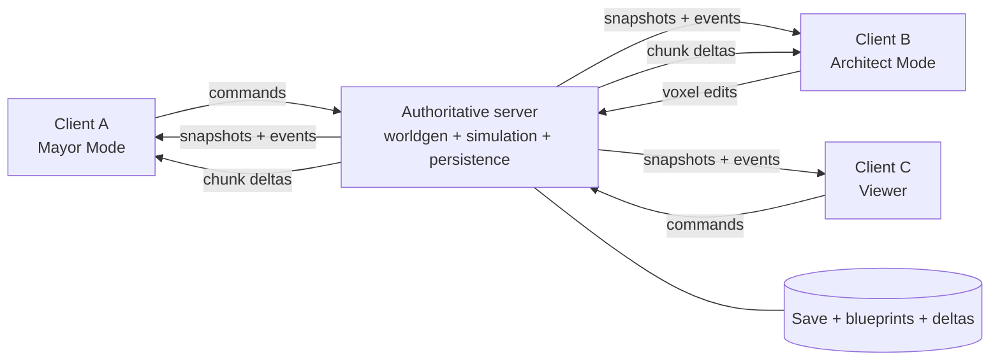

# 05 — Multiplayer

> [!decision] D-004 — Authoritative server, co-op first
> Townsmith uses an **authoritative server** architecture. Single-player runs the same server locally, in-process. Multiplayer is co-op at launch (2–8 players), with dedicated servers. MMO scale is out of scope.

## 1. Goals and non-goals

### Goals

- **Co-op city building:** a small group shares one world, one treasury (by default), and one blueprint library.
- **Build anywhere:** players can found settlements anywhere in the procedural world, not only inside a fixed city tile.
- **1M+ population servers:** the server runs the aggregate/cohort simulation for a metropolis; clients receive detailed data only near them.
- **Two modes at once:** one player can be in Mayor Mode placing buildings while another is in Architect Mode editing a blueprint.
- **Dedicated servers:** headless, Linux-first, runnable on a cheap VPS or a home machine.
- **Listen servers:** host from the game client for casual sessions.
- **Persistence and reconnect:** the world survives restarts; a dropped player can rejoin.
- **Mod-aware:** the server declares required content; clients verify it before joining.
- **Permission-aware:** not every player can bulldoze the capital.

### Non-goals (v1)

- Public servers with hundreds of players.
- Competitive/PvP city building.
- Cross-server persistent worlds.
- Real-time voice chat (text chat and pings at launch).
- Seamless host migration. If the host leaves a listen server, the session pauses or ends; dedicated servers are the durable option.
- Deterministic lockstep. We use server authority, not lockstep.

## 2. Topology



| Mode | Server location | Use case |
|---|---|---|
| **Single-player** | In-process, local | Solo play; same code path as multiplayer |
| **Listen server** | Host's client process | Friends playing together; host has authority |
| **Dedicated server** | Separate headless process | Persistent community server; no host advantage |
| **LAN** | Listen or dedicated | Local co-op |

The client never simulates the authoritative city. It predicts local movement and UI feedback, then reconciles with server snapshots.

## 3. Roles and permissions

| Role | Budget | Roads/zones | Place buildings | Bulldoze | Architect edit | Save blueprint | Time control | Mods/admin |
|---|---|---|---|---|---|---|---|---|
| **Admin** | ✅ | ✅ | ✅ | ✅ | ✅ | ✅ | ✅ | ✅ |
| **Mayor** | ✅ | ✅ | ✅ | ✅ | ✅ | ✅ | ⚙️ | ❌ |
| **Architect** | ❌ | ❌ | ❌ | ❌ | ✅ | ✅ | ❌ | ❌ |
| **Builder (role)** | ❌ | ❌ | ❌ | ❌ | ✅ | ❌ | ❌ | ❌ |
| **Viewer** | ❌ | ❌ | ❌ | ❌ | ❌ | ❌ | ❌ | ❌ |

⚙️ = configurable; admin-only by default. All players can start a time vote by default (`time.vote`). The **Builder** role is a player permission role, not the NPC construction trade; construction crews are simulation jobs.

> [!success] Blueprint placement: D-032 accepted and implemented (protocol v1)
> D-032 (**Accepted 2026-11-23**, implemented by #306 at master `61449ce`) makes `place_blueprint` the v1 server authority. The command carries only `{ blueprint_hash, x, z, rotation }`; the package path never crosses the wire, and the server resolves the hash in its own pre-seeded content-addressed `.tsbp` library. Wilderness placement is authorized by the global **Mayor** role (Admin inherits it); inside a settlement, #323 adds the D-033 `build` check (identity, owned settlement, membership, `build` bit; Admin bypass). Package upload/fetch, transfer, mod auto-download, and a production client placement UI are still **not v1** (the debug 3D world client has a single-hash path plus the #318 opt-in catalog/ghost UI; see §Interest view 3D world client). `world_place_blueprint` in `crates/godot_ext` remains the single-player/developer path: it applies the district gate and first installment to local stores only, and a multiplayer client must use the server command to commit a placement. The **Place buildings** column still describes intended policy beyond placement; v1 enforces the global placement role, the placement rules, and the settlement `build` bit at the placement centre, while the remaining `manage`/`tax`/`members` checks and blueprint editing have the same gap.

- Permissions are configurable per player and per role.
- The server owner can disable roles entirely for a "everyone is mayor" casual server.
- **Blueprint locks:** only one player can edit a given blueprint at a time. Others can view it read-only. The lock is released on save, cancel, or timeout.
- **Authoring:** workshop/creative authoring is the launch default. Live in-world editing requires an explicit server edit lock and permission; it ships after the multiplayer foundation (D-026).
- **Lot claims:** a player can claim a lot for a planned building; others see the claim. Claims expire.
- **Shared treasury** by default. Separate personal budgets are a server option (later).

### Settlement ownership

> [!info] D-033 core + first server slice implemented
> `core_city` implements the stable `PlayerId`/`PlayerRegistry`, roles and the `build`/`manage`/`tax`/`members` permission bits, settlement `owner_id`/`members`/`membership_revision`, claim/transfer/release and member management, the v1→v2 save migration, and stable rejection codes. Stores that never use membership stay v1 and checksum-identical; the first owned/membership mutation upgrades to v2. The authoritative `ServerWorld` now persists the registry and an optional settlement store, the bridge exposes read-only membership fields, and `place_blueprint` enforces `build` inside a settlement. Protocol v1 now has `found_settlement`, `settlement_list`, `settlement_at`, `settlement_claim`, `settlement_rename`, `settlement_transfer`, `settlement_set_tax`, `settlement_release`, and invite/set-role/remove-member mutations; dashboard edit controls remain follow-ups.

- Every settlement has an **owner**: a player, a group, or the server (shared).
- The owner can set local policies, taxes, building permissions, and blueprint allowlists.
- A player may own **multiple settlements**; a settlement may have multiple managers with roles.
- Admins can override ownership, transfer it, or resolve disputes.
- Shared services (highways, regional rail, power) are managed at the world/server level; local services at the settlement level.

D-033's enforcement points are the D-032 server `place_blueprint`, policy CRUD, tax commands, settlement rename/transfer/remove, membership edits, and dashboard edit paths once they exist. `place_blueprint` now checks `build` when the placement centre falls inside a settlement: a global `Admin` bypasses, while everyone else needs an identity, an owned settlement, membership, and the `build` bit. Wilderness placement keeps the global placement role. A global role is a ceiling; a settlement permission never grants a global capability, and single-player/dev keeps an implicit owner. The core store wrappers already check the actor, role, revision, and limits, so the server and bridge reuse one rule set as more slices land.

The authoritative server now keeps the stable `PlayerRegistry` and an optional `SettlementStore` in memory and in `ServerSave` (optional additive fields; a world without either stays byte-identical). A successful `hello`/resume resolves one server-issued `PlayerId` per case-insensitive display name, and the id survives save/load. The registry is a session/identity sidecar, not world gameplay state, so it is excluded from the world checksum; settlement changes still move the checksum. Protocol v1 does not yet expose the id or any settlement command, and placement still enforces only the global role.

## 4. Time and ticks

| System | Rate | Notes |
|---|---:|---|
| Active simulation | 10 Hz | Nearby agents, movement, construction |
| Cohort/region aggregate | 1 Hz | Population cohorts, buildings, utilities |
| Economy tick | 1 Hz | Taxes, upkeep, production, trade |
| Snapshot send | 10–20 Hz | Per-client, interest-filtered, delta-compressed |
| Client render | 60+ FPS | Interpolates between snapshots |
| Autosave | 5–10 min | Atomic writes, rotating backups |

- Server time is authoritative. Clients display server time; day/night and seasons follow it.
- Time state is one of `paused`, `1×`, `2×`, or `4×`. Time scale affects simulation and economy ticks proportionally, not network rates.
- **Single-player:** entering Architect Mode pauses the local server automatically. Leaving restores the previous state (paused stays paused; otherwise the previous speed resumes).
- **Multiplayer:** time never auto-pauses for one player's Mode B. It changes only through an admin with `time.control`, or a successful time vote.

### Time control and votes

| Action | Who | Notes |
|---|---|---|
| Pause / resume | Admin with `time.control` | Immediate; server-authoritative |
| Set speed 1×/2×/4× | Admin with `time.control` | Immediate |
| Start a time vote | Any player with `time.vote` (default: all) | One active vote at a time |
| Cancel a vote | Admin | Logged |
| Vote options | Pause, resume, 2×, 4× | “Fast-forward” is a speed vote |

**Vote rules**

- A vote lasts **60 seconds** (configurable).
- A vote passes when **yes votes are a simple majority of the players online at vote start** (`yes > online / 2`).
- Abstentions and non-votes count as **no**.
- The online count is snapshotted at vote start; players who leave are removed from the tally. If fewer than 2 players remain online, the vote cancels.
- Cooldown: 5 minutes after a failed vote, 2 minutes after a successful vote.
- The result is broadcast to all players and logged for server admins.
- In a single-player or one-player server, time votes are disabled; use direct control.

**Pause semantics**

- Pausing stops simulation ticks (cohorts, buildings, agents, economy, day/night) but **not** editing. It is a shared **design freeze**, not a menu overlay.
- While paused, every player can fly, inspect, place/remove buildings, edit blueprints, and plan. Players get as much design time as they want.
- Construction progress, production, and needs are frozen until time resumes. Placement and blueprint edits are still accepted while paused.
- There is **no auto-resume timer**. The pause lasts until an admin resumes or a resume vote passes.
- A player entering Mode B does not pause the server by itself; if the server is already paused, that player gets the same unlimited design time as everyone else.
- Network snapshots and command processing continue so the UI stays responsive.

**Fast-forward limits**

- The server simulates faster only if it can hold the tick budget. If it cannot, the effective speed is capped and players are notified; never silently run slower than the displayed speed.

**Configuration**

- `server.toml`: `allow_time_votes`, `time_vote_duration_seconds`, `time_vote_cooldown_seconds`, `time_control_role`, `time_vote_role`.
- Defaults: votes enabled, 60 s duration, 5 min failed-vote cooldown, admin-only direct control, all players can start a vote.

## 5. Commands and validation

Clients send **commands**, not state.

```text
PlaceBuilding { blueprint_hash, transform, lot_id }   # creates a construction site
SetConstructionPriority { site_id, priority }
CancelConstruction { site_id }
Bulldoze { instance_id | site_id }
DrawRoad { points[], road_type }
PaintZone { cells[], zone_type }
SetTaxRate { zone, rate }
ApplyVoxelEdits { blueprint_id, base_version, edits[] }
SaveBlueprint { blueprint_id, metadata }
SetTimeState { paused | speed_1x | speed_2x | speed_4x }
StartTimeVote { pauses | resumes | speed_2x | speed_4x }
CastTimeVote { vote_id, yes | no }
```

Player-facing messages are **keys + parameters**, not pre-localized strings. Each client resolves them in its own locale; server logs stay English. See [[16 - Localization]].

The server validates every command:

1. **Permission:** does the player have the role for this action?
2. **Content:** does the blueprint hash exist and match the server's content manifest?
3. **Space:** is the lot free, the slope acceptable, the footprint clear?
4. **Cost:** can the treasury afford it? Are materials available?
5. **Rules:** age tier, structural validity, utility connections.
6. **Version:** is the blueprint edit based on the current version? (Optimistic concurrency.)
7. **Time:** does the player have `time.control`, or is a valid time vote passing? Time commands are never accepted from an unprivileged client.
8. **Construction:** `PlaceBuilding` creates a **construction site**, not a finished instance. The server reserves/consumes materials, validates access, and assigns crews; the site is saved and synced like any other entity.

Accepted commands produce **events** (construction site created, phase changed, building completed, tax changed, blueprint updated) that are broadcast to interested clients. Rejected commands return a reason for UI feedback.

> [!success] Implemented command: server-authoritative blueprint placement (D-032, staged v1)
> **Implemented by #306 at master `61449ce`.** Protocol v1 adds the placement command to the authoritative executor:
>
> ```text
> place_blueprint { blueprint_hash, x, z, rotation }
> ```
>
> The server resolves the hash in its own pre-seeded content-addressed `.tsbp` library; the path and package bytes never cross the wire, and v1 has no upload, fetch, or auto-download. It validates the global **Mayor** role, package hash/size, seed/age, the deterministic placeholder ground, overlap, and the district policy gate (`construction_allowed` + allowlist, smallest containing id; the registry is server-config JSON at startup), then charges the D-028 installment through the authoritative ledger and returns `place_blueprint_result { tick, placement_id, blueprint_hash, placement_checksum, world_checksum, placement }`. Idempotency is exact placement identity (hash + centre + rotation), reusing the existing per-session token bucket and audit ring. Placements and construction are optional `ServerSave` fields; older saves load unchanged. Clients may predict a preview but never commit. The transport-only `protocol::Session` rejects the command with `PLACEMENT_UNAVAILABLE`.
>
> Upload/fetch, mod auto-download, rollback/history, demolition/refunds, and a full Godot placement UI are **not v1**; the #309 debug world client sends `place_blueprint` for one configured hash and renders the authoritative result. `world_place_blueprint` remains the client-side single-player/dev path and does not call the server; a bridge placement is not a server-accepted placement.

> [!success] Implemented commands: settlement found and list (D-033, staged v1)
> Protocol v1 adds the first settlement commands to the authoritative executor:
>
> ```text
> found_settlement { name, x, z, radius_m }
> settlement_list
> ```
>
> `found_settlement` requires **Mayor** and a successful hello/resume. The server assigns the id, uses the caller's stable `player_id` as `owner_id`, derives the legacy `owner` display label from the registry, validates the core name/radius/coordinate rules, creates the store on first use, and returns `settlement_found { tick, settlement, settlement_checksum, world_checksum }`. `settlement_list` is open to **Viewer** and returns `settlement_list { tick, count, checksum, settlements }` in ascending id order. Both records are `SettlementView` (no server path) with `owner_id`, `owned`, `members[{player, role, permissions}]`, and `membership_revision`. Rejections use the core codes (`duplicate_name`, `invalid_radius`, `name_too_long`, `coordinate_out_of_range`, `too_many_owned`, …) plus `settlement.identity`, `settlement.seed_mismatch`, and `settlement.unavailable` in the transport-only session.
>
> Membership mutations add `settlement_invite`, `settlement_set_role`, and `settlement_remove_member` (all **Mayor** at the global ceiling). Each takes the settlement id, target `player_id`, `expected_revision`, and (for invite/set-role) a role string; the core owner/manager `members` permission is checked on the actor, and a stale revision returns `settlement.revision_conflict`. Accepted mutations return `settlement_updated { tick, settlement, settlement_checksum, world_checksum }` and bump the membership revision. The owner cannot be removed or demoted to another role.
>
> `settlement_claim { settlement_id, expected_revision }` claims an unowned record (legacy/admin-released) and assigns the caller as owner; an already-owned record returns `settlement.already_owned`. `settlement_at { x, z }` is a **Viewer** read that returns the nearest containing settlement as `settlement_at { tick, found, settlement }` (or `null`).
>
> `settlement_rename { settlement_id, name, expected_revision }` requires the core `manage` permission, trims the name, checks the 1–48-character/control rules, rejects a duplicate case-insensitively, and bumps the revision. `settlement_transfer { settlement_id, player_id, expected_revision }` also requires `manage`, accepts only a recipient already in the server player registry, makes the recipient owner, and demotes the previous owner to Manager. Both return `settlement_updated`.
>
> `settlement_set_tax { settlement_id, rate }` requires the core `tax` permission (owner or manager) and accepts `0..=100` whole percent. It is data-only: the rate is stored and validated but does not bump the membership revision, and no treasury calculation consumes it yet.
>
> `settlement_release { settlement_id, expected_revision }` is the **Admin** override for a dead owner (Q-113): it clears `owner_id` and every member, bumps the revision, and returns `settlement_updated`. It is the only settlement command above the Mayor ceiling. None of these commands advance the tick.

> [!info] Settlement loopback golden
> `cargo run --release -p townsmith-server -- --settlement-smoke` runs three real TCP connections (Mayor, Mayor, Admin) through the shared world: found, list/at, invite/set-role/remove/re-invite, rename, transfer, claim rejection, tax, Admin release, re-claim, unknown/stale/role/recipient rejections, and a final read-only list/at. Every mutation must return the full `SettlementView` plus 16-hex settlement and world checksums; the read-only tail must leave both unchanged; the final record must survive a JSON save/load round-trip. The deterministic line is `SERVER_SETTLEMENT status=ok messages=36 settlements=1 members=1 checksum=2978a05623398f13 world_checksum=f3ff6835d712845c`; the `settlement_smoke` unit test runs it twice and pins the shape.

> [!info] Connected-client probe
> [[85 - Connected Settlement Surface]] documents the opt-in `mp_world_client` readout (`--settlement-ui` / `--settlement-script`) and the planned mutation actions. It uses the commands above unchanged: there are no new protocol or save fields, and the server remains authoritative.

### Protocol v1 (Phase 6 foundation)

The first runnable protocol lives in `crates/server/src/protocol.rs`. Protocol v1 freezes framing, validation codes, and the handshake, and adds the first authoritative placement command; the stateful simulation commands live in `world.rs`. It does not replace the city simulation.

**Framing**

- A 4-byte big-endian payload length followed by UTF-8 JSON.
- Maximum payload: 1 MiB.
- Zero-length, oversized, truncated, non-UTF-8, and malformed JSON frames are rejected with stable codes: `frame.zero_length`, `frame.oversized`, `frame.truncated`, `frame.invalid_utf8`, `frame.invalid_json`, `frame.io`.
- JSON is deliberate for v1 so loopback transcripts are inspectable. The production transport/encoding decision remains Q-055.

**Client commands**

| Tag | Fields |
|---|---|
| `hello` | `protocol_version`, `content_hash`, `player_name` |
| `resume` | `session_id` (the `session_token` from `welcome`), `last_tick` |
| `ping` | `nonce` |
| `chat` | `text` (1–280 characters) |
| `chat_since` | `after`: last seen chat sequence |
| `time_control` | `action`: `pause`, `resume`, `step`, `speed_1x`, `speed_2x`, `speed_4x` |
| `set_tax` | `resident_rate`, `business_rate` (percent, 0–100) |
| `place_road` | `start: [x, y]`, `end: [x, y]` |
| `place_blueprint` | `blueprint_hash` (`blake3:` + 64 hex, or bare 64 hex), `x`, `z`, `rotation` (multiple of 90°) |
| `found_settlement` | `name`, `x`, `z`, `radius_m` (16–2000) |
| `settlement_list` | `after_id` (optional exclusive cursor), `limit` (optional 1–256; omitted = all) |
| `settlement_invite` | `settlement_id`, `player_id`, `role` (`manager`/`builder`/`member`), `expected_revision` |
| `settlement_set_role` | `settlement_id`, `player_id`, `role`, `expected_revision` |
| `settlement_remove_member` | `settlement_id`, `player_id`, `expected_revision` |
| `settlement_claim` | `settlement_id`, `expected_revision` |
| `settlement_at` | `x`, `z` |
| `settlement_rename` | `settlement_id`, `name`, `expected_revision` |
| `settlement_transfer` | `settlement_id`, `player_id`, `expected_revision` |
| `settlement_set_tax` | `settlement_id`, `rate` (0–100) |
| `settlement_release` | `settlement_id`, `expected_revision` (Admin) |
| `audit_log` | `limit` (optional, default 64, clamped 1–256), `tag` (optional, 1–32 lowercase ASCII letters/digits/underscore, trimmed), `accepted` (optional bool), `role` (optional, 1–16 lowercase ASCII letters/digits/underscore, trimmed); Admin |
| `server_status` | — |
| `blueprint_lock` / `blueprint_unlock` | `hash` (canonical `blake3:` + 64 hex, or bare 64 hex) |
| `blueprint_locks` | — |
| `set_interest` | `center_x`, `center_z`, `radius_m` |
| `disconnect` | — |

**Server messages**

| Tag | Fields |
|---|---|
| `welcome` | `session_id`, `session_token`, `tick`, `protocol_version`, `resumed`, `chat_seq` |
| `pong` | `nonce` |
| `snapshot` | `tick`, `population`, `balance`, `checksum`, `interest_center`, `interest_radius_m`, `visible_roads`, `chat_seq` |
| `interest_view` | `tick`, `center`, `radius_m`, `roads` (≤64 × `{id, start, end, width_m}`), `truncated`, `buildings` (≤64 × `{id, center, radius_m}`), `buildings_truncated` |
| `place_blueprint_result` | `tick`, `placement_id`, `blueprint_hash`, `placement_checksum`, `world_checksum`, `placement` (a `PlacementView` with no path) |
| `settlement_found` | `tick`, `settlement` (`SettlementView`), `settlement_checksum`, `world_checksum` |
| `settlement_updated` | `tick`, `settlement` (`SettlementView`), `settlement_checksum`, `world_checksum` |
| `settlement_list` | `tick`, `count` (page length), `matched`, `next_after`, `has_more`, `checksum`, `settlements` (ascending `SettlementView` records) |
| `settlement_at` | `tick`, `found`, `settlement` (`SettlementView` or `null`) |
| `audit_log` | `tick`, `capacity`, `checksum`, `matched` (total filter matches before the limit), `entries` (newest `limit` × `{tick, role, tag, code, accepted}`) |
| `server_status` | `tick`, `population`, `balance`, `roads`, `buildings`, `settlements`, `placements`, `online`, `chat_seq`, `locks`, `checksum` |
| `blueprint_lock_result` | `tick`, `lock {hash, player_id, player, tick, expires_tick}`, `locks_count`, `checksum` |
| `blueprint_unlock_result` | `tick`, `hash`, `locks_count`, `checksum`, `forced`, `holder_id` (`null` unless an Admin overrode another holder) |
| `blueprint_lock_list` | `tick`, `count`, `checksum`, `locks` (ascending hash) |
| `reject` | `code`, `message` |
| `goodbye` | — |

**Validation rules (v1)**

| Rule | Code |
|---|---|
| Protocol version must match `1` | `protocol.version_mismatch` |
| Player name non-empty, ≤ 32 characters, no control characters | `player_name.empty`, `player_name.too_long`, `player_name.invalid` |
| Content hash is 64 lowercase hex characters | `content_hash.invalid` |
| Client content hash differs from the server's `--content-hash` pin | `content_hash.mismatch` |
| Tax rates are 0–100 percent | `tax.rate_out_of_range` |
| Road endpoints inside ±1,000,000 | `road.out_of_bounds` |
| Road start ≠ end | `road.empty` |
| Road length ≤ 1,024 cells (Chebyshev) | `road.too_long` |
| Interest centre finite and representable as `f32` | `interest.invalid_center` |
| Interest radius finite and `0..=2,048` m | `interest.radius_out_of_range` |
| Placement hash is canonical `blake3:` + 64 lowercase hex (bare 64 hex is normalized) | `PLACEMENT_HASH_INVALID` |
| Placement coordinates finite and inside ±1,000,000 | `PLACEMENT_OUT_OF_RANGE` |
| Placement rotation is a multiple of 90° | `PLACEMENT_ROTATION_INVALID` |
| World has no configured package library | `PLACEMENT_LIBRARY_UNAVAILABLE` |
| Package hash is absent from the library | `PLACEMENT_PACKAGE_MISSING` |
| Package fails `.tsbp` validation or metadata consistency | `PLACEMENT_PACKAGE_INVALID` |
| District policy denies the placement | `PLACEMENT_POLICY_DENIED` |
| Settlement age has not unlocked the structure | `PLACEMENT_AGE_LOCKED` |
| Rotated footprint overlaps a placement | `PLACEMENT_OVERLAP` |
| Treasury cannot afford the first installment | `PLACEMENT_INSUFFICIENT_FUNDS` |
| Placement or construction store is full | `PLACEMENT_STORE_FULL` |
| Transport-only session has no placement state | `PLACEMENT_UNAVAILABLE` |
| Any other placement/construction failure | `PLACEMENT_REJECTED` |
| Second `hello` | `hello.duplicate` |
| Any other command before `hello` | `hello.required` |
| Unknown command tag | `command.unknown_tag` |
| Session already closed | `session.closed` |

`disconnect` is accepted before `hello` so a client can close cleanly. The global Mayor/Admin placement role, package checks, the district policy gate, the placement geometry rules, and the settlement `build` bit are implemented for `place_blueprint`. The settlement commands cover found/list/at/claim/rename/transfer/release plus membership invite/set-role/remove; the remaining simulation rules stay deferred.

**Blueprint locks v0.** `blueprint_lock` / `blueprint_unlock` / `blueprint_locks` are advisory editor locks: they stop a second player from mutating or placing the same package while the holder is editing, but they are not placement ownership. The table is process-local and in-memory, excluded from the world checksum, and not persisted; a server restart clears it. Locks are scoped to the stable player identity: when a session ends, the locks are released only when no other live session for the same id remains (another active `hello` session or a parked session whose resume window is still open). A different player disconnecting never releases the holder's locks, and an expired parked window does not keep them alive. Each lock carries a bounded lease: `expires_tick = evaluation tick + lock_lease_ticks`, renewed when the same holder re-locks. The default lease is 300 ticks; `set_lock_lease_ticks` clamps to 1–3600. Expiry is lazy (checked at the start of each lock/unlock/list/place command and on an economy tick advance; there is no background task): an expired lock disappears from the list and lock checksum, stops blocking placement, and may be taken by anyone. `blueprint.unlock` on an expired lock reports `blueprint.lock_unknown`. A stale or crashed holder therefore cannot brick a package forever. An Admin may unlock another player's live lock; that response sets `forced=true` and `holder_id` to the overridden holder, and the audit ring records `blueprint.unlock_forced` instead of the normal `ok`. A holder unlock and an Admin unlocking their own lock report `forced=false` and no holder id. The full editor UI and lease renewal UI remain follow-ups.

**Shutdown save.** When the server is started with `--save PATH`, the binary installs a one-shot SIGINT/SIGTERM handler (the `ctrlc` `termination` feature also covers SIGHUP). On the first signal it takes the same save-then-world lock order as the normal save path, writes the atomic `.tmp`/`.bak` save, prints `SERVER_SHUTDOWN save=ok path=… tick=…`, and exits 0; a write failure prints `SERVER_SHUTDOWN save=error code=… error=…` and exits 1. The handler is disabled when no save path is configured and in library/test callers, so it never installs a process-global handler during `cargo test`. If a handler is already registered (for example, an embedding process), the server prints `SERVER_SHUTDOWN install=unavailable` and keeps serving without the shutdown save. Normal autosave and disconnect saves are unchanged. The integration matrix `crates/server/tests/shutdown_load.rs` covers SIGTERM with four active clients, a non-reading client, a client mid-frame, socket closure, no `.tmp`, backup rotation, and a populated save that reloads with `chat`/`chat_seq` still in-memory only; the portable `--sessions 1` disconnect path runs on all platforms.

**Reconnect retention.** Servers can opt in to keeping a player's locks across a disconnect with `ServerWorld::set_retain_locks_on_disconnect(true)`; the default stays `false`, so disconnect behavior is unchanged. With retention on, the lock stays in the table and keeps blocking other players, and the reconnect can refresh it with `blueprint_lock` or drop it with `blueprint_unlock` under the same stable player identity. The lease remains authoritative: retention never extends `expires_tick`, expiry is still lazy, and another player may take the package once the lease elapses. Retention is process configuration (not a protocol command or save field), so it is not persisted and a lock never survives a server restart. With retention off, the locks are released only when the last live session for that identity disconnects; a concurrent case-variant `hello` resolves to the same stable id and keeps them. On the server CLI the opt-in is the `--retain-locks` presence flag: it is applied after any `--load`, prints `SERVER_LOCKS retention=on|off` before accepting sessions, and is never written to `ServerSave`, so restarting without the flag returns to immediate release. The lease itself can be overridden per process with `--lock-lease-ticks N`: it is applied after any `--load`, accepts only `1..=3600` (invalid, missing, negative, non-numeric, or `--lock-lease-ticks=N` input prints `SERVER_LISTEN status=error code=lock_lease.invalid` and exits 2 before binding), and is never written to `ServerSave`. When supplied it prints `SERVER_LOCK_LEASE ticks=N` directly after the unchanged `SERVER_LOCKS` line; without the flag nothing new is printed and the 300-tick default applies.

The listen server accepts `--content-hash <64 lowercase hex>` to pin the active content-registry hash. When pinned, every `hello` must carry the exact hash or the server rejects it with `content_hash.mismatch` before registering a player or mutating session state. The pin is process configuration, not save data. The full manifest is still Phase 6 work; the pinned-hash mismatch now has the presentation-only client screen described below.

**Content-mismatch client screen**

When `godot/mp_client.gd` receives a `content_hash.mismatch` reject, it shows the full-rect `godot/content_mismatch_screen.tscn` overlay instead of the generic protocol status line. The screen displays the server code and message, the client's 64-hex `CONTENT_HASH`, and instructions to install the server's exact content pack and reconnect. Its `Retry` and `Quit` buttons emit `retry_requested` and `quit_requested`; the owner decides what those mean.

The screen is presentation-only. It never reconnects, downloads, substitutes, or saves content, and it has no networking or filesystem code. Strict `hello` remains fail-closed: a mismatch produces no welcome, session, player registration, world state, or fallback hash. A non-mismatch reject keeps the existing generic protocol failure path. `scripts/smoke_content_mismatch.sh` runs the synthetic UI twice headless (no server or socket) and requires the stable marker `CONTENT_MISMATCH_UI status=ok runs=2 code=content_hash.mismatch checksum=<8 hex>`.

**Loopback smoke**

```bash
cargo run --release -p townsmith-server -- --loopback-smoke
# SERVER_PROTOCOL status=ok frames=8 checksum=<16 hex>
```

The harness binds `127.0.0.1:0`, runs `hello → welcome`, `ping → pong`, `set_tax → snapshot`, `disconnect → goodbye`, and derives the session id and snapshot checksum deterministically from a fixed seed. It uses socket timeouts rather than sleeps, so it is safe for CI.

**Client v1**

`godot/mp_client.gd` + `mp_client.tscn` speak the same framing over `StreamPeerTCP` (big-endian length prefix, JSON, 1 MiB cap) and announce protocol version `1`. In the normal path the client sends `hello`, `ping`, a valid and an invalid `set_tax`, a `place_road`, a `set_interest`, then `disconnect`, and asserts `welcome`, `pong`, three snapshots, a rejection, one `interest_view`, and `goodbye`. Seven command frames and eight response frames cross the socket. It does not send `place_blueprint`; the opt-in placement paths (single hash and catalog/ghost UI) live in the debug 3D world client (§Interest view 3D world client). This protocol probe has no ghost preview, prediction, or rollback.

`--reconnect` runs the session-resume path instead: the first connection sends `hello`, `ping`, and `place_road`, captures `session_token` and the last snapshot tick, then disconnects. A second connection sends `resume {session_id, last_tick}` and asserts `welcome {resumed:true}` with the same token, a snapshot at or past `last_tick`, a resumed `pong`, and `goodbye`. Both connections together exchange seven command and eight response frames (four each on the first, three/four on the resumed one). The two connections must reach the same server process; `--listen PORT --sessions N` caps a run at N accepted sessions, and `--once` remains the `--sessions 1` shorthand. Without `--sessions`, the listener serves until stopped. The `--listen` accept loop keeps the world in memory and now serves each accepted socket on its own session thread against one shared `ServerWorld`, so the resume window lives in the same process and a slow client does not block the accept loop. Commands are serialized through the world mutex; each connection keeps its own writer thread and bounded outbound queue.

```bash
GODOT=/path/to/godot ./scripts/smoke_mp_client.sh
# Block 1: server `--once`, normal path
# MP_CLIENT status=ok welcome=ok ping=ok snapshot=ok reject=ok road=ok interest=ok roads=1 truncated=false ... \
#   interest_render=ok roads=1 checksum=88903a371d42b367 rendered=1 cleared=true ...
# MP_CLIENT_SMOKE status=ok ... frames=15
# Block 2: server `--sessions 2`, reconnect path
# MP_CLIENT_RECONNECT status=ok resumed=true token=session-... tick=1 snapshot_checksum=... frames_sent=7 frames_received=8 frames=15
# MP_CLIENT_RECONNECT_SMOKE status=ok ... frames=15
```

The smoke starts a fresh server per block, waits for the `SERVER_LISTEN status=ok address=` line instead of sleeping, and checks the server reports `sessions=1 commands=7` for the normal path and `sessions=2 commands=7` for the reconnect path.

Limits: loopback only; the resume token is the seed-derived session id and is **not** authentication; no production/gameplay render integration (the debug 3D world client in §Interest view 3D world client only draws the bounded `interest_view` payload), remote roles, entity/terrain streaming, delta compression, or persistent server state. Resume state is process-local, is not written to `ServerSave`, and cannot survive a server restart. The listener serves concurrent sessions, each with its own reader/writer and bounded queue; commands are serialized under the shared world mutex. The client is a protocol/smoke harness, not the multiplayer UI.

### Authoritative executor (v1)

The first stateful executor lives in `crates/server/src/world.rs` and is exported as `townsmith_server::world`. It replaces the transport-only `Session` accounting for the new smoke path, while `protocol::Session` remains the framing/validation reference and rejects placement with `PLACEMENT_UNAVAILABLE`.

**State**

```rust
ServerWorld {
    // Shared by every connection.
    seed, tick, population, employed, buildings,
    economy: Economy, roads: RoadStore,
    placements, construction, blueprint_library, policies,
    paused, vote: TimeVote, online: BTreeSet<String>,

    // Active per-connection slot. The code keeps these fields flat on
    // ServerWorld and mirrors them in SessionState when switching.
    hello, player, role, closed, resume_window, session_id,
    interest_center, interest_radius_m, rate, audit,
    last_seen_tick, session_checksum, commands,

    sessions: BTreeMap<connection_id, SessionState>,
    active_connection, next_connection,
}
```

Population, employment, and building counts are static for v1. `employed` is 60% of the population and `buildings` is one per 25 citizens (at least one), derived deterministically from the seed-derived population. The treasury starts at `Economy::STARTING_BALANCE` (100,000).

**API**

| Method | Behavior |
|---|---|
| `ServerWorld::new(seed)` | Fresh shared world; the first connection gets a deterministic session id |
| `apply(&ClientCommand) -> ServerMessage` | First response only; legacy single-session slot used by tests and single-connection loopbacks. Transport uses `apply_all` |
| `apply_all(&ClientCommand) -> Vec<ServerMessage>` | Every response on the active session slot: one message normally, `welcome` + `snapshot` for `resume`, `snapshot` + `interest_view` for `set_interest` |
| `open_connection() -> u64` | Issue a process-local connection id and install a fresh session for it |
| `apply_session(connection_id, &ClientCommand) -> Vec<ServerMessage>` | Swap in that connection's session state, apply the command, and leave it active for the next command |
| `close_connection(connection_id)` | Release a dropped connection: remove its player from `online` and open its resume window |
| `set_session_role(connection_id, role)` | Dev-only per-connection role; not authentication |
| `set_blueprint_library(root)` / `clear_blueprint_library()` | Configure or drop the pre-seeded content-addressed `.tsbp` library used by `place_blueprint`; process config, not save data |
| `set_policy_registry(store)` / `clear_policy_registry()` | Configure or drop the same-seed JSON district policy registry used by the placement gate |
| `snapshot() -> ServerMessage` | Current `tick`, `population`, `balance`, `checksum`, the session viewport (`interest_center`, `interest_radius_m`, `visible_roads`), and the `chat_seq` watermark |
| `interest_roads() -> Vec<RoadView>` | At most 64 matching roads, ascending id; the bounded detail list without the envelope |
| `interest_view() -> ServerMessage` | `InterestView` with the viewport, the bounded road list, and `truncated` |
| `advance_day(dt_s) -> EconomyTick` | Run one economy tick, capped at `DAY_SECONDS`, then increment `tick` |
| `tick(dt_s)` | Alias for `advance_day` |
| `checksum() -> String` | 16-hex FNV-1a over tick, population, balance, road store checksum, economy checksum |

**Per-connection sessions.** The simulation — tick, pause, treasury, roads, vote, and the online roster — is shared. Handshake and close flags, player name, role, reconnect window, session token, interest viewport, rate bucket, audit ring, last-seen tick, and the per-session checksum are per connection. The active connection's fields live directly on `ServerWorld`; switching to another id parks them in `sessions` and installs the requested state, so the single-session `apply` path is unchanged. Connection `1` keeps the seed-derived token; later connections append `-<id>` (for example `session-…-2`), so two online players never share a resume token. A vote is stored once on the shared world: a ballot cast by one connection is visible to every other connection and counted once. A duplicate player name is still rejected across connections (`player_name.duplicate`).

**Connection lifecycle.** `open_connection` issues ids `1, 2, …`; `apply_session` creates the state on first use. The multi-connection vote harness calls `apply_session` per TCP connection and `close_connection` on EOF/reset/timeout; the single-connection loopbacks keep using the legacy `apply`/`apply_all` slot. A new connection has its own empty resume window, so another player's pending reconnect never blocks `hello`. `resume {session_id}` searches the parked sessions and adopts only the matching one (player, role, viewport, audit ring, rate bucket); active sessions reject a claim with `resume.duplicate`. The legacy single-slot path keeps the `hello.resumable` attempt limit described below. The `--listen` accept loop serves every accepted socket on its own session thread against the shared world; commands from different connections are serialized by the world mutex, while each connection has its own writer thread and bounded outbound queue.

**Command behavior**

| Command | Accepted effect | Rejection codes |
|---|---|---|
| `hello` | One per connection; returns `welcome`; a name already online is rejected | `protocol.version_mismatch`, `player_name.*`, `content_hash.invalid`, `hello.duplicate`, `player_name.duplicate`, `session.closed` |
| `ping` | Echoes the nonce | `not_hello` before hello |
| `chat` | Viewer-level; trims, caps at 280 characters, rejects control characters, appends to the bounded in-memory log, and returns `chat_sent`; does not advance the tick or checksum | `chat.identity`, `chat.empty`, `chat.too_long`, `chat.invalid`, `not_hello` |
| `chat_since` | Viewer-level read of retained entries with `seq > after`, oldest-first, at most 64; does not advance the tick | `not_hello`, `chat.unavailable` (transport-only) |
| `time_control` pause/resume | Admin only; freezes/unfreezes `advance_day`; returns a snapshot; does not advance the tick | `not_hello`, `role.forbidden` |
| `time_control` step | Admin only; advances exactly one game day and one tick, even while paused | `not_hello`, `role.forbidden` |
| `time_control` speed | Rejected; v1 has no real-time loop | `time.invalid_action` |
| `set_tax` | Validates 0–100 and writes the treasury per-day rates; increments tick | `tax.rate_out_of_range`, `not_hello` |
| `audit_log` | Admin only; optional `tag`/`accepted`/`role` filters apply in that order before `limit`, `matched` reports the total before slicing, and the newest matching entries are returned oldest-first. Well-formed unknown values match nothing; malformed values reject. Filters never mutate the ring, tick, or world checksum; the reported checksum covers the ring before the query is audited. Per-session, in-memory, not saved | `not_hello`, `role.forbidden`, `audit.filter_invalid`, `audit.unavailable` (transport-only) |
| `server_status` | Viewer-level read of tick, population, treasury, roads/buildings, settlement and placement counts, online sessions, chat watermark, live blueprint-lock count, and world checksum; expires stale locks before counting only; does not advance the tick or touch simulation stores, and has no save field | `not_hello`, `role.forbidden`, `status.unavailable` (transport-only) |
| `place_road` | Adds a 6 m wide, axis-aligned segment; increments tick | `road.empty`, `road.not_axis_aligned`, `road.out_of_bounds`, `road.too_long` (>512 cells), `road.duplicate`, `road.overlap`, `road.store_full`, `road.id_exhausted` |
| `blueprint_lock` / `blueprint_unlock` | Mayor-only; requires a server-issued identity; a re-lock by the holder renews `expires_tick` (`evaluation tick + lock_lease_ticks`, default 300, clamp 1–3600, saturating), another holder rejects `blueprint.locked`, unlock is holder-or-Admin and an expired lock reports `blueprint.lock_unknown`; an Admin override of another holder sets `forced=true`/`holder_id` and audits `blueprint.unlock_forced`; expiry is lazy and expired locks do not block placement; in-memory only, excluded from the world checksum; player-scoped release keeps them while another live session for the same stable id exists (active or parked with an open resume window), and the last disconnect releases unless `retain_locks_on_disconnect` is set; not saved | `blueprint.locked`, `blueprint.lock_unknown`, `blueprint.unavailable` (transport-only), `player.identity`, `not_hello` |
| `blueprint_locks` | Viewer-only read; expires stale locks first, then returns ascending canonical hash, stable checksum over `hash`+`player_id`+`tick`+`expires_tick`, does not advance the tick | `blueprint.unavailable` (transport-only), `not_hello` |
| `place_blueprint` | Mayor-only; expires stale locks first; resolves the hash in the configured library, validates package/policy/age/placeholder terrain/overlap/funds, appends the placement and priced site, charges the Survey installment, increments tick; a live lock held by another player rejects `blueprint.locked`; an exact repeat returns the existing record without a second charge | `PLACEMENT_HASH_INVALID`, `PLACEMENT_LIBRARY_UNAVAILABLE`, `PLACEMENT_PACKAGE_MISSING`, `PLACEMENT_PACKAGE_INVALID`, `PLACEMENT_POLICY_DENIED`, `PLACEMENT_OUT_OF_RANGE`, `PLACEMENT_ROTATION_INVALID`, `PLACEMENT_OVERLAP`, `PLACEMENT_AGE_LOCKED`, `PLACEMENT_INSUFFICIENT_FUNDS`, `PLACEMENT_STORE_FULL`, `PLACEMENT_REJECTED`, `not_hello` |
| `found_settlement` | Mayor-only; requires hello/resume and a stable `player_id`; validates name/radius/centre, creates the store on first use, assigns the caller as owner with revision 1; returns `settlement_found`; does not advance the tick | `duplicate_name`, `invalid_radius`, `name_too_long`, `empty_name`, `coordinate_out_of_range`, `too_many_owned`, `settlement.identity`, `settlement.seed_mismatch`, `not_hello`, `role.forbidden` |
| `settlement_list` | Read-only; returns every record in ascending id order with the store checksum; an absent store returns count 0 and checksum `0000000000000000`; does not advance the tick | `settlement.seed_mismatch`, `not_hello` |
| `settlement_invite` / `settlement_set_role` / `settlement_remove_member` | Mayor-only; checks the actor's core `members` permission, revision, role, member limit, and owner invariants; returns `settlement_updated`; does not advance the tick | `settlement.unknown`, `settlement.forbidden`, `settlement.not_member`, `settlement.revision_conflict`, `settlement.owner_required`, `settlement.role_invalid`, `settlement.identity`, `settlement.seed_mismatch`, `role.forbidden`, `not_hello` |
| `settlement_claim` | Mayor-only; claims an unowned record with a revision check and the 16-owned limit; returns `settlement_updated`; does not advance the tick | `settlement.already_owned`, `settlement.revision_conflict`, `settlement.unknown`, `settlement.identity`, `settlement.too_many_owned`, `role.forbidden`, `not_hello` |
| `settlement_at` | Viewer read; nearest containing record or `found:false`; does not advance the tick | `settlement.seed_mismatch`, `not_hello` |
| `settlement_rename` | Mayor-only; core `manage` check, name rules, case-insensitive uniqueness, revision; returns `settlement_updated`; does not advance the tick | `empty_name`, `name_too_long`, `duplicate_name`, `settlement.forbidden`, `settlement.revision_conflict`, `settlement.unknown`, `role.forbidden`, `not_hello` |
| `settlement_transfer` | Mayor-only; core `manage` check, recipient must be registered, previous owner becomes Manager, revision; returns `settlement_updated`; does not advance the tick | `settlement.forbidden`, `settlement.unowned`, `settlement.revision_conflict`, `settlement.unknown`, `settlement.unknown_player`, `settlement.too_many_owned`, `role.forbidden`, `not_hello` |
| `settlement_set_tax` | Mayor-only; core `tax` check (owner or manager), rate `0..=100`; data-only, does not bump the revision or advance the tick; returns `settlement_updated` | `settlement.forbidden`, `settlement.unowned`, `settlement.tax_out_of_range`, `settlement.unknown`, `role.forbidden`, `not_hello` |
| `settlement_release` | Admin-only dead-owner override; clears owner and members with a revision check; returns `settlement_updated`; does not advance the tick | `settlement.unowned`, `settlement.revision_conflict`, `settlement.unknown`, `role.forbidden`, `not_hello` |
| `set_interest` | View-only: stores the connection viewport (`center_x`, `center_z`, `radius_m`) and returns a snapshot plus a bounded `interest_view`; does not advance the tick or move the checksum | `not_hello`, `interest.invalid_center`, `interest.radius_out_of_range` |
| `time_vote` | Per-connection ballot on the shared vote: call (initiator auto-yes), yes, no; admin cancel; returns `TimeVoteStatus` | `vote.open`, `vote.cooldown`, `vote.min_online`, `vote.unknown_player`, `vote.duplicate`, `vote.closed`, `vote.action_required`, `vote.action_unsupported`, `role.forbidden` |
| `disconnect` | Closes this connection; returns `goodbye` | `session.closed` |

`hello` and `disconnect` are accepted before `hello`; every other command is rejected with `not_hello`. Rejections never mutate state.

**Chat push v0.** The world keeps a 64-line, in-memory chat log with a monotonic `seq` independent of the tick. `chat` stores the trimmed text, the sender's stable `player_id`, and a display-name snapshot; empty/whitespace, over-280-character, and control-character messages are rejected without mutation. The log is not saved, is cleared on restart, and is excluded from the world checksum. The listen loop pushes the accepted `chat_sent` frame to every other hello-complete live session in ascending connection-id order; the sender receives its normal command response and no duplicate. A recipient whose bounded queue is full or closed is disconnected without failing the sender or dropping the log entry. `chat_since` remains the authoritative reconnect catch-up path and returns retained entries with `seq > after`; clients should still poll it after resume. `welcome` and every `snapshot` carry an additive `chat_seq` watermark equal to the current log sequence; it is not world state, does not move the checksum or tick, and is only a hint for choosing the next `chat_since`. `chat` and `chat_since` are Viewer-level; the transport-only session rejects both with `chat.unavailable`.

The 3D client consumes pushed `chat_sent` outside its scripted exchange as well: when `--chat` is enabled, a pushed line is merged into the panel transcript without advancing the script, while `chat_log` remains catch-up. The smoke's extra `--chat-listen --chat-expect TEXT` mode starts a second client that sends no `chat` or `chat_since`; it waits for the pushed line, prints `MP_CHAT_LISTEN status=ready` and `MP_CHAT_PUSH status=ok ...`, and proves the sender still receives its own response exactly once.

**Road rules.** Endpoints must be integer cells inside ±1,000,000. Segments must be horizontal or vertical, 1–512 cells long, and are always 6 m wide in v1. The server has no terrain yet, so road validation samples a constant 40 m placeholder ground; water and slope checks are deferred. An exact duplicate (either direction) is `road.duplicate`. A collinear segment sharing two or more cells is `road.overlap`. Roads that share exactly one endpoint cell (T-junction) or cross perpendicularly are allowed. Costs, permissions, and lot/building rules are not implemented.

**Determinism.** The snapshot checksum is a pure function of the listed state; it excludes the wall clock, seed, and paused flag. The flag itself is carried in the `snapshot` and `server_status` envelope as additive `paused` (default `false` for older payloads), so clients can show the authoritative state without a vote probe; pause/resume still does not move the checksum. `advance_day` never sleeps. `dt_s` is clamped to `0..=DAY_SECONDS`; non-finite and negative values become zero. A paused `advance_day` returns the current ledger without changing the tick.

**Roles, rate limits, audit (dev-only).** `--role viewer|mayor|admin` sets the default role for connections; `--listen` defaults to **mayor**, and the vote harness creates Viewer connections so every player may vote. Viewer may hello/ping/disconnect, set its own interest viewport, and call/vote in a time vote; mayor may set tax and place roads; **time control (pause/resume/step) is admin-only** per D-021, while a passed vote applies pause/resume without a direct command. Unknown command tags fail closed to admin. `resume` is rate-limited like other commands; only `disconnect` bypasses the bucket. Each connection has a deterministic token bucket (20 commands/s, burst 40) and a 256-entry audit ring (`tick`, role, command, code); switching connections swaps the bucket and ring with the rest of the session state, and `set_session_role` can assign a role to one harness connection. Neither role, audit, vote, nor interest state is part of the world snapshot checksum. This is not authentication: the role is assigned by the server process for the local harness.

`SERVER_ROLES status=ok sessions=3 role_checks=4 rate_limited=1 audit=65 checksum=b6ab299531341226` is the loopback golden (viewer forbidden, mayor accepted, admin step, rate-limited ping).

**Current server status (2026-11-23).**

| Capability | State | Evidence |
|---|---|---|
| Framing/validation | Protocol v1, 4-byte length + JSON, 1 MiB cap, stable codes | `SERVER_PROTOCOL status=ok frames=8 checksum=e2f15a193149bb86` |
| Authority | Stateful executor; hello, ping, time, tax, road, placement, disconnect | `SERVER_AUTHORITY status=ok commands=6 checksum=70e25aff45867b94` |
| Save/load | `ServerSave` v1, atomic tmp/fsync/rename, one-step `.bak` recovery | `SERVER_SAVE status=ok bytes=744 tick=2 checksum=70e25aff45867b94`; `--listen PORT --save PATH --load PATH` |
| Roles | Dev-only viewer/mayor/admin, token bucket, 256-entry audit ring | `SERVER_ROLES ... checksum=b6ab299531341226` |
| Interest | Per-session viewport; snapshot reports `visible_roads`, plus a ≤64-road and ≤64-building `InterestView` | `SERVER_INTEREST status=ok center=0.0,0.0 radius=16.0 visible=1 roads=1 truncated=false buildings=1 buildings_truncated=false tick=2 checksum=6d92be74bdbc11f5` |
| Time vote | Shared D-021 state machine; one ballot per player across concurrent connections | `SERVER_TIME_VOTE sessions=7 votes=3 passed=1 failed=1 cancelled=1 paused=false checksum=ec840a35bac5065a status=ok` |
| Placement | Server-owned `place_blueprint`: content-addressed library, policy gate, D-028 charge, optional save fields; no upload/fetch, client UI, or per-settlement permissions | `SERVER_PLACEMENT placed=1 duplicate=1 policy=1 funds=1 overlap=1 save=1 reload=1 checksum=d26569ec3dc6b464 status=ok` |
| Godot client | Loopback `hello`/`ping`/tax/road/interest/disconnect; `--reconnect` resumes a session with the token from `welcome` | `MP_CLIENT ... interest=ok roads=1 truncated=false ... frames=15`; `MP_CLIENT_RECONNECT status=ok resumed=true ... frames=15` |
| 3D world client | Loopback `hello`, six deterministic roads, `set_interest`, 3D road/building render, HUD, zero-view probe; opt-in `place_blueprint` (single hash or catalog/ghost UI) and authoritative box render | `MP_WORLD_CLIENT status=ok tick=6 population=3277 balance=100000 roads=6 buildings=4 truncated=false buildings_truncated=false checksum=6a238e448b0d0d76`; `MP_PLACEMENT status=ok id=1 ... placement_checksum=b93c2d35e4408a21 world_checksum=98b682969cf93fd7`; `MP_PLACE_UI_DONE status=ok ... accepted=1 rejected=1` |

**Concurrent status polling (test).** `cargo test -p townsmith-server --test status_watch_load` drives four watchers polling `server_status` over real TCP loopback while two clients interleave `chat`, then applies one deterministic `set_tax`. Every watcher must observe non-decreasing ticks, only the pre-mutation checksum before the mutation and only the reference world's post-mutation checksum after it, and the final authoritative checksum must equal a reference `ServerWorld` that applied the same mutation. This proves read-only status polling and chat traffic do not advance the tick or change the world checksum under concurrency. `cargo test -p townsmith-server --test stalled_watcher` adds the stalled counterpart: one hello-complete watcher sends `server_status` and never reads again while three healthy watchers poll and two senders interleave `chat` and `set_tax`; every healthy request/response completes under the socket timeout, the stalled socket closes cleanly, and the final checksum matches a reference world. That workload stays under the 256-frame outbound cap, so the listener keeps the peer open rather than dropping it, while the backpressure close path for a peer that overflows the cap remains covered by the listener stress case. `cargo test -p townsmith-server --test segmented_transport` adds a byte-level proxy that re-chunks every frame into a deterministic 1/2/3-byte cycle between a real client and the listener; a direct peer runs beside it. Hello, chat push, tax, interest, status, disconnect, and resume all decode exactly, an incomplete frame is closed without applying a command, and the final tick/checksum match a reference world. It covers frame reassembly and clean truncation, not wall-clock latency or TLS.

**Limits.** In-memory world; the `--listen` accept loop serves every accepted socket on its own session thread against the shared world, with per-connection writers and bounded outbound queues. Reconnect/resume works only inside the same server process (300-tick window), is not persisted, and its token is not authentication. A new connection has its own session and resume window; only the legacy single-slot path keeps the `hello.resumable` attempt limit. No content-manifest enforcement, entity/agent/terrain streaming, delta snapshots, rollback, or terrain sampling. `place_blueprint` has no package upload/fetch, full client placement UI (the #309 debug path sends one configured hash), demolition/refunds, or completion-aware interest filtering, the dashboard has no settlement rename/release/membership surface (claim and transfer are wired; the server commands cover all of them); the server uses the package's stored material cost rather than recomputing the price table. Interest v1 is a per-session viewport that filters aggregate snapshot counts and bounded 64-road and 64-building detail lists (building records are placement-backed when a non-empty placement store exists and synthetic fixtures otherwise); it does not stream other entity kinds or activate, deactivate, or hide simulation state. Persistence is one file per world; no journal, compression, or remote storage. Roles are assigned by the server process, not authenticated. Direct mutation of public fields does not refresh `session_checksum`; call `checksum()` for live state.

**Loopback smoke**

```bash
cargo run --release -p townsmith-server -- --loopback-smoke
# SERVER_PROTOCOL status=ok frames=8 checksum=e2f15a193149bb86
# SERVER_AUTHORITY status=ok commands=6 checksum=70e25aff45867b94
# SERVER_ROLES status=ok sessions=3 role_checks=4 rate_limited=1 audit=65 checksum=b6ab299531341226
# SERVER_RESUME status=ok sessions=2 commands=5 frames=11 resumed=true tick=1 checksum=157ba83a1acf65dd
# SERVER_INTEREST status=ok center=0.0,0.0 radius=16.0 visible=1 roads=1 truncated=false buildings=1 buildings_truncated=false tick=2 checksum=6d92be74bdbc11f5
# SERVER_TIME_VOTE sessions=7 votes=3 passed=1 failed=1 cancelled=1 paused=false checksum=ec840a35bac5065a status=ok
cargo run --release -p townsmith-server -- --vote-smoke
# SERVER_TIME_VOTE sessions=7 votes=3 passed=1 failed=1 cancelled=1 paused=false checksum=ec840a35bac5065a status=ok
cargo run --release -p townsmith-server -- --save-load-smoke
# SERVER_SAVE status=ok action=loopback bytes=744 tick=2 checksum=70e25aff45867b94
cargo run --release -p townsmith-server -- --placement-smoke
cargo run --release -p townsmith-server -- --settlement-smoke
# SERVER_PLACEMENT placed=1 duplicate=1 policy=1 funds=1 overlap=1 save=1 reload=1 checksum=d26569ec3dc6b464 status=ok
```

The authority path binds `127.0.0.1:0` and runs `hello → welcome`, `set_tax → snapshot`, `place_road → snapshot`, `ping → pong`, `resume → snapshot`, `disconnect → goodbye`. The client replays the same commands on a local reference world and requires byte-for-byte identical responses; it also asserts the exact tick (1, 2), balance (100,000), and seed-derived population. Socket timeouts replace sleeps.

The time-vote loopback opens **seven real TCP connections across three phases**, all sharing one `ServerWorld` per phase: phase 1 (2 players) calls pause, Bob's yes passes it, and the world pauses; phase 2 (3 players) calls pause and two no votes make the majority unreachable, so it fails; phase 3 (2 players) calls resume and one disconnect drops the roster below the two-player quorum, so it cancels. The report sums the accepted ballots (3), the pass/fail/cancel counters (1/1/1), the final world's `paused` state (`false`, because phase 3 starts from a fresh world), and a checksum over each phase's vote checksum, pause flag, and world checksum. Two runs are byte-identical.

## 6. Voxel editing and blueprint sync

Voxel editing is the hardest sync problem because edits are frequent and fine-grained.

### Strategy

- **Blueprint-scoped editing:** at launch, a player edits a blueprint in the workshop, not arbitrary voxels in the live city. Permissioned live-city editing ships later (D-026).
- **Locking:** the server grants an edit lock for a blueprint. Only the lock holder can send edits.
- **Batched edits:** the client sends `VoxelEditBatch` messages (up to N edits or M milliseconds), not one message per voxel.
- **Versioned blueprints:** each save creates a new version. The edit lock is tied to the base version; stale edits are rejected.
- **Server-side validation:** bounds, material availability, structural rules (optional on the server), and max solid voxel count.
- **Broadcast:** on save, the server stores the new blueprint version and sends the new content hash + metadata to clients. Clients that need the voxels (e.g., viewing the building) download the compressed blueprint file.
- **Live city edits:** if a building is edited in place, the server creates a per-instance override or a new blueprint version; the city's other instances are unaffected unless the player chooses to upgrade them.

### Why not CRDTs

- CRDTs are excellent for concurrent text editing, but voxel buildings have structural invariants (support, rooms, doors) that are hard to merge.
- Locks are simpler, predictable, and match the "one architect per blueprint" workflow.
- Later, a "co-op editing" mode could use operational transforms or CRDTs, but it is not v1.

### Bandwidth

- A voxel edit is ~8–16 bytes (chunk ID, index, material, operation).
- A 1,000-edit batch is ~8–16 KB before compression; zstd reduces it further.
- Blueprint transfer is a compressed file (typically 0.2–1 MB for a detailed building); streamed on demand, not on every edit.
- Static world state is sent on join and then only deltas.

## 7. World streaming and interest management

Open-world multiplayer is mostly a **chunk streaming** problem, not an entity replication problem. The world is effectively infinite; there is no fixed map edge.

- **World seed + deltas:** the server owns the seed and all edits. Clients generate the procedural base locally and apply deltas received from the server. Only visited/edited chunks are persisted.
- **Chunk requests:** clients request **world chunks** (256 m) and **building chunks** (32³ voxels) around their camera; the server prioritizes nearby, visible, and recently edited chunks.
- **Region activation:** the server simulates **active regions** (512 m) around players at full detail. Regions with no players are aggregate or dormant; when a player enters, the server advances them statistically and activates them.
- **Active-region cap:** limit the number of simultaneously active regions (e.g., 4) so 8 players spread across the map do not multiply the simulation cost. Distant players get aggregate updates.
- **Static data:** roads, building instances, and blueprint metadata are sent as deltas as they change.
- **Dynamic data:** citizens, vehicles, construction sites, crews, and effects are filtered by each client's **area of interest (AOI)**.
- **LOD-aware:** a client at mayor altitude receives aggregate/visual data for many buildings but few individual agents; a client on the ground receives detailed nearby agents.
- **Prioritization:** nearby, visible, and recently changed entities are sent first; distant entities are throttled.
- **Quantization:** positions and rotations are quantized; animations are driven by state, not per-frame transforms.
- **Delta compression:** snapshots are diffs against the last acknowledged state.

> [!info] Interest filtering v1
> `set_interest {center_x, center_z, radius_m}` stores a per-session viewport on `ServerWorld` and answers with a snapshot plus an `interest_view`. `radius_m` must be finite and within **0–2,048 m**; the centre must be finite. Out-of-range values are rejected (`interest.radius_out_of_range`, `interest.invalid_center`), never clamped. `visible_roads` counts every road whose midpoint is inside the circle (inclusive); `interest_view.roads` carries at most **64** of them, ascending by id, with `truncated` when more matched. `interest_view.buildings` carries at most **64** `BuildingView { id, center, radius_m }` records for the same circle, ascending by id, with `buildings_truncated` when more matched; when a non-empty authoritative placement store exists these are placement-backed records (`id`, centre `[x, z]`, radius half the larger footprint) including in-progress construction sites because completion is not modelled in v1, and with no store or an empty one they fall back to deterministic synthetic fixtures derived from the static completed-building count, not authoritative footprints. The command is view-only: it does not advance the tick, does not change the world checksum, and is excluded from `ServerSave`. Viewer may set its own viewport; the transport-only `Session` rejects it with `interest.unavailable`. **Limits:** no entity, agent, terrain, or blueprint streaming yet; no delta snapshots, prioritization, or server-side region activation tied to the viewport.

### Bandwidth target

| Client state | Target |
|---|---|
| Join + initial chunks | 10–100 MB compressed, streamed |
| Steady state, mayor view | 20–100 KB/s |
| Steady state, street view | 100–300 KB/s |
| Chunk streaming while flying | 1–5 MB/s, bursty |
| Voxel editing | Bursts up to 1 MB/s, then idle |
| 1M server, 8 players | 20–80 Mbps aggregate target |

These are planning targets. The Phase 0 spike and a network test must measure them.

## 8. Persistence and reconnect

> [!info] Server save v1
> `crates/server/src/save.rs` implements the first server-world save: a deterministic `ServerSave` v1 JSON containing seed, tick, population/employment/building counts, paused state, economy, and roads. `save_to` writes `<path>.tmp`, fsyncs, renames, syncs the parent directory on Unix, and rotates a valid primary to `<path>.bak`. `load_from` falls back to the backup when the primary is missing/corrupt and rejects when both are corrupt. `crates/server/src/listen.rs` saves on disconnect/EOF/reset/idle timeout and optionally autosaves every N ticks. CLI: `--listen PORT --save PATH --load PATH [--autosave-ticks N] [--sessions N] [--retain-locks]` and `--save-load-smoke`; `--once` is the `--sessions 1` shorthand. Limits: one world file, no journal, compression, remote storage, or authentication. Resume windows and tokens are process-local and are **not** part of `ServerSave`, so a restarted server always needs a fresh `hello`.

- **Save format:** world seed + terrain/resource deltas + SQLite for world state + binary blueprint files (see [[03 - Voxel and Scale]] and [[12 - Technical Architecture]]).
- **Autosave:** every 5–10 minutes, atomic (temp file → fsync → rename), with rotating backups.
- **Journal:** world edits are appended to a write-ahead log between autosaves; crash recovery replays it.
- **Reconnect:** the server issues a session token. A reconnecting client resumes with its role, claims, and camera state; it receives a fresh snapshot.
- **Server restart:** the city loads from the last save + journal; players reconnect manually or via invite.
- **Version migrations:** save schema version in the database; migrations run on load; a backup is made before migration.

## 9. Mods and content manifests

Multiplayer + modding is a trust problem. The server is the authority.

- **Content manifest:** the server publishes a manifest of required content mods and their hashes.
- **Client check:** on join, the client compares its installed content mods and versions. A mismatch blocks join with a clear message and a list of missing/extra mods.
- **Content mods vs resource packs:**
  - **Content mods** add blocks, materials, buildings, recipes, jobs, etc. They must match on client and server.
  - **Resource packs** change textures, sounds, UI, and fonts. They are client-side and may differ, as long as material IDs and geometry are unchanged.
- **Server allowlist:** only approved mods can load on a server.
- **Auto-download:** later, via Steam Workshop or a server-hosted mod bundle. v1: manual install with a manifest check.
- **Save compatibility:** if a mod is removed, missing content becomes a placeholder with a warning; the server can refuse to load or run in a degraded mode.
- **Security:** untrusted mods must not execute arbitrary native code on clients. See [[06 - Modding and Resource Packs]].

## 10. Security

| Threat | Mitigation |
|---|---|
| Griefing | Roles/permissions, lot claims, blueprint locks, rollback, whitelist |
| Cheating (infinite money, instant build) | Server validates all costs and commands; client never owns state |
| Malformed voxel data | Bounds checks, palette validation, size limits, fuzzing |
| Mod code execution | Data-first mods; sandboxed scripting; native mods only with explicit trust |
| DoS | Rate limits per connection, command quotas, max blueprint size, timeouts |
| Impersonation | Session tokens, optional password/Steam auth, admin allowlist |
| Save corruption | Atomic writes, backups, journal, schema validation |

- The server logs admin actions and high-impact commands (bulldoze, budget changes, mod changes).
- A rollback tool (restore last autosave) is a launch requirement for community servers.

## 11. Dedicated server

- **Platform:** Linux x86_64 first; Windows server build optional (Q-017).
- **Process:** headless, no GPU, no audio; simulation only.
- **What it offloads:** the dedicated server removes cohort/building/agent simulation from the client CPU. It does **not** render the city; client GPU performance is unchanged. A 1M city is expected to be ~30 FPS at 1080p on an RTX 3060-class client even with a dedicated server.
- **Why it helps:** lower-end clients can join without running the full simulation; multiplayer servers can persist the world; the client CPU is free for meshing, UI, and render submission.
- **Configuration:** `server.toml` (world name, seed, max players, port, password, mod manifest, autosave interval, role defaults). The current dev CLI takes the same knobs as flags (`--listen`, `--bind`, `--seed`, `--role`, `--save`/`--load`, `--autosave-ticks`, `--sessions`, `--content-hash`, `--blueprint-library`, `--policies`). `--retain-locks` is the opt-in retention flag: it keeps a disconnected player's advisory blueprint locks until their lease expires, defaults off, is applied after any load, and is process-local only — it is not written to `ServerSave`, so it does not survive a restart.
- **Admin:** console commands + a local admin file; RCON/web panel later.
- **Discovery:** direct IP, invite code; Steam server browser later.
- **Distribution:** a standalone server tarball/zip, plus a Docker image later.
- **Resources:** target 4–8 CPU cores and 16 GB RAM for an 8-player, 1M-population server; 2–4 cores / 8 GB for a 100k city. Measure in the Phase 0 spike.

## 12. Testing

- **Headless bots:** simulated clients that place buildings, edit voxels, and reconnect.
- **Network simulation:** latency (50–300 ms), jitter, packet loss (0–5%), bandwidth caps.
- **Load tests:** 8 players, 1M citizens, 250k buildings, 2k active agents; measure tick time, memory, chunk streaming, and bandwidth.
- **Reconnect tests:** drop a client mid-edit, reconnect, verify lock/version recovery.
- **Mod mismatch tests:** missing mod, extra mod, wrong version, resource pack difference.
- **Save/load tests:** crash during autosave, journal replay, schema migration.
- **Time-control tests:** SP Mode B auto-pause; MP pause/resume/speed by admin; vote pass/fail with online/offline changes; pause allows edits; construction resumes correctly.
- **Security tests:** malformed commands, oversized blueprints, permission bypass attempts, unprivileged time-control attempts.

### Deterministic network fault coverage (Phase 6)

`crates/server/src/listen/network_faults.rs` (test-only, `#[cfg(test)]`) exercises the v1 frame codec and the `serve_io` session boundary with in-memory readers/writers, so every case is deterministic and no test sleeps or opens a socket:

- **Framing:** one-byte-at-a-time delivery, coalesced frames, a header split across reads, every truncated header/payload prefix, an `Interrupted` retry, zero-length and `MAX_FRAME_LEN + 1` oversized headers, and the exact `MAX_FRAME_LEN` cap.
- **Writers:** a one-byte-per-call writer, a broken pipe at the header, mid-payload, and after a complete response, plus a `serve_io` run that stops before reading the next command after the failure.
- **Session end:** `session_ended` maps EOF/reset/abort/broken-pipe/would-block/timeout to a clean end; `serve_io` ends on an idle timeout, a clean EOF, a zero-length or oversized header, or a truncated header/payload without reaching the executor. A header-only frame (`Truncated { actual: 0 }`) is treated as a clean close, matching the existing `serve_io` contract; no command is applied.
- **Executor:** fragmented and coalesced sessions produce identical responses and world checksums; interleaved accepted/rejected commands keep their order; rejected tax/road/unknown-tag frames leave tick, checksum, treasury, and roads unchanged and are audited; malformed command JSON returns `command.invalid_json` and the session continues; autosave fires only at the configured tick boundary in an isolated temp directory.
- **Reconnect:** a session dropped at EOF opens the existing 300-tick window, resumes successfully at the inclusive deadline tick, and is rejected with `resume.expired` after it.
- **Outbound queue:** acceptance writes frames into a bounded 256-entry queue drained by a per-connection writer thread in FIFO order. A slow reader that fills the queue stops command reading and closes the session (`outbound.backpressure`); a closed queue closes it as `outbound.closed`; reader EOF shuts the writer down and is joined. Queued bytes are byte-identical to the inline path, accepted commands keep their order, and unread commands are never executed after backpressure.

`cargo test -p townsmith-server` runs the module. Production framing, wire format, server CLI, and checksum goldens are unchanged.

### Malformed-frame corpus (2026-11-26)

`crates/server/src/protocol.rs` (`#[cfg(test)]`) adds a deterministic malformed-frame corpus beside the codec. Every case is in-memory: no sockets, sleeps, randomness, proptest, or new dependencies; the module runs in well under a second.

- **Truncation:** all 145 strict prefixes of a framed `hello`. Header prefixes report `frame.truncated { expected: 4 }`, payload prefixes report the exact payload length, and no prefix yields a command.
- **Byte mutations:** all 145 offsets × two masks (`0xFF`, `0x01`) = 290 cases. Framing failures are limited to the stable `frame.*` codes; payloads that still frame either decode losslessly (re-encoding reproduces the exact bytes and both decoders agree) or fail with a typed `frame.invalid_utf8`/`frame.invalid_json` plus a typed `command.*` rejection. No header mutation produces a command.
- **Length prefixes:** `0`, `1`, `MAX_FRAME_LEN`, `MAX_FRAME_LEN + 1`, and `u32::MAX`. Zero and oversized claims are rejected before any body read; `1` and the cap are truncated after a single EOF read. Error messages are pinned and bounded.
- **Payloads:** invalid UTF-8 (exact offset), 512-deep nesting (serde recursion limit, no stack overflow), a 1 MiB string (refused by the frame cap without a partial write), the largest string that fits, duplicate fields, unknown tag, missing field, wrong type, trailing bytes, and CRLF/tab whitespace. Rejection messages never echo more than the `MAX_ECHO_CHARS` budget for client text.
- **Two-frame stream:** a valid frame followed by a truncated frame decodes once, fails with the exact truncated length, and leaves the reader at a deterministic position.

No production change was required. Duplicate non-tag fields are currently collapsed last-wins by the `serde_json::Value` tag pass; the corpus pins that resolution (and conflicting duplicate tags still fail field validation) so a parser or serde upgrade cannot change it silently.

A second command-level corpus (`crates/server/src/protocol_command_faults.rs`) covers the newer v1 commands: `player_list`, `settlement_list` paging, `settlement_at`, `server_status`, `audit_log` filters, the advisory lock commands, `chat`/`chat_since`, `found_settlement`, and the settlement mutations. It asserts stable decode/field codes, role/transport gates, paging clamps, extra-field tolerance, and unchanged tick/checksums/stores on rejection. It is in-memory and test-only.

### Additive-field compatibility corpus (2026-11-28)

`crates/server/tests/paused_compat.rs` pins the additive `paused` field on `snapshot` and `server_status`: payloads written before the field decode as `false`, encoding always carries the field, unknown sibling fields are ignored, and `null`, string, number, array, and object values fail closed rather than coercing. Old and new payloads also pass through the real length-prefixed frame reader, with no sockets, sleeps, or wall clock. The authoritative world checksum still excludes the flag (only the transport-only session checksum mixes it in), so pause/resume continues not to move world goldens.

## 13. Open questions

- **Q-002:** Target player count and server type? Affects bandwidth, AOI, and simulation budgets.
- **Q-066 (answered by D-019):** Multiple settlements; each player may manage one or several. The concrete permissions, membership, and transfer contract is D-033 (core model accepted); Q-111 is answered and Q-112–Q-115 remain open.
- **Q-070:** 1M multiplayer: players per server, active-region cap, server hardware.
- **Q-078:** Time-vote duration, cooldown, and quorum tuning.
- **Q-083:** Construction management depth: auto-assign crews vs player priority.
- **Q-084:** Public works crews vs private contractors.
- **Q-085:** Partial occupancy during construction: assumed no.
- **Q-017:** Windows dedicated server support, or Linux only?
- **Q-028:** Shared treasury or personal budgets? Default is shared.
- **Q-029:** Should clients auto-download resource packs from the server?
- **Q-030:** Is host migration required? Default: no; dedicated servers are the durable option.
- **Q-031:** Voice chat at launch, or text only? Default: text only.
- **Q-032:** Steam networking (lobbies, server browser) or direct IP first? Default: direct IP + invite codes first, Steam later.
- **Q-107–Q-110 (answered by D-032):** v1 uses a pre-seeded content-addressed server library and a hash-only `place_blueprint`, exact-placement idempotency with the existing token bucket/audit ring, and optional `ServerSave` fields. Upload/fetch, mod removal, quotas, and rollback/history remain future work.
- **Q-111:** Stable player identity source for settlement ownership?
- **Q-112:** Claim and abandonment rules for unowned settlements?
- **Q-113:** Offline owner transfer and succession?
- **Q-114:** Per-settlement member and per-player settlement limits?
- **Q-115:** Settlement-level blueprint/mod permissions?

See [[09 - Open Questions]] and [[10 - Decisions]]. D-032 (Accepted 2026-11-23, implemented by #306) is the server-authoritative blueprint placement ADR; D-033 (core model accepted 2026-11-24) is the settlement ownership, membership, and permissions ADR.

### Session resume v0

A disconnected client can resume the same in-memory world with `resume {session_id, last_tick}` inside a 300-tick grace window. The token returned in `welcome` identifies the connection's session; connection `1` derives it from the seed and later connections append their connection id, so concurrent players never share one. It is **not** authentication. Success returns `welcome {resumed:true}` plus a snapshot, restores the player to the online roster, and preserves the dev role. Unknown/empty token, a last tick ahead of the authority, an expired window, or resuming while that session is active are rejected (`resume.*`). In the per-connection model a claim may name a session parked under another connection id; the server adopts only that session (player, role, viewport, audit ring, rate bucket) and leaves every other connection online. A new connection has its own resume window, so another player's pending reconnect does not block its `hello`. On the legacy single-slot path (`--listen`), a fresh `hello` is normally rejected with `hello.resumable` while the window is open, but after **three** attempts the stale window is abandoned so a client that lost its token is never blocked forever. A duplicate online player name is rejected (`player_name.duplicate`). Reconnect state is process-local and is not restored by `ServerSave`; a fresh `hello` after expiry starts a new session.

The Godot client covers the same path with `--reconnect`: it captures the token and tick from its first session, disconnects, and resumes on a second connection. `scripts/smoke_mp_client.sh` starts the server with `--sessions 2`, then asserts `MP_CLIENT_RECONNECT status=ok resumed=true ... frames=15` alongside the normal-path block. The listener still accepts one session at a time, so the reconnect is accepted only after the first disconnects; the token and window do not survive a restart.

`cargo run --release -p townsmith-server -- --resume-smoke` prints `SERVER_RESUME status=ok ...`.
### Time-control vote v0

`core`/server state machine: `TimeVote` implements D-021's 60-second window, simple majority of the online roster at vote start, minimum two online, one vote per player, initiator auto-yes, 300-tick failed/cancelled cooldown and 120-tick success cooldown. Passing `pause`/`resume` applies the effect once through `ServerWorld`; tie/expiry fails, losing quorum cancels. `time_vote` is a protocol command and returns `TimeVoteStatus` (state, counts, window, cooldown, paused, checksum). Ballots stay counted for the vote lifetime even if a voter disconnects, so a reconnect cannot vote twice. The per-connection session model gives every TCP connection its own handshake, player name, role, and ballot identity while the vote, online roster, pause flag, and world checksum stay shared; a ballot cast by one connection is visible to and counted for every other connection. A ballot that resolves the vote immediately is drained by `ServerWorld::tick_vote`, so `pause`/`resume` is applied even when the state machine no longer reports an open vote.

**Multi-connection vote smoke.** `cargo run --release -p townsmith-server -- --vote-smoke` runs three phases over seven real TCP connections sharing one world per phase (two yes votes pass pause; three players fail a pause with two no votes; two players cancel resume when one disconnects) and prints `SERVER_TIME_VOTE sessions=7 votes=3 passed=1 failed=1 cancelled=1 paused=false checksum=ec840a35bac5065a status=ok`. The same line is part of `--loopback-smoke`. Two runs produce the same checksum; the server test `multi_connection_loopback_passes_fails_and_cancels_deterministically` pins it and runs the harness twice.

Limits: no persistence of vote state, proxies, weighted votes, or production UI. Q-078 tuning remains open.

### Time-vote client panel (developer)

`godot/time_vote_panel.tscn` (script `godot/time_vote_panel.gd`) is a self-contained `PanelContainer` that renders one `TimeVoteStatus` dictionary and composes the D-021 wire commands. It never opens a connection: the owning client feeds `set_status`, `set_permissions`, and `set_error`, then sends whatever the panel emits on `command_issued`. Payloads are the protocol dictionaries unchanged: `{"type":"time_vote","action":"call","time":"pause"|"resume"}`, and `yes` / `no` / `cancel` with `"time": null`.

Calls and ballots require `can_vote`; cancel requires `is_admin`. Calls are disabled while a vote is open or its cooldown is live. Ballots are disabled outside an open vote and after the local player has voted in that `vote_id`, which suppresses a duplicate click before the status round-trip. Every status refreshes the labels and button states. `set_error` renders a stable line keyed by every `vote.*` code, `vote.unavailable`, and `role.forbidden`, ignoring the server message for known codes.

The panel is a developer debug tool. Labels live in a small EN/DE table inside the script (`set_locale("en"|"de")`); the surrounding `mp_client.gd` remains raw English. `snapshot()` returns the rendered fields, button states, and a deterministic render checksum for headless tests.

```bash
GODOT=/path/to/godot bash scripts/smoke_time_vote_ui.sh
```

The synthetic smoke covers idle, open → yes → passed, open → no → failed, admin cancel, cooldown, role-disabled controls, duplicate-ballot suppression, exact emitted payloads, and every stable error line. It runs the scene twice and diffs the `TIME_VOTE_UI` and `TIME_VOTE_A11Y` markers.

The panel also carries screen-reader semantics: the title, clock/pause state, vote question, initiator, tally, window, cooldown, all five buttons, and the status/error line each expose `accessibility_name`/`accessibility_description`. The state/result line and the tally are polite live regions, so open/pass/fail/cancel transitions and count changes are announced; the error line is assertive so a rejection interrupts; the clock stays silent because it advances every tick. `accessibility_snapshot()` exposes names, descriptions, live modes, roles, enablement, and structural reachability for the headless smoke. That block runs after every render stage and prints `TIME_VOTE_A11Y status=ok checks=49`, asserting the idle, vote-open, passed, failed, and error states plus EN/DE switching; the 19 `TIME_VOTE_UI` cases and their `73233a80` checksum do not move.

Real server wiring is a follow-up: the `--listen` loop now serves concurrent sessions, but the vote panel is not connected to a live client, and a one-player vote is rejected with `vote.min_online`. Accessibility semantics are property-tested headlessly; no platform screen reader, announcement throttling, or live-region priority is exercised.

### Chat panel (developer)

`godot/chat_panel.tscn` (script `godot/chat_panel.gd`) is a standalone synthetic chat panel for the protocol's `chat` / `chat_since` commands. It never opens a socket or starts a timer: the owning client feeds `set_identity`, `set_log`, `apply_chat_sent`, `apply_chat_log`, `set_status`, and `set_error`, sends whatever the panel emits on `command_issued`, and calls `poll_command()` when it wants `{"type":"chat_since","after":last_seq}`. `submit`/`draft` compose `{"type":"chat","text":...}` and apply the server's local rules: trim, reject empty (`chat.empty`), reject over 280 characters (`chat.too_long`), and reject control characters (`chat.invalid`).

`set_log` and `append_entry` dedupe by `seq`, keep lines ascending, and cap the displayed transcript at the server's 64-line log capacity; `last_seq` always advances to the highest sequence seen even when older lines are dropped. `apply_chat_sent` and `apply_chat_log` update the transcript from the protocol payloads, so a future client can wire the panel without reshaping dictionaries.

```bash
GODOT=/path/to/godot ./scripts/smoke_chat_panel.sh
```

The deterministic `--smoke` mode uses a fixed identity, fixed entries, both rejected and accepted drafts, two accepted sends, `chat_since` polling after each advance, a `chat_log` merge with duplicates and out-of-order sequences, and the 64-line cap. The script runs the scene twice, diffs the `CHAT_PANEL` markers and checksum, and probes that a headless run without `--smoke` prints usage and exits 2.

Under gamepad modality the panel navigates with `ui_up` / `ui_down` / `ui_accept` / `ui_cancel` plus the transcript page actions, and moving gamepad focus to the draft (or a rejected `ui_accept` that keeps it open) raises the platform virtual keyboard; a successful send, focus loss, panel hide, or a cancel that releases focus clears it. `focus_snapshot()` reports `vk_requested`, `vk_requests`, and `vk_clears`, so the headless smoke asserts request/clear intent deterministically, while `DisplayServer.virtual_keyboard_show` / `hide` are called only when the feature exists and the server is not headless. Keyboard and mouse focus never request the keyboard, and the panel's render logic is unchanged. The smoke's final checksum returns to the pre-gamepad baseline (`06986775`) because the VK block's successful send clears the empty-send error recorded by the earlier gamepad accept check.

The panel also carries screen-reader semantics: title, transcript, draft, send, counter, unread badge, help, gamepad footer, and status each expose `accessibility_name`/`accessibility_description`; the transcript is a polite live region and the status/error line is assertive. `accessibility_snapshot()` exposes those names, live modes, roles, and reachability for the headless smoke, which asserts EN/DE switching and no key leaks.

Limits: the panel is not wired into `mp_client.gd`, has no push/notification path, no autocomplete or moderation, and does not persist drafts or the transcript across reconnects. The virtual-keyboard path is intent-tested only: no headless run exercises a real platform keyboard, and no on-screen keyboard geometry, IME composition, or per-platform text input is validated. Accessibility semantics are property-tested headlessly; no platform screen reader or announcement throttling is exercised.

### Interest filtering v1

`set_interest {center_x, center_z, radius_m}` is a per-session viewport. The executor stores `interest_center: [f32; 2]` (default `[0, 0]`) and `interest_radius_m` (default **2,048 m**, the cap). A successful command answers with **two** messages: the current `snapshot`, then an `interest_view`. The snapshot reports `interest_center`, `interest_radius_m`, and `visible_roads`; the view carries `tick`, `center`, `radius_m`, up to **64** `RoadView { id, start, end, width_m }` entries with `truncated`, and up to **64** `BuildingView { id, center, radius_m }` entries with `buildings_truncated`.

Roads match when their midpoint is inside the circle, including the exact boundary (`distance <= radius`). The detail list is sorted by ascending id, so the order is stable even if a loaded store is not; `truncated` is true only when more than 64 roads matched, and the cap keeps the lowest ids. `visible_roads` is the full aggregate count and may exceed `roads.len()`. Both fields derive from the same predicate, so the count and the view cannot disagree.

Buildings use the same inclusive circle over their centres. When a non-empty authoritative placement store exists (D-032), records are placement-backed: `id` is the placement id, `center` is `[center.x, center.z]`, and `radius_m` is half the larger rotated footprint side, a finite-positive render hint. Every placement is a candidate, including an in-progress construction site, because completion is not modelled in v1. They are ascending by id, capped at `MAX_INTEREST_BUILDINGS` (64), and `buildings_truncated` is true only when more matched. With no placement store or an empty one, the view falls back to deterministic fixtures synthesized from the static completed-building count on a fixed 16-column, 64 m grid anchored at the origin: id 1 at `[0, 0]`, id 2 at `[64, 0]`, id 17 at `[0, 64]`, and so on, with an 8 m render-hint radius. The wire shape is unchanged; building records carry no checksum weight and are not ownership, blueprint, or simulation state.

The viewport is **view-only**: `set_interest` does not advance the tick, does not mutate roads or the treasury, and is excluded from `checksum()`, so the protocol/authority/roles/resume goldens stay pinned. It is also not saved; a loaded world starts at the default viewport. Viewer may set its own interest; mayor/admin also may, and the command consumes a rate credit and is audited (`tag=set_interest`, `code=ok`) like any other command. It adds no command beyond `set_interest`.

Validation: the centre must be finite (and representable as `f32`), otherwise `interest.invalid_center`; the radius must be finite and `0..=2048`, otherwise `interest.radius_out_of_range`. A rejected or rate-limited request returns exactly one `reject` and leaves the previous viewport and world state unchanged. The transport-only `protocol::Session` has no interest state and rejects the command with `interest.unavailable`.

`cargo run --release -p townsmith-server -- --interest-smoke` prints `SERVER_INTEREST status=ok center=0.0,0.0 radius=16.0 visible=1 roads=1 truncated=false buildings=1 buildings_truncated=false tick=2 checksum=6d92be74bdbc11f5`. The loopback places one road inside and one outside, narrows the viewport, moves it to the far road, and restores it; every batch must be `snapshot` + `interest_view` and match a local reference world. The 2,048 m batch asserts 64 building records with `buildings_truncated=true`; the narrow batches assert 1 and 0 records with `buildings_truncated=false`. The final restored viewport is the one printed.

Limits: v1 streams only static road geometry plus building records that are placement-backed when a non-empty placement store exists and synthetic otherwise. There is no completion-aware filtering, entity, agent, terrain, or blueprint streaming, no delta compression, no prioritization, no server-side region activation, and no per-client `ServerSave` state.

### Interest road preview

The Godot client draws the `interest_view` road list in a flat top-down `Control` preview (`godot/mp_interest_render.gd` + `mp_interest_canvas.gd`): fitted circle, one line per road, width clamped 1–32 px, at most 64 roads, deterministic 16-hex checksum. The smoke asserts `interest_render=ok roads=1 checksum=… rendered=1 cleared=true`; the snapshot checksum is reported as `snapshot_checksum=`. Limits: debug visualization only; no terrain, chunks, entities, map projection, clipping policy, or AOI activation.

### Interest view 3D preview

`godot/interest_preview.tscn` (`interest_preview.gd`) draws one `interest_view` payload as a stand-alone 3D scene: ground plane, interest ring, centre marker, one reused `MultiMesh` with one flat box per road, and — when the optional building list is present — a second `MultiMesh` with one box per building record. A building box sits at its `center` with a footprint of `2 × radius_m` and a teal/violet palette distinct from the amber/red roads; the status label reports road and building counts, inside/outside splits, and both truncation flags. It preloads `mp_interest_render.gd`, so road parsing, the 64-road wire cap, and the deterministic 16-hex road checksum are shared with the 2D client preview. The fixture may be a JSON file (`--input`) in the wire shape `{tick, center:[x,z], radius_m, roads:[{id, start, end, width_m}], truncated, buildings:[{id, center:[x,z], radius_m}], buildings_truncated}` or the built-in deterministic sample. Roads whose midpoint falls outside the circle are drawn red and buildings whose centre falls outside are drawn violet; the server owns filtering, so the counts expose a regression instead of hiding it.

`GODOT=/path/to/godot ./scripts/smoke_interest_preview.sh` runs the scene twice headlessly, each time writing and reloading the road fixture (60 in-view + 4 out-of-view roads at the 64-road cap, plus malformed entries and no building list), then exercising building-only probes: missing, empty, wrong-typed, and malformed payloads build with zero boxes and no truncation; a 5-building synthetic view asserts the exact count, ascending id order, label text, and every CPU-side transform mirror (headless Godot returns identity transforms from `MultiMesh`, so assertions never read the GPU-side copy); an 80-record payload clamps to 64 boxes and sets `truncated=true` even when the payload flag is false; and an explicit `buildings_truncated=true` is honored. It requires identical markers and marker lines across both processes: `INTEREST_PREVIEW status=ok roads=64 instances=64 truncated=false checksum=736d84e45cd2eb4e` (road pin unchanged), `INTEREST_PREVIEW_BUILDINGS status=ok buildings=0 boxes=0 truncated=false checksum=…`, `INTEREST_PREVIEW_BUILDINGS_TOLERANT …`, `INTEREST_PREVIEW_BUILDINGS_VIEW …`, `INTEREST_PREVIEW_BUILDINGS_CAP raw=80 buildings=64 boxes=64 truncated=true checksum=…`, `INTEREST_PREVIEW_BUILDINGS_FLAG …`, plus `INTEREST_PREVIEW_VIEW`, `INTEREST_PREVIEW_GEOMETRY` (`multimesh=1` and `mesh=3` for the roads-only main fixture), `INTEREST_PREVIEW_CAP raw=80 parsed=64`, and `INTEREST_PREVIEW_TEARDOWN instances=0 nodes=0`. Limits: visualization harness only; no terrain, chunks, citizens, entities, streaming, or client render integration. Building records are preview hints, not authoritative footprints; the harness is not the display filter, not the multiplayer render gate, and not a benchmark gate. Out-of-view roads and buildings are still drawn.

### Interest view 3D world client

`godot/mp_world_client.tscn` (+ `mp_world_client.gd`) is the first **client render integration** for the live multiplayer path: a debug `Node3D` scene that connects to `townsmith-server --listen PORT --sessions 1`, consumes the authoritative `welcome`, road snapshots, viewport `snapshot`, and `interest_view`, and draws the bounded payload in 3D world space at **1 unit = 1 m**. It also has two opt-in D-032 placement paths (below): a single configured hash and a catalog/ghost UI. Without `--place-hash` or `--place-ui` it adds no command, message, or simulation rule.

**Flow.** The client sends `hello` with a deterministic name (`mp-world-client`), then six deterministic `place_road` commands (a 128 m square with a cross, all legal v1 segments), then `set_interest {center_x: 0, center_z: 0, radius_m: 96}`. The server answers with `welcome`, one snapshot per road, then the viewport snapshot and `interest_view`; `set_interest` remains view-only, so the tick is 6 and the server checksum does not move. The scene reuses `godot/mp_interest_render.gd` for road parsing, the 64-road cap, and the 16-hex road checksum. Building records are parsed defensively here, capped at 64, sorted by ascending id, and given a separate 16-hex checksum; a missing list is treated as empty.

**Render.** A ground plane, a world-aligned 16 m grid, X/Y/Z axis lines through the world origin, the interest ring, and a centre marker make the frame legible. Roads become one flat `MultiMesh` box each at the segment midpoint (width from `width_m`, length from the endpoint distance); building records become one box each at their centre with a footprint of `2 * radius_m` and a height derived from that render hint. The HUD reports tick, population, balance, road/building counts, both truncation flags, the server checksum, the road and building checksums, and the rendered instance counts. Out-of-view roads or buildings are still drawn in warning colours, so a filter regression is visible instead of hidden.

**Pause state.** Every `snapshot` carries the additive `paused` flag. The HUD renders it as `state=RUNNING` or `state=PAUSED` beside tick, population, and balance. A missing field is decoded as `false` for older servers; a non-boolean value fails the run with `snapshot_paused_type` rather than being coerced. When a `time_vote_panel` is attached, `set_paused()` mirrors the same authoritative value for display only; the panel still sends votes through its existing commands, and the client adds no vote path. The base smoke prints `MP_WORLD_PAUSE status=ok checks=6 paused=<live>` after the main marker and covers live, synthetic true/false, legacy-missing, non-boolean, and panel-mirror cases.

**Smoke.** `scripts/smoke_mp_world_client.sh` starts a fresh server per run, runs the scene headlessly, and requires two identical runs (including all `MP_WORLD_CLIENT*` lines):

```bash
GODOT=/path/to/godot ./scripts/smoke_mp_world_client.sh
# MP_WORLD_CLIENT status=ok tick=6 population=3277 balance=100000 roads=6 buildings=4 \
#   truncated=false buildings_truncated=false checksum=6a238e448b0d0d76 \
#   road_checksum=48aff8a44b921666 building_checksum=a98d781faa5c1d5b \
#   rendered_roads=6 rendered_buildings=4 center=0.0,0.0 radius=96.0 \
#   session=session-e11a0107db9c1a07
# MP_WORLD_CLIENT_ZERO status=ok tick=6 population=3277 balance=100000 roads=0 buildings=0 \
#   truncated=false buildings_truncated=false checksum=6a238e448b0d0d76 \
#   rendered_roads=0 rendered_buildings=0 center=32.0,32.0 radius=16.0
# MP_WORLD_CLIENT_DONE status=ok ... frames_sent=10 frames_received=12
```

The `MP_WORLD_CLIENT_ZERO` pass narrows the viewport to `{center 32,32, radius 16}`; no road midpoint or synthetic building centre is inside it, so it proves the render clears to zero road/building instances. Assertions read **CPU-side** transform mirrors and parsed records; headless Godot returns identity transforms from `MultiMesh`'s GPU-side copy. The new client-path pins are the server checksum `6a238e448b0d0d76`, road checksum `48aff8a44b921666`, and building checksum `a98d781faa5c1d5b`; the existing protocol/authority/roles/resume/interest goldens are unchanged.

**Placement (opt-in, D-032).** `--place-hash <blake3:…|64 hex>` enables a seventh command after the zero-view probe: the client sends `place_blueprint {blueprint_hash, x, z, rotation}` (defaults `x=32`, `z=32`, `rotation=0`) and waits for `place_blueprint_result`. The client validates the result's tick (`last + 1`), placement id (`>= 1`), echoed canonical hash, 16-hex `placement_checksum`/`world_checksum`, and the `PlacementView` id/hash plus finite centre/footprint/bounds. A `reject` closes the run with the server code in the existing `MP_WORLD_CLIENT status=fail error=reject_place_sent_code=…` marker. The authoritative box is one `MeshInstance3D` named `WorldClientPlacement` at the placement centre on the **client ground**, sized `[footprint.x, bounds.y, footprint.z]` with its bottom at y=0; the server's 40 m placeholder ground is not drawn, so Y is a render hint, not a server height. The CPU transform/size mirror is asserted instead of the headless node transform. The marker is:

```text
MP_PLACEMENT status=ok id=1 hash=blake3:<64 hex> placement_checksum=<16 hex> \
  world_checksum=<16 hex> center=32.0,32.0 footprint=3.2,3.2 tick=7
```

With a placement the run exchanges eleven commands and thirteen responses (`MP_WORLD_CLIENT_DONE ... tick=7 frames_sent=11 frames_received=13`); without `--place-hash` the original ten/twelve flow is unchanged. `scripts/smoke_mp_placement.sh` writes a 32 × 16 × 32-voxel `local:client_smoke_house` fixture (`material_cost=1000`, capacity 2, one job, no structure) into a temporary content-addressed library with `townsmith-server --placement-fixture <abs-dir>`, starts a fresh mayor server per run, and requires two identical runs:

```bash
GODOT=/path/to/godot ./scripts/smoke_mp_placement.sh
# MP_PLACEMENT status=ok id=1 hash=blake3:... placement_checksum=b93c2d35e4408a21 \
#   world_checksum=98b682969cf93fd7 center=32.0,32.0 footprint=3.2,3.2 tick=7
# MP_WORLD_CLIENT_DONE status=ok ... tick=7 frames_sent=11 frames_received=13
# MP_PLACEMENT_SMOKE status=ok runs=2 id=1 placement_checksum=b93c2d35e4408a21 \
#   world_checksum=98b682969cf93fd7 commands=11
```

This single-hash path is a debug client integration, not a production placement UI: there is no ghost preview, prediction, rollback, package upload/fetch, mod auto-download, or server path on the wire. The server's content-addressed library must be pre-seeded (the fixture helper is the smoke's only package source), and the command is authorized by the global Mayor role. The HUD reports the placement id and both checksums; the balance line remains the last authoritative snapshot value because the result carries no balance.

**Placement UI (opt-in, `--place-ui`).** `--place-ui --library <abs-dir>` loads the local library catalog through `blueprint_library_entries` (via `ClassDB`, never a static `TownsmithCore` reference), draws a translucent `BoxMesh` ghost from the selected entry's `bounds_m` on the 1 m grid, and keeps placement mode active through authoritative results and rejects. Tab/Shift+Tab and the wheel cycle entries, arrows nudge 1 m, `R` rotates 90°, `L` locks the selected package (or unlocks it when this session holds the lock), Enter places, and Esc cancels. A lock held by another player renders `LOCKED #<player_id>` and the local `L` is refused with `blueprint.locked` without blocking the ghost; the server remains authoritative. `--place-ui-script "select:0;lock;unlock;move:8,0;rotate:90;place;move:1,0;place;cancel"` provides the deterministic headless path; `lock`/`unlock` wait for their result, and the second overlapping place must surface `PLACEMENT_OVERLAP` without leaving placement mode. A successful result renders the authoritative box under a UI-only node, refreshes with `set_interest`, and increments the accepted count; a reject records the code and continues. The markers are:

```text
MP_PLACE_UI_LOCKS status=ok count=0 checksum=<16 hex> tick=0
MP_PLACE_UI status=ok mode=ui entries=1 selected=0 id=local:client_smoke_house \
  hash=blake3:<64 hex> bounds=3.2,3.2,3.2 footprint=3.2,3.2 library_checksum=<16 hex>
MP_PLACE_UI_LOCK status=ok selected=0 hash=blake3:<64 hex> player_id=1 count=1 \
  checksum=<16 hex> tick=7 lock=LOCKED_you
MP_PLACE_UI_UNLOCK status=ok selected=0 hash=blake3:<64 hex> count=0 \
  checksum=<16 hex> tick=8 lock=unlocked
MP_PLACE_UI_PLACE status=ok index=0 id=1 hash=blake3:<64 hex> center=40.0,32.0 \
  rotation=90 footprint=3.2,3.2 placement_checksum=<16 hex> world_checksum=<16 hex> tick=9
MP_PLACE_UI_REJECT status=ok index=0 code=PLACEMENT_OVERLAP
MP_PLACE_UI_DONE status=ok mode=ui actions=9 accepted=1 rejected=1 placements=1 \
  selected=0 error=PLACEMENT_OVERLAP locks=1 unlocks=1 lock_checksum=<16 hex>
```

`scripts/smoke_mp_placement_ui.sh` seeds separate client/server fixture libraries, starts a fresh mayor server per run, and requires two identical `MP_PLACE_UI*` runs with 15 commands and 17 responses. Without `--place-ui`, the original `--place-hash` and zero-view flows, markers, checksums, and frame counts are unchanged. The UI is still debug-only: no prediction, rollback, upload/fetch, auto-download, per-settlement permissions, or production camera/input layer.

**Connected settlement readout (opt-in, `--settlement-ui`).** After the normal six-road interest view, the client can run a small settlement script against the authoritative server and render a read-only right-side panel. `--settlement-script` accepts `found:<name>[:x,z]`, `list`, and `at:<x,z>` separated by `|`; the default is `found:Harbor|list`. `found` sends `found_settlement` at the requested center with a 64 m radius and uses the session's stable player id as owner; `list` sends `settlement_list`; `at` sends `settlement_at`. Each action waits for its response and advances in order. The panel shows `Settlements: N`, up to eight rows `#id name · owner #id · rev N · tax N% · members M`, and the last `at` result. It has no mutation controls, no invite/role/transfer commands, and no prediction. The marker is:

```text
MP_SETTLEMENT_UI status=ok settlements=1 members=1 at=1 checksum=<16 hex>
```

`scripts/smoke_mp_settlement_ui.sh` starts a fresh server per run, runs twice with `found:Harbor|list|at:0,0`, and requires identical markers, `frames_sent=12`/`frames_received=13`, and the unchanged `MP_WORLD_CLIENT_DONE` line. Without `--settlement-ui`, the existing flows, markers, checksums, and frame counts are unchanged.

**Reconnect/resume is out of scope.** `godot/mp_client.gd --reconnect` already covers the `resume {session_id, last_tick}` wire path and its `MP_CLIENT_RECONNECT` golden. This scene is a one-shot render probe with its own phase machine, so duplicating the resume path would add no render coverage; it does not replay, predict, or fake authoritative state.

**Limits.** Debug-only: the server remains authoritative, and the client only draws the received payload. No prediction, interpolation, reconciliation, terrain/chunk/entity/agent streaming, delta snapshots, interest prioritisation, region activation, blueprint/voxel rendering, production camera controls, or gameplay UI. Building records are placement-backed when a non-empty authoritative placement store exists and synthetic fixtures otherwise, render hints rather than authoritative simulation state. The opt-in placement paths are debug integrations (single hash or catalog/ghost UI), not a production placement flow; package upload/fetch and per-settlement permissions remain out of scope. This is **not** the multiplayer UI, the production render path, the 1M render gate, or a benchmark; it does not change the server, protocol, or `ServerSave`.
