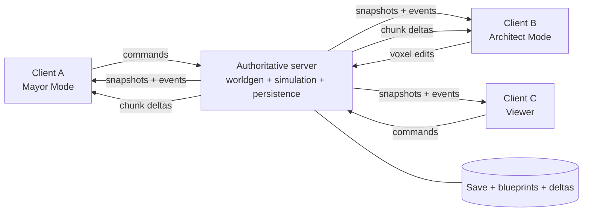

# 05 — Multiplayer

> [!decision] D-004 — Authoritative server, co-op first
> Townsmith uses an **authoritative server** architecture. Single-player runs the same server locally, in-process. Multiplayer is co-op at launch (2–8 players), with dedicated servers. MMO scale is out of scope.

## 1. Goals and non-goals

### Goals

- **Co-op city building:** a small group shares one world, one treasury (by default), and one blueprint library.
- **Build anywhere:** players can found settlements anywhere in the procedural world, not only inside a fixed city tile.
- **1M+ population servers:** the server runs the aggregate/cohort simulation for a metropolis; clients receive detailed data only near them.
- **Two modes at once:** one player can be in Mayor Mode placing buildings while another is in Architect Mode editing a blueprint.
- **Dedicated servers:** headless, Linux-first, runnable on a cheap VPS or a home machine.
- **Listen servers:** host from the game client for casual sessions.
- **Persistence and reconnect:** the world survives restarts; a dropped player can rejoin.
- **Mod-aware:** the server declares required content; clients verify it before joining.
- **Permission-aware:** not every player can bulldoze the capital.

### Non-goals (v1)

- Public servers with hundreds of players.
- Competitive/PvP city building.
- Cross-server persistent worlds.
- Real-time voice chat (text chat and pings at launch).
- Seamless host migration. If the host leaves a listen server, the session pauses or ends; dedicated servers are the durable option.
- Deterministic lockstep. We use server authority, not lockstep.

## 2. Topology



| Mode | Server location | Use case |
|---|---|---|
| **Single-player** | In-process, local | Solo play; same code path as multiplayer |
| **Listen server** | Host's client process | Friends playing together; host has authority |
| **Dedicated server** | Separate headless process | Persistent community server; no host advantage |
| **LAN** | Listen or dedicated | Local co-op |

The client never simulates the authoritative city. It predicts local movement and UI feedback, then reconciles with server snapshots.

## 3. Roles and permissions

| Role | Budget | Roads/zones | Place buildings | Bulldoze | Architect edit | Save blueprint | Mods/admin |
|---|---|---|---|---|---|---|---|
| **Admin** | ✅ | ✅ | ✅ | ✅ | ✅ | ✅ | ✅ |
| **Mayor** | ✅ | ✅ | ✅ | ✅ | ✅ | ✅ | ❌ |
| **Architect** | ❌ | ❌ | ❌ | ❌ | ✅ | ✅ | ❌ |
| **Builder** | ❌ | ❌ | ❌ | ❌ | ✅ | ❌ | ❌ |
| **Viewer** | ❌ | ❌ | ❌ | ❌ | ❌ | ❌ | ❌ |

- Permissions are configurable per player and per role.
- The server owner can disable roles entirely for a "everyone is mayor" casual server.
- **Blueprint locks:** only one player can edit a given blueprint at a time. Others can view it read-only. The lock is released on save, cancel, or timeout.
- **Lot claims:** a player can claim a lot for a planned building; others see the claim. Claims expire.
- **Shared treasury** by default. Separate personal budgets are a server option (later).

## 4. Time and ticks

| System | Rate | Notes |
|---|---:|---|
| Simulation tick | 10 Hz | Agents, movement, utilities, construction |
| Economy tick | 1 Hz | Taxes, upkeep, production, trade |
| Snapshot send | 10–20 Hz | Per-client, interest-filtered, delta-compressed |
| Client render | 60+ FPS | Interpolates between snapshots |
| Autosave | 5–10 min | Atomic writes, rotating backups |

- Server time is authoritative. Clients display server time; day/night and seasons follow it.
- **Pause is disabled in multiplayer.** The admin can set speed (1×/2×/4×); a vote system is a later feature.
- Time scale affects simulation and economy ticks proportionally, not network rates.

## 5. Commands and validation

Clients send **commands**, not state.

```text
PlaceBuilding { blueprint_hash, transform, lot_id }
Bulldoze { instance_id }
DrawRoad { points[], road_type }
PaintZone { cells[], zone_type }
SetTaxRate { zone, rate }
ApplyVoxelEdits { blueprint_id, base_version, edits[] }
SaveBlueprint { blueprint_id, metadata }
```

The server validates every command:

1. **Permission:** does the player have the role for this action?
2. **Content:** does the blueprint hash exist and match the server's content manifest?
3. **Space:** is the lot free, the slope acceptable, the footprint clear?
4. **Cost:** can the treasury afford it? Are materials available?
5. **Rules:** age tier, structural validity, utility connections.
6. **Version:** is the blueprint edit based on the current version? (Optimistic concurrency.)

Accepted commands produce **events** (building placed, tax changed, blueprint updated) that are broadcast to interested clients. Rejected commands return a reason for UI feedback.

## 6. Voxel editing and blueprint sync

Voxel editing is the hardest sync problem because edits are frequent and fine-grained.

### Strategy

- **Blueprint-scoped editing:** a player edits a blueprint, not arbitrary voxels in the live city (unless Q-005 chooses live-city editing).
- **Locking:** the server grants an edit lock for a blueprint. Only the lock holder can send edits.
- **Batched edits:** the client sends `VoxelEditBatch` messages (up to N edits or M milliseconds), not one message per voxel.
- **Versioned blueprints:** each save creates a new version. The edit lock is tied to the base version; stale edits are rejected.
- **Server-side validation:** bounds, material availability, structural rules (optional on the server), and max solid voxel count.
- **Broadcast:** on save, the server stores the new blueprint version and sends the new content hash + metadata to clients. Clients that need the voxels (e.g., viewing the building) download the compressed blueprint file.
- **Live city edits:** if a building is edited in place, the server creates a per-instance override or a new blueprint version; the city's other instances are unaffected unless the player chooses to upgrade them.

### Why not CRDTs

- CRDTs are excellent for concurrent text editing, but voxel buildings have structural invariants (support, rooms, doors) that are hard to merge.
- Locks are simpler, predictable, and match the "one architect per blueprint" workflow.
- Later, a "co-op editing" mode could use operational transforms or CRDTs, but it is not v1.

### Bandwidth

- A voxel edit is ~8–16 bytes (chunk ID, index, material, operation).
- A 1,000-edit batch is ~8–16 KB before compression; zstd reduces it further.
- Blueprint transfer is a compressed file (typically 0.2–1 MB for a detailed building); streamed on demand, not on every edit.
- Static world state is sent on join and then only deltas.

## 7. World streaming and interest management

Open-world multiplayer is mostly a **chunk streaming** problem, not an entity replication problem.

- **World seed + deltas:** the server owns the seed and all edits. Clients generate the procedural base locally and apply deltas received from the server.
- **Chunk requests:** clients request **world chunks** (256 m) and **building chunks** (32³ voxels) around their camera; the server prioritizes nearby, visible, and recently edited chunks.
- **Region activation:** the server simulates **active regions** (512 m) around players at full detail. Regions with no players are aggregate or dormant; when a player enters, the server advances them statistically and activates them.
- **Active-region cap:** limit the number of simultaneously active regions (e.g., 4) so 8 players spread across the map do not multiply the simulation cost. Distant players get aggregate updates.
- **Static data:** roads, building instances, and blueprint metadata are sent as deltas as they change.
- **Dynamic data:** citizens, vehicles, and construction effects are filtered by each client's **area of interest (AOI)**.
- **LOD-aware:** a client at mayor altitude receives aggregate/visual data for many buildings but few individual agents; a client on the ground receives detailed nearby agents.
- **Prioritization:** nearby, visible, and recently changed entities are sent first; distant entities are throttled.
- **Quantization:** positions and rotations are quantized; animations are driven by state, not per-frame transforms.
- **Delta compression:** snapshots are diffs against the last acknowledged state.

### Bandwidth target

| Client state | Target |
|---|---|
| Join + initial chunks | 10–100 MB compressed, streamed |
| Steady state, mayor view | 20–100 KB/s |
| Steady state, street view | 100–300 KB/s |
| Chunk streaming while flying | 1–5 MB/s, bursty |
| Voxel editing | Bursts up to 1 MB/s, then idle |
| 1M server, 8 players | 20–80 Mbps aggregate target |

These are planning targets. The Phase 0 spike and a network test must measure them.

## 8. Persistence and reconnect

- **Save format:** world seed + terrain/resource deltas + SQLite for world state + binary blueprint files (see [[03 - Voxel and Scale]] and [[12 - Technical Architecture]]).
- **Autosave:** every 5–10 minutes, atomic (temp file → fsync → rename), with rotating backups.
- **Journal:** world edits are appended to a write-ahead log between autosaves; crash recovery replays it.
- **Reconnect:** the server issues a session token. A reconnecting client resumes with its role, claims, and camera state; it receives a fresh snapshot.
- **Server restart:** the city loads from the last save + journal; players reconnect manually or via invite.
- **Version migrations:** save schema version in the database; migrations run on load; a backup is made before migration.

## 9. Mods and content manifests

Multiplayer + modding is a trust problem. The server is the authority.

- **Content manifest:** the server publishes a manifest of required content mods and their hashes.
- **Client check:** on join, the client compares its installed content mods and versions. A mismatch blocks join with a clear message and a list of missing/extra mods.
- **Content mods vs resource packs:**
  - **Content mods** add blocks, materials, buildings, recipes, jobs, etc. They must match on client and server.
  - **Resource packs** change textures, sounds, UI, and fonts. They are client-side and may differ, as long as material IDs and geometry are unchanged.
- **Server allowlist:** only approved mods can load on a server.
- **Auto-download:** later, via Steam Workshop or a server-hosted mod bundle. v1: manual install with a manifest check.
- **Save compatibility:** if a mod is removed, missing content becomes a placeholder with a warning; the server can refuse to load or run in a degraded mode.
- **Security:** untrusted mods must not execute arbitrary native code on clients. See [[06 - Modding and Resource Packs]].

## 10. Security

| Threat | Mitigation |
|---|---|
| Griefing | Roles/permissions, lot claims, blueprint locks, rollback, whitelist |
| Cheating (infinite money, instant build) | Server validates all costs and commands; client never owns state |
| Malformed voxel data | Bounds checks, palette validation, size limits, fuzzing |
| Mod code execution | Data-first mods; sandboxed scripting; native mods only with explicit trust |
| DoS | Rate limits per connection, command quotas, max blueprint size, timeouts |
| Impersonation | Session tokens, optional password/Steam auth, admin allowlist |
| Save corruption | Atomic writes, backups, journal, schema validation |

- The server logs admin actions and high-impact commands (bulldoze, budget changes, mod changes).
- A rollback tool (restore last autosave) is a launch requirement for community servers.

## 11. Dedicated server

- **Platform:** Linux x86_64 first; Windows server build optional (Q-017).
- **Process:** headless, no GPU, no audio; simulation only.
- **Configuration:** `server.toml` (world name, seed, max players, port, password, mod manifest, autosave interval, role defaults).
- **Admin:** console commands + a local admin file; RCON/web panel later.
- **Discovery:** direct IP, invite code; Steam server browser later.
- **Distribution:** a standalone server tarball/zip, plus a Docker image later.
- **Resources:** target 4–8 CPU cores and 16 GB RAM for an 8-player, 1M-population server; 2–4 cores / 8 GB for a 100k city. Measure in the Phase 0 spike.

## 12. Testing

- **Headless bots:** simulated clients that place buildings, edit voxels, and reconnect.
- **Network simulation:** latency (50–300 ms), jitter, packet loss (0–5%), bandwidth caps.
- **Load tests:** 8 players, 1M citizens, 250k buildings, 2k active agents; measure tick time, memory, chunk streaming, and bandwidth.
- **Reconnect tests:** drop a client mid-edit, reconnect, verify lock/version recovery.
- **Mod mismatch tests:** missing mod, extra mod, wrong version, resource pack difference.
- **Save/load tests:** crash during autosave, journal replay, schema migration.
- **Security tests:** malformed commands, oversized blueprints, permission bypass attempts.

## 13. Open questions

- **Q-002:** Target player count and server type? Affects bandwidth, AOI, and simulation budgets.
- **Q-005:** Can players build and edit anywhere in the world, or only in a workshop? Affects locks, griefing, and sync.
- **Q-063:** World extent and streaming limits.
- **Q-070:** 1M multiplayer: players per server, active-region cap, server hardware.
- **Q-017:** Windows dedicated server support, or Linux only?
- **Q-028:** Shared treasury or personal budgets? Default is shared.
- **Q-029:** Should clients auto-download resource packs from the server?
- **Q-030:** Is host migration required? Default: no; dedicated servers are the durable option.
- **Q-031:** Voice chat at launch, or text only? Default: text only.
- **Q-032:** Steam networking (lobbies, server browser) or direct IP first? Default: direct IP + invite codes first, Steam later.

See [[09 - Open Questions]] and [[10 - Decisions]].
