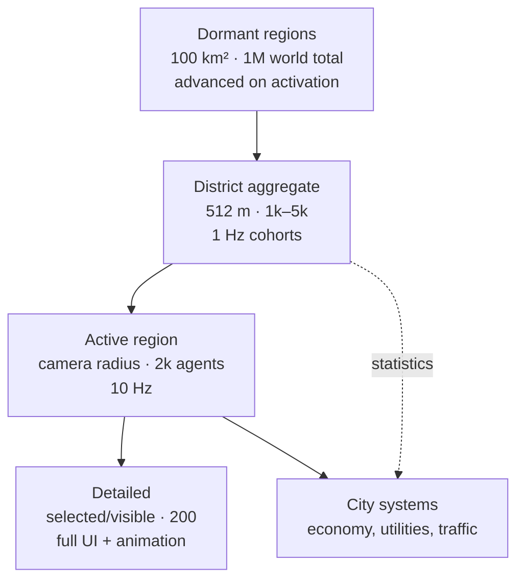
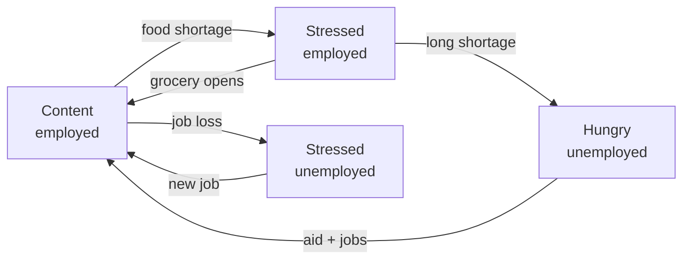

# 07 — Simulation and AI

This document describes how the world actually works: population, cohorts, citizens, needs, jobs, primary industries, wildlife, utilities, traffic, and the economy. The design-level view is in [[02 - Game Design]]; performance and voxel constraints are in [[03 - Voxel and Scale]].

> [!decision] D-007 / D-017 — Tiered simulation and cohorts
> The world is simulated at multiple levels of detail. Distant regions are **dormant**. The bulk population is simulated in **cohorts**, not as a million individual agents. Only citizens near the camera and selected citizens are individual agents.

## 1. Simulation philosophy

A city builder has three competing demands:

1. **Depth:** citizens should feel like they have lives, not just numbers.
2. **Scale:** a metropolis of **1M+ citizens** should fit in one world.
3. **Performance:** the game must run at 60 FPS while simulating them.

The answer is **tiered simulation plus cohorts**. Different entities get different levels of detail based on distance and relevance. The player should never see the seams.



### Tiers

| Tier | Scope | Population | Update rate | Rendering |
|---|---|---|---:|---|
| **Region — dormant** | 512 m regions outside the active set | 1k–5k per region; 1M world total | On activation / 0.1 Hz | None, or distant massing |
| **District — aggregate** | 512 m regions near activity | 1k–5k | 1 Hz cohorts, 1 Hz buildings | Dots, LOD, heatmaps |
| **Active** | Camera radius | 2,000 agents | 10 Hz | Low-poly animated agents |
| **Detailed** | Selected/visible | 200 | 10 Hz | Full model, name, mood, inventory |

- **Individual records** exist for every citizen: identity, household, job, home, basic stats. This makes selection and stories possible.
- **Cohorts** are the simulation workhorse: groups of citizens by district, building type, and needs band. A cohort stores counts and average satisfaction, not one row per person per tick.
- **Active agents** are promoted from cohorts when near the camera or selected; their state is derived consistently from the cohort.
- **Buildings** are always simulated, but at district aggregate level when off-screen. Only nearby buildings run production, occupancy, and condition at full fidelity.
- **Dormant regions** are advanced statistically when the player returns, so the world does not freeze while away.

### What the player sees

- At mayor altitude: district heatmaps, statistics, skyline LOD, and aggregate flows.
- At street level: individual citizens, vehicles, workers, and animals.
- In a selected building or household: detailed rooms, needs, jobs, and stories.

## 2. Time model

| Layer | Rate | Purpose |
|---|---:|---|
| Active simulation | 10 Hz | Agents, movement, construction, utility flow |
| Aggregate/cohort | 1 Hz | District needs, building production, housing, jobs |
| Economy | 1 Hz | Taxes, upkeep, production totals, trade |
| Dormant catch-up | On activation / 0.1 Hz | Advance distant regions statistically |
| Day/night | Continuous | Lighting, schedules, crime, energy demand |
| Calendar | Days → months → years | Seasons, budgets, aging, progression |

- **Time scale:** pause, 1×, 2×, 4×. Target: **1 game day ≈ 10–20 real minutes at 1×**, **1 game month ≈ 1–2 real hours** (Q-041).
- The simulation uses a **fixed timestep** with an accumulator; rendering interpolates.
- Time scale multiplies the number of simulation steps, not the timestep.
- **Single-player:** entering Architect Mode automatically pauses time; leaving restores the previous state (paused stays paused, otherwise the prior speed resumes).
- **Multiplayer:** the server owns time; clients interpolate. Mode B never auto-pauses a shared world. An admin with `time.control`, or a simple-majority vote of online players, can pause/resume/fast-forward (D-021).
- Pause is a **shared design freeze**, not a menu: it freezes simulation, construction progress, production, needs, and day/night, but all players can still fly, inspect, place/remove buildings, and edit blueprints. There is no auto-resume timer: single-player resumes when leaving Mode B; multiplayer stays paused until an admin or vote resumes. See [[05 - Multiplayer]].
- **Seasons:** at launch with an on/off toggle (Q-069). They affect crop growth, wildlife migration, heating demand, and construction.

## 3. Population scale: 1M+ and cohorts

### What 1M means

- **1M citizens** is a late-game metropolis. A town is a few hundred to a few thousand; a city is 100k; a metropolis is 1M+.
- At 10k–20k people/km², 1M citizens occupy **50–100 km²**.
- The city has **100k–250k buildings**, **250k–333k households**, and **400k–600k jobs**.
- The player manages **districts and systems**, not every citizen. The UI must aggregate.

### Why not 1M individual agents?

- 1M agents × 10 Hz = 10M updates per second before pathfinding, needs, animation, or rendering. That is not feasible on consumer hardware.
- 1M individual pathfinders is far worse: the road graph alone is 100k–200k edges.
- The game only needs individual detail where the player looks. Everywhere else, statistics are indistinguishable in play.

### The cohort model, in detail

#### The intuition

A city of 1M people does not need to know that citizen #481,222 is 3% hungrier than yesterday. It needs to know that **12% of the Riverside district is hungry**, that the number is rising, and that a new grocery store would fix it. Cohort simulation tracks those groups and the flows between them.

> [!info] First district snapshot
> `core_city::district::summarize_district` is the first derived district layer: a circular XZ query over completed placements and household records, returning population, housing, vacancies, jobs, employment, resident-weighted needs/happiness/commute, and construction counts. The bridge exposes it as `district_summary(seed, center_x, center_z, radius_m)`; it adds no save field and no UI yet. Cohorts, heatmaps, policies, and district catch-up remain open.

Think of it like traffic: you do not simulate every car's engine to know that a highway is congested. You track how many cars are in each speed band and move them between bands. Cohorts do the same for people and needs.

#### What a cohort is

A **cohort** is a statistical bucket of citizens who share the same:

| Key | Examples |
|---|---|
| District | Riverside, Old Town, North Industrial |
| Housing type | Lower-class apartment, suburban house, dormitory, retirement home |
| Employment band | Employed, unemployed, retired, student |
| Needs band | Content, stressed, hungry, unsafe |
| Income band | Low, middle, high (optional, if it changes behavior) |
| Age band | Child, adult, elderly (optional) |

A cohort is **not a fixed group of named people**. Citizens move between cohorts as their circumstances change. The simulation moves **counts** between buckets.

Each cohort stores:
- `count` — how many citizens are in this state.
- Average needs satisfaction (hunger, rest, hygiene, social, fun, safety, health).
- Average happiness and health.
- Average income/wealth band.
- Home building type and job type distribution.
- Average commute time and service access.
- Migration pressure and tenure (how long the group has been in this state).

#### The update loop

At each aggregate tick (1 Hz game time, or slower for distant districts):

1. **Snapshot** the current cohort counts.
2. **Evaluate** needs satisfaction from housing quality, food/water access, services, jobs, pollution, noise, commute, and taxes.
3. **Move counts** between needs/employment bands. For example, a food shortage moves citizens from `content` to `hungry`; a new grocery moves them back.
4. **Apply lifecycle:** births, deaths, aging, and migration in and out of the district.
5. **Update jobs and income:** hiring, firing, wage changes, commuting.
6. **Emit aggregate demand** for utilities, goods, housing, and traffic.
7. **Emit events and sampled stories** for the UI, advisors, and newspapers.



#### A worked example

Riverside has 12,000 residents:

| Cohort | Count |
|---|---:|
| Content, employed | 7,200 |
| Stressed, employed | 2,400 |
| Hungry, unemployed | 1,200 |
| Content, retired | 1,200 |

A bakery closes, and food coverage drops from 92% to 70%. On the next aggregate tick:
- 600 `content` citizens become `stressed`.
- 300 `stressed` citizens become `hungry`.
- The district's food satisfaction drops from 88% to 74%.
- The player sees "Food access: 92% → 70%" and a sampled complaint from a household in the affected cohort.

A new grocery store opens. The flows reverse over the next few ticks. The player sees the district recover.

#### Materialization: where individual citizens come from

Every citizen has an **individual record** (id, name, household, home, job, basic attributes). But their needs and happiness are not updated individually every tick.

When a citizen is **materialized**:
- The player selects them.
- They are near the camera.
- An event needs a named actor (a complaint, a birth, a death, a promotion).
- A story or tutorial needs a face.

The game samples a citizen from the relevant cohort and gives them:
- A name, household, home, and job.
- Needs/happiness near the cohort average, with variance.
- A consistent personal history while they are active.

While materialized, the citizen updates at 10 Hz like an individual agent. When they are **dematerialized**, their state is folded back into the cohort aggregates. The player never sees a citizen "pop"; the transition is hidden by distance or UI.

> [!note] First named-citizen slice
> The implementation plan for persistent names, selection, and the 2,000-agent materialization budget is in [[67 - Named Citizens]]. It is additive: named citizens are identities over the aggregate household runtime, not a second population simulation.

#### Keeping the cohort count under control

A full cross-product of every band would explode. The design uses a **fixed set of 12–30 cohorts per district**, with split/merge rules:

- Start with a small set of states per district.
- If a cohort grows beyond a threshold, split it into two (e.g., split by income or age).
- If two cohorts become similar and small, merge them.
- 333 districts × ~30 cohorts ≈ 10,000 cohorts for a 1M city, or ~100 citizens per cohort on average.
- The cohort key is deliberately coarse; fine distinctions are handled by materialized citizens or additional splits only where they matter.

#### Why it works

- **Scale:** 1M citizens become ~10k cohort updates, not 1M individual updates.
- **Readability:** the UI naturally works with districts, distributions, and trends, which is how players manage a metropolis.
- **Detail where it matters:** individual agents near the camera still have names, homes, jobs, and needs.
- **Stability:** statistical aggregates are less noisy than individual simulations and easier to balance.

#### Tradeoffs and risks

- **Individual history is approximate.** A citizen's past is reconstructed/sampled; it is not a fully persistent life simulation.
- **Cohort design is hard.** Bad bands can create artifacts ("everyone in this district is suddenly hungry").
- **Events need sampling.** A complaint is representative, not exhaustive; the UI must not imply it is the only one.
- **Validation is required.** Compare cohort aggregates against a fully individual reference simulation on a small city; they should match within tolerance.
- **Transitions must be hidden.** Materialization/dematerialization needs care to avoid visible popping or inconsistent stories.

#### What the player sees

- District dashboards: needs distribution, happiness, income, employment, housing.
- Heatmaps: hunger, pollution, commute, service coverage.
- Sampled stories: "The Millers can't sleep because the steel mill runs at night" — a representative household from the affected cohort, not the only one.
- Selected citizens: a consistent individual with a home, job, and needs while the player watches.
- City-wide trends: population, migration, health, and happiness over time.

This is the core trade: **the player gets a living metropolis of millions, and individual detail where they look, without simulating every life at once.**

### Data budget

| Data | Count | Size | Total |
|---|---:|---:|---:|
| Citizens | 1M | 64 B | 64 MB |
| Households | 250k | 64 B | 16 MB |
| Buildings | 250k | 128 B | 32 MB |
| Jobs | 500k | 32 B | 16 MB |
| Cohorts | 10k | 256 B | 2.5 MB |
| Road graph | 150k edges | ~100 B | 15 MB |
| **Total (with indexes/overhead)** | | | **~0.5–2 GB** |

- This fits the 16–32 GB target with room for rendering and the OS.
- The save stores individual citizen records + aggregates; compressed, 100–300 MB.

### Performance expectation on the target machine

| Scenario | Expectation |
|---|---|
| ~100k city, 8c/16t + RTX 3060 | 60 FPS at 1080p |
| 1M city, 8c/16t + RTX 3060 | **~30 FPS at 1080p** |
| 1M city, higher-end GPU / lower settings | 60 FPS target |
| Dedicated server, 1M city | Simulation only; 4–8 cores, 16 GB RAM |

- **The dedicated server offloads simulation, not rendering.** The client still draws the city; the server's CPU does not make the client's GPU faster.
- A dedicated server helps most when the client is CPU-bound by simulation, when multiple players share a city, and when the world must persist. It also lets low-end clients join without running the full simulation.
- With a dedicated server, the client's CPU is free for chunk meshing, UI, and render submission; the remaining 1M-city limit is largely GPU (LOD, overdraw, shadows) and streaming.
- The Phase 0/5 benchmark must measure both: server tick time and client frame time on the target hardware.
- These expectations are measured by the deterministic benchmark scenes: **Early Settlement**, **Mid City**, and **Late Metropolis**. See [[15 - Benchmarks]].

### Tick budget

| Work | Rate | Budget |
|---|---:|---:|
| Cohorts (10k) | 1 Hz | < 10 ms |
| District aggregates (~333 regions) | 1 Hz | < 10 ms |
| Dirty/active buildings (up to 25k) | 1 Hz | < 20 ms |
| Economy | 1 Hz | < 15 ms |
| Active agents (2k) | 10 Hz | < 10 ms |
| Pathfinding (active) | 10 Hz | < 4 ms |
| Dormant catch-up | On activation | < 50 ms per region, time-sliced |

These are targets. The Phase 0 spike must measure them.

> [!success] Phase 0 cohort tick
> `core_sim` ticks 10,000 cohorts / 1,000,000 citizens in **~0.21 ms median** on the current machine, far below the 10 ms cohort budget. This is a simplified aggregate model: it excludes buildings, construction, active agents, pathfinding, and the economy, so it is a floor for the full tick, not the final number. See [[18 - Phase 0 Implementation]]; the 2,000-agent movement floor is in [[19 - Active Agent Benchmark]].

### Dormant regions and catch-up

- A region with no player nearby does not tick. It stores a statistical snapshot: population, housing, jobs, resource stocks, wildlife, pollution.
- On activation, the region advances by the elapsed game time using stored rates. This avoids simulating the whole 100 km² at 10 Hz.
- Catch-up is deterministic and bounded: if the player is away for a year, the region advances in coarse time steps, not 31M ticks.
- The UI shows an "away summary" when returning: population change, construction, harvests, problems.

## 4. Citizens and households

### Households

- A **household** is the unit of housing: one or more citizens sharing a home and a budget.
- Households have income, rent, savings, and a home building.
- Household size is constrained by beds and floor area.
- Households move in when housing is available and the city is attractive; they move out when unhappy, priced out, or evicted.

### Citizens

| Attribute | Description |
|---|---|
| Name, age, portrait | Identity and UI |
| Household | Home and family links |
| District / cohort | Simulation membership |
| Job | Workplace, role, wage, schedule |
| Education | Level and field; gates jobs |
| Health | Physical and mental; affected by pollution, food, healthcare |
| Happiness | Aggregate of needs and modifiers |
| Needs | Hunger, rest, hygiene, social, fun, safety |
| Skills | Job-specific competence; improves with work/education |
| Wealth | Savings, debt, consumption |
| Mood | Short-term emotional state for UI and stories |

### Lifecycle

- **Birth:** households grow if housing and happiness allow.
- **Schooling:** children attend school; education affects jobs and income.
- **Work:** adults commute to jobs; unemployment affects happiness and budget.
- **Aging:** citizens age; retirees leave the workforce and may need healthcare.
- **Death:** eventually, from old age or health problems.
- **Migration:** new citizens arrive if housing, jobs, and happiness attract them; others leave if not.

### Schedule and state machine

A typical day:

```text
Sleep → Wake → Eat → Commute → Work → Lunch → Work → Commute → Shop/Leisure → Home → Sleep
```

- Each citizen has a state machine with needs-driven interrupts (hunger, exhaustion, health).
- Active agents move along the sidewalk/road graph; entering a building abstracts the interior.
- Cohort citizens resolve their schedule statistically: needs are satisfied based on building quality, service coverage, and commute time.

### Interior abstraction

> [!important] Key simplification
> NPCs do **not** pathfind through building interiors in v1. A citizen enters at the door and is "inside"; the building's rooms and props determine whether their needs are met. This is invisible to the player and saves enormous pathfinding cost.

- The validator still checks that rooms are connected by doors/stairs, so the layout is plausible and future-proof.
- If a future citizen mode needs interior movement, a room-level navigation graph can be added without changing the city simulation.

## 5. Needs and happiness

### Needs

| Need | Satisfied by | Depleted by | Failure effect |
|---|---|---|---|
| **Hunger** | Food at home, grocery, restaurant | Time | Health, happiness |
| **Rest** | Bed, quiet bedroom | Noise, long work, commute | Health, productivity |
| **Hygiene** | Bathroom, shower, water | Time, work | Health, happiness |
| **Social** | Family, friends, parks, pubs | Isolation, long commute | Happiness |
| **Fun** | Parks, entertainment, hobbies | Routine | Happiness |
| **Safety** | Police, fire, well-lit streets, low crime | Crime, disasters | Happiness, health |
| **Health** | Clinic, clean air/water, food | Pollution, untreated illness | Productivity, death |

### Happiness

```
happiness =
    Σ (need_satisfaction × need_weight)
  + housing_quality
  + service_access
  + employment_satisfaction
  - noise_penalty
  - pollution_penalty
  - commute_penalty
  - tax_penalty
  - overcrowding_penalty
```

- Happiness is clamped and smoothed over time; it should not flicker.
- Happiness affects migration, productivity, tax compliance, and social stability.
- The UI explains the top positive and negative factors for any district, building, or selected citizen.
- At 1M scale, happiness is primarily a **district/cohort distribution**, not a single city-wide number. The city average hides inequality; the heatmap shows it.

### Complaints and stories

- Unmet needs generate **complaints** with a cause and a location: "The Millers can't sleep because the steel mill runs at night."
- At scale, complaints are sampled from cohorts so the player sees representative stories, not a million notifications.
- Complaints become notifications, newspaper-style events, or advisor tips.
- Stories are generated from real simulation state, not scripted.

## 6. Jobs, production, and supply chains

### Jobs

- **Job slots** come from props and machines: a workbench, an oven, a counter, a desk, a factory line.
- Each slot has a role, required skill/education, wage, and schedule.
- Citizens apply for jobs based on skill, wage, commute, and happiness.
- Vacancies reduce output; overstaffing wastes wages.
- Workplaces need utilities (power, water) and inputs; a factory without power is idle.

### Construction trades and sites

Construction is a **temporary workplace** with its own job slots, material stockpile, phases, and blockers.

| Phase | Typical trades | What can stall it |
|---|---|---|
| Survey and site prep | Surveyor, civil engineer, laborers | Access, permits, terrain, utilities |
| Foundation | Laborers, concrete/masonry workers | Materials, excavation, weather |
| Structure | Carpenters, masons, steelworkers | Structural materials, cranes, crew |
| Envelope | Roofers, glaziers, insulators | Weather, materials, access |
| Utility rough-in | Electricians, plumbers, HVAC technicians | Utility connection, licensed trades |
| Interior finish | Carpenters, plasterers, painters, flooring | Materials, elevators, inspections |
| Commissioning | Engineers, inspectors, utility technicians | Tests, permits, final connections |

- A construction site generates **temporary job slots per phase**, scaled by workload. A small house needs a handful of workers; a factory or high-rise needs large crews and specialists.
- Workers are citizens with trade skills. Electricians, plumbers, HVAC technicians, and engineers require vocational training or education; laborers and apprentices are easier to hire.
- If a trade is missing, the site stalls with a reason and a duration estimate. The player can build a construction office, fund training, import temporary contractors, or accept the delay.
- **Construction offices / public works** provide crew capacity, tools, and vehicles. More capacity means more simultaneous sites and faster work, at a wage/upkeep cost.
- Materials are delivered progressively from warehouses/producers. A site keeps a stockpile; the phase consumes it. Missing materials stall the phase before workers are assigned.
- Phases can overlap where physically possible (e.g., rough-in after the structure is weather-tight; interior finish in completed floors), but dependencies are explicit.
- A building is **not occupiable** until commissioning/inspection passes. Partially built buildings do not generate residents or production.
- Demolition and major upgrades use the same crew/trade model, with waste hauling and temporary closure.
- At 1M scale, only nearby sites simulate workers individually; distant sites use aggregate progress and trade demand.

#### Age progression of trades

| Age | Construction character |
|---|---|
| **Wood** | Laborers, carpenters, roofers; hand tools; no licensed electricians/plumbers |
| **Masonry** | Masons, stonecutters, glaziers; aqueducts and sewers need engineers |
| **Industrial** | Steelworkers, electricians, plumbers, steamfitters, inspectors; cranes and powered tools |
| **Modern** | HVAC, elevator technicians, structural engineers, code inspectors, glazing crews |
| **Information** | Smart-building technicians, sustainability engineers, complex systems commissioning |

> [!note] Why this matters
> Construction jobs are a real part of the city's labor market, not a cosmetic animation. A building boom creates demand for trades; a shortage slows the boom and raises wages. This is a lever the player can manage through education, training, and construction capacity.

### Production

```json
{
  "id": "base:bake_bread",
  "building": "base:bakery",
  "inputs": [{ "id": "base:flour", "amount": 2 }],
  "outputs": [{ "id": "base:bread", "amount": 20 }],
  "time_seconds": 60,
  "workers": 2,
  "power_kw": 4
}
```

- A production building has input storage, output storage, and a progress timer.
- Staff, inputs, power, and storage must all be available; otherwise production pauses with a reason.
- Byproducts (pollution, waste, noise) are part of the recipe.
- Throughput scales with workers and machine quality, with diminishing returns.

### Supply chains

| Chain | Example |
|---|---|
| Food | Farm → grain → mill → flour → bakery → bread → household |
| Construction | Forest → timber → sawmill → planks → building site |
| Industry | Mine → ore → smelter → ingots → factory → goods → shop |
| Energy | Coal mine → power plant → grid → buildings |
| Waste | Household → garbage truck → landfill/recycling → materials |
| Hunting | Wildlife → hunter → meat/hide → market/tannery → household |

- Resources are stored in buildings, warehouses, and vehicles.
- Freight moves between buildings via trucks/trains; the player can see the vehicles near the camera.
- Imports/exports at the region edge fill gaps; prices fluctuate.
- At 1M scale, most freight is aggregate flow; only nearby vehicles are individual agents.

### Commercial and offices

- **Commercial** buildings sell goods to citizens; demand depends on population, wealth, and preferences.
- **Offices** provide service jobs and tax revenue; they need educated workers and power/connectivity.
- **Services** (schools, clinics, fire, police) consume budget and staff, and provide coverage.

## 7. Primary industries: forestry, agriculture, hunting

The early game is built on the land. These jobs have visible work loops and feed the city's resource chains. They are also data-driven so mods can add new species, crops, animals, and tools.

### 7.1 Lumberjack

| Property | Design |
|---|---|
| Workplace | Lumber camp (early), sawmill (processing) |
| Workers | 1–6 per camp |
| Work area | Radius around the camp; mature trees tagged by species and size |
| Loop | Find tree → walk → chop → carry logs to camp/stockpile → replant sapling |
| Outputs | Logs, timber, branches, saplings |
| Inputs | Tools, labor, saplings |
| Growth | Tree species grow over game days; managed forest is sustainable |
| LOD | Active workers/animation near camera; aggregate yield based on forest inventory and worker count elsewhere |
| Upgrades | Axe → saw → truck; forest management; replanting policy |
| Failure | Overlogging depletes the radius; workers walk farther; output drops |

### 7.2 Farmer

| Property | Design |
|---|---|
| Workplace | Farmhouse, barn, silo |
| Fields | Plots with crop type, area, soil quality, water, growth stage, health, pests |
| Loop | Plow → plant → water/fertilize → harvest → store; livestock later |
| Outputs | Grain, vegetables, milk, eggs, meat, wool |
| Inputs | Seeds, water, feed, labor, tools |
| Seasons | Growth depends on season/temperature; winter fallow or greenhouse; toggleable |
| LOD | Fields update on a daily/cohort tick; active farmers animate near camera |
| Upgrades | Irrigation, fertilizer, crop rotation, machinery, greenhouses |
| Failure | Drought, pests, overwork, soil depletion |

### 7.3 Hunter

| Property | Design |
|---|---|
| Workplace | Hunting lodge |
| Work area | Forest/meadow; wildlife population and habitat |
| Loop | Patrol → track → hunt → field dress → carry meat/hide to lodge |
| Outputs | Meat, hides, fur, pest control |
| Contracts | Farms request removal of rabbits/boars; settlements request predator control |
| Wildlife | Population per region, habitat, food, predators, migration |
| LOD | Wildlife aggregate per region; active animals/hunters near camera |
| Upgrades | Better tools, traps, dogs, refrigerated storage |
| Failure | Overhunting depletes populations; predators may attack livestock; pests destroy crops |

### 7.4 Early-game loop

1. Settlers arrive with tools and a cart.
2. Lumber camp → wood for houses, fuel, and a sawmill.
3. Farm → food for the settlement; fields need water and labor.
4. Hunting lodge → meat and hides; pest control protects the farm.
5. Houses, well, market, storage → a village that can survive winter.
6. Surplus wood/food/hides → trade, crafts, and the first masonry buildings.

### 7.5 Job table

| Job | Workplace | Primary inputs | Primary outputs | World system |
|---|---|---|---|---|
| Lumberjack | Lumber camp | Labor, tools, saplings | Logs, timber, branches | Trees / forestry |
| Farmer | Farmhouse | Labor, seeds, water, feed | Grain, vegetables, milk, meat | Fields / livestock |
| Hunter | Hunting lodge | Labor, tools, ammo | Meat, hides, fur, pest control | Wildlife |
| Miner | Mine | Labor, tools, power | Stone, coal, ore | Resource deposits |
| Fisher | Fishing hut | Labor, boats, nets | Fish | Water / fish stocks |
| Baker | Bakery | Flour, water, fuel, labor | Bread | Production chain |
| Sawmill worker | Sawmill | Logs, power, labor | Planks, beams | Production chain |

## 8. Wildlife and ecosystems

- **Wildlife populations** live per region: species, population count, habitat quality, food, predators, and migration.
- **Active animals** near the camera are individual agents with simple behavior (graze, flee, hunt, herd). Distant populations are aggregate.
- **Hunting pressure** reduces populations; regrowth depends on habitat and season. Overhunting can collapse a population.
- **Predators** (wolves, foxes) can threaten livestock; hunters can cull them, or the player can accept the losses.
- **Pests** (rabbits, boars, insects) damage crops; farmers can request hunter contracts or build fences/scarecrows.
- **Deforestation** reduces habitat and increases erosion/flood risk (later). Replanting restores it.
- **Pollution/noise** can reduce habitat quality near industry and roads (later).
- **Seasons** drive migration, breeding, and crop damage.
- **Modding:** species, habitats, behaviors, and products are data-driven.

The ecosystem is intentionally **light**: enough to create meaningful choices and visible life, not a full ecological simulation.

## 9. Utilities

Utilities are graphs plus demand/supply. They should be readable and fixable, not opaque.

### Power

- **Sources:** power plants (coal, gas, hydro, wind, solar, nuclear later).
- **Storage:** batteries, pumped hydro later.
- **Grid:** power lines or road-embedded cables; connectivity matters.
- **Demand:** buildings have average and peak demand; machines add load.
- **Failure:** if supply < demand, apply brownouts by priority (hospital > homes > industry). Unpowered buildings lose function and report a reason.
- **Pollution:** fossil plants emit air pollution and noise.

### Water and sewage

- **Water:** pumps, towers, pipes, treatment; buildings demand water per day.
- **Water pressure:** tall buildings need pumps/water towers to serve upper floors. Above the pressure limit, upper floors are unusable until boosted. This is a **service gate**, not just a pipe connection.
- **Sewage:** pipes, treatment plants, discharge; untreated sewage pollutes rivers and groundwater.
- **Basements:** below-sewer cellars need a sewage ejector/pump; sump pumps and footing drains handle groundwater.
- **Failure:** no water → hygiene/health collapse; no sewage → pollution and disease; no pressure → upper floors unusable.
- **Contamination:** later; requires a water quality model.

### Telecom and data

- **Telephone/fiber** are optional connections for early buildings; they become important for offices, commerce, and happiness.
- **Missing telecom** is a **soft penalty**: lower land value, office efficiency, and happiness; it does not block occupancy.
- **High-rise/office** demand for data grows with age; modern towers need fiber and backup connectivity.

### Garbage

- **Generation:** households and businesses produce garbage per day.
- **Collection:** trucks are agents with routes and capacity; bottlenecks cause overflow.
- **Disposal:** landfill (land use, pollution), recycling (recovers materials), incinerator (power, pollution).
- **Failure:** overflow reduces happiness and health.

### Noise and air pollution

- **Emitters:** roads, industry, airports, nightlife.
- **Propagation:** a coarse grid with distance falloff and simple occlusion; not a full acoustic simulation.
- **Effects:** sleep, health, land value, happiness.
- **Mitigation:** insulation, buffers, trees, zoning, policy.
- **Overlay:** a heatmap with sources and affected buildings.

### Food

- **Production:** farms, greenhouses, imports, hunting, fishing.
- **Distribution:** grocery stores and markets; coverage and capacity.
- **Failure:** hunger, unrest, health penalties.
- **Spoilage:** later; adds complexity without much early value.

### Transit

- **Modes:** bus, tram, metro, rail (age-gated).
- **Lines:** stops, routes, vehicles, frequency, capacity.
- **Demand:** commute and leisure trips; transit reduces road traffic.
- **Failure:** overcrowding, long waits, unhappy citizens.
- **v1:** bus + one rail mode; more later.

### 1M-scale utilities

- Utilities are solved at **district/region level**, not per building per tick.
- A district has aggregate demand and capacity; individual buildings report only when they change state or are near the camera.
- Network graphs are updated on change (new pipe, building, plant), not rebuilt every tick.
- Shortages are applied by priority and broadcast as events, not per-building notifications.

## 10. Traffic and pathfinding

### Road graph

- Nodes: intersections, stops, building access points.
- Edges: road segments with lanes, speed, capacity, and direction.
- Lanes: for visuals and capacity; not full lane-changing simulation in v1.
- Sidewalks: pedestrian graph, separate from vehicles.
- Buildings connect to the nearest road/sidewalk access point.
- At 1M scale: 100k–200k road edges, 10k–20k intersections.

### Demand

- **Commute:** home → work → home.
- **Services:** home → shop, school, clinic, leisure.
- **Freight:** production → storage → shop/factory.
- **Service vehicles:** garbage, fire, police, construction.
- **Transit:** citizens choose walk/drive/transit based on time, cost, and comfort.

### Pathfinding

- **Flow fields** for common destinations (city center, industrial park, each transit stop): one BFS/Dijkstra per destination, shared by all agents heading there. This is the key to scaling to thousands of agents.
- **Hierarchical A*** for unique origins/destinations: road hierarchy (highway → arterial → local).
- **Caching:** paths and flow fields are cached and invalidated when the road network changes.
- **Time-slicing:** pathfinding runs on worker threads with a per-tick budget.
- **Congestion:** edge costs include current traffic; recompute periodically, not every tick.
- **No per-agent A*** for the 1M population. Aggregate commute flows are assigned to districts; only active agents pathfind individually.

### Traffic simulation

- **Macro:** road segments carry flow; congestion is a function of volume/capacity. This is the 1M-scale model.
- **Micro (visual):** vehicles spawn on segments proportional to flow near the camera, follow lanes, and despawn off-screen.
- **Intersections:** simplified capacity and signal timing; no full microsimulation in v1.
- **Incidents:** later (accidents, roadworks).
- **Parking:** later; buildings can have parking requirements.

### Pedestrians

- Active agents walk on sidewalks; crossing logic at intersections.
- Crowds are visual; density affects happiness and safety.
- Cohort citizens do not render; their commute time is computed statistically.

## 11. Economy

### Treasury

| Flow | Direction | Notes |
|---|---|---|
| Residential tax | In | Based on residents, income, property value |
| Commercial tax | In | Based on sales and profit |
| Industrial tax | In | Based on output and profit |
| Office tax | In | Based on services and wages |
| Trade | In/out | Import/export of resources and goods |
| Fees | In | Transit, utilities, permits |
| Upkeep | Out | Services, infrastructure, maintenance |
| Construction | Out | Materials + labor + permits |
| Loans | In/out | Interest, repayment |
| Subsidies | Out | Policy costs |

- Tax rates are per zone/settlement; high taxes raise revenue but reduce happiness, growth, and compliance.
- The budget UI shows trends, not just totals.
- **Bankruptcy** triggers emergency loans, service cuts, and a warning; it is not an instant game over.
- **Sandbox** can disable money entirely.

### Prices and trade

- Resources have local prices driven by supply/demand and import/export prices.
- Shortages raise prices; surpluses lower them.
- Trade contracts and tariffs are later features.
- The player can stockpile strategically (warehouses) and diversify supply.

### Wages, rents, and households

- Jobs pay wages; households pay rent and buy goods.
- If rent exceeds income, households move out or become unhappy.
- The player can build affordable housing, subsidize rents, or let the market sort it out.
- Class affects rent, tax revenue, and consumption.

### 1M-scale economy

- Taxes and upkeep are aggregated by **district/settlement**, not per citizen.
- Production and trade are aggregated by building type and district; individual buildings update on events.
- The player sees city-wide and district-level budgets, with drill-down into sampled buildings.
- Balance levers: tax rates, service funding, utility prices, zoning, policies, subsidies, loans.

## 12. Building runtime

### Construction site state

A placed blueprint starts as a **construction site**, not a building instance:

| Field | Description |
|---|---|
| Blueprint ID + version | What is being built |
| Phase graph | Survey, foundation, structure, envelope, rough-in, finish, commissioning |
| Current phase + progress | 0–100% per phase |
| Material stockpile | Delivered materials vs required per phase |
| Crew slots | Trade, count, skill, assigned workers |
| Blockers | Missing material, missing trade, no access, permit, weather |
| Cost | Materials, labor, permits, contractor premiums |
| Priority | Player-set priority; affects crew assignment |
| Completion estimate | Updated from current blockers and crew |
| Inspection | Pass/fail, defects, rework |
| Visual state | Scaffolding, partial geometry, material piles, cranes |

- The site is saved and synced like any other entity; a reload resumes it exactly.
- Workers are assigned from the city labor pool; the site competes with other sites for scarce trades.
- On completion, the site becomes a normal building instance, generates its occupancy/production, and releases temporary crews.
- A stalled site is a visible problem, not a silent failure: UI alerts and overlays explain the blocker.

Each placed building instance has:

| State | Description |
|---|---|
| Blueprint ID + version | Template and content hash |
| Structure | Structural system(s), material mix, max stories/height/span, bracing, foundation |
| Sub-ground levels | Cellars, utility basements, later parking; depth, water table, access, drainage, ventilation |
| Condition | 0–100%; decay, maintenance, damage |
| Occupants | Households/residents |
| Workers | Assigned citizens and job slots |
| Inventory | Inputs, outputs, goods |
| Production | Active recipe, progress, stalls |
| Utility connections | Power, water, sewage, garbage |
| Service coverage | School, clinic, fire, police, transit |
| Upgrades | Insulation, elevators, machines |
| Permissions | Owner, rent, access |

- Rooms are derived from the blueprint and stored as semantic data: type, area, capacity, quality.
- A building's stats are computed at blueprint save time and revalidated on load if content changes.
- Condition decays slowly; maintenance budget and age affect it.
- Neglect raises upkeep, lowers class, and increases fire risk.
- At 1M scale, buildings are updated at 1 Hz aggregate; nearby buildings update at 10 Hz for production, occupancy, and condition.
- District aggregates track housing, jobs, production, and utility demand.

## 13. Performance and data structures

### Targets

| Metric | Target |
|---|---:|
| Aggregate citizens | 1,000,000+ |
| Active agents | 2,000 |
| Detailed agents | 200 |
| Buildings | 250,000 |
| Jobs | 500,000 |
| Vehicles (visual) | 500–1,000 |
| Cohorts | 10,000 |
| Active agent tick | < 10 ms at 10 Hz |
| Cohort tick | < 10 ms at 1 Hz |
| District aggregate tick | < 10 ms at 1 Hz |
| Active building tick | < 20 ms at 1 Hz |
| Economy tick | < 15 ms at 1 Hz |
| Pathfinding | < 4 ms/tick, time-sliced |
| Memory | < 4 GB for simulation (excluding rendering) |

### Data layout

- **ECS-style SoA** for citizens, households, buildings, vehicles, jobs, and cohorts. `bevy_ecs` standalone is the default; a custom SoA layout is the fallback if profiling demands it.
- **Cohort arrays** are compact and cache-friendly: count, needs, happiness, income band, district, building type.
- **Spatial index:** a uniform grid or quadtree for "buildings near X," service coverage, and agent queries.
- **Utility graphs:** adjacency lists with dirty-region updates; do not recompute the whole city every tick.
- **Road graph:** compact arrays of nodes/edges; flow fields cached per destination.
- **Event queue:** simulation emits events (building placed, need failed, production completed) consumed by UI, audio, and scripts.
- **Deterministic RNG:** seeded per system; no global random state.

### Threading

- Simulation runs on a dedicated thread (or a job system) in the core; the shell receives snapshots/events.
- Cohort updates, pathfinding, and utility updates run on worker threads with budgets.
- The Godot main thread only handles rendering, input, and UI. Never mutate scene nodes from the sim thread.
- Double-buffer snapshots for rendering interpolation.

### Save/load

- Citizens/households/cohorts/buildings in SQLite or a compact binary snapshot.
- Regenerate derived data (rooms, coverage) on load; store only authoritative state.
- Dormant regions store compact statistical snapshots.
- Validate references; missing content becomes a placeholder.
- Save version + migrations.

## 14. Testing and tuning

- **Headless simulation runner:** fast-forward days/months without rendering; output CSV metrics.
- **1M benchmark:** 1M cohorts, 250k buildings, 2k active agents; measure tick time and memory on target hardware.
- **Scenario tests:** "500 citizens, 50 buildings, wood age; assert no starvation and budget within range."
- **Cohort validation:** compare cohort aggregates against a fully individual reference sim on a small city; they should match within tolerance.
- **Dormant catch-up tests:** leave a region for a year; compare catch-up against continuous simulation.
- **Primary-industry tests:** forest regrowth, crop yields, wildlife population under hunting pressure.
- **Golden saves:** load a known save, tick N times, compare key metrics with tolerances.
- **Balance dashboards:** population, happiness, budget, pollution, traffic, housing, jobs, resources over time.
- **Agent traces:** follow one citizen for a day; log state transitions and needs.
- **Network tests:** see [[05 - Multiplayer]].

## 15. Open questions

- **Q-040:** How deep should the citizen simulation be? The proposal is cohorts + active agents.
- **Q-041:** Time scale: how long is a day/month at 1×?
- **Q-042:** Households or individuals as the primary unit? The proposal is households for housing, individuals for jobs/needs/identity.
- **Q-043:** Traffic fidelity: macro flow with visual cars, or lane-level microsimulation?
- **Q-044:** Economy tone: arcade or realistic?
- **Q-045:** Crime and health depth: basic coverage + stats, or deeper simulation?
- **Q-046:** Will NPCs ever need interior pathfinding?
- **Q-047:** Should individual citizens be visible at mayor altitude?
- **Q-064:** Is cohort simulation acceptable for most of the population? (Explained above; confirm.)
- **Q-067:** Ecosystem balance: overhunting, deforestation, predators, pests?
- **Q-068:** Visible transport for primary industries?
- **Q-070:** 1M multiplayer server scale.
- **Q-083:** How much construction management? (Proposal: auto-assign crews, player sets priority/budget.)
- **Q-084:** Public works vs private contractors? (Proposal: public works + outside contractors.)
- **Q-085:** Partial occupancy during construction? (Proposal: no; inspect first.)
- **Q-086:** Do roads/utilities use the same crew model? (Proposal: simplified yes.)
- **Q-087:** Visible material delivery? (Proposal: trucks near camera.)
- **Q-088:** Construction time scale? (Proposal: hours/days at 1×.)
- **Q-089:** Pay extra to expedite? (Proposal: yes, with a premium.)
- **Q-097:** Basement launch scope: cellars/utility first, habitable/parking later?
- **Q-098:** Maximum basement depth and groundwater/flood model?
- **Q-099:** When do underground parking and vehicle ramps arrive?
- **Q-100:** Underground tunnels/transit between buildings later?

See [[09 - Open Questions]] and [[10 - Decisions]].
