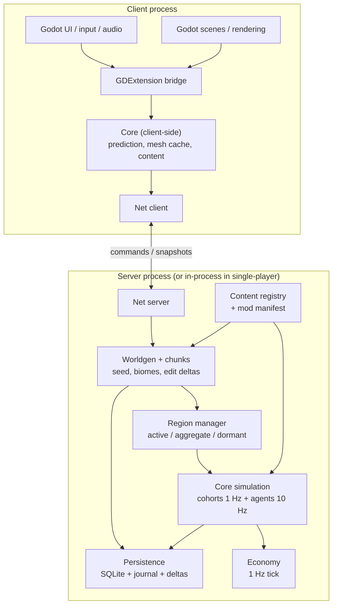
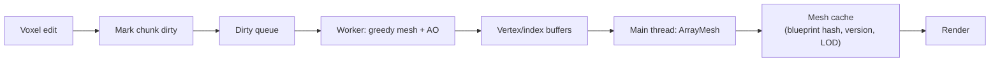

# 12 — Technical Architecture

This is the engineering view: modules, data flow, threading, saves, and the boundaries between the engine and the core. Design context is in [[02 - Game Design]]; voxel details in [[03 - Voxel and Scale]]; engine rationale in [[04 - Engine and Stack]].

> [!decision] D-003 / D-011 — Core + shell
> Godot 4 is the shell; a Rust core owns voxels, simulation, content, and saves. The core has no Godot dependencies. The bridge is coarse-grained and batch-oriented.

## 1. Principles

1. **The core is engine-agnostic.** No Godot types in `core`. It must build and test with `cargo test` alone.
2. **The server is authoritative.** Single-player runs the same server in-process. Clients send commands.
3. **Batch across the boundary.** Never call a native function per voxel or per citizen. Pass arrays and handles.
4. **Data drives content.** Materials, props, recipes, ages, and mods are data, not hard-coded match statements.
5. **Determinism where it matters.** Server authority removes the need for cross-platform lockstep; seeded RNG and stable ordering still matter for tests and replays.
6. **Measure before optimizing.** The Phase 0 spike sets the budgets; profiling, not intuition, decides.
7. **Docs and code move together.** A changed decision gets an ADR in [[10 - Decisions]].
8. **Rust is the primary language from Phase 0.** GDScript owns scenes/UI/glue; C++ is the fallback core language. Do not prototype the core in a scripting language and rewrite it.

## 2. System overview



### Process modes

| Mode | Client | Server |
|---|---|---|
| Single-player | Game process | Same process, local transport, same core |
| Listen server | Host game process | Host process, network transport |
| Dedicated | Game process | Headless server process |

The simulation code is identical in all three. Only the transport and the presence of rendering differ.

> [!important] Dedicated servers offload simulation, not rendering
> The client still draws the city. A dedicated server frees the client CPU from cohort/building/agent simulation and supports persistence/multiplayer, but it does not make the client GPU faster. A 1M city is expected to be **~30 FPS at 1080p on an RTX 3060-class client** even with a dedicated server; 60 FPS for ~100k. Server target: 4–8 cores, 16 GB RAM.

### World and region pipeline

```text
seed + generator version
  → worldgen (terrain, biomes, resources, wildlife spawns)
  → world chunks (256 m) streamed around players
  → region manager (512 m): active, aggregate, or dormant
  → simulation (cohorts, buildings, agents)
  → persistence (seed + edit deltas + dynamic state)
```

- **Worldgen** runs on worker threads, deterministic from the seed and content manifest. The world is **effectively infinite**; only visited/edited chunks are persisted.
- **Coordinates:** 64-bit integer chunk/world coordinates; rendering uses a floating origin rebased near the player to avoid `f32` precision loss.
- **Edit deltas** are applied over the procedural base when a chunk loads.
- **Region manager** decides which regions are active (near players), aggregate (nearby but no player), or dormant (no player, no ticks).
- **Dormant catch-up** advances a region statistically on activation; it is bounded and deterministic.
- **Clients** generate the same procedural base locally, then apply server deltas; they never generate authoritative state.

## 3. Modules

### Rust core (target crates)

| Crate | Responsibility | Key types |
|---|---|---|
| `core` | Public facade, shared math/types, errors | `World`, `Tick`, `Command`, `Event` |
| `core_voxel` | Chunks, palette, RLE, greedy meshing, blueprint I/O | `VoxelChunk`, `Blueprint`, `MeshBuffers` |
| `core_world` | Seed, noise, biomes, resources, wildlife spawns, chunk streaming, edit deltas | `WorldSeed`, `WorldChunk`, `Biome`, `EditDelta` |
| `core_region` | Region activation, dormant snapshots, catch-up | `Region`, `RegionState`, `CatchUp` |
| `core_content` | Content registry, schemas, mod manifests, hashes | `ContentId`, `Registry`, `ModManifest` |
| `core_i18n` | Translation tables, locale fallback, key/placeholder validation, language packs | `Locale`, `TranslationKey`, `TranslationTable` |
| `core_structure` | Material properties, structural systems, story/height/span/foundation validation | `StructuralSystem`, `StructureSpec`, `StructureSummary`, `StructureError` |
| `core_city` | Settlements, districts, buildings, construction sites, sub-ground levels, lots, roads, zoning, utilities, progression, research | `Settlement`, `District`, `BuildingInstance`, `ConstructionSite`, `ConstructionPhase`, `SubgradeLevel`, `RoadGraph`, `Age`, `TechTree`, `ResearchStore` |
| `core_sim` | ECS, cohorts, citizens, households, jobs, needs, production, time state | `Cohort`, `Citizen`, `Household`, `Job`, `Need`, `TimeState`, `TimeVote` |
| `core_living` | Trees, fields, livestock, wildlife populations | `Tree`, `Field`, `WildlifePopulation` |
| `core_econ` | Treasury, taxes, prices, trade, loans | `Treasury`, `Market`, `Loan` |
| `core_save` | SQLite schema, snapshots, migrations, journal | `SaveDb`, `Snapshot`, `Migration` |
| `core_net` | Protocol, commands, snapshots, validation hooks | `NetCommand`, `Snapshot`, `Manifest`, `TimeCommand` |
| `godot_ext` | GDExtension bindings, buffer conversion | `TownsmithCore`, `Node` wrappers |
| `server` | Headless server binary + protocol v0 framing/validation + first authoritative executor | `Session`, `ServerWorld`, `ClientCommand`, `ServerMessage` |
| `bench` | Fixed-scene benchmark runner, camera routes, frame metrics, JSON/compare | `BenchScene`, `CameraRoute`, `FrameStats` |
| `tools` | CLI: validate mods, inspect blueprints, run sims | `validate`, `inspect`, `bench` |

> [!tip] Start simpler
> Begin with one `core` crate and split only when the boundaries are stable. Premature crate splitting adds friction. The table is the target, not the first commit.

> [!note] Named citizens
> The plan for identity, selection, and materialization is in [[67 - Named Citizens]]. Identity and lifecycle live in the core; the shell presents only selected or materialized citizens and never drives their state.

### Godot shell (`game/`)

| Area | Responsibility |
|---|---|
| `scenes/` | Cameras, world root, lights, terrain, building renderers |
| `scenes/world/` | Chunk streaming, terrain LOD, vegetation, wildlife, resource nodes |
| `ui/` | Mayor HUD, district/region dashboards, overlays, library, build tool, budget, settings |
| `addons/townsmith_core/` | GDExtension binary + wrapper scripts |
| `assets/` | Base textures, UI, audio, fonts |
| `project.godot` | Input map, rendering settings, export presets |

**Rules**
- Scenes present state; they do not own simulation state.
- UI calls the extension through coarse methods; it does not iterate voxels.
- No gameplay logic in `_process` except presentation interpolation.
- The world root rebuilds from snapshots/events, not from scene-tree mutation by the core.

## 4. Data flow

### A command's journey

```text
Player input
  → Godot UI builds a Command (place building, paint voxels, set tax, edit terrain)
  → GDExtension validates shape and enqueues it
  → Transport sends it to the server (or local queue)
  → Server checks permission, content, cost, space, rules
  → Simulation applies it on the next tick
  → Event emitted (BuildingPlaced, TaxChanged, VoxelsEdited, TerrainEdited)
  → Clients receive the event or a snapshot delta
  → Godot updates the scene/UI
```

Time control follows the same path:

```text
Client requests pause/resume/speed/vote
  → Server checks time.control or an active time vote
  → Server updates TimeState
  → Event emitted (TimePaused, TimeResumed, SpeedChanged, TimeVoteStarted, TimeVoteResult)
  → Clients update HUD and simulation interpolation
```

### Why commands, not state

- The client cannot invent money, materials, or occupancy.
- The server can reject invalid actions with a reason.
- Replays are command logs + seed, which is compact and debuggable.
- Mods can hook commands/events without owning the network layer.

### Events

Events are immutable facts:

```rust
pub enum Event {
    BuildingPlaced { instance: InstanceId, blueprint: ContentHash, placement: Placement },
    BuildingRemoved { instance: InstanceId },
    VoxelsEdited { blueprint: ContentHash, version: u32, chunks: Vec<ChunkId> },
    TerrainEdited { chunk: WorldChunkId, delta: EditDelta },
    RegionActivated { region: RegionId },
    CitizenMovedIn { citizen: CitizenId, household: HouseholdId },
    ProductionCompleted { building: InstanceId, recipe: ContentId, amount: u32 },
    ResourceHarvested { region: RegionId, kind: ResourceKind, amount: u32 },
    WildlifeChanged { region: RegionId, species: ContentId, population: u32 },
    TaxRateChanged { zone: Zone, rate: f32 },
    UtilityShortage { kind: UtilityKind, buildings: Vec<InstanceId> },
}
```

- The UI, audio, scripts, and analytics consume events.
- Events are persisted in the journal for replay/debugging.

## 5. Threading model

| Thread | Owns | Rules |
|---|---|---|
| **Godot main** | Scene tree, UI, input, mesh upload | Never block on simulation; never mutate core state directly |
| **Simulation** | `World`, cohorts, regions, command queue | Active 10 Hz; cohorts 1 Hz; emits events/snapshots; no Godot calls |
| **Worldgen** | Seed-based terrain/chunks, edit-delta application | Deterministic; worker threads; results via channels |
| **Worker pool** | Meshing, pathfinding, utility updates, compression, dormant catch-up | Pure functions on copied data; results via channels |
| **Render** | Godot renderer | Consumes meshes/resources on the main thread |
| **Network** | Sockets, serialization | Own thread or async runtime; queues into sim |

### Rules

- **No Godot API calls from worker threads or the sim thread.** Only the main thread touches `Node`, `Resource`, `SceneTree`, and the rendering server.
- **Mesh pipeline:** core worker builds vertex/index buffers → main thread creates `ArrayMesh` (or `RenderingServer` mesh) → scene assigns it. Budget uploads per frame.
- **Phase 0 implementation:** `godot_ext` keeps a fixed pool of up to 4 Rust terrain workers. `request_terrain_chunk` queues work; `poll_terrain_chunk` converts finished `TerrainMesh` values to `ArrayMesh` on the main thread. No Godot type crosses the thread boundary.
- **Snapshots:** double-buffer; the render thread reads the latest completed snapshot while the sim writes the next.
- **Command queue:** bounded; backpressure to the client; never unbounded growth.
- **Shutdown:** stop accepting commands, drain the queue, flush the journal, then join threads.

> [!warning] Godot thread safety
> Godot's scene tree is not thread-safe. The most common bug in this architecture is a worker thread touching a `Node` or creating a `Resource` off-thread. Enforce the boundary in code review and with debug assertions.

## 6. Voxel and mesh pipeline



- **Dirty granularity:** a chunk, not the whole building.
- **Budget:** e.g., 4 ms/frame of meshing across workers, 2 ms/frame of upload.
- **Cache key:** `(blueprint_hash, version, lod, material_set_version)`.
- **Instancing:** repeated blueprint instances share a mesh; `MultiMeshInstance3D` per blueprint/LOD.
- **LOD:** generate downsampled meshes at 2×, 4×, 8×; impostors beyond the far threshold.
- **Eviction:** LRU cache with a memory cap; rebuild on demand.

## 7. Save and load

### Storage layout

```
save_001/
├── world.db            # SQLite: settlements, districts, roads, buildings, citizens, economy
├── world.db-wal        # write-ahead log
├── world.json          # seed, worldgen version, game version, content hash
├── deltas/
│   ├── terrain/        # per-chunk height/edit deltas
│   ├── resources/      # harvested trees, deposits, wildlife changes
│   └── regions/        # dormant-region statistical snapshots
├── blueprints/         # content-addressed .tsbp files
│   ├── ab/cd/abcd...tsbp
├── manifest.json       # game version, content hash, mod list
└── backups/
    └── save_001_2026-11-19_1200.zip
```

### SQLite tables (draft)

| Table | Key columns |
|---|---|
| `world` | id, seed, worldgen_version, game_time, speed, schema_version |
| `settlements` | id, name, center, soft_bounds_json |
| `districts` | id, settlement_id, bounds, population, happiness, jobs |
| `regions` | id, state (active/aggregate/dormant), last_tick, snapshot_blob |
| `terrain_deltas` | chunk_x, chunk_z, compressed_delta |
| `roads` | id, points, type, lanes |
| `lots` | id, polygon, zone, building_id, locked |
| `buildings` | id, blueprint_hash, version, transform, condition, inventory_json |
| `construction_sites` | id, blueprint_hash, transform, phase, progress, stockpile_json, blockers_json, priority |
| `subgrade_levels` | building_id, level, depth, use, access_json, waterproofing, ventilation |
| `citizens` | id, household_id, cohort_id, age, job_id, trade, health, happiness, needs_json |
| `households` | id, home_id, income, savings |
| `cohorts` | id, district_id, building_type, needs_band, count, averages_json |
| `jobs` | id, building_id, role, worker_id, wage |
| `living` | id, region_id, type, species, population, state_json |
| `economy` | id, treasury, tax_rates_json, loans_json |
| `mods` | id, version, hash, enabled |
| `events` | id, tick, type, payload_json (journal) |

- Blobs (voxels) live in `.tsbp` files, not SQLite.
- JSON columns are for flexible/modded state; hot fields get real columns.
- Writes are batched; do not commit per tick.
- Autosave uses a transaction + atomic rename; the journal covers the gap.

### Blueprint references

- `buildings.blueprint_hash` + `version` identifies the template.
- The library can live in the save, a shared folder, or a server cache.
- Missing blueprint on load → placeholder massing + warning; never delete the instance silently.

### Migrations

- `schema_version` in `world`.
- Migration functions run in order, inside a transaction, with a backup first.
- Content migrations (renamed material, removed prop) run through the registry.
- A failed migration aborts and leaves the original save intact.

## 8. Networking boundary

- **Protocol version** is explicit; mismatches are rejected.
- **Serialization:** `postcard` or `bincode` for compact messages; JSON only for debugging. Protocol v0 uses length-prefixed JSON so the first loopback transcripts are inspectable; compact binary encoding is still the target.
- **Transport:** Godot ENet for v1 co-op; a Rust QUIC/`quinn` transport is a later option.
- **Messages:** `Hello`, `Manifest`, `Command`, `CommandRejected`, `Snapshot`, `Event`, `Chat`, `Ping`.
- **Protocol v0 (foundation):** `crates/server/src/protocol.rs` implements length-prefixed JSON over TCP, the first command/snapshot set, stable validation codes, a deterministic loopback smoke (`townsmith-server --loopback-smoke`), and `--listen PORT` for the Godot `mp_client` smoke. It is transport-only and does not replace the production transport decision (Q-055).
- **Authoritative executor v0 (foundation):** `crates/server/src/world.rs (authoritative executor; dev roles/rate/audit)` (`townsmith_server::world::ServerWorld`) owns in-memory session state: seed, tick, static population/employed/buildings, `Economy`, `RoadStore`, per-session interest viewport, paused flag, and a session checksum. `apply_all(&ClientCommand) -> Vec<ServerMessage>` handles hello, ping, pause/resume/step, set_tax, place_road, set_interest, time votes, and disconnect; commands before hello are rejected with `not_hello`; speed actions are rejected with `time.invalid_action`. `apply` is the first-response convenience wrapper. `advance_day(dt_s)` runs one economy tick capped at `DAY_SECONDS` and increments the tick without sleeping. `snapshot()` returns tick, population, balance, a 16-hex FNV-1a checksum over tick/population/balance/road checksum/economy checksum, and the viewport envelope (`interest_center`, `interest_radius_m`, `visible_roads`); it is independent of the wall clock. `set_interest {center_x, center_z, radius_m}` is view-only: radius must be finite and within 0–2,048 m (`interest.radius_out_of_range`), the centre must be finite (`interest.invalid_center`), the viewport is excluded from the checksum and save, and `visible_roads` counts road midpoints inside the inclusive circle. A successful command answers with `snapshot` followed by `interest_view`, which carries at most `MAX_INTEREST_ROADS` (64) `RoadView { id, start, end, width_m }` entries, ascending by id, plus `truncated` when more matched. Viewer may set its own viewport; `SERVER_INTEREST status=ok center=0.0,0.0 radius=16.0 visible=1 roads=1 truncated=false tick=2 checksum=6d92be74bdbc11f5` is the loopback golden. Roads are axis-aligned, 1–512 cells, fixed 6 m wide, with stable `road.*` duplicate/overlap codes and a constant 40 m placeholder ground. The `--loopback-smoke` run also executes hello → set_tax → place_road → ping → resume → disconnect and prints `SERVER_AUTHORITY status=ok commands=6 checksum=70e25aff45867b94`. `crates/server/src/save.rs` adds a `ServerSave` v1 envelope with atomic tmp/fsync/rename, one-step `.bak` recovery, and optional autosave; `--listen PORT --save PATH --load PATH` serves the Godot `mp_client` smoke (15 frames). Dev-only roles (`viewer`/`mayor`/`admin`), a token bucket, and a 256-entry audit ring print `SERVER_ROLES ... checksum=b6ab299531341226`. **Limits:** one in-memory session; no authentication, content-manifest enforcement, entity/agent/terrain streaming, delta snapshots, reconnect, rollback, terrain sampling, or cost checks. Interest v0 filters the aggregate snapshot envelope and a bounded 64-road detail list; it does not activate or hide simulation state or stream any other entity kind. One save file with no journal/compression. The production transport decision (Q-055) is unchanged.
- **Validation:** every command is checked on the server (permission, content, cost, space, version).
- **Snapshots:** per-client AOI, delta-compressed, prioritized. v0 implements the viewport envelope plus static road details: `set_interest {center_x, center_z, radius_m}` (finite centre, radius 0–2,048 m) returns `Snapshot` (echoed viewport and aggregate `visible_roads`) followed by `InterestView` (at most 64 roads, ascending id, `truncated`). It never filters the simulation and is excluded from the checksum.
- **Backpressure:** bounded queues; drop/aggregate distant dynamic entities.
- **Reconnect:** session token, role/claims restoration, full snapshot.

Details: [[05 - Multiplayer]].

## 9. Content and modding boundary

- The **content registry** is loaded before the world. It validates IDs, schemas, and cross-references.
- Mods mount into a virtual filesystem; the core reads `mod://` through the registry, not raw paths.
- The base game uses the `base:` namespace; mods use their own.
- **Resource packs** are applied at the shell/render layer by material ID; the core never sees texture paths.
- **Scripts** run through a sandbox with a capability API; simulation-affecting scripts run on the server.
- **Content hash** is computed after loading and stored in the save/manifest.

Details: [[06 - Modding and Resource Packs]].

## 10. Rendering boundary

| Layer | Owns |
|---|---|
| Core | Voxel data, mesh buffers, LOD selection metadata, material IDs |
| Godot shell | `ArrayMesh`, `MultiMesh`, materials/shaders, lights, camera, post-processing |
| Resource packs | Texture arrays, material overrides, UI theme |

- The core produces **geometry**, not Godot resources.
- The shell maps material IDs to a texture array layer.
- The shell decides shadow casters, visibility ranges, and occlusion.
- No gameplay state in shaders.

## 11. Testing strategy

| Level | What | Tool |
|---|---|---|
| Unit | Voxel chunk, RLE, mesher, room detection, formulas | `cargo test` |
| Golden | Blueprint save/load roundtrip; mesh hash; save migration | Fixtures + hash compare |
| Worldgen | Same seed + mods + edits = same hash; chunk streaming | Headless runner |
| Simulation | Scenario: 500 citizens, 30 days, assert metrics | Headless runner |
| Cohorts | Compare cohort aggregates to a fully individual reference sim | Headless runner |
| 1M benchmark | 1M cohorts, 250k buildings, 2k active agents | Headless + `criterion` |
| Benchmark regression | Fixed early/mid/late scenes, fixed routes, 3-run median, baseline compare | `townsmith-bench` in CI |
| Time control | SP Mode B auto-pause; MP admin/vote; pause freezes sim but not editing | Headless server + 4-player test |
| Localization | Missing keys, placeholders, plural forms, German UI, language-pack override | Lint + pseudo-locale + screenshots |
| Construction | Phase progression, trade assignment, material stalls, pause/resume, save/load | Headless scenario + 4-player test |
| Structure | Height/span limits, load path, composite materials, service gates, modded materials | Golden structural cases + editor validation |
| Basements | Depth/water table, retaining walls, drainage, culling, save/load | Headless + editor scenario |
| Dormant catch-up | Leave a region for a year; compare to continuous sim | Headless runner |
| Living world | Forest regrowth, crop yields, wildlife under hunting pressure | Scenario tests |
| Performance | Mesh time, tick time, memory, draw calls | `criterion` + in-game overlay |
| Network | Latency/loss, reconnect, mod mismatch | Headless bots + `tc`/simulated transport |
| Integration | Godot scene loads, extension calls, export | CI + smoke test |
| Manual | Fun, readability, UX | Playtests |

- **Golden saves** catch accidental simulation changes.
- **Fuzz** voxel and command parsers.
- **Deterministic seeds** for reproducible tests.
- **No test depends on wall-clock time**; use a simulated clock.

### Test cadence

| Stage | Run |
|---|---|
| Inner loop | Tests for the changed crate/module only |
| Pre-PR | Affected crate tests + integration tests for touched boundaries |
| PR gate (CI) | Full workspace tests, headless smoke, relevant benchmark gate |
| Nightly | Full matrix, long simulation, benchmark suite |
| Release | Full suite + platform matrix + long-session/network tests |

- The full suite is required before merge; local selective runs are a speed optimization.
- A change to save/load, networking, security, or 1M-scale simulation always requires the broader suite.
- Docs-only changes run link/ID/frontmatter checks, not the game test suite.

## 12. Build and CI

### Workspace

```toml
[workspace]
members = [
  "crates/core",
  "crates/core_voxel",
  "crates/core_world",
  "crates/core_region",
  "crates/core_content",
  "crates/core_i18n",
  "crates/core_structure",
  "crates/core_city",
  "crates/core_sim",
  "crates/core_living",
  "crates/core_econ",
  "crates/core_save",
  "crates/core_net",
  "crates/godot_ext",
  "crates/server",
  "crates/bench",
  "crates/tools",
]
```

The Phase 0 scaffold currently contains `core_voxel`, `core_world`, `core_sim`, `server`, `bench`, `godot_ext`, and the `benchmarks/` harness; the remaining crates are added as their phases land.

### Local build commands

```bash
cargo test -p core_voxel
cargo test -p core_world
./scripts/check.sh
./scripts/build_godot_ext.sh
GODOT=/path/to/godot ./scripts/run_godot.sh
GODOT=/path/to/godot ./scripts/smoke_godot.sh
cargo run --release -p townsmith-bench -- 100
cargo run --release -p townsmith-bench --bin worldgen
cargo run --release -p townsmith-bench --bin cohort
cargo test -p townsmith-server
cargo run --release -p townsmith-server -- --cohorts 10000 --ticks 100
cargo run --release -p townsmith-server -- --loopback-smoke
cargo run --release -p townsmith-server -- --interest-smoke
cargo run --release -p townsmith-server -- --save-load-smoke
./scripts/bench_core.sh
GODOT=/path/to/godot ./scripts/bench_godot.sh 3 5
```

Requires Rust 1.94+ and Godot 4.7+. The GDExtension output is copied to `godot/bin/libtownsmith_core.so` and is not committed.

### Benchmark fixtures

```
benchmarks/
├── scenes/       # fixed .tsave scenes (early, mid, late)
├── routes/       # deterministic camera routes
├── settings/     # standard benchmark presets
├── baselines/    # per-hardware reference results
└── results/      # local/CI output (gitignored)
```

The `bench` crate loads the scene, applies settings, runs the fixed route, samples frame times, and writes JSON. It also supports a headless server mode with no rendering. See [[15 - Benchmarks]].

### CI pipeline

1. `cargo fmt --check`
2. `cargo clippy -- -D warnings`
3. `cargo test`
4. Build `godot_ext` for Linux and Windows
5. Godot headless import + smoke test
6. Export Linux and Windows builds
7. Build the dedicated server
8. Run the benchmark suite (thresholds fail the build)
9. Upload artifacts

### Version pinning

- Pin the Godot version, Rust toolchain (`rust-toolchain.toml`), and GDExtension API.
- Renovate/Dependabot for Rust crates, with a manual review gate.
- No nightly Rust unless a specific feature requires it and the team agrees.

## 13. Coding standards

### Rust

- `#![deny(unsafe_op_in_unsafe_fn)]`; minimize `unsafe`.
- `thiserror` for library errors; `anyhow` only in binaries/tools.
- No `unwrap`/`expect` in library code except proven invariants; return errors.
- `tracing` spans for tick, mesh, save, and network phases.
- Prefer data-oriented layouts (SoA) for hot simulation data.
- Keep public APIs small and documented; internal modules private.
- No Godot or windowing dependencies in `core`.

### GDScript

- Typed GDScript (`var x: int = 0`) everywhere.
- Small scenes; composition over deep inheritance.
- No gameplay logic in `_process`; presentation only.
- Signals for UI events; no direct cross-scene mutation.
- All user-facing strings go through the localization table.

### Data

- Every content file validates against a schema.
- IDs are lowercase, namespaced, and stable.
- No absolute paths; use content IDs.
- Version every schema; migrations are explicit.

### Git

- Small, focused commits.
- Reference the ADR/question ID in the message when relevant.
- Never commit generated binaries or large assets without LFS.
- Docs changes ship with code changes.

## 14. Observability

- **In-game debug overlay:** FPS, frame time, tick time, entity counts, draw calls, triangles, mesh queue depth, memory.
- **CSV metrics:** population, happiness, budget, pollution, traffic, housing, jobs (headless).
- **Replays:** seed + command log; reproduce bugs deterministically.
- **Crash logs:** stack trace, last commands, save version, mod list; opt-in upload.
- **Server logs:** joins/leaves, admin actions, rejected commands, save/backup events.

## 15. Security

- Server validates all commands; clients are untrusted.
- Rate-limit commands per player.
- Validate voxel edit bounds, palette indices, and blueprint size.
- Sanitize mod manifests and paths; prevent path traversal.
- Sandbox mod scripts; no filesystem/network access.
- Never auto-download native mods.
- Hash and verify content manifests.
- Back up before migrations and destructive admin actions.

## 16. Open technical questions

- **Q-053:** One `core` crate first, or the full crate split from day one? (Recommendation: one crate first.)
- **Q-054:** `bevy_ecs` standalone or a custom SoA simulation layout? (Recommendation: `bevy_ecs` first, profile later.)
- **Q-055:** Godot ENet or a Rust QUIC transport for v1 multiplayer? (Recommendation: ENet first.)
- **Q-056:** SQLite for all state, or a binary snapshot for hot simulation data? (Recommendation: SQLite for structured state, binary for snapshots if needed.)
- **Q-057:** Mesh upload on the main thread or via `RenderingServer` from a worker? (Measure in the spike.)
- **Q-058:** How are blueprint overrides stored: new version or per-instance diff? (Recommendation: new version for shared edits; per-instance diff for live tweaks.)
- **Q-062:** What hardware defines the 1M benchmark?
- **Q-064:** Is cohort simulation acceptable for most of the 1M population?
- **Q-071:** Is terrain editing 1 m, or 10 cm near the player?
- **Q-072:** How moddable is worldgen, and can mods replace the generator?
- **Q-073:** Are three benchmark scenes enough at launch?
- **Q-074:** Should benchmark results be shareable/uploaded?
- **Q-075:** Standard preset vs current settings as the default?
- **Q-076:** Benchmark route length and warm-up.
- **Q-077:** Modded benchmark scenes at launch?
- **Q-078:** Time-vote duration, cooldown, and quorum tuning.
- **Q-079–Q-082:** Additional languages, voiceover, translation workflow, server log language.
- **Q-083–Q-089:** Construction management depth, workforce model, partial occupancy, roads/utilities crews, delivery visibility, time scale, expedite.
- **Q-090–Q-096:** Structural validation depth, story/height targets, roof counting, material mixing, glass facades, service gates, modded material migration.
- **Q-097–Q-100:** Basement scope/depth/groundwater, underground parking, tunnels.

See [[09 - Open Questions]] and [[10 - Decisions]].

Reconnect state lives in `ServerWorld` (`session_token`, 300-tick grace window, `Resume`) and is deliberately excluded from the world checksum. The save file restores the world state but not a resumable connection.
Time-control votes live in `crates/server/src/vote.rs`; the pure state machine is deterministic and the world applies a passed pause/resume once. Protocol framing/authority remain in `protocol.rs`/`world.rs`.

The Godot protocol client includes a bounded flat road preview (`godot/mp_interest_render.gd`, `mp_interest_canvas.gd`) for `interest_view`; it is a debug visualization, not the world renderer.
