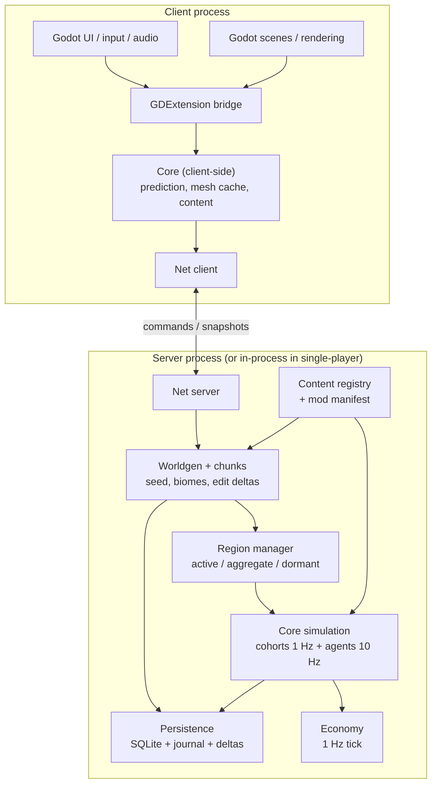
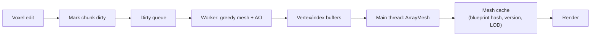

# 12 — Technical Architecture

This is the engineering view: modules, data flow, threading, saves, and the boundaries between the engine and the core. Design context is in [[02 - Game Design]]; voxel details in [[03 - Voxel and Scale]]; engine rationale in [[04 - Engine and Stack]].

> [!decision] D-003 / D-011 — Core + shell
> Godot 4 is the shell; a Rust core owns voxels, simulation, content, and saves. The core has no Godot dependencies. The bridge is coarse-grained and batch-oriented.

## 1. Principles

1. **The core is engine-agnostic.** No Godot types in `core`. It must build and test with `cargo test` alone.
2. **The server is authoritative.** Single-player runs the same server in-process. Clients send commands.
3. **Batch across the boundary.** Never call a native function per voxel or per citizen. Pass arrays and handles.
4. **Data drives content.** Materials, props, recipes, ages, and mods are data, not hard-coded match statements.
5. **Determinism where it matters.** Server authority removes the need for cross-platform lockstep; seeded RNG and stable ordering still matter for tests and replays.
6. **Measure before optimizing.** The Phase 0 spike sets the budgets; profiling, not intuition, decides.
7. **Docs and code move together.** A changed decision gets an ADR in [[10 - Decisions]].
8. **Rust is the primary language from Phase 0.** GDScript owns scenes/UI/glue; C++ is the fallback core language. Do not prototype the core in a scripting language and rewrite it.

## 2. System overview



### Process modes

| Mode | Client | Server |
|---|---|---|
| Single-player | Game process | Same process, local transport, same core |
| Listen server | Host game process | Host process, network transport |
| Dedicated | Game process | Headless server process |

The simulation code is identical in all three. Only the transport and the presence of rendering differ.

> [!important] Dedicated servers offload simulation, not rendering
> The client still draws the city. A dedicated server frees the client CPU from cohort/building/agent simulation and supports persistence/multiplayer, but it does not make the client GPU faster. A 1M city is expected to be **~30 FPS at 1080p on an RTX 3060-class client** even with a dedicated server; 60 FPS for ~100k. Server target: 4–8 cores, 16 GB RAM.

### World and region pipeline

```text
seed + generator version
  → worldgen (terrain, biomes, resources, wildlife spawns)
  → world chunks (256 m) streamed around players
  → region manager (512 m): active, aggregate, or dormant
  → simulation (cohorts, buildings, agents)
  → persistence (seed + edit deltas + dynamic state)
```

- **Worldgen** runs on worker threads, deterministic from the seed and content manifest. The world is **effectively infinite**; only visited/edited chunks are persisted.
- **Coordinates:** 64-bit integer chunk/world coordinates; rendering uses a floating origin rebased near the player to avoid `f32` precision loss.
- **Edit deltas** are applied over the procedural base when a chunk loads.
- **Region manager** decides which regions are active (near players), aggregate (nearby but no player), or dormant (no player, no ticks).
- **Dormant catch-up** advances a region statistically on activation; it is bounded and deterministic.
- **Clients** generate the same procedural base locally, then apply server deltas; they never generate authoritative state.

## 3. Modules

### Rust core (target crates)

| Crate | Responsibility | Key types |
|---|---|---|
| `core` | Public facade, shared math/types, errors | `World`, `Tick`, `Command`, `Event` |
| `core_voxel` | Chunks, palette, RLE, greedy meshing, blueprint I/O | `VoxelChunk`, `Blueprint`, `MeshBuffers` |
| `core_world` | Seed, noise, biomes, resources, wildlife spawns, chunk streaming, edit deltas | `WorldSeed`, `WorldChunk`, `Biome`, `EditDelta` |
| `core_region` | Region activation, dormant snapshots, catch-up | `Region`, `RegionState`, `CatchUp` |
| `core_content` | Content registry, schemas, mod manifests, hashes | `ContentId`, `Registry`, `ModManifest` |
| `core_i18n` | Translation tables, locale fallback, key/placeholder validation, language packs | `Locale`, `TranslationKey`, `TranslationTable` |
| `core_structure` | Material properties, structural systems, story/height/span/foundation validation | `StructuralSystem`, `StructureSpec`, `StructureSummary`, `StructureError` |
| `core_city` | Settlements, districts, buildings, construction sites, sub-ground levels, lots, roads, zoning, utilities, progression, research | `Settlement`, `District`, `BuildingInstance`, `ConstructionSite`, `ConstructionPhase`, `SubgradeLevel`, `RoadGraph`, `Age`, `TechTree`, `ResearchStore` |
| `core_sim` | ECS, cohorts, citizens, households, jobs, needs, production, time state | `Cohort`, `Citizen`, `Household`, `Job`, `Need`, `TimeState`, `TimeVote` |
| `core_living` | Trees, fields, livestock, wildlife populations | `Tree`, `Field`, `WildlifePopulation` |
| `core_econ` | Treasury, taxes, prices, trade, loans | `Treasury`, `Market`, `Loan` |
| `core_save` | SQLite schema, snapshots, migrations, journal | `SaveDb`, `Snapshot`, `Migration` |
| `core_net` | Protocol, commands, snapshots, validation hooks | `NetCommand`, `Snapshot`, `Manifest`, `TimeCommand` |
| `godot_ext` | GDExtension bindings, buffer conversion | `TownsmithCore`, `Node` wrappers |
| `server` | Headless server binary + protocol v1 framing/validation + authoritative executor + server-owned blueprint placement | `Session`, `ServerWorld`, `ClientCommand`, `ServerMessage`, `PlacementView` |
| `bench` | Fixed-scene benchmark runner, camera routes, frame metrics, JSON/compare | `BenchScene`, `CameraRoute`, `FrameStats` |
| `tools` | CLI: validate mods, inspect blueprints, run sims | `validate`, `inspect`, `bench` |

> [!tip] Start simpler
> Begin with one `core` crate and split only when the boundaries are stable. Premature crate splitting adds friction. The table is the target, not the first commit.

> [!note] Named citizens
> The plan for identity, selection, and materialization is in [[67 - Named Citizens]]. Identity and lifecycle live in the core; the shell presents only selected or materialized citizens and never drives their state.

### Godot shell (`game/`)

| Area | Responsibility |
|---|---|
| `scenes/` | Cameras, world root, lights, terrain, building renderers |
| `scenes/world/` | Chunk streaming, terrain LOD, vegetation, wildlife, resource nodes |
| `ui/` | Mayor HUD, district/region dashboards, overlays, library, build tool, budget, settings |
| `addons/townsmith_core/` | GDExtension binary + wrapper scripts |
| `assets/` | Base textures, UI, audio, fonts |
| `project.godot` | Input map, rendering settings, export presets |

**Rules**
- Scenes present state; they do not own simulation state.
- UI calls the extension through coarse methods; it does not iterate voxels.
- No gameplay logic in `_process` except presentation interpolation.
- The world root rebuilds from snapshots/events, not from scene-tree mutation by the core.

## 4. Data flow

### A command's journey

```text
Player input
  → Godot UI builds a Command (place building, paint voxels, set tax, edit terrain)
  → GDExtension validates shape and enqueues it
  → Transport sends it to the server (or local queue)
  → Server checks permission, content, cost, space, rules
  → Simulation applies it on the next tick
  → Event emitted (BuildingPlaced, TaxChanged, VoxelsEdited, TerrainEdited)
  → Clients receive the event or a snapshot delta
  → Godot updates the scene/UI
```

Time control follows the same path:

```text
Client requests pause/resume/speed/vote
  → Server checks time.control or an active time vote
  → Server updates TimeState
  → Event emitted (TimePaused, TimeResumed, SpeedChanged, TimeVoteStarted, TimeVoteResult)
  → Clients update HUD and simulation interpolation
```

### Blueprint placement (accepted and implemented, D-032)

`place_blueprint` is the authoritative multiplayer placement path (protocol v1, #306). The Phase 2 bridge `world_place_blueprint` remains the single-player/dev path: it loads the `.tsbp`, applies the district policy gate, validates terrain, appends to the local `PlacementStore`, creates the construction site, and charges the local treasury. The server keeps its own placement and construction stores, so a multiplayer placement reaches the ledger, save, and checksum.

The server flow is:

```text
Client ghost preview (world_validate_placement, prediction only)
  → place_blueprint { blueprint_hash, x, z, rotation }
  → Server: role → package hash/size → seed/age → terrain/overlap
      → district policy (smallest containing id) → D-028 charge → record
  → place_blueprint_result { tick, placement_id, blueprint_hash, placement_checksum, world_checksum, placement }
  → the placing client updates from the result; other clients do not yet receive placement events or snapshots
```

The server owns the placement record, save entry, and checksum; clients may predict but never commit. The command resolves the hash in a pre-seeded content-addressed library and uses the server's deterministic placeholder ground and JSON policy registry; there is no upload, fetch, or auto-download. Protocol v1 is the current version; a client that announces version 0 is rejected by the version gate. The bridge remains the single-player/dev placement path and does not call the server.

### Settlement permissions (proposed, D-033)

Settlement ownership is not in the authority path yet. `Settlement.owner` is a free-form string in the client bridge's `SettlementStore`; the authoritative `ServerWorld` has no settlement store, and protocol v1 has no settlement command. `owner_at` is a spatial lookup for display and district queries, not an authorization boundary.

D-033 proposes the missing boundary:

```text
Client command (placement, policy edit, tax, settlement management)
  → server resolves the settlement for the command centre
      (inclusive radius, nearest centre, lower id on a tie)
  → global role ceiling (viewer / mayor / admin)
  → settlement membership + permission (build / manage / tax / members)
  → admin override, or reject settlement.forbidden / settlement.unowned
```

A global role is a ceiling, not a grant: a Manager cannot use a settlement permission they do not have, and a Builder cannot exceed the global role. Single-player and local dev treat the local player as the implicit owner, so the current path is unchanged. Today no placement, policy, tax, or settlement mutation passes through this flow; the bridge remains the local implementation.

### Why commands, not state

- The client cannot invent money, materials, or occupancy.
- The server can reject invalid actions with a reason.
- Replays are command logs + seed, which is compact and debuggable.
- Mods can hook commands/events without owning the network layer.

### Events

Events are immutable facts:

```rust
pub enum Event {
    BuildingPlaced { instance: InstanceId, blueprint: ContentHash, placement: Placement },
    BuildingRemoved { instance: InstanceId },
    VoxelsEdited { blueprint: ContentHash, version: u32, chunks: Vec<ChunkId> },
    TerrainEdited { chunk: WorldChunkId, delta: EditDelta },
    RegionActivated { region: RegionId },
    CitizenMovedIn { citizen: CitizenId, household: HouseholdId },
    ProductionCompleted { building: InstanceId, recipe: ContentId, amount: u32 },
    ResourceHarvested { region: RegionId, kind: ResourceKind, amount: u32 },
    WildlifeChanged { region: RegionId, species: ContentId, population: u32 },
    TaxRateChanged { zone: Zone, rate: f32 },
    UtilityShortage { kind: UtilityKind, buildings: Vec<InstanceId> },
}
```

- The UI, audio, scripts, and analytics consume events.
- Events are persisted in the journal for replay/debugging.

## 5. Threading model

| Thread | Owns | Rules |
|---|---|---|
| **Godot main** | Scene tree, UI, input, mesh upload | Never block on simulation; never mutate core state directly |
| **Simulation** | `World`, cohorts, regions, command queue | Active 10 Hz; cohorts 1 Hz; emits events/snapshots; no Godot calls |
| **Worldgen** | Seed-based terrain/chunks, edit-delta application | Deterministic; worker threads; results via channels |
| **Worker pool** | Meshing, pathfinding, utility updates, compression, dormant catch-up | Pure functions on copied data; results via channels |
| **Render** | Godot renderer | Consumes meshes/resources on the main thread |
| **Network** | Sockets, serialization | Own thread or async runtime; queues into sim |

### Rules

- **No Godot API calls from worker threads or the sim thread.** Only the main thread touches `Node`, `Resource`, `SceneTree`, and the rendering server.
- **Mesh pipeline:** core worker builds vertex/index buffers → main thread creates `ArrayMesh` (or `RenderingServer` mesh) → scene assigns it. Budget uploads per frame.
- **Phase 0 implementation:** `godot_ext` keeps a fixed pool of up to 4 Rust terrain workers. `request_terrain_chunk` queues work; `poll_terrain_chunk` converts finished `TerrainMesh` values to `ArrayMesh` on the main thread. No Godot type crosses the thread boundary.
- **Snapshots:** double-buffer; the render thread reads the latest completed snapshot while the sim writes the next.
- **Command queue:** bounded; backpressure to the client; never unbounded growth.
- **Shutdown:** stop accepting commands, drain the queue, flush the journal, then join threads.

> [!warning] Godot thread safety
> Godot's scene tree is not thread-safe. The most common bug in this architecture is a worker thread touching a `Node` or creating a `Resource` off-thread. Enforce the boundary in code review and with debug assertions.

## 6. Voxel and mesh pipeline



- **Dirty granularity:** a chunk, not the whole building.
- **Budget:** e.g., 4 ms/frame of meshing across workers, 2 ms/frame of upload.
- **Cache key:** `(blueprint_hash, version, lod, material_set_version)`.
- **Instancing:** repeated blueprint instances share a mesh; `MultiMeshInstance3D` per blueprint/LOD.
- **LOD:** generate downsampled meshes at 2×, 4×, 8×; impostors beyond the far threshold.
- **Eviction:** LRU cache with a memory cap; rebuild on demand.

## 7. Save and load

### Storage layout

```
save_001/
├── world.db            # SQLite: settlements, districts, roads, buildings, citizens, economy
├── world.db-wal        # write-ahead log
├── world.json          # seed, worldgen version, game version; content identity when a pack is active (D-034)
├── deltas/
│   ├── terrain/        # per-chunk height/edit deltas
│   ├── resources/      # harvested trees, deposits, wildlife changes
│   └── regions/        # dormant-region statistical snapshots
├── blueprints/         # content-addressed .tsbp files
│   ├── ab/cd/abcd...tsbp
├── manifest.json       # game version, content hash, mod list
└── backups/
    └── save_001_2026-11-19_1200.zip
```

### SQLite tables (draft)

| Table | Key columns |
|---|---|
| `world` | id, seed, worldgen_version, game_time, speed, schema_version |
| `settlements` | id, name, center, soft_bounds_json |
| `districts` | id, settlement_id, bounds, population, happiness, jobs |
| `regions` | id, state (active/aggregate/dormant), last_tick, snapshot_blob |
| `terrain_deltas` | chunk_x, chunk_z, compressed_delta |
| `roads` | id, points, type, lanes |
| `lots` | id, polygon, zone, building_id, locked |
| `buildings` | id, blueprint_hash, version, transform, condition, inventory_json |
| `construction_sites` | id, blueprint_hash, transform, phase, progress, stockpile_json, blockers_json, priority |
| `subgrade_levels` | building_id, level, depth, use, access_json, waterproofing, ventilation |
| `citizens` | id, household_id, cohort_id, age, job_id, trade, health, happiness, needs_json |
| `households` | id, home_id, income, savings |
| `cohorts` | id, district_id, building_type, needs_band, count, averages_json |
| `jobs` | id, building_id, role, worker_id, wage |
| `living` | id, region_id, type, species, population, state_json |
| `economy` | id, treasury, tax_rates_json, loans_json |
| `mods` | id, version, hash, enabled |
| `events` | id, tick, type, payload_json (journal) |

- D-033's core model adds `owner_id`, `members`, and `membership_revision` to the settlement record in `core_city` (lazy v2 save upgrade). The bridge world JSON still writes only `owner`, a display string, until the bridge slice wires the new fields.
- Blobs (voxels) live in `.tsbp` files, not SQLite.
- JSON columns are for flexible/modded state; hot fields get real columns.
- Writes are batched; do not commit per tick.
- Autosave uses a transaction + atomic rename; the journal covers the gap.

### Blueprint references

- `buildings.blueprint_hash` + `version` identifies the template.
- The library can live in the save, a shared folder, or a server cache.
- Missing blueprint on load → placeholder massing + warning; never delete the instance silently.

### Server placement persistence (D-032, accepted v1)

D-032 is accepted and implemented (#306, master `61449ce`). Persistence follows these defaults:

- **Optional fields.** `ServerSave` gains optional `placements` and `construction` members. Both use serde defaults, so a save written without them loads with empty stores and no destructive migration. The envelope stays load-compatible; there is no migration beyond load-old/ignore-missing.
- **Record.** A placement stores id, `blueprint_hash`, centre (`x`, `z`), rotation, footprint/bounds/foundation, material cost, resident capacity/jobs, and its construction state. The record is included in the world checksum and returned to the placing client. The authoritative `blueprint_path` field holds the content-addressed reference `tsbp:blake3:<hex>`, so the server library root and other process configuration never enter the save, checksum, or wire `PlacementView`; the bridge/world save still records absolute package paths.
- **Library root.** The server starts with an explicit absolute content-addressed `.tsbp` library root and resolves `blueprint_hash` there. The save stores hashes, not package paths; v1 has no upload, fetch, auto-download, or package transfer.
- **Protocol v1.** `place_blueprint { blueprint_hash, x, z, rotation }` and `place_blueprint_result { tick, placement_id, blueprint_hash, placement_checksum, world_checksum, placement }` are the v1 pair and the current protocol version. A client that announces version 0 is version-gated.
- **Idempotency and limits.** Exact placement identity (hash + centre + rotation) is the idempotency key; a repeat returns the existing record without a second charge. The existing per-session token bucket and audit ring apply. Per-player quotas, rollback, history, and GC are not v1.
- **Policy and terrain.** The district policy registry is server-configured JSON loaded at startup and is not persisted in `ServerSave`; a missing or foreign-seed registry is neutral. Terrain validation uses the deterministic placeholder ground (the road constant) until the server streams terrain; the local preview keeps full terrain sampling.
- **Bridge.** The local `world_place_blueprint` remains the single-player/dev path and is not removed. There is no full Godot placement UI, per-settlement permission, package upload/fetch, demolition, or refund in v1; the #309 debug 3D world client has an opt-in single-hash `place_blueprint` path (no ghost preview, prediction, or rollback). `interest_view.buildings` is placement-backed whenever a non-empty placement store exists and falls back to the synthetic fixture otherwise, with no completion-aware filtering (in-progress sites are included).

### Content identity (D-034, accepted; bridge v1)

Implemented at the bridge level (2026-11-23). `world.json` stays base-only and outer `format_version: 1` unless one `content_load_dir` pack is live; then it is outer `format_version: 2` with one optional top-level object:

```json
"content": {
  "format_version": 1,
  "pack_id": "example:copper_age",
  "pack_checksum": "ad4c645869a411ed",
  "registry_checksum": "330a538d07805b50"
}
```

- **Base-only saves omit it** and stay outer `format_version: 1` and byte-identical. A save written with a live pack uses outer `format_version: 2`; an older reader rejects v2 with its unsupported-version error instead of silently loading base content.
- **Load verification runs before store construction or any `.tsbp` load**, immediately after the save JSON is read. The active pack ID, pack checksum, and merged registry checksum must match; missing or changed packs return a stable `content_*` code and leave live state untouched. A v2 match is normalized to v1 in memory (remove `content`, set `format_version: 1`) for the existing parsers; the file is not rewritten.
- **One pack only.** The object describes the single `content_load_dir` pack merged after base, not a list or load order. `content_multiple_packs_unsupported` blocks save/load if the registry ever reports more than one.
- **Identity survives a load/save cycle.** A content-bound world cannot be saved without its pack or with a different pack; unpinning is an explicit content migration (Q-118), not a normal save. A legacy v1 save loaded with a pack is allowed as `legacy_unbound` and pinned on its next save.
- **No auto-download, no substitution.** `--accept-missing-content` is not implemented; the reserved bridge `world_load_content_checked(..., true)` returns `content_degraded_unsupported` (Q-117).
- Per-blueprint hashes and `dependencies.mods` remain separate; the world object is the coarse pack gate, not a per-ID reference list.

`ServerSave` still has no content-manifest enforcement; when the server carries content-bound placements, it should reuse this object instead of inventing a second identity.

### Migrations

- `schema_version` in `world`.
- Migration functions run in order, inside a transaction, with a backup first.
- Content migrations (renamed material, removed prop) run through the registry.
- A failed migration aborts and leaves the original save intact.

## 8. Networking boundary

- **Protocol version** is explicit; mismatches are rejected.
- **Serialization:** `postcard` or `bincode` for compact messages; JSON only for debugging. Protocol v1 uses length-prefixed JSON so the first loopback transcripts are inspectable; compact binary encoding is still the target.
- **Transport:** Godot ENet for v1 co-op; a Rust QUIC/`quinn` transport is a later option.
- **Messages:** `Hello`, `Manifest`, `Command`, `CommandRejected`, `Snapshot`, `Event`, `Chat`, `Ping`.
- **Protocol v1 (foundation):** `crates/server/src/protocol.rs` implements length-prefixed JSON over TCP, the command/snapshot set, stable validation codes, a deterministic loopback smoke (`townsmith-server --loopback-smoke`), and `--listen PORT [--sessions N]` for the Godot `mp_client` smoke, including the session-resume path. Protocol v1 adds `place_blueprint`; the transport-only reference session still rejects it with `PLACEMENT_UNAVAILABLE`. It does not replace the production transport decision (Q-055).
- **Authoritative executor v1 (foundation):** `crates/server/src/world.rs (authoritative executor; dev roles/rate/audit)` (`townsmith_server::world::ServerWorld`) owns in-memory session state: seed, tick, static population/employed/buildings, `Economy`, `RoadStore`, per-session interest viewport, paused flag, and a session checksum. `apply_all(&ClientCommand) -> Vec<ServerMessage>` handles hello, ping, pause/resume/step, set_tax, place_road, place_blueprint, set_interest, time votes, and disconnect; commands before hello are rejected with `not_hello`; speed actions are rejected with `time.invalid_action`. `apply` is the first-response convenience wrapper. `advance_day(dt_s)` runs one economy tick capped at `DAY_SECONDS` and increments the tick without sleeping. `snapshot()` returns tick, population, balance, a 16-hex FNV-1a checksum over tick/population/balance/road checksum/economy checksum, and the viewport envelope (`interest_center`, `interest_radius_m`, `visible_roads`); it is independent of the wall clock. `set_interest {center_x, center_z, radius_m}` is view-only: radius must be finite and within 0–2,048 m (`interest.radius_out_of_range`), the centre must be finite (`interest.invalid_center`), the viewport is excluded from the checksum and save, and `visible_roads` counts road midpoints inside the inclusive circle. A successful command answers with `snapshot` followed by `interest_view`, which carries at most `MAX_INTEREST_ROADS` (64) `RoadView { id, start, end, width_m }` entries, ascending by id, plus `truncated` when more matched. It also carries at most `MAX_INTEREST_BUILDINGS` (64) `BuildingView { id, center, radius_m }` records, ascending by id, filtered by the same inclusive circle over their centres, plus `buildings_truncated` when more matched; when a non-empty authoritative placement store exists these are placement-backed (`id`, `[center.x, center.z]`, radius half the larger footprint) and include in-progress construction sites because completion is not modelled in v1, while a missing or empty store keeps the deterministic synthetic fixtures derived from the static completed-building count (16 columns, 64 m spacing, 8 m render hint), not authoritative footprints. Viewer may set its own viewport; `SERVER_INTEREST status=ok center=0.0,0.0 radius=16.0 visible=1 roads=1 truncated=false buildings=1 buildings_truncated=false tick=2 checksum=6d92be74bdbc11f5` is the loopback golden. Roads are axis-aligned, 1–512 cells, fixed 6 m wide, with stable `road.*` duplicate/overlap codes and a constant 40 m placeholder ground. The `--loopback-smoke` run also executes hello → set_tax → place_road → ping → resume → disconnect and prints `SERVER_AUTHORITY status=ok commands=6 checksum=70e25aff45867b94`. `crates/server/src/save.rs` adds a `ServerSave` v1 envelope with atomic tmp/fsync/rename, one-step `.bak` recovery, and optional autosave; `--listen PORT --save PATH --load PATH [--sessions N]` serves the Godot `mp_client` smoke (15 frames) and its `--reconnect` resume path (`--sessions 2`); `--once` is the `--sessions 1` shorthand. Dev-only roles (`viewer`/`mayor`/`admin`), a token bucket, and a 256-entry audit ring print `SERVER_ROLES ... checksum=b6ab299531341226`. **Limits:** one in-memory world; the shared model supports concurrent per-connection sessions, while `--listen` serves one socket at a time. `resume` is a 300-tick, process-local window whose token is not authentication, so reconnect state is not saved and does not survive a restart. No content-manifest enforcement, entity/agent/terrain streaming, delta snapshots, rollback, or terrain sampling; placement cost checks use the package metadata. Interest v1 filters the aggregate snapshot envelope and bounded 64-road and 64-building detail lists (building records are placement-backed when a non-empty placement store exists and synthetic otherwise, with no completion-aware filtering); it does not activate or hide simulation state or stream any other entity kind. One save file with no journal/compression. The production transport decision (Q-055) is unchanged.
- **Validation:** every command is checked on the server (permission, content, cost, space, version).
- **Placement authority (accepted and implemented, D-032):** protocol v1 includes `place_blueprint { blueprint_hash, x, z, rotation }`, and the authoritative executor owns the placement and construction stores. The server resolves the hash in its own pre-seeded content-addressed `.tsbp` library (no upload/fetch/auto-download), validates the global Mayor role, package/seed/age/placeholder terrain/overlap and the JSON policy gate, charges D-028 through the ledger, and owns the record, save entry, and checksum. Clients may predict a preview but never commit; `world_place_blueprint` remains a client bridge path. The **#309 debug 3D world client** (`godot/mp_world_client.tscn`, `--place-hash`) sends one operator-configured hash, validates `place_blueprint_result`, and renders one authoritative box; it has no ghost preview, prediction, rollback, upload/fetch, or full placement UI, and the server library must be pre-seeded (`SERVER_PLACEMENT_FIXTURE` seeds the smoke). Placements and construction are optional `ServerSave` fields; idempotency is exact placement identity; interest building records are placement-backed when a non-empty placement store exists and synthetic otherwise, with no completion-aware filtering, and there is no upload/fetch, per-settlement permission, demolition, or refund in v1.
- **Settlement authority (proposed, D-033):** protocol v1 has no settlement command and the server has no settlement store. D-033 would check `build`, `manage`, `tax`, and `members` per settlement on the authoritative path, with the global role as a ceiling, an admin override, and an implicit owner in single-player/dev. Today `owner` is a display string and no permission check exists.
- **Snapshots:** per-client AOI, delta-compressed, prioritized. v1 implements the viewport envelope plus static road details: `set_interest {center_x, center_z, radius_m}` (finite centre, radius 0–2,048 m) returns `Snapshot` (echoed viewport and aggregate `visible_roads`) followed by `InterestView` (at most 64 roads and 64 building records that are placement-backed when a non-empty placement store exists and synthetic otherwise, ascending id, `truncated` and `buildings_truncated`). It never filters the simulation and is excluded from the checksum.
- **Preview harnesses:** `godot/mp_interest_canvas.gd` draws the same road list in 2D, and `godot/interest_preview.tscn` (+ `interest_preview.gd`) draws one payload in 3D with a ground plane, ring, centre marker, one `MultiMesh` for roads, and an optional second `MultiMesh` for bounded building records (one box per building at its centre, footprint from `radius_m`). Both preload `godot/mp_interest_render.gd` for road parsing, the 64-road cap, and the 16-hex road checksum. `./scripts/smoke_interest_preview.sh` runs the 3D scene twice headlessly and requires identical markers (`INTEREST_PREVIEW status=ok roads=64 instances=64 truncated=false checksum=…`, plus zero/synthetic/over-cap building probes). Neither standalone harness is client render integration, the multiplayer render gate, or a benchmark gate; the viewport is still view-only and the server owns filtering.
- **Debug 3D world client (render integration):** `godot/mp_world_client.tscn` (+ `mp_world_client.gd`) connects to `townsmith-server --listen PORT --sessions 1`, sends `hello`, six deterministic `place_road` commands, and `set_interest {center 0,0, radius 96 m}`, then draws the received `interest_view` in 3D at 1 unit = 1 m: ground plane, world-aligned grid and axes, interest ring, one `MultiMesh` box per road at its midpoint, one box per bounded building record, and a HUD with tick/population/balance/counts/truncation/checksum. It reuses `mp_interest_render.gd` for roads and adds defensive building parsing, a separate 16-hex building checksum, and CPU-side transform mirrors for headless assertions. `./scripts/smoke_mp_world_client.sh` runs two fresh servers and requires identical markers: `MP_WORLD_CLIENT status=ok tick=6 population=3277 balance=100000 roads=6 buildings=4 truncated=false buildings_truncated=false checksum=6a238e448b0d0d76 …`, a zero-view probe (`MP_WORLD_CLIENT_ZERO ... roads=0 buildings=0 ... center=32.0,32.0 radius=16.0`), and `MP_WORLD_CLIENT_DONE ... frames_sent=10 frames_received=12`. An opt-in `--place-hash` run (#309) sends one `place_blueprint` after the zero-view probe, asserts `place_blueprint_result`, renders the authoritative placement box, and exchanges eleven commands/thirteen responses (`MP_PLACEMENT status=ok id=1 … tick=7`; `MP_PLACEMENT_SMOKE status=ok runs=2 … commands=11`); the default flow stays ten/twelve. This is a debug client only: no ghost preview, prediction/interpolation, rollback, full placement UI, terrain/chunk/entity/agent streaming, delta snapshots, or reconnect/resume (the existing `mp_client --reconnect` path covers resume). It does not change the server/protocol and is not the production renderer, the multiplayer UI, the 1M render gate, or a benchmark.
- **Backpressure:** bounded queues; drop/aggregate distant dynamic entities.
- **Reconnect:** session token, role/claims restoration, full snapshot. v1 implements `resume {session_id, last_tick}` inside a 300-tick grace window: success answers `welcome {resumed:true}` plus a snapshot and restores the dev role; the token is not authentication. `--sessions N` lets one `--listen` process serve the initial and resumed connections sequentially. The Godot client covers this with `--reconnect` and prints `MP_CLIENT_RECONNECT status=ok resumed=true ... frames=15`; resume state is process-local and not persisted.

Details: [[05 - Multiplayer]].

## 9. Content and modding boundary

- The **content registry** is loaded before the world. It validates IDs, schemas, and cross-references.
- Mods mount into a virtual filesystem; the core reads `mod://` through the registry, not raw paths.
- The base game uses the `base:` namespace; mods use their own.
- **Resource packs** are applied at the shell/render layer by material ID; the core never sees texture paths.
- **Scripts** run through a sandbox with a capability API; simulation-affecting scripts run on the server.
- **Content hash** is computed after loading and stored in the save/manifest. D-034 stores the active pack ID and checksums in `world.json` when one pack is live; the save/load contract is in §7 and is implemented at the bridge level.

Details: [[06 - Modding and Resource Packs]].

## 10. Rendering boundary

| Layer | Owns |
|---|---|
| Core | Voxel data, mesh buffers, LOD selection metadata, material IDs |
| Godot shell | `ArrayMesh`, `MultiMesh`, materials/shaders, lights, camera, post-processing |
| Resource packs | Texture arrays, material overrides, UI theme |

- The core produces **geometry**, not Godot resources.
- The shell maps material IDs to a texture array layer.
- The shell decides shadow casters, visibility ranges, and occlusion.
- No gameplay state in shaders.

## 11. Testing strategy

| Level | What | Tool |
|---|---|---|
| Unit | Voxel chunk, RLE, mesher, room detection, formulas | `cargo test` |
| Golden | Blueprint save/load roundtrip; mesh hash; save migration | Fixtures + hash compare |
| Worldgen | Same seed + mods + edits = same hash; chunk streaming | Headless runner |
| Simulation | Scenario: 500 citizens, 30 days, assert metrics | Headless runner |
| Cohorts | Compare cohort aggregates to a fully individual reference sim | Headless runner |
| 1M benchmark | 1M cohorts, 250k buildings, 2k active agents | Headless + `criterion` |
| Benchmark regression | Fixed early/mid/late scenes, fixed routes, 3-run median, baseline compare | `townsmith-bench` in CI |
| Time control | SP Mode B auto-pause; MP admin/vote; pause freezes sim but not editing | Headless server + 4-player test |
| Localization | Missing keys, placeholders, plural forms, German UI, language-pack override | Lint + pseudo-locale + screenshots |
| Construction | Phase progression, trade assignment, material stalls, pause/resume, save/load | Headless scenario + 4-player test |
| Structure | Height/span limits, load path, composite materials, service gates, modded materials | Golden structural cases + editor validation |
| Basements | Depth/water table, retaining walls, drainage, culling, save/load | Headless + editor scenario |
| Dormant catch-up | Leave a region for a year; compare to continuous sim | Headless runner |
| Living world | Forest regrowth, crop yields, wildlife under hunting pressure | Scenario tests |
| Performance | Mesh time, tick time, memory, draw calls | `criterion` + in-game overlay |
| Network | Latency/loss, reconnect, mod mismatch | Headless bots + `tc`/simulated transport |
| Integration | Godot scene loads, extension calls, export | CI + smoke test |
| Manual | Fun, readability, UX | Playtests |

- **Golden saves** catch accidental simulation changes.
- **Fuzz** voxel and command parsers.
- **Deterministic seeds** for reproducible tests.
- **No test depends on wall-clock time**; use a simulated clock.

### Test cadence

| Stage | Run |
|---|---|
| Inner loop | Tests for the changed crate/module only |
| Pre-PR | Affected crate tests + integration tests for touched boundaries |
| PR gate (CI) | Full workspace tests, headless smoke, relevant benchmark gate |
| Nightly | Full matrix, long simulation, benchmark suite |
| Release | Full suite + platform matrix + long-session/network tests |

- The full suite is required before merge; local selective runs are a speed optimization.
- A change to save/load, networking, security, or 1M-scale simulation always requires the broader suite.
- Docs-only changes run link/ID/frontmatter checks, not the game test suite.

## 12. Build and CI

### Workspace

```toml
[workspace]
members = [
  "crates/core",
  "crates/core_voxel",
  "crates/core_world",
  "crates/core_region",
  "crates/core_content",
  "crates/core_i18n",
  "crates/core_structure",
  "crates/core_city",
  "crates/core_sim",
  "crates/core_living",
  "crates/core_econ",
  "crates/core_save",
  "crates/core_net",
  "crates/godot_ext",
  "crates/server",
  "crates/bench",
  "crates/tools",
]
```

The Phase 0 scaffold currently contains `core_voxel`, `core_world`, `core_sim`, `server`, `bench`, `godot_ext`, and the `benchmarks/` harness; the remaining crates are added as their phases land.

### Local build commands

```bash
cargo test -p core_voxel
cargo test -p core_world
./scripts/check.sh
./scripts/build_godot_ext.sh
GODOT=/path/to/godot ./scripts/run_godot.sh
GODOT=/path/to/godot ./scripts/smoke_godot.sh
cargo run --release -p townsmith-bench -- 100
cargo run --release -p townsmith-bench --bin worldgen
cargo run --release -p townsmith-bench --bin cohort
cargo test -p townsmith-server
cargo run --release -p townsmith-server -- --cohorts 10000 --ticks 100
cargo run --release -p townsmith-server -- --loopback-smoke
cargo run --release -p townsmith-server -- --interest-smoke
cargo run --release -p townsmith-server -- --save-load-smoke
./scripts/bench_core.sh
GODOT=/path/to/godot ./scripts/bench_godot.sh 3 5
```

Requires Rust 1.94+ and Godot 4.7+. The GDExtension output is copied to `godot/bin/libtownsmith_core.so` and is not committed.

### Benchmark fixtures

```
benchmarks/
├── scenes/       # fixed .tsave scenes (early, mid, late)
├── routes/       # deterministic camera routes
├── settings/     # standard benchmark presets
├── baselines/    # per-hardware reference results
└── results/      # local/CI output (gitignored)
```

The `bench` crate loads the scene, applies settings, runs the fixed route, samples frame times, and writes JSON. It also supports a headless server mode with no rendering. See [[15 - Benchmarks]].

### CI pipeline

1. `cargo fmt --check`
2. `cargo clippy -- -D warnings`
3. `cargo test`
4. Build `godot_ext` for Linux and Windows
5. Godot headless import + smoke test
6. Export Linux and Windows builds
7. Build the dedicated server
8. Run the benchmark suite (thresholds fail the build)
9. Upload artifacts

### Version pinning

- Pin the Godot version, Rust toolchain (`rust-toolchain.toml`), and GDExtension API.
- Renovate/Dependabot for Rust crates, with a manual review gate.
- No nightly Rust unless a specific feature requires it and the team agrees.

## 13. Coding standards

### Rust

- `#![deny(unsafe_op_in_unsafe_fn)]`; minimize `unsafe`.
- `thiserror` for library errors; `anyhow` only in binaries/tools.
- No `unwrap`/`expect` in library code except proven invariants; return errors.
- `tracing` spans for tick, mesh, save, and network phases.
- Prefer data-oriented layouts (SoA) for hot simulation data.
- Keep public APIs small and documented; internal modules private.
- No Godot or windowing dependencies in `core`.

### GDScript

- Typed GDScript (`var x: int = 0`) everywhere.
- Small scenes; composition over deep inheritance.
- No gameplay logic in `_process`; presentation only.
- Signals for UI events; no direct cross-scene mutation.
- All user-facing strings go through the localization table.

### Data

- Every content file validates against a schema.
- IDs are lowercase, namespaced, and stable.
- No absolute paths; use content IDs.
- Version every schema; migrations are explicit.

### Git

- Small, focused commits.
- Reference the ADR/question ID in the message when relevant.
- Never commit generated binaries or large assets without LFS.
- Docs changes ship with code changes.

## 14. Observability

- **In-game debug overlay:** FPS, frame time, tick time, entity counts, draw calls, triangles, mesh queue depth, memory.
- **CSV metrics:** population, happiness, budget, pollution, traffic, housing, jobs (headless).
- **Replays:** seed + command log; reproduce bugs deterministically.
- **Crash logs:** stack trace, last commands, save version, mod list; opt-in upload.
- **Server logs:** joins/leaves, admin actions, rejected commands, save/backup events.

## 15. Security

- Server validates all commands; clients are untrusted.
- Rate-limit commands per player.
- Validate voxel edit bounds, palette indices, and blueprint size.
- Sanitize mod manifests and paths; prevent path traversal.
- Sandbox mod scripts; no filesystem/network access.
- Never auto-download native mods.
- Hash and verify content manifests.
- Back up before migrations and destructive admin actions.

## 16. Open technical questions

- **Q-053:** One `core` crate first, or the full crate split from day one? (Recommendation: one crate first.)
- **Q-054:** `bevy_ecs` standalone or a custom SoA simulation layout? (Recommendation: `bevy_ecs` first, profile later.)
- **Q-055:** Godot ENet or a Rust QUIC transport for v1 multiplayer? (Recommendation: ENet first.)
- **Q-056:** SQLite for all state, or a binary snapshot for hot simulation data? (Recommendation: SQLite for structured state, binary for snapshots if needed.)
- **Q-057:** Mesh upload on the main thread or via `RenderingServer` from a worker? (Measure in the spike.)
- **Q-058:** How are blueprint overrides stored: new version or per-instance diff? (Recommendation: new version for shared edits; per-instance diff for live tweaks.)
- **Q-062:** What hardware defines the 1M benchmark?
- **Q-064:** Is cohort simulation acceptable for most of the 1M population?
- **Q-071:** Is terrain editing 1 m, or 10 cm near the player?
- **Q-072:** How moddable is worldgen, and can mods replace the generator?
- **Q-073:** Are three benchmark scenes enough at launch?
- **Q-074:** Should benchmark results be shareable/uploaded?
- **Q-075:** Standard preset vs current settings as the default?
- **Q-076:** Benchmark route length and warm-up.
- **Q-077:** Modded benchmark scenes at launch?
- **Q-078:** Time-vote duration, cooldown, and quorum tuning.
- **Q-079–Q-082:** Additional languages, voiceover, translation workflow, server log language.
- **Q-083–Q-089:** Construction management depth, workforce model, partial occupancy, roads/utilities crews, delivery visibility, time scale, expedite.
- **Q-090–Q-096:** Structural validation depth, story/height targets, roof counting, material mixing, glass facades, service gates, modded material migration.
- **Q-097–Q-100:** Basement scope/depth/groundwater, underground parking, tunnels.
- **Q-111–Q-115:** Settlement identity, claiming/abandonment, offline transfer, member limits, and settlement-level mod/blueprint permissions.

See [[09 - Open Questions]] and [[10 - Decisions]].

Reconnect state lives in `ServerWorld` (`session_token`, 300-tick grace window, `Resume`) and is deliberately excluded from the world checksum. The save file restores the world state but not a resumable connection.
Time-control votes live in `crates/server/src/vote.rs`; the pure state machine is deterministic and the world applies a passed pause/resume once. Protocol framing/authority remain in `protocol.rs`/`world.rs`.

The Godot protocol client includes a bounded flat road preview (`godot/mp_interest_render.gd`, `mp_interest_canvas.gd`) for `interest_view`; it is a debug visualization, not the world renderer. `godot/mp_world_client.tscn` adds the debug 3D client render integration: live `hello`/`place_road`/`set_interest` over loopback, roads and bounded building records drawn at world coordinates, and a HUD; #309 adds an opt-in single configured-hash `place_blueprint` and one authoritative placement box. It remains a debug client with no ghost preview, prediction, rollback, full placement UI, streaming, or reconnect path.
