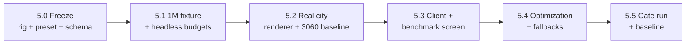

# 68 — Metropolis Gate

> [!danger] The gate is not passed
> No 1M-city run on an RTX 3060-class machine exists yet. The 21-house result — **6,195 FPS average / 4,484 1% low** — is a **21-instance, 293-quad, one-draw-call scene on an RTX 4080**. It is a slice acceptance data point and a regression fixture, not the Phase 5 gate. The 1M / RTX 3060 target in D-017 remains open.

## 1. What this note is

This is the plan for the Phase 5 **metropolis gate**: the measurement that decides whether Townsmith can ship a 1M+ city at ~30 FPS on the recommended machine.

It covers:

- the reference hardware and settings profile;
- the required scenes and routes;
- the metrics and pass/fail thresholds;
- the benchmark protocol, JSON capture, and CI baseline policy;
- the current evidence, separated into microbenchmarks and player-facing numbers;
- the pass/fail rules and fallback tiers;
- the staged plan, owners, and risks to reach the gate.

It does **not** change an accepted ADR. The gate itself follows D-017 (1M+ via cohorts and 2k active agents) and D-020 (deterministic benchmark mode). Thresholds in this note are **proposed**; they become binding when stage 5.0 freezes them. Any change after that freeze needs an ADR.

The gate is a **performance** gate, not a feature-completeness gate. Multiplayer, mods, weather variants, and 4K are out of scope. The 100k minimum-hardware tier and Q-052 remain separate.

## 2. Gate statement

> [!decision] Gate G5 — Metropolis
> A fixed 1M-city save (100 km², 250k buildings, 10k cohorts, 2k active agents, 200 detailed agents) must render at **≥30 FPS average / ≥22 FPS 1% low at 1920×1080** on the reference rig, with **p99 ≤45 ms**, no OOM, no more than three >50 ms hitches per 120 s, save/load ≤30 s, benchmark overhead <2%, and a 3-run spread ≤5%.
>
> The dedicated server must run the same 1M simulation within the per-system tick budgets without a GPU.

The gate has two configurations:

| Config | Server | What it proves | Gate role |
|---|---|---|---|
| **C1 — local server** | Same 8c/16t machine as the client | Single-player default; the honest "one PC" result | **Primary gate** |
| **C2 — dedicated server** | Separate 8c/16t machine | Recommended large-city / multiplayer path; simulation off the client | **Required secondary run**; conditional-pass route if C1 misses |

C1 is the primary gate because D-004 makes the local server the single-player default. C2 is still required: D-017 recommends a dedicated server for simulation, and the Phase 5 exit criteria include a headless 1M server run. A C2 pass does **not** erase a C1 failure; it can produce a conditional pass with an in-game recommendation and an ADR.

> [!important] The dedicated server does not make the client GPU faster
> It offloads cohort/buildings/economy/agent CPU and lets the client spend its cores on rendering, streaming, and UI. A GPU-bound client stays GPU-bound.

### Out of scope

- 60 FPS at 1M (the target is ~30 FPS; 60 FPS is the higher-end GPU/lower-settings tier).
- 4K, VR, ultra-wide, and multi-monitor.
- Modded content and modded benchmark scenes.
- Multiplayer bandwidth, reconnect, and 4-player scale.
- Weather/day-night variants; Q-073 remains open.

## 3. Target hardware and settings

### 3.1 Reference rig

| Item | Gate value | Notes |
|---|---|---|
| CPU | **8 cores / 16 threads**, desktop class | Ryzen 7 5700X/5800X or Core i5-12400/13400 class. Record the exact model. No laptop SKU. |
| GPU | **GeForce RTX 3060 12 GB**, stock clocks | The 12 GB card is the reference. A 3060 Ti, 4060, or 8 GB card is not a substitute for a gate run. |
| RAM | **32 GB** | 16 GB is the minimum-hardware tier; report it separately, do not mix it into the gate baseline. |
| Storage | NVMe SSD, ≥50 GB free | Save/load and streaming depend on it. |
| OS | The declared shipping OS, one per gate cycle | Windows 11 expected. Linux results are development trends until a Windows gate rig exists. Do not compare across OS or driver versions. |
| GPU driver | Pinned, recorded in JSON | No driver update mid-cycle. |
| Engine | Godot 4.7.x, release template | No debug build for the gate. |
| Rust extension | `--release`, thin LTO, 1 codegen unit | Current route script builds the debug extension; stage 5.0 adds a release path. |
| Display | 1920×1080, vsync off, frame cap off | Record window mode, refresh rate, and actual window size. |
| Power | High-performance plan, no battery | Record thermals and clock behavior. |

**Substitution policy.** A "3060-class" result on other hardware is **not** the gate. An equivalent may be used for development only if a side-by-side run on at least one scene shows it is within 5% of the reference, and the substitution is recorded in the JSON and the report. When in doubt, run the gate on the reference rig.

### 3.2 Standard settings preset

The comparable preset is frozen at 5.0 as `standard_1080p_high_v1` and hashed. It represents the intended default experience, not a low-settings escape hatch.

| Setting | Value |
|---|---|
| Resolution / render scale | 1920×1080, 100% |
| Renderer | **Forward+** (the target path in [[03 - Voxel and Scale]]) |
| Vsync / frame cap | Off / off |
| Upscaling / frame generation | **Off** (no FSR, DLSS, TSR, or frame generation in the comparable run) |
| Anti-aliasing | TAA |
| Shadows | High; near buildings cast, distant LOD does not |
| SSAO / GI | On / the shipping default |
| LOD distance | High preset; frozen and hashed |
| Vegetation / props | High preset |
| Active agent target | 2,000; 200 detailed |
| Dynamic resolution | Off |
| Mods | None |

Rules:

- Any setting change invalidates the baseline. The settings hash is part of the result.
- The **Compatibility renderer** is a fallback tier, not the primary gate. If Forward+ misses and Compatibility passes, the result is a conditional pass with an ADR; the project target remains Forward+.
- "My current settings" results are personal and non-comparable (Q-075).
- Do not hide cost with upscaling, dynamic resolution, or a frame cap. Those are tuning levers for fallback tiers, and each tier is measured as its own preset.

## 4. Required scenes

All scenes are fixed fixtures, not generated at run time. Each records a **save hash**, **content hash**, **worldgen version**, **route hash**, and **settings hash**. Base content only; no mods. Time of day, season, and weather are fixed. Construction sites are fixed at early/mid/late phases.

| Scene | Type | Fixture | Workload / route | Gate role |
|---|---|---|---|---|
| `early_town_v1` | Display | ~1 km², ~800 citizens, 30–50 buildings, 3 construction sites, forest/river, first roads | 60 s flyover + 60 s street-level, 15 s warm-up | 60 FPS target |
| `mid_city_v1` | Display | 10–25 km², ~100k citizens, ~25k buildings, mixed districts, 5–10 sites | 90 s flyover, 15 s warm-up | D-020 supporting scene; reported, not a pass/fail blocker in this plan |
| `late_metropolis_v1` | Display | **100 km² (10 km × 10 km)**, **1M citizens**, **250k buildings**, 10k cohorts, 2k active / 200 detailed agents, 100k–200k road edges, 10–20 sites, high-rise core, transit, industry, pollution | 120 s flyover + 90 s street-level, 15 s warm-up | **Primary gate** |
| `cohort_1m_v1` | Headless | Same save as `late_metropolis_v1` | 3,600 ticks at 1 Hz, full cohort/district/building/economy pipeline | 1M simulation budgets |
| `agents_2k_v1` | Headless | 2,000 agents, fixed seed, sparse 128 m and dense 32 m worlds | 1,000 ticks at 10 Hz, 200 warm-up | Active-agent budget |
| `traffic_grid_v1` | Headless | 32×32 regression grid + 256×256 scale grid (65,536 nodes, ~130k edges, 16 m spacing) | Build, incremental update, 5,000 flow-field queries | Traffic budget |
| `slice_houses_21_v1` | Display | Existing 21-house fixture: one 293-quad mesh, 21 instances, one MultiMesh | 30 s route, 3 s warm-up | Regression guardrail; not a 1M proof |

Scene rules:

- **The late save is the fixture.** The box city in [[23 - City Rendering Benchmark]] is a rendering stress fixture, not the gate scene. The gate scene has real blueprint-derived buildings, roads, terrain, and simulation state.
- **Mid city is required by D-020.** It is a diagnostic point on the way to Late and is required for the player-facing benchmark screen, but it does not block the 1M gate by itself.
- **Streaming is part of the route**, not a separate preload. The flyover must cross from empty/outskirt space into the dense core and back, so chunk loading, LOD transitions, and meshing are measured.
- **The street route** must include agents, vehicles, shadows, and near buildings. It is where the 2k active tier is visible.
- **Warm-up** covers shader compilation and first chunk population; it is never measured.

## 5. Metrics and thresholds

Thresholds are for the **median of three valid runs**. The worst run must also meet the 1% low floor and the memory caps. See §5.4 for definitions.

### 5.1 Displayed frame metrics

| Scene | Avg FPS | 1% low | 0.1% low | p95 | p99 | p99.9 | Hitches | Stalls |
|---|---:|---:|---:|---:|---:|---:|---|---|
| `early_town_v1` | **≥60** | ≥45 | ≥30 | ≤18 ms | ≤22 ms | ≤33 ms | ≤2 >33 ms per 120 s; 0 >50 ms | 0 >250 ms |
| `mid_city_v1` | **≥60** | ≥40 | ≥25 | ≤20 ms | ≤25 ms | ≤40 ms | ≤2 >33 ms per 120 s; 0 >50 ms | 0 >250 ms |
| `late_metropolis_v1` | **≥30** | **≥22** | ≥15 | ≤38 ms | **≤45 ms** | ≤67 ms | ≤3 >50 ms per 120 s | 0 >250 ms |
| `slice_houses_21_v1` | ≥60 | ≥45 | ≥30 | ≤8 ms | ≤16 ms | ≤33 ms | 0 >50 ms | 0 >100 ms |

- The 1% low is **1000 / p99 frame time**, matching the current harness. The 0.1% low is **1000 / p99.9**; the harness does not capture p99.9 yet (G-08).
- The existing `hitches_16ms` / `hitches_33ms` counters are retained for 60 FPS scenes. They are **not** pass/fail at 30 FPS: at 30 FPS almost every frame is >16 ms and most are near 33 ms.
- A "stall" is a single frame >250 ms after warm-up. It is a failure even if it does not move p99.9.

### 5.2 Render load and memory

| Scene | Draw calls (p99) | Triangles (median) | VRAM peak | Client RSS peak |
|---|---:|---|---:|---:|
| `early_town_v1` | <1,500 | 3–5M | ≤8 GB | ≤8 GB |
| `mid_city_v1` | <2,000 | 5–10M | ≤9.5 GB | ≤10 GB |
| `late_metropolis_v1` | **<2,000** | **5–10M** | **≤10.5 GB** | **≤12 GB** |
| `slice_houses_21_v1` | <10 | <10k | ≤2 GB | ≤4 GB |

- The draw-call and triangle budgets come from [[03 - Voxel and Scale]]. Exceeding 2,000 draw calls means batching/instancing has regressed, not that the GPU is slow.
- VRAM leaves ~1.5 GB of headroom on the 12 GB card. A run that needs more than 10.5 GB is one texture/LOD change away from stuttering or failing on a driver update.
- The 16 GB minimum-hardware check is separate: the client must survive at ≤10 GB RSS with no OOM. It is reported, not used as the gate.

### 5.3 Simulation, server, and traffic

These budgets come from [[07 - Simulation and AI]] and the recommended tier in [[03 - Voxel and Scale]]. The full 1 Hz pipeline is allowed the looser 50 ms aggregate budget; the individual cohort step keeps the tighter 10 ms budget.

| Metric | Budget | Source |
|---|---:|---|
| Cohort step, 10k cohorts, 1 Hz | p99 **≤10 ms** | 07 |
| Full 1 Hz aggregate: districts + dirty buildings + economy | p99 **≤50 ms** | 03 recommended |
| Active agents, 2,000, 10 Hz, sparse and dense | p99 **≤10 ms** | 07 |
| Pathfinding, active tier | p99 **≤4 ms** | 07 |
| **Total simulation CPU per wall-clock second** | p99 **≤250 ms** on one core | Derived from the per-system budgets above |
| Client render-thread simulation handoff | p99 **≤2 ms**; no sim-caused frame >50 ms | Design rule |
| Dedicated server | Completes the 1M loop with **no GPU** and no network-loop stall >16 ms | Phase 5 exit |
| Server RSS | ≤4 GB | 07 |
| Traffic 32×32 regression | Build ≤1 ms; flow build ≤1 ms; 1,000 flow queries ≤5 ms | [[56 - Traffic]] baseline |
| Traffic 1M grid | Build ≤250 ms on a worker; incremental update p99 ≤16 ms; flow field p99 ≤4 ms; 5,000 flow queries ≤10 ms; no linear nearest-node scan in the tick | 07, 56 limits |
| Traffic graph memory | ≤64 MB at 100k–200k edges | Derived |

- **Total sim CPU per second** is the sum of the work, not a single blocking tick. It gives the scheduler room to spread 1 Hz work across frames. The per-system p99 budgets are the spike guard.
- The traffic grid must add a **spatial index and incremental updates** before the gate. The current linear nearest-node lookup and on-demand full rebuild are acceptable at 32×32, not at 65k nodes (G-06).
- "No GPU" means the server has no rendering device and still completes 3,600 ticks with the budgets above.

### 5.4 Load, streaming, save/load, and validity

| Metric | Threshold |
|---|---|
| Early cold load | ≤10 s |
| Mid cold load | ≤20 s |
| Late cold load | ≤30 s (Phase 5 exit) |
| Late warm load | ≤15 s |
| Save 100k city | ≤15 s (03) |
| Save 1M city | **≤30 s** (Phase 5 exit) |
| Load 1M city | **≤30 s** |
| Save → load → save hash | Equal; no data loss |
| Dropped chunks | 0 |
| Streaming stalls >100 ms | 0 |
| `chunks_loaded_min` | At or above the configured ring during the dense segment |
| Streaming frame | No >250 ms frame after warm-up |
| Benchmark recording overhead | **<2%** |
| 3-run variance | **<5% average FPS**, <8% 1% low |
| Gate report completeness | All required scenes, both C1 and C2, JSON + summary |

### 5.5 Measurement definitions

- **Average FPS:** total frames / measured seconds, from the harness frame-time samples.
- **1% low:** 1000 / p99 frame time. **0.1% low:** 1000 / p99.9. Do not compute an average of the slowest 1%; that is a different metric.
- **Median of three:** run each route three times; take the median of each metric across runs. A run is invalid if the scene did not finish, the save hash changed, or the settings hash changed.
- **Worst run:** the worst of the three must still meet the 1% low floor and the memory caps. This prevents a lucky median from hiding a stutter.
- **Warm-up:** 15 s for the gate routes; discarded. Shader compilation, first chunk load, and first-frame allocation do not count.
- **Duration:** 60 s minimum, 90–120 s for Late. The current 3–5 s routes are too short for 1% lows and are not gate evidence (G-08).
- **Overhead:** run one route with recording on and one with it off; the average frame time difference must be <2%.
- **Variance:** if the three runs differ by more than 5% average FPS, rerun the set once after a cool-down. If it still differs, the result is invalid; investigate thermals, background load, or driver state.

## 6. Benchmark protocol

### 6.1 Preflight

1. Boot the rig, let it idle 5 minutes, and record ambient/CPU/GPU idle temperatures.
2. Close all non-essential applications, overlays, browsers, and capture tools.
3. Confirm the power plan, driver, OS build, Godot build, and Git commit.
4. Confirm a clean worktree; record `git_dirty`.
5. Verify the scene save hash, content hash, route hash, and settings hash.
6. Run the benchmark on a **copy** of the save; autosave and achievements are disabled.

### 6.2 Run sequence

1. Load the scene and wait for the load-complete signal.
2. Warm up for 15 s; discard samples.
3. Measure 60–120 s of camera movement.
4. Stop, write one JSON per run, and close the process.
5. Cool down 2 minutes between runs; record GPU temperature and clock.
6. Repeat three times per route, per configuration (C1 and C2).
7. Run the headless cohort, agent, and traffic scenes three times each; take the median.

### 6.3 Capture

Each run records at least:

```json
{
  "format_version": 1,
  "gate": "G5",
  "config": "C1_local_server",
  "scene": "late_metropolis_v1",
  "scene_hash": "blake3:...",
  "content_hash": "blake3:...",
  "worldgen_version": 1,
  "route": "late_flyover_v1",
  "route_hash": "blake3:...",
  "settings": "standard_1080p_high_v1",
  "settings_hash": "blake3:...",
  "game_version": "0.5.0",
  "git_commit": "...",
  "git_dirty": false,
  "hardware": {
    "cpu": "8c/16t ...",
    "gpu": "RTX 3060 12 GB",
    "driver": "...",
    "ram_gb": 32,
    "os": "Windows 11 ..."
  },
  "results": {
    "fps_avg": 31.4,
    "fps_low_1pct": 24.8,
    "fps_low_0_1pct": 18.2,
    "frametime_ms_avg": 31.8,
    "frametime_ms_p95": 38.0,
    "frametime_ms_p99": 44.0,
    "frametime_ms_p99_9": 55.0,
    "hitches_50ms": 1,
    "stalls_250ms": 0,
    "draw_calls_p99": 1840,
    "triangles_avg": 7600000,
    "vram_mb_peak": 9800,
    "ram_mb_peak": 12400,
    "sim_tick_ms_p99": 8.1,
    "sim_cpu_ms_per_s": 180,
    "load_ms": 21000,
    "save_ms": 24000,
    "overhead_pct": 1.2
  },
  "rating": "playable",
  "bottleneck": "gpu",
  "valid": true
}
```

Every result must carry enough provenance to reject an invalid comparison. A result without hashes and hardware is a personal observation, not gate evidence.

### 6.4 CI baseline policy

- Baselines live in `benchmarks/baselines/<rig>/<scene>_<route>.json`. The current `rtx4080_1080p_gl_compatibility.json` is a developer sanity baseline; it is **not** the 3060 gate baseline.
- The gate baseline is committed only from a signed gate run (stage 5.5). No auto-updates.
- A PR that touches rendering, streaming, simulation, or save/load runs the affected scene on the self-hosted display runner and compares against the baseline.
- Regression thresholds for CI follow [[15 - Benchmarks]]: fail on **>5% average FPS drop**, **>8% 1% low drop**, a new >250 ms stall, a new >50 ms hitch beyond the allowed count, or any simulation system >5% over its baseline p99.
- The full matrix runs nightly; the gate run is manually dispatched on the trusted runner so fork PRs cannot reach it.
- Keep at least the last 20 gate artifacts (JSON, logs, hardware metadata). Report-only aggregation is allowed for triage but is not a gate result.

### 6.5 Commands

Current commands (short, debug-extension sanity runs — **not** gate evidence):

```bash
./scripts/bench_core.sh
GODOT=/path/to/godot ./scripts/bench_godot.sh 3 5 benchmarks/routes/phase0_city_late.json
GODOT=/path/to/godot ./scripts/bench_slice.sh
```

Planned gate commands (added in 5.0; names are provisional):

```bash
# Build release extension + release Godot template first.
./scripts/build_godot_ext.sh release

# Gate runner: scene, route, preset, config, output.
cargo run --release -p townsmith-bench --bin gate -- \
  --scene benchmarks/scenes/late_metropolis_v1.tsave \
  --route benchmarks/routes/late_flyover_v1.json \
  --settings benchmarks/settings/standard_1080p_high_v1.json \
  --config local-server \
  --runs 3 \
  --out benchmarks/results/gate/late_metropolis_v1.json
```

The current `bench_godot.sh` builds a debug extension, forces GL Compatibility through the project settings, and supports only Phase 0 routes. The gate needs release, Forward+, p99.9, GPU time, draw calls, triangles, VRAM/RSS, simulation timings, load/save, and the 1M scene. That harness work is part of 5.0, not an afterthought.

## 7. Current evidence and gaps

### 7.1 Evidence ledger

| Area | Result | Machine | Class | What it proves | What it does **not** prove |
|---|---|---:|---|---|---|
| 21-house slice | **6,195 FPS avg / 4,484 1% low**, 0 hitches, 0.156 ms median, 0.201 ms p99 | RTX 4080, 7950X, 1080p, GL Compatibility, debug extension | Display-backed micro-scene | One 293-quad mesh × 21 instances renders cheaply; the slice's 60 FPS criterion passes on this machine | The 3060, 1M city, 250k buildings, LOD, shadows, streaming, memory, save/load, or the gate |
| Box city Late | 766 FPS avg / 435 1% low, 0 hitches | RTX 4080, 1080p, GL Compatibility | Display-backed best case | The MultiMesh 100k-instance path and buffer upload work | Real voxel geometry, LOD/impostors, shadows/GI, 250k buildings, or the 3060 |
| Box city Mid | 3,046 FPS avg / 376 1% low | RTX 4080 | Display-backed best case | 10k instances are cheap in the best case | 100k citizens with real city content |
| Terrain streaming | 2,841 FPS avg / 415 1% low, 4 hitches >16 ms | RTX 4080, 3 × 5 s | Display-backed micro-scene | The 3-chunk streaming route and LOD path run | A 100 km² city, real building streaming, or a 120 s route |
| 1M cohort tick | ~0.21 ms median | 7950X, release | CPU microbenchmark | The simplified 10k-cohort aggregate model is cheap | Buildings, construction, agents, economy, pathfinding, or the full 1M loop |
| 2k active agents | 0.194 ms sparse / 0.901 ms dense median | 7950X, release | CPU microbenchmark | Steering + separation + spatial hash fit the 10 ms budget | Pathfinding, needs, schedules, animation, rendering, or the city |
| Traffic 32×32 | 0.44 ms build; 1.3 ms per 1k flow queries; 94 ms per 1k pair queries | 7950X, release | CPU microbenchmark | Flow fields are the right primitive; 32×32 is cheap | 100k–200k edges, incremental updates, or a 65k-node spatial index |
| City layout Late | 5.13 ms generation; Godot debug build/upload 110–115 ms, 6.4 MB buffer | 7950X + RTX 4080 | CPU microbenchmark / one-time build | Deterministic 100k-box layout generation is fast | Per-frame rendering, voxel buildings, or LOD |
| Voxel/terrain meshing | 3.4–3.8 ms checkerboard; 0.5 ms hut; 1.4–1.6 ms terrain; worldgen 131–141 ms | 7950X, release | CPU microbenchmark | Individual meshing/worldgen paths fit their budgets | Streaming under a 1M city, upload contention, or frame pacing |
| Save/load | Only smoke-level correctness; no 1M timing | — | Structural smoke | The save/load path round-trips and hashes match | The 30 s save/load target, memory peak, or 1M file size |

### 7.2 What is player-facing today

Only the display-backed rows in the table are player-facing. None of them is the gate:

- **21 houses** is a tiny reuse scene, not a city.
- **Box city Late** is 100k boxes, no LOD, no shadows, no GI, no voxel geometry; "1M population" is metadata.
- **Terrain streaming** is three chunks, not 100 km².
- The **headless** runs are not FPS at all; the dummy renderer reports ~145 FPS regardless of scene complexity.

The 21-house result is the one most likely to be misquoted. It is an **RTX 4080** data point with **one draw call**. It validates the slice's 60 FPS criterion, not the metropolis target.

> [!danger] Do not quote 6,195 FPS as the metropolis result
> The gate is a 1M-city scene with 250k buildings, 2k agents, voxel LOD, streaming, shadows, and real simulation. The 21-house scene has none of those. On the reference 3060 the 21-house scene should still clear 60 FPS easily; that is a regression check, not a scale proof.

### 7.3 Gaps

Local gap IDs only; they are not ADRs or questions.

| ID | Gap | Blocks gate? | Owner |
|---|---|---|---|
| G-01 | No reference 8c/16t + RTX 3060 12 GB run exists | **Yes** | P |
| G-02 | No fixed 1M save (1M citizens, 250k buildings, 10k cohorts) | **Yes** | S/T |
| G-03 | No real voxel/LOD building renderer at city scale; boxes only | **Yes** | R |
| G-04 | No full 1M loop: cohorts exist, but buildings, economy, agents, traffic, and pathfinding are not integrated at 1M | **Yes** | S |
| G-05 | 2k agents lack pathfinding, needs, schedules, animation, and render integration | **Yes** | S/R |
| G-06 | Traffic graph is capped at 10k roads / 20k nodes; linear nearest-node lookup; full rebuild | **Yes** | S |
| G-07 | No 1M save/load timing, peak RSS, VRAM, or save-size measurement | **Yes** | S/P |
| G-08 | Harness uses a debug extension, GL Compatibility, 3–5 s routes; no p99.9, GPU time, draw calls, triangles, memory, or sim fields | **Yes** | P |
| G-09 | No player-facing Benchmark screen (scene select, rating, recommendations, export) | No for the raw gate; yes for the Phase 5 feature | U |
| G-10 | No committed 3060 gate baseline and no gate job on the self-hosted runner | **Yes** | P/T |
| G-11 | Streaming is measured only on terrain; no building/chunk budget under a real city | **Yes** | R/S |
| G-12 | No thermal/cool-down/background-load protocol in the current 3-run script | No, but results are fragile without it | P |

The biggest gap is not a number. It is that **the current evidence is the easy part of the problem**: one mesh reused 21 times, or boxes with no LOD. The gate lives in the part that does not exist yet — a real 1M city with 250k distinct building records, LOD/impostors, streaming, shadows, and simulation.

### 7.4 Data-scale harness

`cargo run --release -p townsmith-bench --bin metropolis` builds the data side of the gate without rendering:

- 10,000 cohorts × 100 = **1,000,000 population** across 128 districts;
- **2,000 active agents** split 1,000 sparse (128 m) and 1,000 dense (32 m), with ten 10 Hz agent steps per 1 Hz city tick;
- **250,000 compact building records** (16 bytes each, 4 MB), no strings or render data;
- fixed seed, **120 ticks**, no sleeps;
- checksum over cohorts, agents, and building records, plus median/p95 tick timings and a `render:false` marker.

Measured on the developer machine (Ryzen 9 7950X, Linux, release build, three runs):

| Metric | Result |
|---|---:|
| Wall time | 404–410 ms |
| City tick median | 3.29–3.38 ms |
| City tick p95 | 4.19–4.21 ms |
| 10k-cohort update | ~0.217 ms |
| 20 agent updates per city tick | ~3.12 ms |
| Checksum | `3632d2135fa98d29` (stable across runs/processes) |

`--smoke` runs the scene twice and fails on checksum/state drift.

> [!warning] What it does not prove
> This is not the gate. It has no renderer, GPU, LOD, streaming, shadows, voxel meshes, pathfinding, schedules, needs, traffic, economy, save/load, or peak-memory measurement. It does not close G-02, G-04, G-05, G-07, or G-08, and it is not §8 gate evidence. It only proves the 1M cohort/agent/building data loop fits the CPU budget at this scale.

## 8. Pass/fail decision rules

### 8.1 Validity first

A run is valid only if:

- the scene, content, route, settings, and save hashes match the gate manifest;
- the measured route completes without a crash or OOM;
- the 3-run average FPS spread is <5%; otherwise the set is rerun once after a cool-down;
- the run is on the reference rig (or an approved equivalent with a side-by-side);
- the renderer is Forward+ and the preset is `standard_1080p_high_v1`;
- C1 and C2 are both recorded.

An invalid run is not evidence, even if it hits 30 FPS.

### 8.2 Mandatory checks

| # | Check | Pass condition |
|---|---|---|
| 1 | Late average FPS | ≥30 |
| 2 | Late 1% low | ≥22 |
| 3 | Late 0.1% low | ≥15 |
| 4 | Late p99 / p99.9 | ≤45 ms / ≤67 ms |
| 5 | Late hitches | ≤3 >50 ms per 120 s; 0 >250 ms |
| 6 | Early / Mid average | ≥60 / ≥60 |
| 7 | Early / Mid 1% low | ≥45 / ≥40 |
| 8 | Draw calls / triangles | <2,000 p99 / 5–10M median on Late |
| 9 | VRAM / client RSS | ≤10.5 GB / ≤12 GB on Late |
| 10 | Cohort step / full 1 Hz aggregate | p99 ≤10 ms / ≤50 ms |
| 11 | Active agents / pathfinding | p99 ≤10 ms / ≤4 ms |
| 12 | Total sim CPU | p99 ≤250 ms per wall-clock second |
| 13 | Dedicated server | 1M loop, no GPU, within the same budgets |
| 14 | Traffic 1M grid | Build/incremental/flow/query budgets |
| 15 | Load / save 1M | ≤30 s each; hash equal |
| 16 | Streaming | 0 dropped chunks, 0 >100 ms stalls, no >250 ms frame |
| 17 | Overhead / variance | <2% / <5% average FPS |
| 18 | 21-house regression | ≥60 avg, ≥45 1% low, no >5% regression |
| 19 | Correctness | No crash, no OOM, save/load round-trip, deterministic checksum |

### 8.3 Verdicts

| Verdict | Rule | What it means |
|---|---|---|
| **PASS** | All mandatory checks pass on C1, and C2 passes as well | M5 is met; the baseline is committed and the gate is green |
| **CONDITIONAL PASS** | Late average is **28.5–29.9 FPS** (within 5% of target), 1% low ≥20, all non-FPS checks pass, and the shortfall has a named cause and a scheduled fallback | M5 is **not** fully met; an ADR records the measured ceiling, the fallback tier is scheduled before Phase 6, and the result is labeled "M5 conditional" |
| **C1 conditional, C2 pass** | C1 misses 30 but C2 passes; every other check passes | Single-player is degraded at 1M; ship the dedicated/background-server recommendation in-game, record an ADR, and treat C1 as an open performance item |
| **FAIL** | Late average <28.5, 1% low <20, any simulation/memory/save/load/streaming check fails, or any OOM/crash/hash mismatch | Do not claim M5. Apply fallback tiers and re-run; if still failing, record the ceiling in an ADR |

Rules that keep the gate honest:

- A microbenchmark pass never substitutes for a scene pass.
- A 21-house pass never substitutes for a Late pass.
- A C2 pass never hides a C1 failure; it changes the verdict to conditional, not pass.
- Do not lower the 1M population cap, the 250k building count, or the 2k agent target to manufacture a pass. The correct response is to optimize the aggregate path and lower **detail** (agents, LOD, render distance) with an ADR.
- Do not compare a Compatibility-renderer result to a Forward+ baseline. They are different tiers.
- The gate report is signed by the performance lead and an independent reviewer. A single-person run is provisional.

## 9. Fallback tiers

If the gate misses, diagnose first. The wrong fallback wastes weeks.

| Tier | Change | Addresses | Does not fix | Gate status |
|---|---|---|---|---|
| **F0** | Full gate, no change | — | — | Pass |
| **F1** | **Server offload**: run the 1M simulation on a dedicated/background server (C2); client renders and streams | Client CPU contention, sim spikes, local-server scheduling | A GPU-bound client | Conditional pass if C2 passes; ADR + in-game recommendation |
| **F2** | **Active agents** 2,000 → 1,200 → 800; detailed 200 → 100 | Agent CPU/animation/render cost | GPU fill, streaming, memory | Conditional pass; ADR; 1M cohorts and 250k buildings stay |
| **F3** | **LOD/render distance**: −25% distance, earlier impostors, shadows near-only, vegetation density −50%, district merges | GPU vertex/fill, draw calls, streaming working set | Pure sim CPU | Conditional pass; visual-quality ADR |
| **F4** | **Fixed 85% render scale**, lower AA/AO/shadow resolution; still no dynamic resolution in the comparable run | GPU fill rate | Sim CPU, memory spikes | Conditional pass; quality-preset ADR |
| **F5** | **Diagnostic** `late_lite` at 500k population / 125k buildings | Records the measured ceiling and informs Phase 6/8 | The 1M target | **Not a gate pass**; an ADR and a roadmap decision |

Order of application:

1. Profile the late route and classify the bottleneck: GPU, CPU simulation, streaming, memory, or mixed.
2. GPU-bound: F3, then F4.
3. CPU-bound by simulation: F1, then F2.
4. Streaming/memory-bound: F3 plus a streaming-cache/LOD working-set fix.
5. Re-run the full gate after each tier. Do not stack tiers without a fresh baseline; otherwise the gain is unattributable.
6. Any tier that changes gate content (agents, buildings, population, render distance) needs an ADR. Never silently redefine "1M".

> [!warning] Offload is not a free win
> A dedicated server helps a CPU-bound client. If the late route is GPU-bound at 25 FPS, moving the simulation to another machine changes nothing. Measure the bottleneck before choosing a tier.

## 10. Staged plan to the gate

The roadmap gives Phase 5 six to eight weeks. This plan uses the same window and keeps the gate scope frozen.

| Stage | Weeks | Work | Owner | Exit |
|---|---:|---|---|---|
| **5.0 Freeze the gate** | 1 | Reference rig, settings preset, scene/route manifest, JSON schema, baseline dirs, gate report template, release/Forward+ harness | P + T | Rig fingerprint, frozen settings hash, empty baseline, runbook, current matrices labeled "pre-gate" |
| **5.1 1M fixture and headless truth** | 1–2 | Fixed 1M save, full 1 Hz/10 Hz pipeline, per-system timing, traffic spatial index + incremental graph, save/load instrumentation | S + T | 1M headless run within budgets (or ranked bottleneck list), save/load ≤30 s, deterministic checksums |
| **5.2 Real city renderer** | 2–4 | Blueprint LOD 0/1/2 + impostors, per-blueprint/LOD MultiMesh, occlusion/culling, district merges, building streaming, 3060 baseline | R + T | First 3060 Late number, draw calls/triangles/VRAM within budget or ranked GPU bottlenecks |
| **5.3 Client integration and benchmark screen** | 3–5 | Sim off the render thread, snapshot/interpolation, district UI aggregation, player-facing Benchmark screen (scenes, preset, results, rating, recommendations, JSON export) | U + S | Client main thread ≤16 ms p99 on Late, 1M UI opens ≤1 s, benchmark screen runs all scenes |
| **5.4 Optimization loop** | 4–7 | Weekly matrix, profile top five, tune LOD/streaming/agents/memory, test fallback tiers | P + R + S + U | Late ≥30 / 1% low ≥22, or the best fallback measured and documented |
| **5.5 Gate run and sign-off** | 8 | Freeze commit, 3-run C1 + C2, capture JSON, compare baseline, write report, commit baseline, enable CI gate | P + V | Signed gate report, committed baseline, green CI gate, ADR for any conditional/fail result |



- Do not start 5.2 before the 5.1 fixture exists; otherwise the renderer is tuned against a scene that will change.
- Do not start 5.4 before the first 3060 Late baseline exists; otherwise the team is optimizing the 4080.
- 5.3 can overlap 5.2, but the benchmark screen must not become a substitute for the gate.

### 10.1 Roles

| Role | Responsibility | With 2–3 people |
|---|---|---|
| **P — Performance/bench lead** | Harness, protocol, profiles, baselines, gate run, report | Usually the same person as R |
| **R — Rendering lead** | LOD/impostors, instancing, streaming, GPU budgets | P + R can be one generalist |
| **S — Simulation lead** | Cohorts, districts, buildings, agents, traffic, save/load | Second generalist |
| **U — Shell/UI lead** | Benchmark screen, settings, district dashboard, snapshots | Usually the same person as S |
| **T — Tools/content** | 1M fixture, scene/route assets, CI runner, JSON plumbing | Third person, part-time |
| **V — Reviewer** | Independent gate run, hash checks, sign-off | Third person or external reviewer |

No single person may both produce and sign off the gate result. With two people, the reviewer is the person who did not run the final set, or an external reviewer.

### 10.2 Stage acceptance details

**5.0**

- Record CPU/GPU/RAM/OS/driver/Godot/Rust and the rig's thermal behavior.
- Freeze `standard_1080p_high_v1`; hash it; write it to `benchmarks/settings/`.
- Define the scene and route manifest; create `benchmarks/scenes/` and `benchmarks/baselines/<rig>/`.
- Extend the JSON schema for p99.9, GPU time, draw calls, triangles, VRAM/RSS, sim timings, load/save, and overhead.
- Re-run the current core, route, and slice matrices; label them "pre-gate, not comparable to the 3060 baseline."

**5.1**

- Build the 1M fixture from the real city pipeline, not a synthetic box layout. Save it compressed and content-address it.
- Run 3,600 1 Hz ticks and 10 Hz agent ticks; capture per-system p50/p95/p99 and total CPU per simulated second.
- Replace the linear traffic nearest-node lookup with a spatial index; make graph updates incremental or time-sliced.
- Measure save, load, save size, and peak RSS. Assert hash equality.
- Exit with either budgets met or a ranked list of the systems that miss, with evidence.

**5.2**

- Render blueprint-derived buildings at LOD 0/1/2 and impostor distance; instance by blueprint/LOD/material.
- Merge districts at distance; cull occluded and off-screen buildings; keep shadow casters near-only.
- Stream building data by camera priority; measure request-to-apply latency and dropped chunks.
- Produce the first 3060 Late run at 1080p, even if it is below 30 FPS. That number is the real starting point.

**5.3**

- Move simulation off the render thread; hand off snapshots with a bounded copy.
- Aggregate district UI; never build per-citizen lists at 1M.
- Benchmark screen: scene select, standard preset, run, results graph, 1%/0.1% lows, hitches, bottleneck, rating, recommended settings, JSON export.
- Verify 1M load, UI open, and benchmark completion on the rig.

**5.4**

- One weekly matrix: Early, Mid, Late flyover, Late street, 21-house, cohort, agents, traffic.
- Profile the top five costs per route; fix the largest first.
- Test fallback tiers in order and record the gain per tier.
- Keep a changelog of optimizations with before/after JSON.

**5.5**

- Freeze the commit; no unrelated changes during the gate run.
- Run C1 and C2, three valid runs each; capture all artifacts.
- Write the gate report: medians, worst runs, thresholds, verdict, bottleneck, fallback status.
- Commit the baseline; enable the CI gate; update [[08 - Roadmap]], [[15 - Benchmarks]], and this note.
- If conditional or failed, write the ADR before any public claim.

## 11. Risks

| Risk | Probability | Impact | Mitigation | Trigger |
|---|---|---|---|---|
| Reference 3060 rig unavailable or unstable | Medium | High | Acquire early in 5.0; keep a verified spare/loaner; record thermals | No rig by end of week 1 |
| 1M fixture drifts as content changes | High | High | Content hash, pinned save, regenerate only with an ADR, store compressed | Save hash changes without a gate run |
| Box-to-voxel/LOD gap is larger than expected | High | High | Prototype LOD/impostors in 5.2; measure early; F3 fallback | First 3060 Late run <20 FPS |
| Local-server CPU contention | High | High | Sim off the render thread; 2 ms handoff; F1 server offload | Sim-caused frame >50 ms |
| Traffic graph rebuild or linear lookup | Medium | High | Spatial index, incremental updates, worker-thread build | 1M graph build >250 ms or tick spike |
| VRAM/RSS over budget | Medium | High | Streaming cache budget, texture compression, LOD bias, impostors | Peak VRAM >10.5 GB or RSS >12 GB |
| Thermal throttling / run variance | High | Medium | 5 min idle, 2 min cool-down, 3 runs, log clocks | >5% average FPS spread |
| Harness overhead or missing fields | Medium | Medium | Release build, ring buffer, overhead A/B, schema test | >2% overhead or missing hash |
| CI runner contamination/security | Medium | Medium | Dedicated low-privilege runner, manual dispatch, artifacts only | Any fork-triggered display run |
| Fallback quietly becomes the target | High | High | Label "M5 conditional", ADR, roadmap note, no silent cap | A fallback ships without an ADR |
| Scope creep (district UI, content, weather) | High | High | Freeze gate scope; cut lines from [[08 - Roadmap]] | New feature in the gate branch |
| OS/driver comparability | Medium | Medium | One reference OS per cycle; separate baselines; record driver | Mixed-OS comparison in a report |

## 12. Definition of done

- All required scenes exist as fixed fixtures with hashes.
- C1 and C2 have three valid runs each on the reference rig.
- The gate report is signed and includes medians, worst runs, thresholds, verdict, and bottleneck.
- The 3060 baseline is committed; the CI gate fails on the regression thresholds in §6.4.
- The player-facing Benchmark screen runs Early/Mid/Late, shows 1% lows, hitches, rating, and recommended settings, and exports JSON.
- Save/load, memory, streaming, and simulation numbers are in the same report as the frame numbers.
- Any conditional pass or failure has an ADR with the measured ceiling and the next action.
- [[08 - Roadmap]] Phase 5 and [[15 - Benchmarks]] point at the result; this note is updated with the measured outcome.
- The 21-house scene remains a regression guardrail; it is never presented as the metropolis result.

## 13. Related

- [[08 - Roadmap]] — Phase 5 scope, exit criteria, cut lines, and the 1M fallback note.
- [[15 - Benchmarks]] — D-020 scenes, routes, metrics, and CI regression rules.
- [[03 - Voxel and Scale]] — multi-scale architecture, draw-call/triangle budgets, memory estimates.
- [[07 - Simulation and AI]] — tiers, cohorts, active agents, tick budgets, 1M data budget.
- [[40 - Slice Acceptance Results]] — the 21-house technical acceptance and its 4080 caveat.
- [[39 - Slice House Benchmark]] — the 21-house scene details.
- [[23 - City Rendering Benchmark]] — the box-city best case and its limitations.
- [[25 - Phase 0 Results]] — cohort, agent, meshing, and worldgen microbenchmarks.
- [[19 - Active Agent Benchmark]] — the 2k-agent movement floor.
- [[56 - Traffic]] — graph model, flow fields, 32×32 baseline, and 1M limits.
- [[58 - Runner Matrix]] — the Phase 3 mechanics matrix; not a performance target.
- [[17 - Materials and Structure]] — high-rise content and service gates that the Late scene must render.
- [[10 - Decisions]] — D-017 (1M target), D-020 (benchmark mode), D-004 (local server), D-016 (open world).
- [[09 - Open Questions]] — Q-052 (minimum hardware), Q-062 (1M target/hardware), Q-073 (scene variants).
