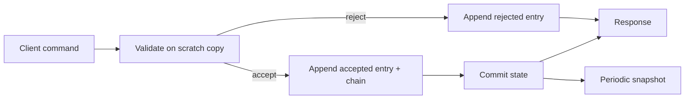

# 82 — Journal and Rollback

> [!abstract] What this note is
> A design proposal for the Phase 6 **authoritative command journal** and **admin rollback** path. It is planning only: a pure, unwired record model now exists in `core_city::journal`, but there is no journal writer, replay, or rollback path. It does not change D-004, D-020, D-021, D-032, D-034, or D-038; it describes how those decisions can be observed and recovered without adding a second simulation state.

Related: [[05 - Multiplayer]], [[10 - Decisions]] D-040, [[09 - Open Questions]] Q-123/Q-124, [[12 - Technical Architecture]], [[42 - World Placement Bridge]], [[75 - Save Load Stress]], [[79 - Voxel Edit Sync]], [[80 - Phase 6 Remaining Work]], [[78 - Code Audit Findings]].

## 1. Problem

The server is authoritative (D-004) and deterministic (D-020). It already has two narrow recovery aids:

- A **256-entry, per-session, in-memory audit ring** exposed by the Admin `audit_log` command. It records `{tick, role, tag, code, accepted}` for the current connection, is lost on disconnect or restart, and is not persisted or replayable. It is a moderation/security view, not a world history.
- A **process-local 300-tick resume window**. A reconnect can resume the same session only inside the same server process; the token is seed-derived, not authentication, and nothing survives a restart.

Neither answers the Phase 6 questions:

| Need | Today | Gap |
|---|---|---|
| Reconnect/replay | Resume returns a fresh snapshot at the current tick | A client cannot catch up on accepted commands after its last tick, and cannot tell a bounded replay from a gap |
| Save reliability | Atomic `.tmp`/`.bak` save, no write-ahead record | A crash can lose accepted commands between saves, and there is no way to prove what was accepted |
| Admin rollback | None; only the last `.bak` | No target tick, no preview, no snapshot requirement, no resync, no audit of the rollback itself |
| Audit vs journal | Per-session ring, memory only | No world-scoped, ordered, tamper-evident record with stable sequence numbers |
| Support/diagnosis | Logs and the save checksum | No bounded evidence of which command produced a state change |

The journal is **not** a second simulation. It records decisions the server already made and the inputs needed to reproduce them; the save remains the source of world state.

> [!warning] Proposal status
> D-040 is **Proposed**. Nothing here is implemented, and no accepted ADR is amended. Rollback of a live city is an admin recovery tool, not player undo.

## 2. Design principles

1. **The server writes every entry.** Clients never supply journal records, sequence numbers, ticks, or checksums.
2. **Append-only and bounded.** Entries are never updated in place. Retention is bounded by both ticks and entries. Rotation deletes only segments that no retained snapshot or rollback floor needs.
3. **Order is `seq`, not `tick`.** A paused world accepts edits without advancing the tick (D-021), so several commands can share a tick. `seq` is the global acceptance order.
4. **Hash by default, payload by opt-in.** The default journal records a command checksum, not the command body. Raw payload capture is an explicit admin mode for replay.
5. **Fail closed on write.** If the journal cannot append, an accepted mutation is rejected and nothing changes. The journal is a gate, not a best-effort log.
6. **Snapshots are required for rollback.** The journal never replays from genesis. A rollback starts at a validated snapshot and replays a bounded suffix.
7. **One content/schema identity.** A snapshot and its journal range are usable only under the content identity and schema versions they recorded (D-034).
8. **Recovery is audited.** Reading payloads and applying a rollback are Admin actions and produce their own audit records.

## 3. Journal v1

### 3.1 Command entry

The canonical entry is deliberately small:

| Field | Type | Meaning |
|---|---|---|
| `seq` | `u64` | World-scoped monotonic sequence, starts at 1, never reused, including across rollback |
| `tick` | `u64` | Server tick when the command was decided |
| `player_id` | `u64` | Stable `PlayerId` from D-033; `0` for server/system actions |
| `role` | enum | Role at decision time: `viewer`, `mayor`, `admin`, `system` |
| `tag` | bounded string | Protocol command tag, e.g. `place_blueprint`; maximum 64 bytes |
| `command_checksum` | 64-hex | BLAKE3-256 of the canonical command bytes (or of the canonical no-payload form when body capture is off) |
| `accepted` | bool | Whether the command mutated state |
| `result_code` | bounded string | Stable code, e.g. `ok` or `role.forbidden`; maximum 64 bytes |

Each stored record adds a `chain` field:

- `chain = BLAKE3(prev_chain || canonical_entry_bytes)`, where `prev_chain` is the previous record's `chain` and the first record chains from the journal header checksum.
- The chain detects accidental corruption and naive edits. It is **not** a signature: an attacker with write access to the journal can rewrite the whole chain. The server remains the authority (D-004).

> [!note] Core model landed (proposed)
> A pure, unwired record model now exists in `crates/core_city/src/journal.rs` and is re-exported from `core_city::journal`.
>
> - `JournalEntry { seq, tick, player_id, role, tag, command_checksum, accepted, result_code }`.
> - `Journal::new(epoch, max_entries)`, `append`, `replay_after`, `gap_after`, `truncate_after`, `retention_drop_through`, `validate_loaded`, `checksum`, `chain_hash`, `len`, `is_empty`, plus `epoch`/`entries`/`next_seq`/`max_entries` accessors.
> - `JournalError` with stable codes `journal.invalid_seq`, `journal.invalid_epoch`, `journal.chain_mismatch`, `journal.gap`, `journal.overflow`, and `journal.capacity`, each with `code()`, `Display`, and `std::error::Error`.
>
> Sequence is assigned from 1 by the journal; `0` on input means unassigned. The retained window trims the oldest entries above the cap and re-bases its chain; a high-water `next_seq` survives full retention so a committed sequence is never reused. `truncate_after` is an explicit tail-discard helper only.
>
> The chain uses four FNV-1a-64 lanes over the previous head plus canonical fields (32-byte `chain_hash`), and `checksum` folds that head with epoch and length into a `u64`. FNV is a dependency-free choice for corruption and naive-edit detection; it is not a signature. Retention re-bases the chain over the retained window; a fully drained window seeds from the epoch.
>
> Deliberate limits: no server, protocol, save, GDExtension, or bridge wiring; no segments, disk I/O, snapshots, payload capture, replay feed, or rollback command. The entry carries a 64-bit command fingerprint rather than the proposed 64-hex BLAKE3 value, and the 64-byte tag/result-code caps are documented (`MAX_JOURNAL_TAG_BYTES`, `MAX_JOURNAL_RESULT_CODE_BYTES`) but not enforced by the model. D-040 remains **Proposed**; Q-123 and Q-124 remain **Open**, and the §11 review trigger still gates any write path.

Rejected commands are journaled so the audit trail shows what the server refused and why. Replay applies **accepted** entries only; rejected entries affect no state.

The journal also writes control records, which are not command entries:

| Control record | Purpose |
|---|---|
| `header` | Journal id, world seed, schema version, content identity, first tick, creation time |
| `snapshot` | Snapshot tick, save checksum, content identity, last included `seq` |
| `rollback_intent` | Target `(tick, seq)`, admin id, dry-run checksum, previous epoch |
| `rollback_applied` | Target, new epoch, post-rollback save checksum |
| `rotate` / `close` | Segment boundary and clean-shutdown marker |

A rollback does not erase entries. It appends a marker, increments the journal epoch, and starts a new replay range. Older entries stay for audit and chain continuity; the active replay path stops at the latest rollback marker.

### 3.2 Payload policy

Default mode, `payload = hash`:

- The journal stores only `command_checksum`, never the raw command body.
- Chat text, personal text, tokens, and credentials are never captured, even in payload mode.
- Rollback in this mode is limited to a target that is exactly a snapshot tick. Any other target reports `rollback.payload_missing` in the dry run.

Admin mode, `payload = capture` (reserved flag `--journal-payloads`):

- The journal stores a canonical, bounded payload for replay. Proposed cap: 4 KiB per entry and an explicit total disk budget.
- Payloads are readable only by Admin, are excluded from `audit_log` and ordinary logs, and are never sent to clients.
- The mode is off by default; enabling it is an operator decision recorded in the journal header.
- A per-tag denylist always excludes `chat`, `hello`, `resume`, and any future authentication command from body capture.

### 3.3 Storage and retention

- Records are length-prefixed or line-delimited canonical JSON in rotated segments, with a small header per segment. Exact encoding is an implementation choice; the bytes must be canonical and deterministic.
- Retention is bounded by **both** a maximum entry count and a maximum tick age. Proposed starting points, pending Q-123: 100,000 entries and 7 in-game days, whichever is smaller.
- A segment is deletable only when a retained snapshot exists at or after its last entry and no rollback floor still references it.
- The in-memory index is bounded: `seq`, segment offset, and chain head only. Full payloads are not kept in memory.
- The journal is local to the server process and its save directory. It is not uploaded, fetched, or shared between servers.

### 3.4 Write ordering

- Validation runs before any mutation, matching the existing scratch-copy pattern used by placement and the D-038 edit design.
- For an accepted command, the entry is appended and flushed before the state commit and before the response.
- An append failure (`journal.unavailable`, `journal.disk_full`) rejects the command and changes nothing. The server may enter an explicit read-only/degraded mode only with an Admin opt-in; it never silently continues without a journal.
- For a rejected command, the entry is appended before the rejection response. An append failure turns the rejection into `journal.unavailable`.

### 3.5 Snapshots

- A snapshot is a normal `ServerSave`-shaped file written with the existing atomic `.tmp`/`.bak` path. No new `ServerSave` field is required.
- A sidecar manifest records `{tick, last_seq, save_checksum, schema_version, content_identity, journal_id}` and is written atomically with the snapshot.
- Proposed cadence: every 1,000 accepted entries, on clean shutdown, and before an Admin rollback. Cadence is Q-123.
- Snapshots are periodic and bounded; the journal does not keep an unbounded snapshot history. A rollback needs the newest snapshot at or before the target, not every snapshot.

## 4. Reconnect and replay

The journal gives a reconnect a bounded command-level catch-up feed. It does not replace the resume token, extend the 300-tick window, or make a session survive a restart.

| Situation | Behavior |
|---|---|
| `last_tick == current tick` | No replay; the normal resumed `welcome` and snapshot are enough |
| `last_tick < current tick` and within the retained journal and resume window | Replay accepted entries with `seq` after the client's acknowledged `seq` (or `tick > last_tick` when the client has no `seq`), bounded by an entry cap |
| `last_tick` older than the journal floor or the resume window | `journal.replay_gap`; the client must take a full snapshot resync, not a partial replay |
| `last_tick > current tick` | `journal.tick_ahead`; the client is from a different save or server and must re-hello |
| Session window expired | Resume is refused as today; a fresh `hello` starts a new session and receives a snapshot |
| Server restarted | Resume tokens are gone; the journal may replay for an Admin/rollback path, but it does not resurrect a player session |

Details:

- **Which entries?** All accepted entries after the client's acknowledged position, filtered to the client's interest view where the command has a spatial result. The feed is bounded by an entry cap and a byte cap; exceeding either falls back to a snapshot.
- **What is replayed?** Recorded metadata and results, not a re-execution on the server. The server does not run the command again for a reconnect. The client applies the returned deltas or asks for a snapshot.
- **Gap detection.** `seq` must increase by exactly one across retained records. A missing or duplicate `seq`, a tick that goes backwards, or a chain mismatch stops replay with a stable code. The server never skips a gap.
- **Acknowledgment.** The client may report the last `seq` it applied on `resume`; if it cannot, the server uses `last_tick` and treats equal-tick ambiguity conservatively (resend the tick, not a partial range).
- **No persistence promise.** The resume path remains process-local and unauthenticated (F-039). The journal is not authentication and does not carry a resume token.

## 5. Rollback

Rollback restores the world to the state after a chosen accepted command. It is an **Admin-only recovery operation**, not player undo.

### 5.1 Preconditions

1. The caller is Admin and authenticated to the server process.
2. A snapshot exists at or before the target tick, and its manifest validates.
3. The snapshot's schema version and content identity match the active server, or the operator passes an explicit verified-compatibility path (D-036) with no pending content migration (D-037). Otherwise `rollback.content_mismatch` or `rollback.schema_unsupported`.
4. The target is in the current epoch and after the rollback floor. Otherwise `rollback.already_rolled_back`.
5. Payload capture covers the target range, or the target is exactly a snapshot tick. Otherwise `rollback.payload_missing`.

### 5.2 Dry run first

`rollback_preview { target_tick, target_seq? }` returns:

- resolved target `(tick, seq)`, snapshot used, entries to replay, and the first/last `seq`;
- content/schema identity comparison and the list of affected stores;
- a deterministic preview checksum over the proposed post-rollback world state;
- warnings for removed players, missing payloads, rejected entries in range, and saves that would be replaced;
- no mutation, no save, no journal marker.

Apply requires the preview checksum and a second explicit confirmation. The server rejects `rollback.apply` without a matching preview unless the caller passes a documented emergency flag; the default is two-step.

### 5.3 Apply

1. Append `rollback_intent` with the target, admin id, and preview checksum, and flush it.
2. Load the chosen snapshot into a scratch world, validate it, and replay accepted entries in `seq` order up to the resolved target.
3. Validate the result (schema, checksums, content references, player/settlement invariants).
4. Write the rolled-back world to the normal atomic save path: `.tmp`, flush, rename, retain `.bak`.
5. Append `rollback_applied` with the new save checksum and increment the journal epoch.
6. Audit the operation with the admin id, target, snapshot, and result.
7. Resynchronize online clients: each receives a new snapshot at the rollback tick and discards optimistic state. A client that cannot resync is disconnected rather than left on divergent state.

Crash recovery: on startup, an unmatched `rollback_intent` is resolved by comparing the save tick/checksum with the intent. If the save already matches, append `rollback_applied`; otherwise discard the intent and keep the pre-rollback world. A rollback never commits half a world.

### 5.4 What rollback does not do

- It does not rewrite the journal backwards or reuse `seq`.
- It does not undo a rejected command (there is nothing to undo).
- It does not restore deleted content packs or apply D-037 migrations.
- It does not roll back a single voxel edit; voxel edits are D-038's revisioned deltas, and a rollback restores the whole world boundary.
- It does not run while the world is paused differently from normal: pause stops simulation, not the rollback operation or the editing commands around it.

## 6. Failure modes

| Condition | Stable code | Behavior |
|---|---|---|
| Malformed record | `journal.malformed` | Stop at the first bad record; keep the validated prefix; require a snapshot or explicit tail quarantine |
| Chain/checksum mismatch | `journal.checksum_mismatch` | Treat as corruption/tamper; refuse replay and rollback; Admin repairs or restores a snapshot |
| Missing or duplicate `seq`, backward tick | `journal.gap` / `journal.sequence_conflict` | No replay past the gap; full snapshot resync |
| Target already rolled back or outside the epoch | `rollback.already_rolled_back` | Reject; no-op, no marker |
| Content pack or registry identity differs | `rollback.content_mismatch` | Reject unless the exact identity or a verified D-036 compatibility path applies |
| Schema version unsupported | `rollback.schema_unsupported` | Reject; migrations are not run by rollback in v1 |
| Player removed from the registry | `journal.player_removed` | Attribution is retained and the player is never recreated; dry-run warns; replay fails closed if an effect needs the live record |
| Snapshot missing or invalid | `rollback.snapshot_missing` | Reject; no rollback below the oldest retained snapshot |
| Payload not captured for the range | `rollback.payload_missing` | Only an exact snapshot-tick target is allowed |
| Target ahead of current state | `rollback.target_ahead` | Reject |
| Journal append/write failure | `journal.unavailable` / `journal.disk_full` | Reject the command and mutate nothing; enter explicit degraded mode only by Admin opt-in |

## 7. Security and limits

- **Authority:** the server decides and writes; clients cannot submit journal entries, replay commands, choose a target, or supply a checksum. A rollback is Admin-only and never a client command.
- **Validation:** every command is validated before append and commit; replay never re-authorizes a historical command into a new decision.
- **Bounded resources:** entry count, tick age, segment size, payload size, total disk, in-memory index, and replay count all have caps. Retention never deletes the only copy a retained snapshot needs.
- **Rate limits:** journal writes inherit the existing per-session command bucket and add a global append budget; payload reads are Admin-only and rate-limited.
- **Privacy:** no chat or personal text by default or in payload mode; `player_id` is a save-local pseudonym, not an account or IP. Payload mode is never enabled by a client.
- **Integrity, not authenticity:** the chain catches corruption and naive edits; it does not replace file permissions, backups, or server authority. Checksums are not secrets.
- **Degraded mode:** if the journal is unavailable, the default is fail closed. A read-only or best-effort mode must be explicit, Admin-enabled, visible in snapshots/status, and audited.

## 8. Non-goals

- Full version control, branching timelines, or a replayable history UI.
- Per-voxel or per-building undo; D-038 defines bounded, revisioned voxel edits and explicitly excludes rollback/history.
- Client-side prediction rollback or netcode reconciliation.
- Upload, fetch, Workshop, or cross-server journal transfer.
- A second simulation state, an event-sourced replacement for `ServerSave`, or a general database/WAL.
- Rewriting old saves to a different schema or content version.
- Capturing chat, credentials, tokens, or arbitrary mod payloads.
- Making the journal a multiplayer authentication or anti-cheat boundary.

## 9. Test plan

### Unit

- Append increments `seq` monotonically; a duplicate or skipped `seq` is rejected.
- Chain verification over an empty journal, one entry, many entries, and a truncated tail.
- Retention by entry count and tick age; a segment is retained while a snapshot/rollback floor needs it.
- Malformed record, wrong length, unknown control record, and unknown field version fail with the documented code.
- Payload mode off writes no body; payload mode on writes a bounded canonical body; the denylist excludes chat/auth tags.
- Target resolution with paused equal-tick entries uses `seq`, not file order.
- Epoch and rollback-floor rules reject an already-rolled-back target.

### Integration

- Reconnect after N accepted commands replays only the suffix; a gap forces snapshot resync; an expired window refuses resume.
- A restart invalidates the resume token and does not resurrect a session from the journal.
- `rollback_preview` mutates nothing and is deterministic; apply requires the preview checksum.
- Apply from a snapshot + replay produces the same world checksum as the original run to that target.
- Content mismatch, schema mismatch, missing snapshot, and removed player fail with the documented codes and leave the live world untouched.
- Save/load roundtrip after rollback preserves the journal epoch and the new save checksum; `.bak` is retained.
- Crash between `rollback_intent` and save rename is resolved deterministically on startup.
- Online clients receive a post-rollback snapshot; no client keeps pre-rollback optimistic state.

### Deterministic and golden

- A fixed seed and command script produce byte-identical entries, chain, preview checksum, and rollback result across runs.
- Golden fixtures for a valid journal header, a truncated tail, a chain break, and a rollback manifest.
- No wall clock, network, or sleep in unit tests; loopback only for reconnect.

### Benchmark

- Append and verify **100,000 entries**; report p50/p99 append latency, bytes per entry, and memory index size.
- Replay **1,000 ticks** from a snapshot after a 100,000-entry journal; report replay time and peak memory.
- Compare payload `hash` and `capture` modes; the default must fit the Phase 6 tick budget.
- Three-run median, fixed seed, committed JSON only when the proposal is accepted.

## 10. Open questions

| ID | Question |
|---|---|
| Q-123 | What are the default retention (entries and ticks), payload capture policy, and snapshot cadence? |
| Q-124 | Who may authorize a rollback, and does it require a second Admin or a player quorum? |

## 11. Review trigger

Accept D-040 before the first journal write, the first protocol replay field, or the first rollback command. Revisit when Q-123/Q-124 are answered, when payload capture or retention exceeds the save/disk budget, when a content or schema migration makes a snapshot unreadable, or when a rollback is requested on a live multiplayer server. If D-038 changes the edit stream shape, confirm the journal still records one bounded entry per edit batch before accepting.
