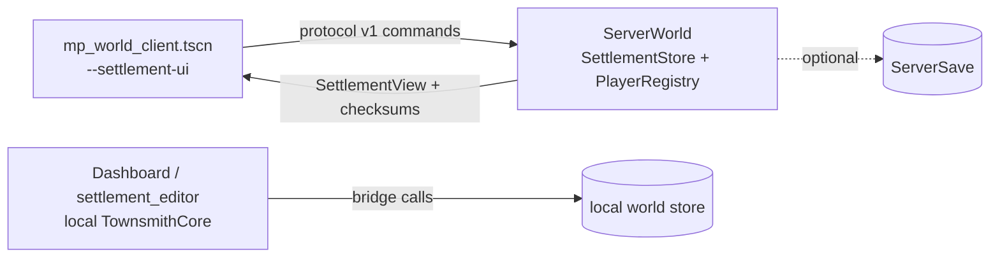

# 85 — Connected Settlement Surface

> [!info] What this note covers
> The opt-in settlement probe in `godot/mp_world_client.gd`: the read-only client readout merged as **#424**, and the planned mutation actions that follow it. It is a connected-client debug surface over the existing D-033 protocol commands. It adds **no** protocol command, wire field, save field, or ADR. [[48 - Settlement Boundaries]] §3 is the command contract; [[05 - Multiplayer]] §5 is the server behavior.

> [!success] Status: readout and scripted mutations implemented
> `--settlement-ui` implements readout plus `rename`, `set_tax`, `release`, `invite`, `set_role`, `remove`, `claim`, and `transfer`, including settlement-list paging. They reuse the commands accepted by `ServerWorld`; the server remains authoritative. Without `--settlement-ui`, no settlement code runs. §7's local shell now includes all mutation controls, and its connected mode adds read/paging plus rename/tax; the remaining connected mutations, focus model, and canonical navigation remain planning.

## 1. Where it sits



The probe is a connected client, not a local editor. It speaks the same 4-byte length-prefixed JSON protocol as the rest of `mp_world_client`, uses the session's stable `player_id`, and draws only what the server returns. It never opens a local `TownsmithCore`, never calls a bridge mutation, and never writes a world save.

| Piece | Current |
|---|---|
| Script actions | `found:<name>[:x,z]`, `list[:<after>:<limit>]`, `at:<x,z>`, `rename`, `set_tax`, `release`, `invite`, `set_role`, `remove`, `claim`, `transfer` |
| Commands sent | `found_settlement`, `settlement_list`, `settlement_at`, and the existing D-033 mutation commands |
| Panel | Rows from the current page, refreshed after each accepted mutation |
| Markers | `MP_SETTLEMENT_UI`, `MP_SETTLEMENT_PAGE`, `MP_SETTLEMENT_ACTION`, `MP_SETTLEMENT_TRANSFER`, `MP_SETTLEMENT_PRESEED` |
| Protocol / save | Unchanged | Unchanged; no new command or field |

## 2. Command contract

These are the existing authoritative commands. Field names, rejection codes, and revision rules are defined in [[48 - Settlement Boundaries]] §3 and implemented in `crates/server/src/world.rs`; this page only records what the connected probe uses.

| Command | Request fields | Success response | Gate |
|---|---|---|---|
| `found_settlement` | `name`, `x`, `z`, `radius_m` | `settlement_found { tick, settlement, settlement_checksum, world_checksum }` | **Mayor**; caller becomes `owner_id` |
| `settlement_list` | — | `settlement_list { tick, count, checksum, settlements }` | **Viewer** |
| `settlement_at` | `x`, `z` | `settlement_at { tick, found, settlement }` (`settlement` is `null` when `found` is false) | **Viewer** |
| `settlement_rename` | `settlement_id`, `name`, `expected_revision` | `settlement_updated { tick, settlement, settlement_checksum, world_checksum }` | **Mayor** + core `manage` |
| `settlement_set_tax` | `settlement_id`, `rate` | `settlement_updated` | **Mayor** + core `tax` |
| `settlement_release` | `settlement_id`, `expected_revision` | `settlement_updated` | **Admin** (dead-owner override) |
| `settlement_invite` | `settlement_id`, `player_id`, `role`, `expected_revision` | `settlement_updated` | **Mayor** + core `members` |
| `settlement_set_role` | `settlement_id`, `player_id`, `role`, `expected_revision` | `settlement_updated` | **Mayor** + core `members` |
| `settlement_remove_member` | `settlement_id`, `player_id`, `expected_revision` | `settlement_updated` | **Mayor** + core `members` |
| `settlement_claim` | `settlement_id`, `expected_revision` | `settlement_updated` | **Mayor**; unowned record only |
| `settlement_transfer` | `settlement_id`, `player_id`, `expected_revision` | `settlement_updated` | **Mayor** + core `manage`; registered recipient |

Rules the probe depends on:

- Every command requires a successful `hello`/`resume`; none advances the tick.
- `role` is `manager`, `builder`, or `member`. `owner` is not an invitable or assignable role.
- `rate` is a whole percent `0..=100`. It is **data-only**: the rate is stored and permission-gated, but no treasury calculation consumes it, and a tax change does not bump `membership_revision`.
- `expected_revision` is the record's current `membership_revision`. A stale value returns `settlement.revision_conflict`; the client must not retry with the same revision.
- The owner cannot be removed or demoted. `settlement_release` is the only command above the global Mayor ceiling; a Mayor server rejects it with `role.forbidden`.
- A global role is a ceiling. A settlement permission never grants a missing global capability.
- `settlement_claim` only claims an unowned record (legacy or Admin-released); an owned record returns `settlement.already_owned`.
- `settlement_transfer` accepts only a recipient already in the server player registry, then makes that player owner and demotes the previous owner to Manager.

A `SettlementView` carries the display and permission state the panel needs:

```text
id, name, owner (legacy display label), center, radius_m,
owner_id (null when unowned), owned,
members[{ player, role, permissions }], membership_revision,
membership_checksum, tax_rate
```

`members` is sorted by ascending player id; `owner_id` is not repeated in the member list. The client keeps only read-only display fields and sorts member ids for its marker checksum.

## 3. Launching the probe

```bash
# Server
cargo run --release -p townsmith-server -- --listen 47015 --sessions 1

# Client
GODOT=/path/to/godot "${GODOT:-godot}" --path godot res://mp_world_client.tscn -- \
  --port 47015 --settlement-ui \
  --settlement-script "found:Harbor|list|at:0,0"

# Pinned read-only smoke
GODOT=/path/to/godot ./scripts/smoke_mp_settlement_ui.sh
```

`--settlement-ui` enables the path. `--settlement-script` defaults to `found:Harbor|list` and is parsed completely **before** the socket opens, so a typo fails fast instead of halfway through a session. The path is mutually exclusive with `--place-ui`, `--place-hash`, and the chat modes (`settlement_ui_conflict`). When enabled, it skips the zero-view probe and runs after the normal six-road interest view.

### 3.1 Current grammar

Actions are separated by `|`; at most 64 actions are allowed.

| Token | Meaning |
|---|---|
| `found:<name>[:<x>,<z>]` | `found_settlement` at `x,z` with radius 64 m; omitted coordinates default to `0,0` |
| `list` | `settlement_list` with no paging fields (all records) |
| `list:<after_id>:<limit>` | `settlement_list { after_id, limit }`; exclusive cursor, limit 1–256 |
| `at:<x>,<z>` | `settlement_at` at an integer point |

- `name` is 1–48 characters with no control characters, trimmed; empty names reject the script.
- Coordinates are canonical integer pairs inside ±1,000,000.
- An empty segment, unknown token, bad coordinate pair, or empty name rejects the whole script with `settlement_script_invalid`.
- `found` is the ordinary D-033 founding command, not a dashboard control.
- `at` is display-only: it does not add a row to the list unless `found`/`list` already populated one.
- `--skip-roads` starts the settlement script immediately after welcome, for a world that already has the deterministic roads (used by the transfer smoke).

### 3.2 Mutation grammar

| Token | Sends | Local validation |
|---|---|---|
| `rename:<name>` | `settlement_rename { settlement_id, name, expected_revision }` | name rules |
| `set_tax:<rate>` | `settlement_set_tax { settlement_id, rate }` | integer `0..=100` |
| `release` | `settlement_release { settlement_id, expected_revision }` | target must be owned |
| `invite:<player_id>[:<role>]` | `settlement_invite { settlement_id, player_id, role, expected_revision }` | positive id, valid role |
| `set_role:<player_id>:<role>` | `settlement_set_role { settlement_id, player_id, role, expected_revision }` | positive id, valid role |
| `remove:<player_id>` | `settlement_remove_member { settlement_id, player_id, expected_revision }` | positive id |
| `claim` | `settlement_claim { settlement_id, expected_revision }` | target must be unowned |
| `transfer:<player_id>` | `settlement_transfer { settlement_id, player_id, expected_revision }` | positive id; recipient must already be registered |

Example (one server that stays Mayor; `release` would need an Admin server):

```text
found:Harbor|list|at:0,0|set_tax:12|rename:Port Harbor|invite:7:builder|set_role:7:manager
```

**Target selection.** Mutation tokens do not carry a settlement id. The selected record is resolved deterministically:

1. A successful `found` selects the record it returned.
2. Otherwise, a successful `list` selects the **highest id** in the returned page.
3. A successful `at` selects its containing record and overrides the previous selection.
4. An `at` with `found:false` clears the selection.
5. A mutation with no selected record fails locally with `settlement_no_target` and sends nothing.

**Revision handling.** Each mutation sends the selected record's cached `membership_revision`. A successful `settlement_updated` replaces the cached record and becomes the revision for later actions. `settlement_set_tax` leaves the revision unchanged. A `settlement.revision_conflict` marks the selection **stale**; later mutations against it fail locally with `settlement_stale` until a successful `found`, `list`, or `at` refreshes the cache.

**Rejection handling.** A `reject { code, message }` is matched to the pending action. The client records the stable code, leaves the cached record unchanged, and continues with the next action (except the stale-revision rule above). The server decides every role and permission gate; the client does not pre-check the global dev role, and it never retries a rejected mutation automatically. Transport failure or a malformed response still ends the run through the existing `MP_WORLD_CLIENT status=fail error=...` path.

### 3.3 Connected read-only probe

`godot/settlement_mp_probe.tscn` is the standalone wire-level counterpart to the local settlement shell and dashboard. It opens a real TCP protocol v1 session, founds one deterministic `Harbor` fixture at `(0,0)` with radius 64 m as the Mayor session owner, then only reads. It renders a compact English detail panel (name, id, owner, revision, tax, member count, and the resolved roster count) and exits. It never opens a local `TownsmithCore`, never calls a bridge mutation, and never writes a world save. The production settlement screen and the existing clients are unchanged.

```bash
# Server
cargo run --release -p townsmith-server -- --listen 47015 --once

# Probe
GODOT=/path/to/godot "${GODOT:-godot}" --path godot res://settlement_mp_probe.tscn -- --port 47015

# Pinned two-run smoke (fresh server per run)
GODOT=/path/to/godot ./scripts/smoke_settlement_mp_probe.sh
```

The wire sequence after `hello` is:

1. `found_settlement { name: "Harbor", x: 0, z: 0, radius_m: 64 }`, waiting for `settlement_found`.
2. `settlement_list { after_id: 0, limit: 8 }`; the first page must hold exactly one record.
3. `settlement_list { after_id: <first page next_after>, limit: 8 }`; the walked page must be empty with `has_more: false`.
4. `player_list { after_id: 0, limit: 8 }`; the owner id from the record must resolve to the hello display name.
5. `settlement_at { x: 0, z: 0 }`; the containing record id must match the founded id.
6. `disconnect`.

The only mutation is the founding fixture itself. Every subsequent command is a Viewer read and the server remains authoritative. `--smoke` prints one additive marker:

```text
MP_SETTLEMENT_PROBE status=ok settlements=1 players=1 at=<id> owner=<id> revision=1 checksum=<16 hex>
```

The checksum is SHA-256 over ascending `id|name|owner_id|revision|tax|member_ids` lines, first 16 hex. A reject, timeout, malformed response, or mismatched read prints `MP_SETTLEMENT_PROBE status=fail code=...` and exits non-zero. The smoke harness starts a fresh `townsmith-server --listen PORT --once` per run, polls the `SERVER_LISTEN` line, runs the probe twice, and requires identical markers.

## 4. Panel and display

The current panel is a right-side `PanelContainer`, hidden until at least one settlement record is known:

- Title: `Settlements: N`, where `N` is every record in the local cache.
- Up to **eight** rows, ascending id. The row format is exactly:

```text
#<id> <name> · owner <#owner_id|none> · rev <membership_revision> · tax <n>% · members <count>
```

- `owner #<id>` comes from `owner_id`; an unowned record shows `owner none`. The legacy `owner` display string is not shown.
- `members` is the number of member entries, not including the owner.
- The last `at` result renders below the rows as `At (<x>,<z>): #<id> <name>` or `At (<x>,<z>): none`. `at` alone never creates the row list.
- There is no scrolling or paging; records beyond the eighth are omitted from the panel but still included in the marker checksum.
- The panel is raw English developer text. It is not localized and is not the dashboard.

Mutation support is planned to refresh the same panel from the returned `settlement_updated` record, so the visible state after a mutation is the server's state, not an optimistic local edit.

## 5. Difference from the local surfaces

| Surface | Transport / authority | Purpose |
|---|---|---|
| `mp_world_client` + `--settlement-ui` | Real TCP protocol v1; authoritative server | Connected debug probe; readout plus scripted mutations |
| Dashboard (`godot/world_placement.gd`) | Local `TownsmithCore` bridge; local world store | In-game settlement selector, district/policy/heatmap detail, and local developer write controls |
| `settlement_editor.tscn` | Local `TownsmithCore` bridge; no server | Standalone developer CRUD over local records |
| `district_panel.tscn` | Local `TownsmithCore` bridge; read-only | Standalone district overview |

The important distinction is the authority boundary. A dashboard or editor mutation succeeds against the **local** store in a single-player process; it is not a server-accepted settlement mutation and does not prove the D-033 protocol path. The connected probe exercises the server path, where the global role, the settlement permission bit, the revision, and the registered-recipient rule are all enforced. The probe does not draw the dashboard, does not drive the 256 m district query, and does not replace the developer district/editor scenes. See [[57 - Dashboard and Advisor]] and [[48 - Settlement Boundaries]] §2.2.

## 6. Test approach

**Read-only smoke.** `scripts/smoke_mp_settlement_ui.sh` starts a fresh server per run (`--listen PORT --sessions 1`), waits for `SERVER_LISTEN status=ok address=`, and runs the client headless twice with `found:Harbor|list|at:0,0`. It requires:

```text
MP_SETTLEMENT_UI status=ok settlements=1 members=1 at=1 checksum=<16 hex>
```

identical across both runs, the unchanged `MP_WORLD_CLIENT_DONE` line with `frames_sent=12 frames_received=13`, and then prints:

```text
MP_SETTLEMENT_UI_SMOKE status=ok runs=2 settlements=1 members=1 at=1 checksum=<16 hex>
```

No sleeps are used; readiness is the bounded server-log poll. The checksum is SHA-256 over ascending lines of `id|name|owner_id|revision|tax|member_ids`, first 16 hex; unowned records use owner id `0` and an empty member list.

**Mutation and transfer smoke.** The same harness runs two more fresh-server scripts: `found:Harbor|rename:Riverside|set_tax:5|release` under Admin, and `found:Harbor|claim|invite:9999:builder|set_role:9998:manager|remove:9998` under Mayor. A final pair pre-seeds `BuilderTown` with one player, saves the world, reloads it for a second player named `builder`, pages `list:0:2`, transfers `Harbor` to the registered player, and pages again. It requires:

1. `MP_SETTLEMENT_PAGE after=0 limit=2 count=2 matched=2 next=2 more=0`.
2. `MP_SETTLEMENT_TRANSFER ok=1 from=2 to=1 settlement=2 revision=2`.
3. A final `MP_SETTLEMENT_UI` with `settlements=2 members=3 actions=4 accepted=4 rejected=0`.
4. Rejection markers for claim, non-member role change/remove, and unknown recipient.
5. Two fresh runs with identical `MP_SETTLEMENT_ACTION`/`MP_SETTLEMENT_TRANSFER` lines and the same final checksum.

`settlement_release` needs an Admin process role; a Mayor server must reject it, and a separate Admin run accepts it. The test is deterministic: fixed seed, fixed script order, fresh server, no wall-clock sleeps, and no dependency on real network timing.

## 7. Production UI plan

> [!success] Shell implemented with local and connected mutations
> The standalone `godot/settlement_screen.tscn` implements the first **production settlement shell**. Local mode covers every mutation over the bridge; connected mode (`--connected`) reads paged `settlement_list`/`player_list` and wires claim, rename, transfer, release, invite, set-role, remove, and set-tax against the authoritative server. Every mutation re-reads the current `membership_revision`; server rejections keep the stable code and leave the local page cache untouched. Release stays visible for a Mayor so the server's `role.forbidden` is shown rather than hidden. The connected smoke seeds a second player, exercises all nine actions, and pins `SETTLEMENT_SCREEN_CONNECTED ... players=2 actions=9 accepted=8 rejected=1 checksum=...`.
>
> **Embedded.** The Mayor dashboard opens this shell with `F10` through `configure_shared(core, seed)`: the screen uses the live world core, never creates or frees a second store, and `Esc`/`F10` returns to the dashboard. The standalone launch path still owns its core. `scripts/smoke_settlement_embed.sh` covers the shared-core lifecycle; the world smoke covers the host overlay.
>
> **Implemented**
> - Cursor-paged list (`settlements_page(after_id, limit)`, 8 rows/page) with name, `#id`, owner name/`#id` or `unowned`, tax, membership revision, and member count. The cursor is the order; the client never re-sorts a page.
> - PageUp/PageDown, click and arrow-key selection, page-local number keys 1–8, and a `+N more` footer. Selection is preserved by id across a refresh, otherwise it resets to the first row.
> - Read-only detail: identity, centre/radius, owner, tax, revision, and one row per member with a resolved name or the plain `#id` fallback, localized role, and localized permission tokens.
> - `Projected local multiplier: xN.NN (preview, D-039 proposed)` from the stateless `tax_projection(rate)` helper.
> - Localized empty, unavailable, and select-a-row states; header shows the `Local` authority mode.
> - EN/DE keys under `base.ui.settlement_screen.*` in `godot/world_i18n.gd`; numbers use `WorldI18n.format_int`/`format_float`.
>
> **Excluded on purpose**
> - No founding; founding stays in the placement flow.
> - Connected mode now wires all nine actions; a Mayor's release attempt surfaces the server `role.forbidden` instead of hiding the control.
> - The keyboard focus ring, Tab/arrow/Home/End/PgUp/PgDn model, modal trap, focus return, and a gamepad focus model are implemented. Gamepad D-pad/left-stick traversal, accept/cancel, paging, and the modal trap run through the same focus state; `gamepad_snapshot()` exposes modality for tests. Rename requests the platform virtual keyboard when available and remains headless-safe (requests/clears are counted, not asserted on a device). Screen-reader announcements and a gamepad footer/help label remain open; §7.2 and §7.6 remain the target for those.
> - The dashboard, settlement editor, and `mp_world_client` probe are untouched.
>
> **Smoke**
> `GODOT=/path/to/godot ./scripts/smoke_settlement_screen.sh` seeds 23 local settlements (one unowned, one owned with owner + manager + builder + member + an unregistered member, varied tax) and asserts 8/8/7 paging, page-local selection, name/`#id` fallbacks, projections at 0/5/100/invalid, EN/DE key coverage, the focus model (`SETTLEMENT_SCREEN_FOCUS`), gamepad traversal and virtual-keyboard intent (`SETTLEMENT_SCREEN_GAMEPAD`), and identical two-run output. Final marker:
> `SETTLEMENT_SCREEN status=ok pages=3 settlements=23 selected=2 checksum=<16 hex>`
>
> **Mutations wired locally:** claim, rename, set tax, invite, set role, remove member, transfer, and release, each re-reading the selected page for a fresh revision and showing a localized reason when unavailable. Destructive release/remove use a two-press confirmation; the owner cannot be removed or demoted. The smoke exercises 11 actions (8 accepted, 3 rejected) and prints `SETTLEMENT_SCREEN status=ok pages=3 settlements=23 selected=2 actions=11 accepted=8 rejected=3 checksum=<16hex>`.
>
> **Connected mode.** `--connected --host H --port P --name NAME` uses `godot/settlement_screen_net.gd` for length-prefixed JSON hello, cursor-paged `settlement_list`, paged `player_list` name resolution, and every D-033 mutation: claim, rename, transfer, release, invite, set-role, remove-member, and set-tax. It re-reads the selected record before each send, shows the server `world_checksum` and a `Connected` authority label, and surfaces the stable server code on rejection. The smoke seeds a second player, founds `Harbor`, reads one page and two players, renames, sets tax 0→5, invites, cycles role twice, removes, re-invites, transfers, and proves a Mayor release rejects with `role.forbidden`; it prints `SETTLEMENT_SCREEN_CONNECTED status=ok settlements=1 players=2 rename=1 tax=1 actions=9 accepted=8 rejected=1 checksum=<16hex>` twice.
>
> **Remaining connected work** (target §7.1–§7.4, no new ADR): screen-reader behavior and a gamepad footer/help label, full destructive-confirmation dialogs, and a real connected roster picker beyond the next-registered-player rule. Embedding and gamepad navigation are implemented.

The rest of this section is the target **production settlement surface**. §1–§6 remain the developer probe, and the dashboard in [[57 - Dashboard and Advisor]] remains the current local settlement surface. The plan uses the existing D-033 commands, the `settlements_page` read in [[42 - World Placement Bridge]], and the EN/DE string rules in [[16 - Localization]]. It does not add a protocol command, wire field, save field, permission, or ADR.

### 7.1 Screens and surfaces

The target is one settlement screen shell with a list → detail → action flow. Whether it is the canonical screen reachable from both modes or hosted as a dashboard tab is open (§7.9). It is a screen shell, not a new simulation layer.

| Surface | Shows | Mutations | Notes |
|---|---|---|---|
| **Settlement list** | Paged rows ordered by ascending id: name, owner name/id, owned/unowned, tax rate, membership revision, member count | None | The cursor is the source of order; the client never re-sorts a page |
| **Selected detail** | Identity (name, id, centre, radius), owner name and id, tax rate, `membership_revision`, and one row per member with name, id, role, and permission bits | None by itself | Read-only snapshot of the returned `SettlementView` plus resolved display names |
| **Membership management** | Registered-player picker for invite/transfer, member role selector, remove action | Invite, set role, remove member, transfer owner | Owner is a separate identity and cannot be removed or demoted |
| **Tax control** | Whole-percent rate `0..=100` with a step control and numeric readout | `settlement_set_tax` | Data-only today; the screen says so and does not promise revenue |
| **Ownership and identity actions** | Claim (unowned only), rename, transfer, release | `settlement_claim`, `settlement_rename`, `settlement_transfer`, `settlement_release` | Release and transfer are confirmed; release is Admin-only |
| **Read-only inspector** | The same list/detail/member/tax data for a non-member or Viewer | None | Every mutation control is disabled with a localized reason |

The list is the default screen; selecting a row opens the detail pane, and a back action returns focus to that row. The screen does not found a settlement; founding stays in the existing placement flow. A connected screen and a local screen may share the same shell, but the authority mode is always visible (see §7.4).

### 7.2 Input model

Focus order is fixed and visible. It follows reading order, never visual position alone:

1. screen header and authority/mode indicator;
2. list paging controls, then the settlement rows;
3. detail identity block;
4. member rows and membership actions;
5. tax control;
6. ownership actions;
7. footer help and close/back.

- **Mouse.** A click selects a row and moves focus to it. Actions are explicit buttons; there are no hover-only actions, double-click shortcuts, or context-menu-only commands. Scroll pages the member list or scrolls the page, never a hidden carousel.
- **Keyboard.** `Tab`/`Shift+Tab` move between groups; arrow keys move within the list or member rows; `Home`/`End` jump within the focused list; `Enter`/`Space` activate; `Esc` cancels a modal or returns to the list. `PageUp`/`PageDown` page the focused list only. No shortcut fires while a text field or modal has focus.
- **Gamepad.** D-pad or left stick moves focus; the south face button activates; the east face button goes back; shoulder buttons page the focused list. Glyphs come from the active input map and are shown in the footer. Focus never jumps between list and detail without an explicit directional move.
- **No hidden hotkeys.** Every keyboard or gamepad shortcut is displayed in the footer or the control's label and performs exactly the same action as its button. Destructive actions never have a single-key shortcut. Rebinding lives in the normal input settings, not in this screen.
- **Confirmation.** `release` and `transfer` open a modal that names the settlement, the current owner, and the consequence; the confirm button repeats the verb (`Release settlement`, `Transfer ownership`), the default focus is **Cancel**, and `Esc`/east face cancels. Remove-member is also confirmed. `claim`, tax changes, and role changes do not need a destructive confirmation, but every result is announced.
- **Rename.** Rename opens a prefilled text field with the current name, a character count for the 1–48 limit, inline validation for empty/control characters, and explicit Save/Cancel. The field validates locally for shape only; the server owns duplicate-name and permission checks. Gamepad text entry uses the platform virtual keyboard; no hidden controller chord opens it.
- **Focus return.** Closing a modal or action panel returns focus to the control that opened it. A failed mutation leaves the panel open with focus on the failed control and its reason, not on a hidden or removed row.

### 7.3 Permission model

The global role is a **ceiling**; a settlement permission never grants a capability the global role lacks. The owner holds all settlement capabilities. `owner` is an ownership state, not an assignable role; Manager, Builder, and Member are the invitable roles. Admin satisfies the global ceiling but does not replace a missing settlement capability, except for the explicit release override.

| Action | Global ceiling | Settlement capability | Enabled when |
|---|---|---|---|
| View list and detail | Viewer | — | Connected session is hello-complete, or the local bridge is open |
| Read-only inspection | Viewer | — | Always; the non-member state is a display state, not an error |
| Claim | Mayor | — | Selected record is unowned and its revision is fresh |
| Rename | Mayor | `manage` | Selected record is owned and the actor holds `manage` |
| Set tax | Mayor | `tax` | Selected record is owned and the actor holds `tax` |
| Invite / set role / remove member | Mayor | `members` | Selected record is owned; the target is not the owner for role/remove |
| Transfer | Mayor | `manage` | Recipient is a registered player, not the current owner, and the revision is fresh |
| Release | Admin | — | Selected record is owned; this is the dead-owner override |

**Disable with reason.** Every unavailable action stays visible, disabled, and paired with a localized reason: `not a member`, `missing manage`, `global role too low`, `settlement unowned`, `revision stale`, `recipient not registered`, `owner cannot be removed`, `release requires Admin`, or `server unavailable`. The screen may collapse a whole group under one reason, but it never hides a control without explanation and never presents a control that the server would reject for a reason the player cannot see. A server rejection replaces the reason with the returned stable code and refreshes the record; it is never shown as raw English.

**Local-only versus connected.** The screen records its authority mode in the header:

- **Connected** is server-authoritative. The global role comes from the session; the settlement permission and revision come from the server record; every mutation is a request/response. A local cache never authorizes a command.
- **Local** is the single-player bridge over `TownsmithCore`, where the local player is the implicit actor. The same screen may render local records, but a local success is labelled local and is not presented as a server-accepted mutation. There is no global session role in this mode; the bridge's local developer actor applies the store's owner/member rules, and release remains a developer-only local override. The screen must not imply that this override performed a server role check.
- A mode switch discards the cache and re-reads from cursor 0. There is no mixing of local and connected rows in one list.

### 7.4 Data flow

The screen has one page model over two transports. The authority mode selects the source, not the shape.

**Reads.**

1. Opening the list, changing page, or refreshing sends `settlement_list { after_id, limit }` on a connected session. `after_id` is the exclusive cursor and `limit` is 1–256. The first page uses `after_id: 0`. The client stores `next_after`, `has_more`, `matched`, `count`, and the full-store `checksum` from the response; it does not infer order from the local array.
2. A local session calls `settlements_page(after_id, limit)` and receives the same cursor semantics (`next_after`, `has_more`, `matched`, `count`, checksum, rows). One adapter maps both responses into list rows, so the screen does not branch on transport for rendering.
3. Paging appends by id and de-duplicates by id. A row is never inserted by array position. An empty page is terminal (`next_after` 0); a page whose rows no longer exist is discarded and the previous cursor is re-read. The list preserves the current selection and focus when a refresh returns the same ids.
4. Selecting a row uses the record already in the page; opening its detail does not trust a second copy from a different page. `settlement_at` may refresh the selected record by its centre, but the list page remains the paging source.

**Names.** `SettlementView` carries `owner_id` and `members[{ player, role, permissions }]`; it does not carry member display names. The screen resolves each `player_id` through a read-only name cache filled from the authoritative player registry. The name is display-only: authorization always uses the id. An unresolved id renders as `#<id>` with the localized `unknown player` reason, and that player cannot be chosen as an invite or transfer recipient until the registry resolves them. The current server protocol exposes no roster command, so a read-only name source is a prerequisite for the member-name surface, not something this plan assumes already exists. The cache is invalidated on reconnect and never written to a save.

**Mutations.**

1. Opening an action panel takes a fresh read of the selected record before enabling the confirm button. On a connected session that is the current list page or `settlement_at` at the target centre; on a local session it is `settlements_page` or `settlements()`.
2. If the record disappeared, the panel closes with the localized `settlement not found` reason and the list refreshes. If `membership_revision` changed, the panel updates to the new owner/members/tax and requires an explicit second confirm; it never sends the old revision silently.
3. The command carries the freshly read `expected_revision`. `settlement_set_tax` has no revision field but still follows the fresh-read step so the displayed rate is current.
4. A successful `settlement_updated` replaces the row and detail **in place**, preserving selection, page cursor, focus, and list order. `settlement_set_tax` leaves the revision unchanged; every other accepted mutation uses the returned record. The screen does not apply an optimistic row, a local prediction, or a queued retry.
5. A rejection updates the reason on the affected control, keeps the returned state, and never auto-retries. `settlement.revision_conflict` refreshes the record once and returns the panel to the unconfirmed state; a second failure leaves it open with the reason.
6. A disconnect freezes the list as read-only with a disconnected banner. Reconnect discards the cache and re-reads from cursor 0; there is no offline mutation queue and no merge of stale pages.

**In-place refresh.** The screen refreshes the visible page, not the whole world. A refresh that returns the same ids preserves row focus by id, not by index. If the selected id disappears, focus moves to the next id in the old page, then the previous id, then the list header. If a mutation changes ownership and the current player loses a capability, the detail re-renders with disabled controls and reasons rather than closing.

### 7.5 Empty and error states

| State | Display | Controls |
|---|---|---|
| No settlements | Localized empty list with the world/authority context; no raw `0` count alone | Founding stays outside this screen; the list offers refresh |
| Unowned record | Owner `—`; claim is the primary action | Rename, tax, membership, and transfer disabled with `settlement unowned` |
| Stale revision | Existing detail stays visible with a stale badge and the old revision | Mutations disabled until a fresh read; a conflict updates the panel and asks for confirmation again |
| Unknown player | `#<id>` plus the localized unknown-player reason | The id remains visible; invite/transfer cannot select an unresolved player |
| Not a member | Read-only inspector banner; the same identity, tax, revision, and member rows | All mutation controls disabled with `not a member` |
| Transport-only session | Localized `settlements unavailable` state; the list is empty | No retry loop; the screen explains that this session cannot carry settlement commands |
| Server disconnect | Cached rows marked disconnected/stale; mutation controls disabled | Reconnect re-reads from cursor 0; no offline queue |
| Permission denied | Localized reason on the control, with the server code available as detail | Other actions recompute from the returned record |
| Invalid page or malformed record | Localized unavailable state; the page is discarded | Restart from the previous cursor or cursor 0; never render partial rows |

Every stable code maps to a localized key plus named params (`settlement.revision_conflict` with the current revision, `player.unknown` with the id, `settlement.unavailable` with the authority mode). The server's `reject.message` is developer English and is never shown to players. An unknown code falls back to a generic localized message with the code appended verbatim. No state is communicated by color alone.

### 7.6 Accessibility and localization

- **Languages.** Every player-facing string is keyed in EN/DE under the world table, using the existing string rules. Settlement names, player names, ids, roles, and codes stay verbatim; role and permission labels are localized display names, not the wire values.
- **Focus.** A visible focus ring is always present on the focused control, including after a mouse click and after a refresh. It uses a 2 px outline plus a contrasting halo, is not removed for aesthetics, and does not rely on color alone.
- **Screen readers.** Each row announces its label, id, owner, tax, revision, and member count as one sentence; each button announces its action and target; each disabled control announces its reason. Modals expose a dialog role, a label, and a focus trap that returns focus on close. A polite live region announces refresh, success, rejection, and revision-conflict changes without moving focus.
- **Numbers and formats.** Display numbers use `WorldI18n.format_int` and `WorldI18n.format_float`; tax is a whole percent, revision is an integer, ids keep their `#` prefix and are not digit-grouped, and member counts follow the locale. Dates do not appear on this screen.
- **Color-independent status.** Owned/unowned, stale, disconnected, error, and disabled states pair their color with a text label and an icon or shape. The selected row is not identified only by a color fill. The confirm dialog names the consequence in text, not just a red button.
- **Input parity.** Every action is reachable by mouse, keyboard, and gamepad; no action requires a drag, hover, or simultaneous button press. Text entry has a visible field and an explicit commit.

### 7.7 Test plan

| Level | Coverage | Gate |
|---|---|---|
| **Bridge unit** | `settlements_page` cursor semantics: exclusive `after_id`, `limit` 1–256 and `0` = remaining, negative `invalid_page`, `next_after`/`has_more`/`matched`, empty-page terminal, stable full-store checksum, read-only behavior, no save/path leak | `cargo test -p godot_ext` (or the bridge crate) |
| **Godot smoke per screen** | List, detail, membership, tax, ownership, and read-only inspector scenes; focus order; disabled reasons; confirmation default; rename validation; EN/DE text; no raw English; empty and error fixtures | Headless Godot smoke, deterministic markers, two identical runs |
| **Connected two-player invite/transfer** | Two sessions on one server: A founds and invites B as Builder, B sees the membership, A transfers to B, B becomes owner and A becomes Manager, B renames and changes tax, A's owner-only controls disable | Protocol loopback with fixed seed; exact markers and checksums |
| **Revision conflict** | A second client mutates between the panel read and the confirm; the first client receives `settlement.revision_conflict`, re-reads, shows the new revision, and does not retry automatically | Deterministic two-session test; no sleeps |
| **Paging 1,000** | Seed the capped store, walk every page, assert no duplicate or missing ids, stable ascending order, `has_more`/`next_after` agreement, one checksum, and in-place refresh of a middle page | Server and bridge paging tests plus a Godot list fixture |
| **Permissions matrix** | Viewer/Mayor/Admin × `build`/`manage`/`tax`/`members` × each action; owner cannot be removed or demoted; Admin release only; non-member inspector; global-ceiling denial for every control | Table-driven server and UI tests; every disabled reason asserted |
| **Accessibility/localization** | EN/DE key coverage, focus ring presence, screen-reader labels, numeric formatting, color-independent status, gamepad focus order, modal focus return | Godot smoke assertions and the locale table check |

Tests use a fixed seed, a simulated or fresh server, fixed action order, and no wall-clock sleeps. A test that needs a second player uses two deterministic sessions, not real network timing.

### 7.8 Non-goals

- **Per-lot or per-parcel claims.** Settlement membership stays a soft boundary; lots and zoning remain separate systems.
- **Merge or split.** Settlements keep one stable id and one owner; no geometry merge, split, or boundary redistribution.
- **Cross-server transfer.** Ownership and membership do not move between servers, saves, or identities; there is no portable player identity in this plan.
- **Moderation.** No kick, ban, mute, report, ownership dispute, or trust-and-safety tooling. Admin release is the only override.
- **Protocol, save, or permission changes.** This is a client shell over D-033 and the existing bridge reads. No treasury consumer, authentication, optimistic UI, offline queue, or new ADR.

### 7.9 Open questions

> [!question] Unfiled
> These are planning questions, not yet `Q-xxx` entries. File them in [[09 - Open Questions]] before implementation.

1. **One canonical screen or a dashboard tab?** Should the production surface be the single settlement screen reachable from both modes, or a tab inside the existing dashboard? The answer decides navigation, whether the dashboard stays the local default, and how much of [[57 - Dashboard and Advisor]] is replaced.
2. **Gamepad text entry.** Does rename use the platform virtual keyboard, an in-game grid keyboard, or a companion text field? The choice affects focus trapping, cancellation, and certification.
3. **Offline and read-only behavior.** When the server disconnects, should the screen keep the last snapshot with a stale badge, hide the list behind a reconnect state, or fall back to a local read-only inspector? No option may enable mutations.
4. **Default member page size.** The detail response returns all members. What page size should the member list use by default, and does it scale with UI size or remain a fixed constant?

## 8. Limits

> [!important] Server authority over everything
> The client sends commands and displays returned records. It does not predict a mutation, apply an optimistic row, queue an action while offline, reconcile a rollback, or authenticate a player. Server roles are process-assigned developer roles, not authentication.

- **Developer probe, not a production settlement UI.** There is no 3D selection, mouse control, confirmation dialog, localized text, or role-aware control state.
- **No prediction, optimistic UI, or offline queue.** Every mutation is a request/response round trip; a reject leaves the cached row unchanged.
- **No authentication.** The session identity is the existing dev identity; ownership and member ids are only as trustworthy as the server process that assigned them.
- **Page rendering is bounded.** `list:<after>:<limit>` supports server paging, but the panel still renders at most eight rows per page.
- **No member names or role/permission rows.** `SettlementView` carries member ids, roles, and permissions, but the panel only counts members. The owner is shown as an id.
- **No treasury consumer.** `tax_rate` is stored and permission-gated but does not affect income yet.
- **No protocol or save change.** The probe uses existing commands; its cache, selection, and markers are process-local and are not persisted. The optional `ServerSave` settlement store is the only persistence.
- **Not the multiplayer UI, a render gate, or a benchmark.** It reuses the world client's debug scene and interest view; it does not add streaming, interpolation, or a production camera.

## 9. Follow-ups

1. **Full mutation UI:** select a settlement and open a real action panel with confirmation, role-aware disabled states, and localized errors.
2. **Paging for 1,000 records:** scroll or page the list without dropping rows from the view.
3. **Member names:** resolve `player_id` to a display name from the server registry; the current view has ids only.
4. **Transfer recipient picker:** choose a registered player instead of typing a numeric id, and show the recipient before committing.

## 10. References

- [[48 - Settlement Boundaries]] §3 — authoritative command/schema contract.
- [[05 - Multiplayer]] §3 and §5 — settlement ownership, protocol v1, and server behavior.
- [[10 - Decisions]] D-033 — settlement ownership, membership, and permission bits.
- [[42 - World Placement Bridge]] — `settlements_page` cursor semantics and read-only bridge shape.
- [[57 - Dashboard and Advisor]] — current local dashboard, district overview, and developer editor surfaces.
- [[16 - Localization]] — EN/DE string keys, params, and number formatting.
- [[09 - Open Questions]] — where §7.9's unfiled questions are recorded.
- [[00 - Start Here]] — document map and current project status.

> [!info] No new decision
> This page documents an existing command contract and a client-side step. It does not propose a new ADR; D-033 remains the contract, and the mutation UI is a follow-up implementation detail.
