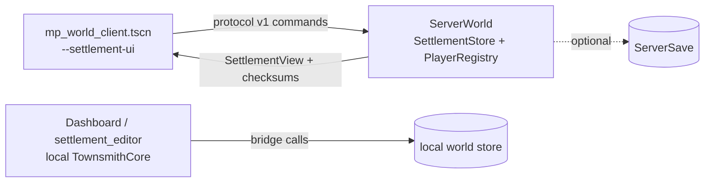

# 85 — Connected Settlement Surface

> [!info] What this note covers
> The opt-in settlement probe in `godot/mp_world_client.gd`: the read-only client readout merged as **#424**, and the planned mutation actions that follow it. It is a connected-client debug surface over the existing D-033 protocol commands. It adds **no** protocol command, wire field, save field, or ADR. [[48 - Settlement Boundaries]] §3 is the command contract; [[05 - Multiplayer]] §5 is the server behavior.

> [!warning] Status: read-only current, mutation planned
> `--settlement-ui` with `found` / `list` / `at` is implemented and smoke-pinned. The mutation actions, their script grammar, and `MP_SETTLEMENT_ACTION` are **planned / in progress** and are not emitted by master. They reuse the commands already accepted by `ServerWorld`; the server remains authoritative. Without `--settlement-ui`, no settlement code runs.

## 1. Where it sits



The probe is a connected client, not a local editor. It speaks the same 4-byte length-prefixed JSON protocol as the rest of `mp_world_client`, uses the session's stable `player_id`, and draws only what the server returns. It never opens a local `TownsmithCore`, never calls a bridge mutation, and never writes a world save.

| Piece | Current (#424) | Planned mutation step |
|---|---|---|
| Script actions | `found:<name>[:x,z]`, `list`, `at:<x,z>` | Add `rename`, `set-tax`, `release`, `invite`, `set-role`, `remove-member`, `claim`, `transfer` |
| Commands sent | `found_settlement`, `settlement_list`, `settlement_at` | The same plus the existing D-033 mutation commands |
| Panel | Read-only rows and the last `at` result | Same rows, refreshed after each accepted mutation |
| Markers | `MP_SETTLEMENT_UI` | `MP_SETTLEMENT_UI` plus one `MP_SETTLEMENT_ACTION` per mutation attempt |
| Protocol / save | Unchanged | Unchanged; no new command or field |

## 2. Command contract

These are the existing authoritative commands. Field names, rejection codes, and revision rules are defined in [[48 - Settlement Boundaries]] §3 and implemented in `crates/server/src/world.rs`; this page only records what the connected probe uses.

| Command | Request fields | Success response | Gate |
|---|---|---|---|
| `found_settlement` | `name`, `x`, `z`, `radius_m` | `settlement_found { tick, settlement, settlement_checksum, world_checksum }` | **Mayor**; caller becomes `owner_id` |
| `settlement_list` | — | `settlement_list { tick, count, checksum, settlements }` | **Viewer** |
| `settlement_at` | `x`, `z` | `settlement_at { tick, found, settlement }` (`settlement` is `null` when `found` is false) | **Viewer** |
| `settlement_rename` | `settlement_id`, `name`, `expected_revision` | `settlement_updated { tick, settlement, settlement_checksum, world_checksum }` | **Mayor** + core `manage` |
| `settlement_set_tax` | `settlement_id`, `rate` | `settlement_updated` | **Mayor** + core `tax` |
| `settlement_release` | `settlement_id`, `expected_revision` | `settlement_updated` | **Admin** (dead-owner override) |
| `settlement_invite` | `settlement_id`, `player_id`, `role`, `expected_revision` | `settlement_updated` | **Mayor** + core `members` |
| `settlement_set_role` | `settlement_id`, `player_id`, `role`, `expected_revision` | `settlement_updated` | **Mayor** + core `members` |
| `settlement_remove_member` | `settlement_id`, `player_id`, `expected_revision` | `settlement_updated` | **Mayor** + core `members` |
| `settlement_claim` | `settlement_id`, `expected_revision` | `settlement_updated` | **Mayor**; unowned record only |
| `settlement_transfer` | `settlement_id`, `player_id`, `expected_revision` | `settlement_updated` | **Mayor** + core `manage`; registered recipient |

Rules the probe depends on:

- Every command requires a successful `hello`/`resume`; none advances the tick.
- `role` is `manager`, `builder`, or `member`. `owner` is not an invitable or assignable role.
- `rate` is a whole percent `0..=100`. It is **data-only**: the rate is stored and permission-gated, but no treasury calculation consumes it, and a tax change does not bump `membership_revision`.
- `expected_revision` is the record's current `membership_revision`. A stale value returns `settlement.revision_conflict`; the client must not retry with the same revision.
- The owner cannot be removed or demoted. `settlement_release` is the only command above the global Mayor ceiling; a Mayor server rejects it with `role.forbidden`.
- A global role is a ceiling. A settlement permission never grants a missing global capability.
- `settlement_claim` only claims an unowned record (legacy or Admin-released); an owned record returns `settlement.already_owned`.
- `settlement_transfer` accepts only a recipient already in the server player registry, then makes that player owner and demotes the previous owner to Manager.

A `SettlementView` carries the display and permission state the panel needs:

```text
id, name, owner (legacy display label), center, radius_m,
owner_id (null when unowned), owned,
members[{ player, role, permissions }], membership_revision,
membership_checksum, tax_rate
```

`members` is sorted by ascending player id; `owner_id` is not repeated in the member list. The client keeps only read-only display fields and sorts member ids for its marker checksum.

## 3. Launching the probe

```bash
# Server
cargo run --release -p townsmith-server -- --listen 47015 --sessions 1

# Client
GODOT=/path/to/godot "${GODOT:-godot}" --path godot res://mp_world_client.tscn -- \
  --port 47015 --settlement-ui \
  --settlement-script "found:Harbor|list|at:0,0"

# Pinned read-only smoke
GODOT=/path/to/godot ./scripts/smoke_mp_settlement_ui.sh
```

`--settlement-ui` enables the path. `--settlement-script` defaults to `found:Harbor|list` and is parsed completely **before** the socket opens, so a typo fails fast instead of halfway through a session. The path is mutually exclusive with `--place-ui`, `--place-hash`, and the chat modes (`settlement_ui_conflict`). When enabled, it skips the zero-view probe and runs after the normal six-road interest view.

### 3.1 Current grammar

Actions are separated by `|`; at most 64 actions are allowed.

| Token | Meaning |
|---|---|
| `found:<name>[:<x>,<z>]` | `found_settlement` at `x,z` with radius 64 m; omitted coordinates default to `0,0` |
| `list` | `settlement_list` |
| `at:<x>,<z>` | `settlement_at` at an integer point |

- `name` is 1–48 characters with no control characters, trimmed; empty names reject the script.
- Coordinates are canonical integer pairs inside ±1,000,000.
- An empty segment, unknown token, bad coordinate pair, or empty name rejects the whole script with `settlement_script_invalid`.
- `found` is the only write in the current path; it is the ordinary D-033 founding command, not a dashboard control.
- `at` is display-only: it does not add a row to the list unless `found`/`list` already populated one.

### 3.2 Planned mutation grammar

The planned step adds mutation tokens to the same ordered script. They are not implemented on master.

| Token | Sends | Local validation |
|---|---|---|
| `rename:<name>` | `settlement_rename { settlement_id, name, expected_revision }` | name rules |
| `set-tax:<rate>` | `settlement_set_tax { settlement_id, rate }` | integer `0..=100` |
| `release` | `settlement_release { settlement_id, expected_revision }` | target must be owned |
| `invite:<player_id>:<role>` | `settlement_invite { settlement_id, player_id, role, expected_revision }` | positive id, valid role |
| `set-role:<player_id>:<role>` | `settlement_set_role { settlement_id, player_id, role, expected_revision }` | positive id, valid role |
| `remove-member:<player_id>` | `settlement_remove_member { settlement_id, player_id, expected_revision }` | positive id |
| `claim` | `settlement_claim { settlement_id, expected_revision }` | target must be unowned |
| `transfer:<player_id>` | `settlement_transfer { settlement_id, player_id, expected_revision }` | positive id |

Example (one server that stays Mayor; `release` would need an Admin server):

```text
found:Harbor|list|at:0,0|set-tax:12|rename:Port Harbor|invite:7:builder|set-role:7:manager
```

**Target selection.** Mutation tokens do not carry a settlement id. The selected record is resolved deterministically:

1. A successful `found` selects the record it returned.
2. Otherwise, a successful `list` selects the **lowest id** in the returned list.
3. A successful `at` selects its containing record and overrides the previous selection.
4. An `at` with `found:false` clears the selection.
5. A mutation with no selected record fails locally with `settlement_no_target` and sends nothing.

**Revision handling.** Each mutation sends the selected record's cached `membership_revision`. A successful `settlement_updated` replaces the cached record and becomes the revision for later actions. `settlement_set_tax` leaves the revision unchanged. A `settlement.revision_conflict` marks the selection **stale**; later mutations against it fail locally with `settlement_stale` until a successful `found`, `list`, or `at` refreshes the cache.

**Rejection handling.** A `reject { code, message }` is matched to the pending action. The client records the stable code, leaves the cached record unchanged, and continues with the next action (except the stale-revision rule above). The server decides every role and permission gate; the client does not pre-check the global dev role, and it never retries a rejected mutation automatically. Transport failure or a malformed response still ends the run through the existing `MP_WORLD_CLIENT status=fail error=...` path.

## 4. Panel and display

The current panel is a right-side `PanelContainer`, hidden until at least one settlement record is known:

- Title: `Settlements: N`, where `N` is every record in the local cache.
- Up to **eight** rows, ascending id. The row format is exactly:

```text
#<id> <name> · owner <#owner_id|none> · rev <membership_revision> · tax <n>% · members <count>
```

- `owner #<id>` comes from `owner_id`; an unowned record shows `owner none`. The legacy `owner` display string is not shown.
- `members` is the number of member entries, not including the owner.
- The last `at` result renders below the rows as `At (<x>,<z>): #<id> <name>` or `At (<x>,<z>): none`. `at` alone never creates the row list.
- There is no scrolling or paging; records beyond the eighth are omitted from the panel but still included in the marker checksum.
- The panel is raw English developer text. It is not localized and is not the dashboard.

Mutation support is planned to refresh the same panel from the returned `settlement_updated` record, so the visible state after a mutation is the server's state, not an optimistic local edit.

## 5. Difference from the local surfaces

| Surface | Transport / authority | Purpose |
|---|---|---|
| `mp_world_client` + `--settlement-ui` | Real TCP protocol v1; authoritative server | Connected debug probe; readout now, scripted mutations planned |
| Dashboard (`godot/world_placement.gd`) | Local `TownsmithCore` bridge; local world store | In-game settlement selector, district/policy/heatmap detail, and local developer write controls |
| `settlement_editor.tscn` | Local `TownsmithCore` bridge; no server | Standalone developer CRUD over local records |
| `district_panel.tscn` | Local `TownsmithCore` bridge; read-only | Standalone district overview |

The important distinction is the authority boundary. A dashboard or editor mutation succeeds against the **local** store in a single-player process; it is not a server-accepted settlement mutation and does not prove the D-033 protocol path. The connected probe exercises the server path, where the global role, the settlement permission bit, the revision, and the registered-recipient rule are all enforced. The probe does not draw the dashboard, does not drive the 256 m district query, and does not replace the developer district/editor scenes. See [[57 - Dashboard and Advisor]] and [[48 - Settlement Boundaries]] §2.2.

## 6. Test approach

**Current read-only smoke.** `scripts/smoke_mp_settlement_ui.sh` starts a fresh server per run (`--listen PORT --sessions 1`), waits for `SERVER_LISTEN status=ok address=`, and runs the client headless twice with `found:Harbor|list|at:0,0`. It requires:

```text
MP_SETTLEMENT_UI status=ok settlements=1 members=1 at=1 checksum=<16 hex>
```

identical across both runs, the unchanged `MP_WORLD_CLIENT_DONE` line with `frames_sent=12 frames_received=13`, and then prints:

```text
MP_SETTLEMENT_UI_SMOKE status=ok runs=2 settlements=1 members=1 at=1 checksum=<16 hex>
```

No sleeps are used; readiness is the bounded server-log poll. The checksum is SHA-256 over ascending lines of `id|name|owner_id|revision|tax|member_ids`, first 16 hex; unowned records use owner id `0` and an empty member list.

**Planned mutation smoke.** When the mutation step lands, extend the same harness with a fresh server per run and a script that covers both outcomes:

1. `found` / `list` / `at` warm-up and a pinned baseline checksum.
2. Success: `rename`, `set-tax`, `invite` / `set-role` / `remove-member`, `claim` on an unowned record, and `transfer` to a recipient registered by a second connection.
3. Rejection: stale `expected_revision`, invalid role, out-of-range tax, duplicate name, removing the owner, and an unknown transfer recipient.
4. A final `list` / `at` tail that must not move the settlement or world checksum.
5. Two fresh runs with identical `MP_SETTLEMENT_ACTION` lines, the same final `MP_SETTLEMENT_UI` checksum, and pinned frame counts.

`settlement_release` needs an Admin process role; a Mayor server must reject it, and a separate Admin run should accept it. The test is deterministic: fixed seed, fixed script order, fresh server, no wall-clock sleeps, and no dependency on real network timing.

## 7. Limits

> [!important] Server authority over everything
> The client sends commands and displays returned records. It does not predict a mutation, apply an optimistic row, queue an action while offline, reconcile a rollback, or authenticate a player. Server roles are process-assigned developer roles, not authentication.

- **Developer probe, not a production settlement UI.** There is no 3D selection, mouse control, confirmation dialog, localized text, or role-aware control state.
- **No prediction, optimistic UI, or offline queue.** Every mutation is a request/response round trip; a reject leaves the cached row unchanged.
- **No authentication.** The session identity is the existing dev identity; ownership and member ids are only as trustworthy as the server process that assigned them.
- **No paging.** The panel shows at most eight rows even though the store allows up to 1,000 settlements.
- **No member names or role/permission rows.** `SettlementView` carries member ids, roles, and permissions, but the panel only counts members. The owner is shown as an id.
- **No treasury consumer.** `tax_rate` is stored and permission-gated but does not affect income yet.
- **No protocol or save change.** The probe uses existing commands; its cache, selection, and markers are process-local and are not persisted. The optional `ServerSave` settlement store is the only persistence.
- **Not the multiplayer UI, a render gate, or a benchmark.** It reuses the world client's debug scene and interest view; it does not add streaming, interpolation, or a production camera.

## 8. Follow-ups

1. **Full mutation UI:** select a settlement and open a real action panel with confirmation, role-aware disabled states, and localized errors.
2. **Paging for 1,000 records:** scroll or page the list without dropping rows from the view.
3. **Member names:** resolve `player_id` to a display name from the server registry; the current view has ids only.
4. **Transfer recipient picker:** choose a registered player instead of typing a numeric id, and show the recipient before committing.

## 9. References

- [[48 - Settlement Boundaries]] §3 — authoritative command/schema contract.
- [[05 - Multiplayer]] §3 and §5 — settlement ownership, protocol v1, and server behavior.
- [[10 - Decisions]] D-033 — settlement ownership, membership, and permission bits.
- [[57 - Dashboard and Advisor]] — local dashboard, district overview, and developer editor surfaces.
- [[00 - Start Here]] — document map and current project status.

> [!info] No new decision
> This page documents an existing command contract and a client-side step. It does not propose a new ADR; D-033 remains the contract, and the mutation UI is a follow-up implementation detail.
